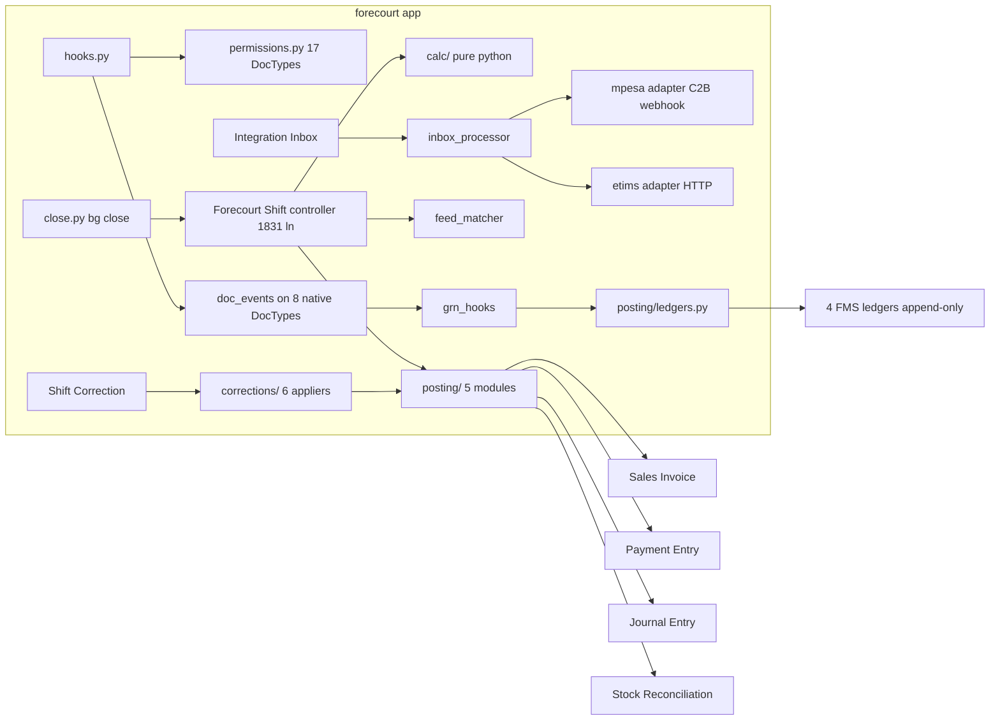

# AFMS — Independent Project Audit

**Date:** 2026-11-17 · **Audited revision:** `main` @ `dcc19d2` ("tests fix") · **Auditor:** Claude Code (automated audit session)
**Method:** documentation-first review, hook/path resolution by AST, dead-code sweep by reference analysis, full test-suite execution on `test_fms`, golden-month scenario execution, CI run inspection. No project files were modified. The only new file is this report.

**Scope caveat (honesty note):** all 49 DocTypes, all hooks, all fixtures, the posting/correction/integration packages, and the test suite were verified directly. The 142 TASKS.md items were reconciled at section level with spot checks, not one-by-one re-execution of every Verify step. UI behaviour was audited from code (JS/JSON), not by clicking through a browser. eTIMS and M-Pesa were verified as wired and mock-tested, not against live providers. Findings below distinguish verified facts from inferences.

---

## A. Executive Summary

AFMS is substantially real. It is not scaffolding: the shift lifecycle, the calculation core, the posting layer, wetstock ledgers, corrections, payment import, and 26 reports exist, are registered, are wired together, and pass a 276-test suite plus an end-to-end golden-month scenario. The architecture matches CLAUDE.md's rules in practice, not just on paper: there are no core overrides, no custom GL, a single posting package, pure-Python calc with zero `frappe` imports, and no `frappe.db.commit()` anywhere in request code (one legitimate `rollback` in the background-close error path).

What is genuinely done end-to-end: station setup → shift open → meters/dips/collections → reconcile → close → native ERPNext documents (Sales Invoice, Payment Entry, Journal Entry, Stock Reconciliation) → four append-only FMS ledgers → reports. The golden scenario exercises this across two stations and a month of shifts, including a price change, a delivery, a correction, and a credit cycle.

The important problems are few and specific:

1. **The meter-correction flow on `main` produces financially inconsistent output** (ledgers superseded but amounts not recomputed, walk-in invoice never adjusted). The complete fix exists, tested, on an un-pushed branch. This is the single most important merge outstanding.
2. **`patches.txt` references a patch module that does not exist** (`forecourt.patches.v0_0.rename_forecourt_settings_meter_fields`). Fresh installs survive (Frappe marks patches executed without running them on install), but any site that predates the entry will crash on `bench migrate`. The CI job that would catch this ("Upgrade Migration Test") is currently being skipped.
3. **The R-section (reporting framework, 18 tasks) has essentially not started**, and K/L/M/N (quality, CI formalisation, deployment, pilot) are open. These are the real distance to production.
4. A small amount of genuinely dead/orphaned code exists (4 items, detailed in §G) — notable mainly because two of them are an unregistered patch and a superseded gate that could confuse future maintainers.

**Overall classification: FUNCTIONALLY_INCOMPLETE, trending to RELEASE_CANDIDATE for single-station core.** The core transactional engine is release-candidate quality; the surrounding programme (reporting framework, deployment, pilot, UAT) is not started. No real station should run on it until Phase 0 of the roadmap in §L is done.

**Confidence:** high on registration, wiring, dead code, and test evidence (directly executed); medium on accounting edge-cases (verified via golden assertions and posting-code reading, not a ledger-by-ledger manual audit); low on live-provider behaviour (eTIMS/M-Pesa mocked only) and real-device UX.

---

## B. Project Completion Scorecard

Percentages = (verified working capabilities) ÷ (capabilities the authoritative docs require for production), weighted by my judgement of scope. They are estimates, not measurements.

| Domain | Status | ~% | Evidence | Remaining | Risk |
|---|---|---|---|---|---|
| Station & infrastructure setup | VERIFIED_COMPLETE | 95 | 11 setup + 11 wetstock DocTypes; side-effect creation of walk-in customer & tank warehouse (`forecourt/setup/`); `test_station.py`, `test_station_infra.py` pass | Onboarding polish | Low |
| Shift lifecycle | VERIFIED_COMPLETE | 90 | 17-gate `before_submit` (`forecourt_shift.py:66–82`), readiness API, New-Shift dialog, background close with S120 duplicate guard, golden scenario | U12 usability walk-through; tablet check (K03) | Low |
| Calculation core | VERIFIED_COMPLETE | 95 | 6 modules in `calc/`, zero frappe imports (verified), 193 unit tests incl. property tests pass | — | Low |
| Wetstock & inventory | VERIFIED_COMPLETE | 85 | Wetstock Ledger single writer (`posting/ledgers.py`), GRN/Stock Entry hooks, Stock Reconciliation per tank, golden stock-vs-dips assertions | Dip-side superseding on correction (bug-log item); temperature compensation deferred by design (P7) | Medium |
| Financial posting | VERIFIED_COMPLETE* | 85 | All money via native documents; one function per document in `posting/`; atomic in-transaction submit; golden GL assertions | *Correction flow inconsistency (P0-1) until bug001 branch merges | **High until P0-1 merged** |
| Corrections | PARTIALLY_COMPLETE | 70 | 6 correction appliers wired to Shift Correction controller; director-approval workflow; cancel guards (C502/C503) | P0-1; dip-side supersede; "raise sale" case unsupported (C504 by design) | High |
| Payment import & matching | IMPLEMENTED_UNVERIFIED | 80 | statement_import (CSV/XLSX), feed_matcher wired into shift, S111/S114 gates, mpesa C2B webhook, Integration Inbox with retry | No live-provider verification; no scheduler for polling (webhook/manual only) | Medium |
| Fiscal (eTIMS) | IMPLEMENTED_UNVERIFIED | 60 | Real HTTP adapter, sandbox/prod URLs, submit/status/cancel, hooks on SI submit/cancel, 5 mock tests | Never run against KRA sandbox; no retry queue beyond inbox retry | Medium |
| Non-fuel (S-section) | NOT_IMPLEMENTED | 0 | `fms-nonfuel.md` v0.2 says "Nothing here is built" — confirmed, no dry-stock DocTypes exist | All of S01–S22 | — |
| Loyalty/promotions | NOT_IMPLEMENTED | 0 | Doc is v0.1 proposal; no code | All (by design — backlog P6) | — |
| Customer vehicles | IMPLEMENTED_UNVERIFIED | 70 | 3 DocTypes, `test_customer_vehicle.py` passes | Credit-authorisation flow depth not traced | Low |
| Reports | PARTIALLY_COMPLETE | 45 | 26 reports registered & load; `test_report_totals.py`; golden runs every report per station | R01–R18: shared framework, ~45 catalogued reports missing, report tests (R17), prepared-report settings | Medium |
| Workspaces/UX | VERIFIED_COMPLETE | 85 | 7 workspaces in fixtures; number cards/charts wired; readiness panel | U12; UX-23 colour scheme open | Low |
| Permissions | VERIFIED_COMPLETE | 90 | 17 DocTypes under `permission_query_conditions` + `has_permission`; `test_permissions.py` passes; server-side enforcement | H12 query-perf check | Low |
| Testing | PARTIALLY_COMPLETE | 70 | 276 tests green; golden 225 checks (branch) / reduced version (main); CI green | K01 tick, R17 report tests, UAT (K06) | Medium |
| CI/CD | PARTIALLY_COMPLETE | 60 | `ci.yml` + `linter.yml` exist and pass on main | Upgrade-migration job skipped; L03/L04 release & patch discipline | Medium |
| Deployment/ops | NOT_IMPLEMENTED | 10 | `ops-runbooks.md` exists (docs only) | All of M01–M08, D1 decision | — |
| Pilot/go-live | NOT_IMPLEMENTED | 0 | — | N01–N05 | — |

---

## C. Documentation Audit

**Authority matrix** (after the 2026-11-17 cleanup commit `b10484d` which deleted `catalogue-v1.2.md` and `fms-nonfuel-v2.md` and merged their content):

| Document | Role | Current? | Issues |
|---|---|---|---|
| `docs/fms.md` v1.3 (2026-10-20) | Behaviour spec | Yes | Header still says "**Nothing here is built yet**" — false and misleading; error catalogue lacks C504/C505 (added only on bug001 branch) |
| `docs/catalogue.md` v1.2 (2026-11-06) | Names/DocTypes — authoritative for names | Yes | Consistent with the 49 implemented DocTypes (spot-checked) |
| `docs/decisions.md` | Decision log | Yes | D1, D2, D16, D17, UX-23 still OPEN; D16–D36 of fms.md §19 remain Proposed |
| `docs/fms-nonfuel.md` v0.2 | Non-fuel proposal | Yes | Correctly states nothing built |
| `docs/loyalty-promotions-commissions.md` v0.1 | Proposal | Yes | No code, correctly marked |
| `docs/reporting-catalogue.md` v1.0 | Report spec (~70 reports) | Yes | 26 built pre-framework; R-section tracks the gap |
| `docs/test-cases.md` v1.0 | Test catalogue | Yes | Partially realised; no traceability tick-list maintained |
| `docs/ui-ux-design-guide.md` v1.0 | UX spec | Yes | §24.1 gap table maintained (FMS-U01) |
| `docs/ops-runbooks.md`, `bank-reconciliation-guide.md`, `dev-setup.md` | Ops/aux | Yes | dev-setup says Python 3.14/Node 24 — matches env |
| `CHANGELOG.md` | Release log | Stale | Only 0.1.0 (2026-10-27); everything since (U-series, round4, workspaces) unrecorded |
| `TASKS.md` | Progress | Partly stale | See §F |

**Contradictions found:** (1) fms.md status line vs reality; (2) TASKS progress table says "H 11/12, R 1/18" but no R checkbox is ticked anywhere — table and body disagree; (3) CI exists and is green while L01/L02 are unticked; (4) golden-month exists (and on the branch, at full strength) while K01 is unticked; (5) the Bug log table is empty although at least three known defects exist (meter-correction supersede, dip-side supersede, tracked `.pyc` files).

---

## D. Architecture Assessment

**Actual structure (verified):**

**Strengths (verified, keep):**
- Single posting path; append-only ledgers with one writer module; cancel guards on native documents (`cancel_guards.py`, FMS-C502) — the three together make double-posting and silent edits structurally hard.
- `calc/` purity confirmed: `grep` finds no `frappe` import in any calc module; 193 unit tests including property-based tests.
- Atomic close: everything posts inside the submit transaction; background path (≥200 collections) sets `Closing`, enqueues after commit, resets state with rollback on failure (`close.py:56–70`).
- Permission model enforced server-side via `has_permission` + row-level query conditions, not hidden buttons.
- All 54 dotted hook paths in `hooks.py` resolve (AST-verified); the 23 non-resolving strings are all commented-out scaffold templates.

**Weaknesses:**
- Correction package corrects FMS ledgers and native docs with different degrees of completeness per type (meter vs dip asymmetry).
- Two form-script sources for Forecourt Shift (`doctype/.../forecourt_shift.js` 780 ln + `public/js/forecourt_shift.js` 173 ln via `doctype_js`). Functionally split (buttons/dialogs vs live-preview/child-rows) and both load correctly, but it is an unusual pattern that will trip maintainers.
- No scheduler-driven integration polling: only `fms_health.send_daily` is scheduled. Payment feeds arrive via webhook or manual import only — fine if that is the design (it matches D-decisions), but a dropped webhook has no sweep-up job.
- `forecourt_setup/sidebar/` and onboarding content exist but were not deeply verified.

---

## E. Functional Implementation Matrix

(condensed; status per §B scorecard)

| Capability (docs §) | Entry point | Chain | ERPNext output | Tests | Status |
|---|---|---|---|---|---|
| Station onboarding | Station controller | → walk-in customer, tank warehouse, dimension | Customer, Warehouse, Accounting Dimension | test_station (7) | VERIFIED |
| Fuel delivery | Purchase Receipt (manual) + `grn_hooks` | validate dips → on_submit → wetstock ledger + shortage entry API | PR, optional shortage JE | golden + test_station_movements | VERIFIED |
| Shift open | `create.py` (S117–S119) | template → prefill meters/dips/cashiers | — | golden | VERIFIED |
| Price change | Fuel Price Change + workflow | price segments; `price_hooks` on SI/POS | — | golden (price-segment checks) | VERIFIED |
| Reconcile/close | `reconcile`, `close_shift` | 17 gates → on_submit posting block | SI, PE, JE, SR per shift | golden + gates tests (69) | VERIFIED |
| Payments (cash/provider/voucher/debt) | `posting/payments.py` | per-collection PE with provider ref | Payment Entry | golden balance checks | VERIFIED |
| Credit sales | `posting/sales.py` | per-customer SI or DN (monthly mode D26) | SI / DN | golden credit-cycle | VERIFIED |
| Corrections | Shift Correction → 6 appliers | supersede ledgers, cancel/amend natives | amended docs | test_corrections + golden | **PARTIAL (P0-1)** |
| M-Pesa | `c2b_callback` (whitelisted webhook) | Inbox → handler → Payment Feed Entry → matcher → shift gate S111 | — | test_statement_import | IMPL_UNVERIFIED (live) |
| eTIMS | SI on_submit hook | inbox → `etims.submit` HTTP | fiscal fields on SI | test_fiscal_adapter (5, mocked) | IMPL_UNVERIFIED (live) |
| Reports (26) | query reports | ledger-sourced (spot-checked: read from FMS ledgers/GL, not recomputed) | — | test_report_totals + golden runs-all | PARTIAL vs catalogue (~70) |
| Non-fuel / loyalty | — | — | — | — | NOT_IMPLEMENTED |

---

## F. TASKS.md Reconciliation

Progress table claims 100/142. Section-level verification:

| Section | Claimed | Audit verdict |
|---|---|---|
| A–G, I, J (76 tasks) | done | **VERIFIED_COMPLETE at section level.** Spot checks (gates, posting, corrections, payment import, permissions, workflows) all found the artefacts present, wired, and tested. No contradicting evidence. |
| H 11/12 | H12 open | Correct. 26 reports + 7 workspaces exist. H12 (query perf) genuinely open. |
| K 0/7 | open | **K01 understated:** golden-month exists; full 225-check version passes — but only on the un-merged `task/FMS-BUG-001-meter-correction-supersede` branch. On main a reduced version exists. After merging, K01 can be ticked honestly. K02–K07 genuinely open. |
| L 0/4 | open | **L01/L02 effectively done** (`ci.yml`, `linter.yml`, green on main) but unticked. L03/L04 open. Upgrade-migration CI job is skipped — fix before ticking L01. |
| M 0/8, N 0/5 | open | Correct. Docs exist (runbooks); no deployment work. D1 (hosting model) still blocks M01. |
| Q 11/12 | U12 open | Correct per code evidence. |
| R 1/18 | — | **Inconsistent:** table says 1 done, no checkbox ticked, and I found no R01 audit artefact. Treat R as 0/18. |
| S | proposed | Correct — nothing built. |
| Bug log | empty | **Wrong.** At minimum: FMS-BUG-001 (meter correction, fix on branch), dip-side supersede gap, tracked `.pyc` files in repo, stale fms.md status line. |

**Proposed status corrections:** tick L01/L02 after un-skipping the migration job; tick K01 after merging the bug001 branch; fix the R-row in the progress table; populate the Bug log (4 entries above).

---

## G. Dead Code and Forgotten Implementation

Full AST reference-sweep of all 210 Python files (external references + JS/JSON references + hooks + string-dotted-path awareness). Findings — deliberately short because the codebase is unusually clean:

| Component | Intended responsibility | Actual consumers | Status | Evidence | Recommendation |
|---|---|---|---|---|---|
| `patches.txt` entry `forecourt.patches.v0_0.rename_forecourt_settings_meter_fields` | Early field rename | Module **does not exist anywhere in repo** | **BROKEN REFERENCE** | `find_spec` → ModuleNotFoundError; no file matches the name | Remove the line, or restore the module if any site still needs the rename |
| `forecourt/patches/v0_2/retire_old_workspaces.py` | Retire pre-U09 workspaces on upgrade | **Not listed in `patches.txt`** → never executes | IMPLEMENTED_NOT_INTEGRATED | patches.txt has no v0_2 entry | Register under `[post_model_sync]` |
| `feed_matcher.gate_unmatched_feeds` (`feed_matcher.py:113`) | S111 gate | None — controller has its own `_gate_feed_entries` (`forecourt_shift.py:376`) | SUPERSEDED | zero external refs; duplicate of live gate | Delete; keep the controller gate |
| `api/number_cards.cumulative_tank_variance_chart` (`number_cards.py:39`) | Custom source for "FMS - Cumulative Tank Variance" chart | None — fixture chart was built as `chart_type: Sum` instead | ORPHANED | 0 refs in any JSON/JS | Either point the fixture chart at it or delete it |
| `notifications.py` | Approval notifications | Shift/Correction/Price-Change controllers import it directly | ACTIVE_AND_USED | 3 importers | None (the commented `notification_config` hook is fine — different mechanism) |
| `mpesa.c2b_callback`, `close_shift_in_background`, 4× `on_doctype_update` | Webhook / enqueued job / index hooks | External URL, dotted-string enqueue, framework convention | ACTIVE_AND_USED | — | None — do not delete (dynamic entry points) |
| Tracked `__pycache__/*.pyc` under `report/` dirs | — | — | REPO HYGIENE | git-tracked, churn on every test run | `git rm --cached`, extend .gitignore |

No TODO/FIXME/HACK markers exist in the entire app (one false positive in an M-Pesa docstring). No commented-out implementations found. No competing calc implementations: correction code reuses `calc_meters` (on the branch) and posting reuses `calc` throughout.

---

## H. Critical Bugs and Architectural Risks

**P0-1 — Meter correction leaves books inconsistent (main branch).**
`forecourt/corrections/meter.py` on `main` supersedes Nozzle/Sales Ledger rows and writes replacements, but does **not** recompute `net_volume_l`/`amount` from the corrected reading and does **not** adjust the walk-in Sales Invoice. After a director-approved correction that lowers a closing meter, the GL (invoice) and the Sales Ledger disagree by the delta.
*Evidence:* no `_recomputed`/`new_amount`/`post_walkin_credit_note` symbols in main's `meter.py`; the full fix (supersede + recompute + credit note with `update_stock=0` + FMS-C504/C505 codes + golden checks, 225/225 green) sits on un-pushed branch `task/FMS-BUG-001-meter-correction-supersede` (4 commits, rebased onto current main).
*Impact:* incorrect receivables/revenue after any meter correction. *Resolution:* push branch, PR, merge. Flag the credit-note treatment as Proposed (owner decision). *Dependencies:* none.

**P1-1 — Broken patch reference breaks upgrade migrations.**
`forecourt/patches.txt` line 4 references a non-existent module (§G row 1). Fresh installs survive (Frappe records patches as executed on install without importing them); any site created before the entry was added crashes on `bench migrate` with ModuleNotFoundError. The CI job that would catch this — "Upgrade Migration Test" — shows `skipped` on the latest main run (run 43991573235).
*Resolution:* delete/fix the line **and** make the migration job actually run.

**P1-2 — v0_2 workspace-retirement patch never runs** (§G row 2). Upgraded sites keep retired workspaces alongside the 7 current ones → duplicate navigation. *Resolution:* register the patch.

**P2-1 — Dip-side correction gap.** `corrections/dip.py` was not audited to the same depth, but the session bug-log note stands: Wetstock Ledger rows are not superseded symmetrically with the meter path, and next-shift opening handling differs. Needs its own failing-test-first fix after P0-1 merges.

**P2-2 — Correction throw ordering.** In the branch version of `meter.py`, FMS-C504 ("raise sale unsupported") throws *after* superseded rows are written; correctness currently depends on the request transaction rolling back. True today (single transaction), but fragile if anyone adds batching. Cheap hardening: compute delta before writing.

**P2-3 — No sweep-up for missed webhooks.** Only `fms_health.send_daily` is scheduled. A lost M-Pesa C2B callback is invisible until shift close blocks on S111. Consider a scheduled reconciliation of provider statements (fits R-section PAY reports work).

**P3** — orphaned chart method (§G row 4); duplicate shift form-script sources (§D); stale fms.md status line and CHANGELOG; `txt.txt` junk file at repo root; progress-table/R-row mismatch.

---

## I. Test Coverage and Verification

**Executed during this audit (all on `test_fms` / local env):**

| What | Command | Result |
|---|---|---|
| Site-free unit tests (calc, gates) | `pytest` on 10 files | **193 passed, 3 skipped, 0.46s** |
| Full app suite | `bench --site test_fms run-tests --app forecourt` | **276 ran, 0 failures, 3 skipped** |
| Golden-month (branch, full) | bench execute with `PYTHONPATH` to worktree | **225/225 checks passed** (earlier this session, twice) |
| Golden-month (main @ dcc19d2) | bench execute | **224/225 — fails exactly the P0-1 check**: `✗ Corrected nozzle sales match corrected meter (SH-KE-NBO-ALPHA-2026-04182): sales=19800.0, expected 18800.0` |
| CI on main @ dcc19d2 | `gh run view 43991573235` | Calc Unit ✅, Integration ✅, **Upgrade Migration: skipped** |

**Coverage shape:** calc functions — excellent (property tests included). Gates — excellent (69 tests, two files). Corrections — good (test_corrections + golden). Posting — verified via golden *balance* assertions (till vs counted cash, receivables vs credit, tank stock vs dips, SLE vs GL) which is the right kind of assertion. Integrations — mocked only. Reports — smoke-level (runs + row presence + totals file) rather than per-report fixtures (that is R17). Permissions — dedicated test file. **Missing:** concurrency tests (two simultaneous closes rely on the S120 status guard — untested under race), performance tests (H12/R18), live-provider tests, and the UAT/tablet passes (K02–K06).

The 3 skips are in gate tests (version-dependent paths) — benign, but should be inventoried when K04 runs.

---

## J. ERPNext / HRMS Integration Assessment

**Correctly reused native functionality (verified):** Sales Invoice, Delivery Note (monthly credit mode), Payment Entry, Journal Entry, Stock Entry (Fuel Own Use / drops / float via Stock Entry Types fixture), Stock Reconciliation, Purchase Receipt (manual GRN + hooks), Warehouse-per-tank, Customer (walk-in auto-created), Accounting Dimension (Station), Workflow (approval only, on `approval_state` — matches D19), Mode of Payment accounts.
**Appropriate custom additions:** the four FMS ledgers (operational analytics ERPNext cannot express), shift/correction DocTypes, calibration.
**No duplication of native accounting found** — no custom GL writes anywhere; `account_perm_check` interplay handled (Administrator context for system postings on the branch).
**Custom fields:** 40, all `fms_`-prefixed, module-filtered fixtures, across 11 native DocTypes. `Employee` custom fields are safe without HRMS: Employee lives in `erpnext/setup/doctype/employee` in this v16 install (verified on disk). `required_apps = ["erpnext"]` is therefore correct; HRMS is genuinely optional today (D2 open).
**Compatibility risks:** `pyproject.toml` pins `frappe >=15,<17` while the app uses v16 conventions (fine); Python `>=3.14` and ruff `py314` — aggressive but consistent with the bench. Biggest upgrade risk is the skipped migration CI job plus the broken v0_0 patch line (P1-1): fix both and upgrades become testable.

---

## K. Operational Readiness

For a single pilot station with an engaged accountant: the core daily loop (open shift → enter readings → import/match payments → resolve differences → close → books) is implemented, gate-protected, and balance-asserted. What a real station would hit today:

- A meter correction after close silently skews revenue (P0-1) — unacceptable for operations until merged.
- No deployed environment, backups, monitoring, or upgrade drill exists (M-section 0/8).
- Nobody has timed a close on a tablet (K02/K03/U12) — the 10-minute-close requirement is unproven.
- Exception visibility relies on FMS Health (daily) + Exception Register report — adequate for pilot, thin for a group.
- Multi-station directors get Station Comparison + consolidated reports; the heavier group reporting (FIN-04/05/06) is unbuilt (R14).

Verdict: **pilot-capable after Phase 0 + Phase 1 below; not before.**

---

## L. Completion Roadmap

**Phase 0 — Integrity blockers (sequence-critical)**

| ID | Task | Pri | Deps | Files | Acceptance |
|---|---|---|---|---|---|
| RM-001 | Merge `task/FMS-BUG-001-meter-correction-supersede` (push → PR → review → merge); flag credit-note as Proposed | P0 | — | corrections/meter.py, posting/sales.py, errors.py, tests/golden.py, docs/fms.md | Golden 225/225 green on main; CI green |
| RM-002 | Fix `patches.txt`: remove/restore v0_0 line; register v0_2 retire_old_workspaces | P1 | — | forecourt/patches.txt | `bench migrate` passes on a site restored from a pre-v0_2 backup |
| RM-003 | Un-skip the CI Upgrade Migration job | P1 | RM-002 | .github/workflows/ci.yml | Job runs and passes on next main push |
| RM-004 | Dip correction parity: supersede Wetstock Ledger rows + next-shift opening, failing test first | P2 | RM-001 | corrections/dip.py, tests | New golden/dip checks pass |
| RM-005 | Hoist C504 delta check before ledger writes | P2 | RM-001 | corrections/meter.py | Unit test: no rows written on raise-sale correction |
| RM-006 | Repo hygiene: untrack `.pyc`, delete `txt.txt`, populate Bug log, fix fms.md status line + progress-table R row, tick L01/L02/K01 honestly | P3 | RM-001..003 | TASKS.md, docs | Clean `git status` after test run |

**Phase 1 — Core completion:** RM-010 remove dead code (gate_unmatched_feeds, chart method or wire it) · RM-011 H12 query-perf pass with indexes · RM-012 concurrency test for double-close (S120 under race) · RM-013 K02 close-timing + K03 tablet pass · RM-014 U12 usability walk-through → bug log.

**Phase 2 — Integration hardening:** RM-020 eTIMS sandbox run against KRA (real credentials, record outcomes) · RM-021 webhook sweep-up job or documented manual statement-import SOP · RM-022 live M-Pesa statement replay test.

**Phase 3 — Reporting programme (R-section as written):** R01 audit → R02 framework → R03 migration → R04–R15 report batches → R16 schedules. Independent of Phases 0–2 except R17.

**Phase 4 — Stabilisation:** R17 report tests · R18 prepared reports/perf at group scale · K04 validation pass · K05 user guides · K06/K07 UAT.

**Phase 5 — Production:** decide D1 (blocks everything here) → M01–M08 (staging, prod, backups+restore drill, monitoring, pipeline, upgrade policy) → N01–N05 (pilot data, parallel run, fixes, go-live, playbook).

Parallelisable: Phase 3 alongside Phases 1–2; Phase 5 infra (M02 onward) once D1 is decided. Strictly sequential: RM-001 before any correction work; D1 before M01; K06 before N01.

---

## M. Proposed TASKS.md Structure

Keep the existing file and IDs (history matters). Changes only:
1. Add section **"O. Integrity backlog"** holding RM-001…RM-006 as first-class tasks with Verify steps.
2. Move the four Bug-log entries from §F into the Bug log table now, each linked to its RM task.
3. Correct the Progress table (R→0/18; recount after RM-006 ticks).
4. Mark L01/L02 done with a note "migration job un-skipped in RM-003"; tick K01 on RM-001 merge.
5. Add "Phase 2 integration hardening" tasks (RM-020–022) to section J as J09–J11.
6. Leave S/P sections untouched (correctly gated on owner sign-off).

---

## N. Final Verdict

1. **Genuinely complete:** ~70% of the Phase 0–3 programme by scope (core engine ~90%, reporting programme ~15%, ops/pilot ~5%). The 100/142 tick-count is honest about what it covers; the unticked 30% is real work, not bookkeeping.
2. **Five biggest problems:** (1) un-merged meter-correction fix (P0-1); (2) broken patch line + skipped migration CI (P1-1); (3) R-section reporting framework not started; (4) zero deployment/ops work and D1 undecided; (5) no UAT/field validation of the close workflow on real devices.
3. **Implemented but unused:** `gate_unmatched_feeds` (superseded), `cumulative_tank_variance_chart` (orphaned), `retire_old_workspaces` patch (unregistered), plus the full golden suite living only on an un-pushed branch.
4. **Missing entirely:** non-fuel (S), loyalty (P6), ~45 catalogued reports, group-site sync (P1), deployment stack, pilot artefacts.
5. **Could corrupt money/stock in production:** the P0-1 correction flow; secondarily the dip-correction parity gap (P2-1) and untested concurrent close (S120 race).
6. **Most important architectural issue:** none structural — the architecture is sound. The closest thing is the asymmetric correction package (each applier reimplements supersede/recompute to a different standard); worth a shared helper when RM-004 is done.
7. **Before one real station:** Phase 0 (RM-001…006) + RM-013/014 + K05 user guide + a staging deployment (M02 minimum) + N02 parallel run.
8. **Before multiple stations:** D1 decision, M03–M07, R02/R03 + the FIN/consolidated reports (R14), H12/R18 performance passes.
9. **Release blockers today:** RM-001, RM-002/003, D1, M-section, K06 UAT.
10. **Next development task:** push and merge `task/FMS-BUG-001-meter-correction-supersede` (RM-001). It is finished, tested 225/225, rebased onto current main, and unblocks K01, RM-004/005, and the honest Bug log.

---

*Addendum — golden-month executed on `main` @ dcc19d2 during this audit: **224/225 checks passed**. The single failure is the corrected-meter sales check (1,000 KES overstatement), independently confirming finding P0-1. The same scenario passes 225/225 on branch `task/FMS-BUG-001-meter-correction-supersede`.*
