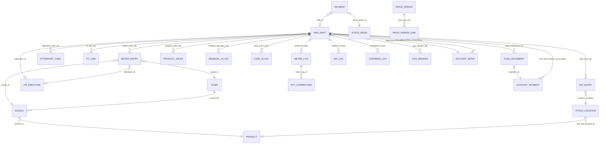
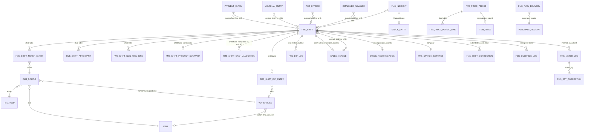
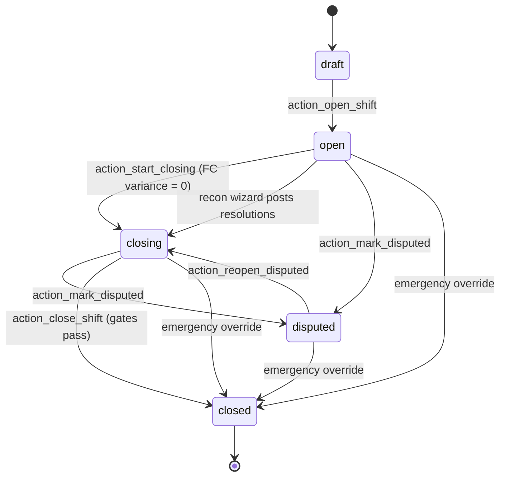

# FMS: Odoo 18 → Frappe / ERPNext Migration Guide

**Scope:** a deep dive for rewriting the `fms` Odoo 18 addon (repository `niiniyare/fms`, branch `main`, last commit `bd90360`) as a Frappe app on ERPNext.
**Target stack:** Frappe Framework v16, ERPNext v16, Frappe HRMS v16 (ERPNext v16.0.0 shipped on 12 January 2026; the v16 line is current).
**Written:** 2026-10-19.
**Evidence:** every statement about the Odoo module was read from the code in this repository (`file:line` references are given). Every statement about Frappe/ERPNext was checked against the `version-16` branches of `frappe/frappe`, `frappe/erpnext` and `frappe/hrms` on GitHub, or against the release notes linked in [Sources](#19-sources). Where something is an inference or a recommendation rather than a fact, it says so.

---

## Table of contents

1. [Executive summary](#1-executive-summary)
2. [How the two frameworks map, concept by concept](#2-how-the-two-frameworks-map-concept-by-concept)
3. [Inventory of the current Odoo module](#3-inventory-of-the-current-odoo-module)
4. [Relationships: current model graph and target DocType graph](#4-relationships-current-model-graph-and-target-doctype-graph)
5. [DocType design, model by model](#5-doctype-design-model-by-model)
6. [Business logic deep dive](#6-business-logic-deep-dive)
7. [The close gates, one by one](#7-the-close-gates-one-by-one)
8. [Accounting and stock design in ERPNext](#8-accounting-and-stock-design-in-erpnext)
9. [Security: groups, record rules and immutability](#9-security-groups-record-rules-and-immutability)
10. [Reports, dashboards and print formats](#10-reports-dashboards-and-print-formats)
11. [ERPNext/Frappe features Odoo CE does not have, and how to use them](#11-erpnextfrappe-features-odoo-ce-does-not-have-and-how-to-use-them)
12. [Odoo features Frappe/ERPNext does not have, and how to tackle them](#12-odoo-features-frappeerpnext-does-not-have-and-how-to-tackle-them)
13. [The missing `fms_accounting` module](#13-the-missing-fms_accounting-module)
14. [Defects and inconsistencies to fix instead of porting](#14-defects-and-inconsistencies-to-fix-instead-of-porting)
15. [Frappe app skeleton and code patterns](#15-frappe-app-skeleton-and-code-patterns)
16. [Data migration and cutover](#16-data-migration-and-cutover)
17. [Testing strategy](#17-testing-strategy)
18. [Phased plan and risk register](#18-phased-plan-and-risk-register)
19. [Sources](#19-sources)

---

## 1. Executive summary

### What the module is

`fms` is one Odoo 18 Community addon built around a single orchestration model, `fms.shift` (`models/fms_shift.py`, 3,045 lines). A shift holds pump meter readings, tank dips, per-attendant cash reconciliation, non-fuel sales lines and floats/drops. Closing a shift runs a battery of hard gates, then writes immutable meter and dip logs, posts the fuel sales journal, posts non-fuel journals, moves fuel out of the tank in the stock ledger, resets the tank's book stock to the physical dip and optionally opens the next shift. Around that core sit masters (pumps, nozzles, tanks, site preferences, EPRA price periods), an incident register, a correction wizard, an emergency override, about 20 SQL-view reports, six PDF reports and three security groups.

The module relies on a sibling module, `fms_accounting`, that is **not in the repository**. It adds `fms_shift_id`, `fms_attendant_id` and `fms_payment_context` to `account.payment`, `account.move` and `hr.expense`, and defines fuel deliveries. `fms` detects it at runtime with `information_schema` and `to_regclass` checks and silently skips logic when it is missing (see [§13](#13-the-missing-fms_accounting-module)).

### Verdict

The rewrite is a good fit. Three things in ERPNext line up with this domain better than Odoo CE does:

1. **Submittable documents.** Frappe's `docstatus` (0 Draft, 1 Submitted, 2 Cancelled) makes a submitted document and all its child rows read-only by the framework. The Odoo module reimplements this by hand in seven different `write()`/`unlink()` overrides. In Frappe, "shift closed" simply becomes "shift submitted".
2. **Full accounting in the open-source edition.** ERPNext ships P&L, Balance Sheet, Trial Balance, General Ledger, AR/AP ageing, cost centers, accounting dimensions, budgets, period closing and accounting-period locks. Odoo 18 CE does not ship the financial reports (they are in the Enterprise `account_reports` module), which is why `fms_accounting` had to build its own P&L, Balance Sheet, Trial Balance and debtor reports (`docs/runbook/11-oca-migration.md`). All of that can be deleted.
3. **Item defaults per company.** The custom `fms_revenue_account_id` and `fms_cogs_account_id` on products are replaced by ERPNext's native `Item Default` rows (`income_account`, `expense_account` and, new in v16, `default_cogs_account`).

Three things get harder:

1. **No dependency-tracked computed fields.** Odoo recomputes `fms.shift.attendant.cash.balance` whenever a linked payment changes. Frappe has no `@api.depends`. Values are computed in `validate()` or on demand, and cross-document refresh needs `doc_events` hooks.
2. **Child tables have no row-level permissions.** The Odoo rule "an attendant sees only their own cash line" cannot be expressed on a Frappe child table.
3. **POS.** ERPNext's POS identifies the cashier as a `User`, not an `Employee`, and still needs a working connection (no offline queue). Odoo POS supports employee login and offline orders.

### Ten decisions to make up front

| # | Decision | Recommendation |
|---|----------|----------------|
| D1 | Shift lifecycle | `FMS Shift` is **submittable**. `status` (Draft/Open/Closing/Disputed) lives on docstatus 0. Submit = Close. Cancel is admin-only and only for the latest shift. |
| D2 | Logs | Keep immutable log DocTypes (`FMS Meter Log`, `FMS Dip Log`) written on submit, because the next shift's openings, month variance and reports read them. |
| D3 | Who owns fuel revenue | Move from "clearing account + E610/E611 guards" to **one consolidated cash Sales Invoice per shift for the uninvoiced balance**, so each litre and each shilling is posted exactly once by construction ([§8.2](#82-the-revenue-ownership-decision)). |
| D4 | Stock | Tanks become **Warehouses**. Fuel consumption posts through the Sales Invoice (`update_stock = 1`); the closing dip posts a **Stock Reconciliation**. |
| D5 | Floats, drops, expenses | Native **Payment Entry** (Internal Transfer / Pay / Receive) and **Journal Entry** (Cash Entry), tagged with custom fields `fms_shift`, `fms_attendant`, `fms_payment_context`. |
| D6 | Attendant shortages | Post to HRMS **Employee Advance** (with optional salary recovery) instead of a hand-built "staff advance" JE. |
| D7 | Prices | EPRA periods stay a custom DocType that **generates Item Price rows** (`valid_from` / `valid_upto`) on submit. |
| D8 | Attendant privacy | Attendants do not get Desk access to `FMS Shift`. They use a dedicated page or a separate `FMS Attendant Statement` DocType if self-service is required. |
| D9 | Database | Plan for **MariaDB** (ERPNext's default and CI-tested database). All raw SQL in the Odoo module is PostgreSQL-specific and must be rewritten, preferably with `frappe.qb`. |
| D10 | `fms_accounting` | Merge it into the new app. Do not reproduce the "optional sibling module" detection. |

---

## 2. How the two frameworks map, concept by concept

| Odoo 18 | Frappe v16 / ERPNext v16 | Notes |
|---|---|---|
| Addon (`__manifest__.py`) | App (`bench new-app fms`), `hooks.py`, `required_apps = ["erpnext", "hrms"]` | Modules inside an app group DocTypes. |
| `models.Model` with `_name` | **DocType** (JSON + Python controller class) | DocType name is title case with spaces: `FMS Shift`. Table becomes `tabFMS Shift`. |
| `_inherit = 'stock.location'` (extend) | **Custom Field** (shipped as fixtures) + **Property Setter**; controller logic via `doc_events` or `extend_doctype_class` | `extend_doctype_class` exists in Frappe v16 (`frappe/model/base_document.py:190`) and is absent in v15. `override_doctype_class` replaces the class ("last app wins"). |
| `One2many` to a dedicated child model | **Table** field pointing to a child DocType (`istable = 1`) | Child rows have `parent`, `parenttype`, `parentfield`, `idx`. They cannot be targets of a Link. |
| `Many2one` | **Link** field | |
| `Many2many` | **Table MultiSelect** (child DocType with one Link) | |
| `related='x.y', store=True` | `fetch_from: "x.y"` (copied on save; `fetch_if_empty` optional) | Not live. If the source changes later, rows are not updated. |
| `compute=..., store=True` + `@api.depends` | Compute in `validate()` / `before_save()` | No automatic cross-document recompute. |
| `compute=..., store=False` | DocField `is_virtual = 1` + a Python `@property` on the controller | Available in v16 DocField. |
| `@api.constrains` | `validate()` raising `frappe.ValidationError` (`frappe.throw`) | |
| `@api.onchange` | Client Script / app JS: `frappe.ui.form.on("FMS Shift Meter Entry", { nozzle(frm, cdt, cdn) {...} })` | Also `depends_on`, `mandatory_depends_on`, `read_only_depends_on` expressions on fields. |
| `_sql_constraints UNIQUE(a, b)` | Single field: `unique = 1`. Composite: `frappe.db.add_unique(doctype, [a, b])` in an `on_doctype_update()` hook or a patch | `add_unique` exists (`frappe/database/database.py:1385`). |
| `state` Selection + button methods | `docstatus` + `status` Select + `@frappe.whitelist()` methods, or the **Workflow** DocType | See [§6.1](#61-lifecycle-state-machine). |
| `write()` / `unlink()` overrides for immutability | `is_submittable`; submitted docs are read-only except fields with `allow_on_submit` | |
| `TransientModel` wizard | `frappe.ui.Dialog` / `frappe.prompt` calling a whitelisted method; or a **Single** DocType | |
| `res.config.settings` | **Single** DocType (`issingle = 1`) for global settings; a normal DocType named by company for per-company settings | |
| `ir.model.access.csv` | DocType **Permissions** (role × read/write/create/delete/submit/cancel/amend/report/export…) | Stored in the DocType JSON; site overrides in Custom DocPerm. |
| `ir.rule` | **User Permissions** (restrict by Link value) + `permission_query_conditions` hook (list filter SQL) + `has_permission` hook (per-document check) | No per-child-row rules. |
| `res.groups` with `implied_ids` | **Role** (+ **Role Profile** to bundle roles) | Roles do not imply each other; assign all needed roles. |
| `sudo()` | `doc.insert(ignore_permissions=True)`, `doc.flags.ignore_permissions = True`, `frappe.set_user` in jobs | |
| `self.env.cr.savepoint()` | `frappe.db.savepoint(name)` / `frappe.db.rollback(save_point=name)`, or the `frappe.database.database.savepoint` context manager | The whole request is already one transaction; an exception rolls back everything. |
| `self.env.cr.execute(sql)` | `frappe.db.sql(...)` or the query builder `frappe.qb` | MariaDB syntax. |
| `_auto = False` SQL view model | **Script Report** / **Query Report**, or a **Virtual DocType** (`is_virtual = 1`) | |
| QWeb PDF report | **Print Format** (Jinja, or the Print Format Builder) | |
| `mail.thread` chatter, `message_post` | Form timeline: `doc.add_comment("Comment", text)`, **Version** log when `track_changes = 1` | |
| `mail.activity` | **ToDo** / `assign_to.add`, **Notification**, **Assignment Rule** | |
| `ir.cron` | `scheduler_events` in `hooks.py` (`hourly`, `daily`, `cron: {...}`) | |
| `ir.sequence` | `naming_series` / `autoname: "format:INC-{YYYY}-{####}"` / **Document Naming Rule** | |
| `post_init_hook` | `after_install` hook; data fixes as **patches** (`patches.txt`) | |
| XML data files | **fixtures** (`hooks.py` → exported JSON) and `install` hooks | |
| `TransactionCase` tests | `frappe.tests.IntegrationTestCase` / `UnitTestCase` (`bench run-tests --app fms`) | Both classes exist in v16 (`frappe/tests/classes/__init__.py`). |

---

## 3. Inventory of the current Odoo module

### 3.1 Models (persistent)

| Odoo model | File | Role |
|---|---|---|
| `fms.shift` | `models/fms_shift.py:85` | Root of a shift: state machine, gates, close posting |
| `fms.shift.meter.entry` | `models/fms_shift_entry.py:19` | One nozzle's three meters for one shift |
| `fms.shift.dip.entry` | `models/fms_shift_entry.py:279` | One tank's opening/closing dip |
| `fms.shift.attendant.cash` | `models/fms_shift_entry.py:384` | Per-attendant money reconciliation (two formulas: `balance` and `fc_variance`) |
| `fms.shift.product.sales` | `models/fms_shift_reconciliation.py:24` | Per-product rollup of meters vs POS |
| `fms.shift.residual.allocation` | `models/fms_shift_reconciliation.py:142` | Litres moved from over- to under-invoiced product |
| `fms.shift.fc.line` | `models/fms_shift_fc_line.py` | Non-fuel goods (opening + received − closing) and services |
| `fms.shift.cash.movement` | `models/fms_shift_cash_movement.py` | Float or drop row that auto-creates and posts an `account.payment` |
| `fms.shift.cash.allocation` | `models/fms_shift_cash_allocation.py` | Read-only split of each attendant's payments across products |
| `fms.meter_log` | `models/fms_logs.py:14` | Immutable snapshot of a meter entry |
| `fms.dip_log` | `models/fms_logs.py` | Immutable snapshot of a dip entry plus variance figures |
| `fms.meter_log.rtt_correction` | `models/fms_logs.py` | Append-only RTT correction after close |
| `fms.shift.override.log` | `wizards/fms_emergency_override_wizard.py` | Immutable record of an emergency close |
| `fms.pump` | `models/fms_pump.py` | Dispenser |
| `fms.pump.nozzle` | `models/fms_pump.py` | Nozzle with lifecycle draft → initialized → active and current meter positions |
| `fms.price.period` / `.line` | `models/fms_price_period.py` | EPRA gazette period, cap, pump price, landed cost, margin |
| `fms.incident` | `models/fms_incident.py` | Drive-off / spillage register that writes stock off |
| `fms.site.preferences` | `models/fms_site_preferences.py` | One per company: thresholds, accounts, schedule, switches |

### 3.2 Transient models (wizards and tools)

`fms.shift.recon.wizard` (+ `.line`), `fms.emergency.override.wizard`, `fms.shift.correction.wizard`, `fms.setup.check` (+ `.issue`), `fms.overview` (dashboard), `res.config.settings` extension.

### 3.3 Extensions of core models

| Core model | Added fields | File |
|---|---|---|
| `stock.location` | `fms_is_fuel_tank`, `fms_is_forecourt`, `fms_fuel_product_id`, `fms_tank_capacity_l`, `fms_reorder_point_days`, `fms_lead_time_days`, `fms_safety_days` | `fms_shift.py:23` |
| `product.category` | `fms_is_fuel`, `fms_is_fms` | `fms_shift.py:49` |
| `product.product` | `fms_is_fuel`, `fms_cogs_account_id`, `fms_revenue_account_id` | `fms_shift.py:60` |
| `hr.employee` | `fms_is_attendant`, `fms_pumps_assigned` (M2M pumps) | `fms_shift.py:70` |
| `pos.payment.method` | `fms_payment_type` (cash, mpesa, card, bank, credit, cheque, other) | `fms_shift_entry.py:979` |
| `pos.session` | close-time guard E610 | `fms_pos_session.py` |
| From `fms_accounting` (not in repo) | `account.payment`: `fms_shift_id`, `fms_attendant_id`, `fms_payment_context`; `account.move`: `fms_shift_id`, `fms_attendant_id`, `fms_payment_classification`; `account.move.line`: `fms_nozzle_id`; `hr.expense`: `fms_shift_id`, `fms_attendant_id`; models `fms.fuel.delivery`, `fms.fuel.delivery.line` | inferred from queries in `fms_shift.py` and `fms_shift_entry.py`, and `FMS_FINAL_ARCHITECTURE.md` §22 |

### 3.4 Reports

20 `_auto = False` SQL views in `models/fms_report_views.py` (daily station, attendant sales, wetstock, stock position + reorder cron, meter variance, residual exceptions, GL reconciliation, sales summary, throughput, nozzle performance, attendant by category, shortage ledger, attendant performance, risk & anomaly, nozzle handover, attendant cash breakdown, cash reconciliation, meter reconciliation, tank loss). Six QWeb PDFs in `reports/`: shift report, FC cash reconciliation, sales register, daily station report, attendant shift statement, meter movement.

### 3.5 Security

Groups `group_fms_attendant` ⊂ `group_fms_supervisor` ⊂ `group_fms_accountant` (`security/fms_groups.xml`), ACLs for 45 models (`security/ir_model_access.xml`), record rules for company scope, open-shift-only edits and own-cash-line visibility (`security/ir_rule.xml`).

---

## 4. Relationships: current model graph and target DocType graph

### 4.1 Current Odoo graph



Implicit links that are not foreign keys but carry business meaning:

- Pump → company (`fms.pump.company_id`). Nozzles, meter entries and logs inherit company through pump/shift.
- Nozzle `current_elec_volume` / `current_elec_cash` / `current_mech_volume` are advanced on every close (`fms_shift.py:2606`) and become the next shift's openings (`fms_shift.py:1023`).
- `fms.dip_log.closing_volume` of the previous closed shift becomes the next shift's `opening_volume` (`fms_shift.py:1085`).
- `fms.site.preferences` (one per company) is read by almost every gate.

### 4.2 Target Frappe/ERPNext graph



Two structural changes are deliberate:

1. **Nozzle gets an explicit tank link.** The Odoo module finds the tank for a product with `search([('fms_fuel_product_id','=',product)], limit=1)` (`fms_shift.py:3002`, `fms_incident.py:416`). That breaks the moment a station has two tanks of the same product. Linking nozzle → tank fixes it.
2. **Floats/drops stop being a child table.** In Odoo `fms.shift.cash.movement` rows create payments as a side effect of `create()`/`write()`. In Frappe, a child row of a draft shift cannot sensibly own a submitted Payment Entry. Floats and drops become Payment Entries created from a button on the shift (see [§6.8](#68-floats-drops-expenses-and-vendor-payments)).

---

## 5. DocType design, model by model

Naming convention used below: DocTypes are prefixed `FMS`, fieldnames are snake_case, custom fields on ERPNext DocTypes are prefixed `fms_`.

### 5.1 Extensions of core ERPNext DocTypes (Custom Fields, shipped as fixtures)

| Odoo field | ERPNext target | How |
|---|---|---|
| `stock.location.fms_is_fuel_tank` | `Warehouse.fms_is_fuel_tank` (Check) | Custom Field. Each tank is a leaf Warehouse under a group Warehouse "Forecourt Tanks - <Company abbr>". |
| `stock.location.fms_fuel_product_id` | `Warehouse.fms_fuel_item` (Link Item) | Custom Field. |
| `fms_tank_capacity_l`, `fms_reorder_point_days`, `fms_lead_time_days`, `fms_safety_days` | `Warehouse.fms_capacity_l`, `fms_reorder_point_days`, `fms_lead_time_days`, `fms_safety_days` | Custom Fields. |
| `stock.location.fms_is_forecourt` | `Warehouse.fms_is_forecourt_store` (Check) | Custom Field for the lubes/shop store. |
| `product.product.fms_is_fuel` | `Item.fms_is_fuel` (Check) | Custom Field. |
| `product.product.fms_revenue_account_id` | **native** `Item Default.income_account` (per company) | Delete the custom field. |
| `product.product.fms_cogs_account_id` | **native** `Item Default.default_cogs_account` (v16) or `expense_account` | Delete the custom field. |
| `product.category.fms_is_fuel`, `fms_is_fms` | `Item Group.fms_is_fuel`, `fms_is_forecourt` | Custom Fields; Item Group also carries `item_group_defaults`. |
| `hr.employee.fms_is_attendant` | `Employee.fms_is_attendant` (Check) | Custom Field. Alternatively a Designation "Forecourt Attendant". |
| `hr.employee.fms_pumps_assigned` | `Employee.fms_pumps` (Table MultiSelect → child `FMS Employee Pump`) | Custom Field. |
| `pos.payment.method.fms_payment_type` | **native** `Mode of Payment.type` (Cash / Bank / General / Phone) + `Mode of Payment.fms_payment_type` (Select) | Use native `type = Phone` for M-Pesa; keep a custom select only for finer classes (card vs bank vs credit). Drop the name-matching fallback. |
| `account.payment.fms_*` (from `fms_accounting`) | `Payment Entry.fms_shift`, `fms_attendant` (Link Employee), `fms_payment_context` (Select) | Custom Fields. |
| `account.move.fms_*` | `Sales Invoice` / `POS Invoice` / `Journal Entry`: `fms_shift`, `fms_attendant`; Sales Invoice Item: `fms_nozzle` | Custom Fields. On POS, add `fms_attendant` to **POS Settings → POS Additional Fields** (`invoice_fields`) so it appears on the POS screen. |
| `hr.expense.fms_*` | `Expense Claim.fms_shift`, `fms_attendant` and `Employee Advance.fms_shift` | Custom Fields (HRMS DocTypes). |

### 5.2 Masters

#### FMS Pump (normal DocType)

| Field | Type | Notes |
|---|---|---|
| `pump_name` | Data, reqd | Odoo `name`. |
| `code` | Data, reqd | Odoo auto-derives from the name if empty (`fms_pump.py:48`); keep in `before_insert`. |
| `company` | Link Company, reqd | |
| `display_order` | Int | |
| `disabled` | Check | Odoo `active` inverted (Frappe convention). |

Naming: `autoname: "format:{company_abbr}-{code}"` or `field:code`. Uniqueness of `(pump_name, company)` and `(code, company)` (`fms_pump.py:43`): composite unique via `frappe.db.add_unique` in `on_doctype_update`.

#### FMS Nozzle (normal DocType, **not** a child of Pump)

It must be a standalone DocType because meter entries, logs, incidents and invoice lines link to it, and Frappe child rows cannot be Link targets.

| Field | Type | Notes |
|---|---|---|
| `pump` | Link FMS Pump, reqd | |
| `nozzle_label`, `letter`, `display_order` | Data, Data, Int | Unique `(pump, letter)` (`fms_pump.py:178`). |
| `item` | Link Item, reqd, filter `fms_is_fuel = 1` | |
| `tank` | Link Warehouse, reqd, filter `fms_is_fuel_tank = 1` | **New.** Validate `tank.fms_fuel_item == item`. |
| `default_attendant` | Link Employee | Used in pre-assigned mode. |
| `status` | Select Draft / Initialized / Active | Odoo `state`; driven by whitelisted `initialize()`, `activate()`, `reset_to_draft()`. |
| `init_elec_volume`, `init_elec_cash`, `init_mech_volume`, `init_date`, `init_shift` | Float ×3, Date, Link FMS Shift | |
| `current_elec_volume`, `current_elec_cash`, `current_mech_volume` | Float, read_only | Advanced by shift submit via `frappe.db.set_value`. |
| `disabled` | Check | |

Note: in the Odoo code the nozzle status is cosmetic for shifts. `_populate_opening_entries` picks every `active=True` nozzle regardless of `state` (`fms_shift.py:1021`). Decide whether only `Active` nozzles should be loaded; the guide recommends yes.

#### Tanks

No new DocType; use Warehouse with the custom fields in §5.1. ERPNext's warehouse tree (`is_group`, `parent_warehouse`) gives a natural "Station → Forecourt Tanks → Tank 1 (Diesel)" hierarchy, and the warehouse `account` field allows a separate inventory GL account per tank if perpetual inventory per tank is wanted.

#### FMS Station Settings (per company, replaces `fms.site.preferences` and the `res.config.settings` proxy)

A normal DocType with `autoname: "field:company"` gives "one record per company" without the `UNIQUE(company_id)` constraint and the race-handling in `get_for_company` (`fms_site_preferences.py:152`). If the business will only ever run one company, a Single DocType is simpler, but the Odoo code is consistently multi-company, so keep it per company.

| Group | Fields (Odoo name → Frappe name) |
|---|---|
| Thresholds | `default_dip_variance_meniscus` → `dip_variance_limit_l` (default 50); `meniscus_pct` → `meter_vs_sales_pct` (default 0.5); `elec_vs_cash_threshold_l` (default 5); new `cash_recon_tolerance` (Odoo hardcodes 100, `fms_shift.py:2371`); new `elec_vs_manual_limit_l` (Odoo hardcodes 1.0, `fms_shift.py:2245`); new `float_tolerance` (Odoo hardcodes 1.0, `fms_shift.py:2453`) |
| Schedule | `shift_duration_hrs` (8/12/24), `shift_1_start_hour`, `shift_2_start_hour`, `shift_3_start_hour`; drop unused `shift_label_1..3` |
| Behaviour | `attendant_assignment_mode`, `allow_multiple_disputed`, `auto_sync_attendants`, `auto_open_next_shift`, `require_pos_reconciliation` |
| Accounts | `clearing_account` (Link Account, `account_type` filter), `fms_sales_journal` → not needed in ERPNext (no journals), `default_revenue_account`/`default_cogs_account` → move to Item Group defaults, `staff_advance_account` → HRMS Employee Advance account, `allow_variance_writeoff`, `variance_writeoff_account`, `max_writeoff_amount` (default 200), new `cash_customer` (Link Customer "Forecourt Cash Sales"), new `clearing_mode_of_payment` (Link Mode of Payment) |
| Station | new `cost_center` (Link Cost Center), new `price_region` (for EPRA) |

ERPNext has no "journal" concept. Every voucher type (Sales Invoice, Journal Entry, Payment Entry) is its own sequence via `naming_series`. The Odoo `sales_journal_id` disappears; if a separate numbering for forecourt documents is wanted, create naming series such as `FMS-SINV-.YYYY.-`.

#### FMS Price Period (submittable) + child FMS Price Period Line

| Field | Notes |
|---|---|
| `gazette_ref`, `region`, `date_start`, `date_end`, `price_list` (Link Price List), `notes` | Overlap check per region in `validate` (`fms_price_period.py:226`). |
| Child: `item`, `epra_cap`, `pump_price`, `landed_cost`, `margin_per_litre` (computed in `validate`) | Validate `pump_price <= epra_cap` (the Odoo code does not; it should). |

On submit, create or update one **Item Price** per line on the station's selling Price List with `valid_from = date_start` and `valid_upto = date_end` (both fields exist on Item Price in v16). Then every ERPNext document (Sales Invoice, POS) picks up the gazetted price natively, and the shift uses the same price lookup (`erpnext.stock.get_item_details.get_price_list_rate` or a direct Item Price query). This removes three different price sources in the Odoo code (see [§14](#14-defects-and-inconsistencies-to-fix-instead-of-porting)).

### 5.3 The shift

#### FMS Shift (submittable, `track_changes = 1`)

| Field | Type | Source in Odoo | Notes |
|---|---|---|---|
| `naming_series` / autoname | | display name `"{date} — {label}"` | Suggest `format:SHIFT-{company_abbr}-{date}-{label}`; keep a `title` for display. |
| `company` | Link Company, reqd, `set_only_once` | `company_id` | |
| `date` | Date, reqd | `date` | |
| `label` | Select `1. Day` / `2. Evening` / `3. Night` | `label` | |
| `planned_open`, `planned_close` | Datetime, read_only | computed in `create()` | Compute in `before_insert`. Use the system time zone (the Odoo code builds naive datetimes, `fms_shift.py:837`). |
| `status` | Select Draft / Open / Closing / Disputed / Closed / Cancelled | `state` | `Closed` is set in `on_submit`, `Cancelled` in `on_cancel`. |
| `supervisor` | Link Employee | `supervisor_id` | Mandatory at submit when the shift is not empty. |
| `opened_at`, `opened_by`, `closing_started_at`, `closing_started_by` | Datetime, Link User | `opening_meter_*`, `closing_meter_*` | Odoo names say "meter" but they are state timestamps. |
| `meters` | Table → FMS Shift Meter Entry | `meter_entry_ids` | |
| `dips` | Table → FMS Shift Dip Entry | `dip_entry_ids` | |
| `attendants` | Table → FMS Shift Attendant | `attendant_cash_ids` | |
| `non_fuel_lines` | Table → FMS Shift Non Fuel Line | `fc_line_ids` | |
| `product_summary` | Table → FMS Shift Product Summary, read_only | `product_sales_ids` | Rebuilt in `validate`. |
| `cash_allocation` | Table → FMS Shift Cash Allocation, read_only, `allow_on_submit` | separate model | Computed in `on_submit`. |
| `pos_opening_entries` | Table MultiSelect → POS Opening Entry | `pos_session_ids` | Only if POS is used for fuel. |
| Totals (`total_meter_sales`, `total_fuel_sales`, `total_nonfuel_sales`, `total_all_sales`, `total_cash_received`, `total_digital_received`, `total_credit_sales`, `declared_cash_total`, `expected_cash_position`, `cash_variance_summary`, `fc_variance_total`) | Currency, read_only | `_compute_totals`, `_compute_commercial_summary` | Recompute in `validate` and again in `before_submit`. |
| `fc_writeoff_amount`, `fc_writeoff_account`, `fc_writeoff_voucher` | Currency, Link Account, Link Journal Entry | `fc_variance_writeoff`, `fc_writeoff_*` | See [§6.9](#69-resolving-fc-cash-variances). |
| `cash_sales_invoice`, `closing_stock_reconciliation` | Link, read_only, `allow_on_submit` | `sales_journal_entry_id` | Set in `on_submit`. |
| `gate_status` | HTML, virtual | `gate_status_html` | Filled client-side from a whitelisted `get_gate_status()` call. |
| `override_log` | Link FMS Override Log, read_only, `allow_on_submit` | | |
| `notes` | Small Text | `notes` | |

#### FMS Shift Meter Entry (child)

| Field | Type | Notes |
|---|---|---|
| `nozzle` | Link FMS Nozzle, reqd | |
| `pump`, `item`, `tank` | Link, `fetch_from: nozzle.pump`, `nozzle.item`, `nozzle.tank`, read_only | Replaces `related=..., store=True` and the `_onchange_nozzle_id`. |
| `attendant` | Link Employee, filter `fms_is_attendant = 1` | |
| `opening_elec_volume`, `closing_elec_volume` | Float (precision 2) | Opening read_only after open. |
| `opening_elec_cash`, `closing_elec_cash` | Currency | |
| `opening_man_mech`, `closing_man_mech` | Float | |
| `rtt_volume`, `rtt_cash` | Float, Currency | |
| `qty_sold_elec`, `elec_cash_sold`, `qty_sold_man`, `amount_elec` | read_only, computed in parent `validate` | Formulas in [§6.3](#63-meter-arithmetic-and-entry-validations). |
| `notes` | Data | |

#### FMS Shift Dip Entry (child)

`tank` (Link Warehouse), `item` (`fetch_from: tank.fms_fuel_item`), `opening_volume` (read_only), `closing_volume`, `book_stock_open` (read_only), `delivery_qty` (read_only, from FMS Fuel Delivery), `meter_sales_l`, `shift_variance_l`, `shift_variance_amount` (computed), `notes`. Validate `closing_volume <= tank.fms_capacity_l` (`fms_shift_entry.py:330`).

#### FMS Shift Attendant (child, replaces `fms.shift.attendant.cash`)

| Field | Kind | Notes |
|---|---|---|
| `attendant` | Link Employee, reqd | One row per attendant (enforce in `validate`). |
| `cash_dropped` | Currency, editable | The only manual figure (`cash_collected` in Odoo). |
| `meter_sales` | computed | Σ `elec_cash_sold` of the attendant's nozzles |
| `mpesa`, `card`, `credit` | computed | From POS/Sales Invoice payments by Mode of Payment classification |
| `customer_receipts`, `floats`, `drops`, `vendor_payments`, `expenses` | computed | From Payment Entry / Journal Entry / Expense Claim with `fms_shift` + `fms_attendant` |
| `direct_cash_sales`, `direct_digital_sales`, `direct_credit_sales` | computed | From non-fuel Sales Invoice lines |
| `non_fuel_sales` | computed | From FMS Shift Non Fuel Line rows of this attendant |
| `invoices_raised`, `receipts_raised` | computed | Posted credit invoices / receipts for this attendant |
| `expected_cash`, `accounted_cash`, `balance` | computed | Odoo `total_in`, `total_out`, `balance` |
| `fc_captured`, `fc_collected`, `fc_variance` | computed | Odoo FC Cash formula |
| `resolution`, `resolution_voucher` | Select (None / Employee Advance / Write-off), Dynamic Link | Result of variance resolution, see [§6.9](#69-resolving-fc-cash-variances) |

All computed values are recalculated by a single shift-level method (see [§6.5](#65-attendant-money-two-formulas)) on every save and in `before_submit`. Stored values are a snapshot for reports and printing, not a live truth.

#### FMS Shift Non Fuel Line (child, replaces `fms.shift.fc.line`)

`attendant`, `item` (filter `fms_is_fuel = 0`), `line_type` (Goods/Service, fetched from `item.is_stock_item`), `opening_qty` (snapshot of `Bin.actual_qty` in the forecourt store warehouse on open), `received_qty`, `closing_qty`, `qty_sold`, `rate` (from Item Price), `amount` (service), `sales_amount`. The per-line journal posting in Odoo (`_post_nonfuel_fc_lines_journal`, one JE per line) becomes lines on the same consolidated cash Sales Invoice as fuel, with `update_stock = 1` from the forecourt store warehouse. That also fixes a gap: the Odoo module posts revenue for non-fuel goods but **does not move their stock** (no stock move for `fc_line_ids`).

#### FMS Shift Product Summary (child, replaces `fms.shift.product.sales`)

`item`, `is_fuel`, `meter_volume`, `meter_volume_man`, `price_at_close`, `meter_revenue`, `invoiced_volume` (Odoo `accounted_volume`), `volume_residual`, `elec_cash_sold`, `invoiced_amount` (Odoo `pos_cash_collected`), `cash_residual`, `residual_type`, `allocated_volume`, `allocated_amount`. Odoo's `UNIQUE(shift_id, product_id)` becomes "rebuild the table in `validate`", so duplicates cannot occur. Drop the five legacy alias fields (`fms_shift_reconciliation.py:105`).

#### FMS Shift Residual Allocation

Drop it as a stored table unless the business still wants the report. The Odoo code computes it only from a button (`fms_shift.py:1204`), never on close, and never posts the journal (`_post_residual_allocation_journals` has no caller). `docs/fc_cash_system.md` §2.5 says the money side was retired. If the volume report is still wanted, compute it inside a Script Report from Product Summary rows rather than storing it.

#### FMS Shift Cash Allocation (child, `allow_on_submit`)

`attendant`, `item`, `is_fuel`, `priority`, `product_qty`, `product_revenue`, `digital_allocated`, `cash_allocated`, `uncovered`. Written in `on_submit` with `self.append(...)` then `self.db_update_all()` or as rows inserted via `frappe.get_doc(...).db_insert()`; mark the table `allow_on_submit` so it can be regenerated. Algorithm in [§6.7](#67-cash-allocation-per-product).

### 5.4 Logs and audit DocTypes

| DocType | Kind | Notes |
|---|---|---|
| **FMS Meter Log** | normal DocType, permissions read-only for every role, created only by code with `ignore_permissions` | Same fields as the meter entry plus `shift`, `recorded_at`, `recorded_by`. Controller `on_trash` and `validate` (when not new) throw. |
| **FMS Dip Log** | same pattern | Plus snapshot fields `delivery_qty`, `book_stock_open`, `meter_sales_snapshot`, `shift_variance`, `shift_var_amount`, `month_variance`, `month_var_amount`, `var_rate`. Drop the `fms_delivery_update` context backdoor (`fms_logs.py:180`); a delivery reconciled after close should create a correction document, not rewrite a log. |
| **FMS RTT Correction** | submittable, no cancel permission | Links `meter_log`, creates the reversing Journal Entry on submit. |
| **FMS Override Log** | submittable, no cancel | `shift`, `user`, `approver` (Employee), `reason`, `gate_failures`. |

Why not rely only on the submitted shift's child rows? They are already immutable once submitted, and that is enough for audit. Separate log DocTypes are still worth it because the next shift's openings, the month-to-date variance (`fms_shift.py:1905`) and many reports query "all logs for tank X since date Y" across shifts. Indexed standalone tables make those queries cheap, which mirrors ERPNext's own pattern of Stock Ledger Entry and GL Entry alongside the source vouchers.

### 5.5 Other DocTypes

| Odoo | Frappe | Notes |
|---|---|---|
| `fms.incident` | **FMS Incident** (submittable, `track_changes`) | Workflow Draft → Reported → Approved → Closed maps to docstatus 0 with status Draft/Reported, submit = Approve, status Closed via `allow_on_submit`. On submit create a **Stock Entry** (purpose Material Issue) from the tank warehouse with the item's `expense_account` set to an "Incident Losses" account. Recovery: Payment Entry from the customer/driver or Journal Entry, linked back. Naming `INC-.YYYY.-.####` (Odoo `INC/%(year)s/` sequence). |
| `fms.shift.recon.wizard` | Dialog + whitelisted `resolve_fc_variances(shift, rows)` | See [§6.9](#69-resolving-fc-cash-variances). |
| `fms.emergency.override.wizard` | Dialog + whitelisted `emergency_close(shift, reason, approver)` | See [§6.11](#611-emergency-override). |
| `fms.shift.correction.wizard` | **FMS Shift Correction** (submittable) | Types: Missed Expense (Journal Entry DR expense CR clearing), RTT (Journal Entry DR revenue CR clearing + FMS RTT Correction). A real document is better than a wizard because corrections need approval and an audit trail. |
| `fms.setup.check` | whitelisted `run_setup_check(company)` returning issues; a **Page** or a Dialog lists them | Also called at the start of `before_submit`. |
| `fms.overview` | **Workspace** "Forecourt" with Number Cards and Dashboard Charts, or a custom **Page** | See [§10](#10-reports-dashboards-and-print-formats). |
| `fms.fuel.delivery` (fms_accounting) | **FMS Fuel Delivery** (submittable) linked to a native **Purchase Receipt** | Records dip before/after, invoiced vs received litres, temperature if needed. Shift dip variance reads it. |

---

## 6. Business logic deep dive

### 6.1 Lifecycle state machine

Odoo (`fms_shift.py:131`, transitions at `915`, `1133`, `1163`, `1193`, `1370`, `1540`):



Frappe target:

| Odoo state | docstatus | `status` | Who moves it | Method |
|---|---|---|---|---|
| draft | 0 | Draft | Supervisor | insert |
| open | 0 | Open | Supervisor | `open_shift()` whitelisted |
| closing | 0 | Closing | Supervisor | `start_closing()` |
| disputed | 0 | Disputed | Supervisor / Accountant | `mark_disputed()`, `reopen_disputed()` |
| closed | 1 | Closed | Supervisor (gates pass) or Accountant (override) | `doc.submit()` |
| — | 2 | Cancelled | System Manager only, latest shift only | `doc.cancel()` |

Two implementation options:

- **Controller-driven status (recommended).** Buttons call whitelisted methods that check the current status, do the work and `db_set("status", ...)`. This is how ERPNext's own POS Opening Entry and many manufacturing documents manage status. It keeps the side effects (populating rows, snapshotting stock) next to the transition.
- **Workflow DocType.** Gives a visual editor, role-per-transition and an action log, but workflow transitions only change fields and docstatus. The side effects would still need `doc_events` hooks keyed on the status change, which spreads logic out. Use Workflow only if non-developers must be able to change who may perform which transition.

Rules to carry over:

- **One open shift per company** (`fms_shift.py:932`): check in `open_shift()` for any other shift with status in (Open, Closing).
- **One disputed shift per company** unless `allow_multiple_disputed` (`fms_shift.py:1178`).
- **Concurrent edit check before close** (`fms_shift.py:1396`): not needed. Frappe's `check_if_latest()` (`frappe/model/document.py:1090`) already rejects a save or submit when `modified` changed since the user loaded the form.
- **Closed shift immutability** (`fms_shift.py:849`) and **child locking** (`fms_shift_entry.py:179`, `342`, `963`, `fms_shift_fc_line.py:307`): free with docstatus 1.
- **Undeletable closed shifts** (`fms_shift.py:873`): free; submitted documents cannot be deleted, only cancelled. Remove the Cancel permission from all roles except System Manager, and in `before_cancel` refuse unless this is the latest shift for the company and the next shift is still Draft.

### 6.2 Opening a shift

`action_open_shift` → `_populate_opening_entries` (`fms_shift.py:1002`):

1. For every active pump and every active nozzle on it, create a meter entry whose opening (and initial closing) equals the nozzle's `current_*` positions. In pre-assigned mode set the attendant from `nozzle.default_attendant_id`.
2. For every active fuel tank, create a dip entry: `opening_volume` = previous closed shift's dip log closing volume, falling back to the tank's book stock; `book_stock_open` = book stock (`stock.quant` sum).
3. Create one attendant cash line per attendant appearing on meter entries (`_sync_attendant_cash_lines`, `fms_shift.py:1111`).
4. Snapshot opening quantities of non-fuel goods lines from the forecourt store (`_snapshot_fc_opening_qty`, `fms_shift.py:957`).

Frappe port:

```python
# fms/fms/doctype/fms_shift/fms_shift.py
@frappe.whitelist()
def open_shift(self):
    self.check_permission("write")
    if self.status != "Draft":
        frappe.throw(_("Only a Draft shift can be opened."))
    self._assert_no_other_open_shift()
    prev = self._previous_closed_shift()

    for nz in frappe.get_all("FMS Nozzle",
            filters={"disabled": 0, "status": "Active", "company": self.company},
            fields=["name", "current_elec_volume", "current_elec_cash",
                    "current_mech_volume", "default_attendant"],
            order_by="pump, display_order"):
        self.append("meters", {
            "nozzle": nz.name,
            "opening_elec_volume": nz.current_elec_volume,
            "closing_elec_volume": nz.current_elec_volume,
            "opening_elec_cash": nz.current_elec_cash,
            "closing_elec_cash": nz.current_elec_cash,
            "opening_man_mech": nz.current_mech_volume,
            "closing_man_mech": nz.current_mech_volume,
            "attendant": nz.default_attendant if self._settings.attendant_assignment_mode == "Pre-Assigned" else None,
        })

    prev_dips = self._dip_log_closings(prev)          # {tank: closing_volume}
    for tank in self._fuel_tanks():                     # Warehouses with fms_is_fuel_tank
        book = get_stock_balance(tank.fms_fuel_item, tank.name)   # erpnext.stock.utils
        self.append("dips", {
            "tank": tank.name,
            "opening_volume": prev_dips.get(tank.name) or book,
            "book_stock_open": book,
        })

    self._sync_attendant_rows()
    self._snapshot_non_fuel_opening()
    self.status = "Open"
    self.opened_at, self.opened_by = now_datetime(), frappe.session.user
    self.save()
```

`erpnext.stock.utils.get_stock_balance(item_code, warehouse, posting_date=None, posting_time=None)` replaces the `stock.quant` reads.

Decide one thing explicitly: the Odoo docstring says meter openings come from the previous shift's meter logs, but the code reads `nozzle.current_*` (`fms_shift.py:1023`). The nozzle positions are the right source because they also cover nozzle initialization, so keep that behaviour and correct the documentation.

### 6.3 Meter arithmetic and entry validations

Per meter entry (`fms_shift_entry.py:108`):

```
qty_sold_elec  = (closing_elec_volume − opening_elec_volume) − rtt_volume
elec_cash_sold = (closing_elec_cash   − opening_elec_cash)   − rtt_cash
qty_sold_man   =  closing_man_mech    − opening_man_mech
amount_elec    =  qty_sold_elec × pump price for the shift date
```

`elec_cash_sold` (the cash totalizer) is the authoritative revenue figure (`fms_shift.py:2717`). `amount_elec` is theoretical.

Validations to put in the shift's `validate()` (they run per row):

| Code | Rule | Odoo |
|---|---|---|
| E650 | `elec_cash_sold >= 0` | `fms_shift_entry.py:187` |
| E620 | `rtt_volume >= 0`, `rtt_cash >= 0` | `:210`, `:217` |
| E620 | `rtt_volume <= closing − opening elec volume` | `:224` |
| E620 | `rtt_cash <= closing − opening elec cash` | `:233` |
| — | `closing_volume <= tank capacity` | `:330` |
| — | attendant `meter_sales >= 0` | `:951` |
| — | float xor drop, positive | `fms_shift_cash_movement.py:396` |

Keep the error codes in messages; operators and the runbook (`docs/runbook/04-gate-failures.md`) refer to them.

### 6.4 Tank dip variance

`_compute_dip_variance_data` (`fms_shift.py:1846`):

```
meter_sales      = Σ qty_sold_elec of this shift's meter entries for the tank's product
delivery         = Σ confirmed/billed fuel delivery litres into this tank for this shift
shift_variance   = closing_dip − (opening_dip + delivery − meter_sales)
shift_var_amount = shift_variance × product list price
month_variance   = closing_dip − (MIN(opening of month's dip logs) + Σ deliveries + delivery − Σ meter_sales_snapshot − meter_sales)
```

Notes for the port:

- Meter sales are grouped **by product**, not by tank. With two tanks of the same product the full product volume is charged to each tank. With nozzle → tank links (§4.2) group by `meters.tank` instead.
- `MIN(opening_volume)` over the month's logs is the smallest opening, not the first opening of the month. It works only while stock never dips below the month's first opening. Use the opening of the earliest log by shift date.
- In ERPNext, read deliveries from submitted **FMS Fuel Delivery** (or Purchase Receipt Items into the tank warehouse with `fms_shift` set).

### 6.5 Attendant money: two formulas

The Odoo code has two coexisting reconciliations per attendant. The port must keep both or consciously drop one.

**A. POS balance** (`_compute_balance`, `fms_shift_entry.py:925`), used by Gate 3 when POS sessions are linked:

```
expected (total_in)  = meter_sales + customer_receipts + floats + direct_cash_sales − drops
accounted (total_out) = cash_dropped + mpesa + card + credit + vendor_payments + expenses + direct_digital_sales
balance = expected − accounted                      (must be 0)
```

**B. FC Cash** (`_compute_fc_variance`, `fms_shift_entry.py:538`), used by Gates 3 and 4 without POS, and by `start_closing`:

```
fc_captured  = meter_sales + non_fuel_sales + floats + customer_receipts
fc_collected = posted_credit_invoices + posted_sales_receipts + drops + expenses
               (drops fall back to cash_dropped when no drop payments exist)
fc_variance  = fc_captured − fc_collected           (must be 0)
```

`docs/fc_cash_system.md` describes B as the current design and A as legacy. Recommendation: **port B as the single attendant formula**, and express POS payments as Sales Invoice / POS Invoice receipts (they are "posted sales receipts" in B's terms). That collapses two formulas, two gates and two UIs into one.

Frappe implementation: one shift method computes all attendant figures with a handful of grouped queries (the Odoo code already batches with SQL). Example with the query builder (MariaDB-safe):

```python
from frappe.query_builder.functions import Sum, Coalesce

def _payment_totals(self):
    pe = frappe.qb.DocType("Payment Entry")
    rows = (frappe.qb.from_(pe)
        .select(pe.fms_attendant, pe.fms_payment_context, Sum(pe.paid_amount).as_("amt"))
        .where((pe.fms_shift == self.name) & (pe.docstatus == 1))
        .groupby(pe.fms_attendant, pe.fms_payment_context)).run(as_dict=True)
    return {(r.fms_attendant or "", r.fms_payment_context): r.amt for r in rows}
```

Because Frappe will not recompute the shift when a Payment Entry is submitted elsewhere, add `doc_events` so the shift's snapshot stays fresh while it is open:

```python
# hooks.py
doc_events = {
    ("Payment Entry", "Journal Entry", "Sales Invoice", "POS Invoice", "Expense Claim"): {
        "on_submit": "fms.fms.events.refresh_linked_shift",
        "on_cancel": "fms.fms.events.refresh_linked_shift",
        "before_cancel": "fms.fms.events.block_cancel_if_shift_closed",
    }
}
```

`refresh_linked_shift` loads the shift if `doc.fms_shift` is set and its docstatus is 0, recomputes and saves (or enqueues the recompute to avoid slowing the cashier). `block_cancel_if_shift_closed` enforces `docs/fc_cash_system.md` §2.4: documents linked to a closed shift can only be reversed, not cancelled.

### 6.6 Product rollup and residual volume

`_refresh_product_sales` (`fms_shift.py:711`) rebuilds one row per product: meter volume (elec and manual), cash meter, price at close; for non-fuel products it adds invoice quantities as "allocated". `_compute_accounted` then adds POS litres and POS revenue per product; `volume_residual = meter − POS litres`, `cash_residual = cash meter − POS revenue`.

`_run_greedy_allocation` (`fms_shift.py:1322`) is a pure function: sort over-invoiced and under-invoiced products by size, match greedily, ignore residuals under 0.1 L. Port it unchanged as a module-level function (easy unit test). As noted in §5.3, its result is informational only today.

### 6.7 Cash allocation per product

`_compute_cash_allocation` (`fms_shift_cash_allocation.py:624`), run after close, non-blocking:

1. For each attendant, per-product quantity and revenue from their nozzles (`amount_elec`, i.e. volume × price).
2. Sort products: fuel first, then by name.
3. Allocate digital money (M-Pesa + card + AR + direct digital + direct credit, capped at total revenue) to products in that order.
4. Allocate declared cash to each product's remainder in the same order.
5. `uncovered = revenue − digital − cash` per product.

No accounting impact; it is a management view. In Frappe compute it in `on_submit` into the `cash_allocation` child table (marked `allow_on_submit`). Wrap it in `try/except` and log with `frappe.log_error` to keep the Odoo "never block close" behaviour. Use `flt(value, precision)` for rounding instead of `float_round`.

### 6.8 Floats, drops, expenses and vendor payments

In Odoo a float/drop row auto-creates an `account.payment` with the attendant's contact as a **customer** partner and posts it (`fms_shift_cash_movement.py:433`). That makes the station's AR sub-ledger carry attendants. In ERPNext use documents designed for internal cash moves:

| Event | ERPNext document | Accounts | Tags |
|---|---|---|---|
| Float to attendant | Payment Entry, `payment_type = Internal Transfer` | paid_from Safe (Cash) → paid_to Forecourt Clearing | `fms_shift`, `fms_attendant`, `fms_payment_context = Float` |
| Cash drop to safe | Payment Entry, Internal Transfer | Forecourt Clearing → Safe | context Drop |
| Petty expense from till | Journal Entry, `voucher_type = Cash Entry` (or Expense Claim with `is_paid`) | DR expense, CR Forecourt Clearing | context Expense |
| Vendor paid from till | Payment Entry, `payment_type = Pay`, party Supplier, paid_from Forecourt Clearing | | context Vendor Payment |
| Customer settles account at the pump | Payment Entry, `payment_type = Receive`, party Customer, paid_to Forecourt Clearing | | context Customer Receipt |

The shift form gets a "Float / Drop" button that opens a dialog (attendant, float or drop, amount, note) and creates and submits the Payment Entry server-side. Editing a posted float in Odoo cancels and re-posts the payment (`fms_shift_cash_movement.py:456`); in ERPNext the user cancels the Payment Entry and makes a new one (amend), which keeps both in the audit trail.

The Gate G11/G12 checks "no draft expenses / vendor payments" carry over as "no draft Payment Entry or Journal Entry with this `fms_shift`".

### 6.9 Resolving FC Cash variances

Odoo has two paths:

1. **Per-attendant wizard** opened by Start Closing when any attendant's `fc_variance ≠ 0` (`fms_shift.py:1141`, `fms_shift_recon_wizard.py:67`). Each row is posted either to staff advance (DR Staff Advances, CR Clearing) or written off (DR write-off, CR Clearing; capped by `max_writeoff_amount` when write-off is allowed). The shift then moves to Closing.
2. **Shift-level write-off** button (`fms_shift.py:425`) that posts one JE for the net variance and stores `fc_variance_writeoff`, which Gate 4 subtracts.

ERPNext port, one path:

- **Shortage → Employee Advance** (HRMS). Create an Employee Advance for the attendant with `advance_account` = staff advances, mark it paid from Forecourt Clearing (Payment Entry, party type Employee). HRMS can recover it through salary (`repay_unclaimed_amount_from_salary`) and tracks `pending_amount`, so the shortage follows the employee instead of sitting in a GL account nobody reconciles.
- **Small shortage or surplus → write-off.** Journal Entry, `voucher_type = Write Off Entry`, DR/CR the write-off account against Forecourt Clearing, enforced against `max_writeoff_amount`.
- Each resolution voucher carries `fms_shift`, `fms_attendant` and `fms_payment_context = Variance Resolution`, and **the FC Cash formula must count it as collected**. In the Odoo code the wizard's journal entries are `move_type = 'entry'`, and `fc_collected` only counts `out_invoice`, `out_receipt` and payments (`fms_shift_entry.py:575`). The wizard therefore appears not to clear the variance it resolves, so Gates 3/4 would still fail at close. Confirm this with a test before porting; either way, the new formula must include resolution vouchers.

### 6.10 Closing: gate run and posting sequence

Odoo `action_close_shift` (`fms_shift.py:1370`):

1. Must be in `closing`; concurrency check.
2. If the shift is **empty** (no meter cash, all attendant balances zero; `_is_empty_shift`, `fms_shift.py:1352`), skip all gates and the supervisor requirement.
3. Otherwise run, in order, each failure posting a chatter note and aborting: GL config check, E610, E611, supervisor present, per-nozzle attendant present, then G1–G8 and G10–G15 (catalogue in [§7](#7-the-close-gates-one-by-one)).
4. In one savepoint: write meter logs and advance nozzle positions, write dip logs with variance snapshot, post the fuel sales JE, post one JE per non-fuel line, post fuel `stock.move`s tank → Customers, reset each tank's quant to the closing dip (`action_apply_inventory`), set `closed`.
5. Outside the savepoint: cash allocation (errors logged, not raised).
6. If configured, create and open the next shift.

Frappe port:

```python
def before_submit(self):
    self._recompute_all()
    if not self._is_empty_shift():
        failures = run_gates(self, GATES_BEFORE_CLOSE)     # list of (code, message)
        if failures and not self.flags.emergency_override:
            self._log_close_failure(failures)              # add_comment, survives rollback? see note
            frappe.throw(_format_gate_failures(failures), title=_("Shift cannot close"))

def on_submit(self):
    self._write_meter_logs()          # FMS Meter Log + db_set nozzle positions
    self._write_dip_logs()
    self._make_cash_sales_invoice()   # fuel residual + non-fuel lines, update_stock=1
    self._make_closing_stock_reconciliation()
    self.db_set("status", "Closed")
    self._compute_cash_allocation()   # try/except + frappe.log_error

def on_submit_after_commit(self):     # via frappe.db.after_commit.add(...)
    if self._settings.auto_open_next_shift:
        frappe.enqueue("fms.fms.doctype.fms_shift.fms_shift.auto_open_next", shift=self.name,
                       enqueue_after_commit=True)
```

Notes:

- **Everything in `on_submit` is one transaction** with the submit. Any exception rolls back logs, invoices and the status change together, which is what the Odoo savepoint achieves.
- **Logging a failed close to the timeline:** an exception rolls back the comment too. To keep the Odoo audit of failed attempts (`fms_shift.py:1483`), write the failure with `frappe.log_error` or insert a comment and `frappe.db.commit()` before `frappe.throw`, or enqueue the comment with `enqueue_after_commit=False` in a separate job. Committing inside a request handler is allowed but should be limited to this case.
- **Ordering of stock postings matters.** The Odoo comment at `fms_shift.py:1499` explains that consumption must post before the dip adjustment or AVCO doubles COGS. In ERPNext the same rule is expressed through posting date and time: give the cash Sales Invoice a posting time earlier than the Stock Reconciliation (for example shift `planned_close − 1 minute` and `planned_close`), and set `set_posting_time = 1` on both. If either is backdated behind existing stock transactions, ERPNext queues a **Repost Item Valuation**, which is correct but asynchronous.
- **Auto-open next shift** must happen after commit, because it inserts another document that should not be rolled back with this one and must see the new nozzle positions.

### 6.11 Emergency override

`_apply_emergency_override` (`fms_shift.py:1540`) collects which gates would have failed, writes an immutable override log, performs the same posting sequence and posts a chatter warning. Allowed from open, closing or disputed; requires the accountant group and a reason of at least 10 characters.

Frappe:

```python
@frappe.whitelist()
def emergency_close(name, reason, approver):
    frappe.only_for("FMS Accountant")
    if len((reason or "").strip()) < 10:
        frappe.throw(_("Override reason must be at least 10 characters."))
    shift = frappe.get_doc("FMS Shift", name)
    failures = run_gates(shift, GATES_BEFORE_CLOSE, collect=True)
    log = frappe.get_doc({"doctype": "FMS Override Log", "shift": name, "approver": approver,
                          "reason": reason, "gate_failures": "\n\n".join(m for _, m in failures)})
    log.insert(ignore_permissions=True); log.submit()
    shift.flags.emergency_override = True
    shift.override_log = log.name
    shift.submit()
```

### 6.12 Auto-open next shift

`_next_label_and_date` (`fms_shift.py:1642`): 8 h cycles Day → Evening → Night → next day's Day; 12 h cycles Day → Night → next day; 24 h is always Day, next date. Port as a pure function.

### 6.13 Corrections after close

Odoo's correction wizard (`wizards/fms_shift_correction_wizard.py`) posts a JE for a missed expense or an RTT revenue reversal and, for RTT, an append-only `fms.meter_log.rtt_correction`. Port as **FMS Shift Correction** (submittable). On submit it creates the Journal Entry with `fms_shift` set and, for RTT, the FMS RTT Correction row. Reports sum `meter_log.rtt_volume + Σ corrections`.

### 6.14 Incidents

`fms.incident.action_approve` (`fms_incident.py:382`) moves litres from a tank to a virtual "Incident Losses" location. ERPNext has no virtual loss warehouse concept for this; the idiom is a **Stock Entry** with purpose **Material Issue** from the tank warehouse, whose item rows carry `expense_account` (Incident Losses) and `cost_center`. Value is the valuation rate, so the loss lands in the P&L at cost. If the incident links to a shift, the dip variance for that shift should exclude its litres; add `incident_litres` to the dip formula (the Odoo code does not do this yet, so the incident still shows as variance if it happened during an open shift).

---

## 7. The close gates, one by one

All thresholds below are what the Odoo code does today. "Port" says how it looks in Frappe; "Change" lists recommended changes.

| # | Gate | Odoo rule | Skipped when | Port / Change |
|---|---|---|---|---|
| P1 | GL configuration | `fms.setup.check` finds no errors (`fms_shift.py:2092`) | empty shift | `run_setup_check(company)`; checks Item Defaults, clearing account, cash customer, mode of payment accounts. |
| P2 | E610 POS revenue config | Fuel products' POS income account is not an income account (`:2110`) | no POS sessions, no fuel sales | **Drop** with the D3 revenue model; there is no second revenue path to guard. |
| P3 | E611 POS already posted | No linked POS session move credited a fuel income account (`:2164`) | no POS sessions | **Drop** (D3). |
| P4 | Supervisor | `supervisor_id` set (`:1436`) | empty shift | `mandatory_depends_on` in JSON is not enough because it would apply to drafts; check in `before_submit`. |
| P5 | Attendant on every nozzle | per-nozzle mode only (`:1444`) | pre-assigned mode | Same. |
| G1 | Elec vs manual | `abs(qty_sold_elec − qty_sold_man) ≤ 1 L` per nozzle (`:2231`) | manual qty is 0 | Make the 1 L a setting. |
| G2 | Elec vs cash | `abs(qty_sold_elec − elec_cash_sold / list_price) ≤ elec_vs_cash_threshold_l` (default 5 L) (`:2259`) | threshold ≤ 0, price or cash 0 | Use the period pump price, not `list_price`. Note that RTT is subtracted from both sides, which is consistent. |
| G3 | Volume reconciliation | `abs(Σ meter L − Σ POS L) ≤ max(0.5, meniscus_pct% × meter L)` (`:2295`) | `require_pos_reconciliation` off **and** no POS sessions | Becomes "meter litres = invoiced litres + consolidated cash litres", which holds by construction under D3. Keep only as a sanity check on credit/digital invoices: invoiced litres per product must not exceed metered litres. |
| G4 | Cash reconciliation | `abs(Σ elec cash − Σ POS revenue) ≤ 100` (hardcoded) (`:2342`) | as G3 | Same as G3; tolerance becomes a setting. |
| G5 | Attendant balances | each attendant `balance` (POS) or `fc_variance` (non-POS) within ±0.01 (`:1809`) | — | One formula (§6.5). Include resolution vouchers. |
| G6 | FC Cash net zero | `abs(Σ fc_variance − fc_writeoff) ≤ 0.01` (`:1792`) | — | Redundant once G5 uses the single formula and write-offs are per attendant; keep as a summary line. |
| G7 | Dip variance | each tank `abs(shift_variance) ≤ default_dip_variance_meniscus` L (default 50; code falls back to 1000 if the setting is 0) (`:1939`) | tank with closing dip ≤ 0 | Same, grouped by tank; consider a % of tank capacity as an alternative limit. Do not skip a tank whose closing dip was left at 0; that is the most common data entry miss. |
| G8 | Meter vs invoices | per fuel product `abs(meter L − invoice+receipt L) ≤ meniscus_pct%`; per nozzle if lines carry a nozzle (`:1972`) | no POS sessions; no `fms_accounting`; no fuel invoices | Folded into G3 under D3. |
| ~~G9~~ | Customer receipts ≤ invoiced | method exists (`:2387`) but is not called | always | Do not port. |
| G10 | Float reconciliation | `abs(floats − (drops + cash_dropped)) ≤ 1` (`:2421`) | no floats | The comparison is questionable: drops include sales cash, so floats rarely equal drops + cash. Review with the business; it likely should compare only float returns. |
| G11 | Draft expenses | no draft payment with context expense (`:2466`) | no `fms_accounting` | Any Journal Entry / Expense Claim with `fms_shift` and docstatus 0. |
| G12 | Draft vendor payments | no draft vendor payment (`:2487`) | no `fms_accounting` | Any Payment Entry with `fms_shift` and docstatus 0. |
| G13 | Digital payments | POS M-Pesa + card ≥ 0 (`:2507`) | no POS sessions | Trivially true in practice. Replace with something useful: M-Pesa receipts match the M-Pesa statement or till report, if that data is available. |
| G14 | Not disputed | state ≠ disputed (`:2534`) | — | Implicit: `submit()` only allowed from status Closing. |
| G15 | Non-fuel sales posted | no draft non-fuel invoice/receipt linked to the shift (`:2552`) | no `fms_accounting` | Any draft Sales Invoice / POS Invoice with `fms_shift`. |
| S1 | Start-closing FC check | any attendant `fc_variance ≠ 0` opens the resolution wizard (`:1141`) | — | `start_closing()` returns a "needs resolution" payload; the client opens the dialog. |

Implementation pattern: a registry of small functions, each returning `None` or a message. One runner serves `before_submit`, the emergency override (collect mode) and the live gate panel.

```python
GATES_BEFORE_CLOSE = [
    ("P1", _("GL configuration"), gate_setup_check),
    ("P4", _("Supervisor"), gate_supervisor),
    ("P5", _("Attendant on every nozzle"), gate_attendants_assigned),
    ("G1", _("Electronic vs manual meter"), gate_elec_vs_manual),
    # ...
]

def run_gates(shift, gates, collect=False):
    failures = []
    for code, label, fn in gates:
        msg = fn(shift)
        if msg:
            failures.append((code, f"{code} {label}: {msg}"))
            if not collect:
                break        # or keep going to show all failures at once (recommended)
    return failures

@frappe.whitelist()
def get_gate_status(name):
    shift = frappe.get_doc("FMS Shift", name)
    shift.check_permission("read")
    shift._recompute_all()
    return [{"code": c, "label": l, "ok": not fn(shift), "message": fn(shift)} for c, l, fn in GATES_BEFORE_CLOSE]
```

Showing all failures at once, rather than stopping at the first one as the Odoo close does, saves supervisors several round trips.

---

## 8. Accounting and stock design in ERPNext

### 8.1 What the Odoo module posts today

| When | Entry | Lines | Code |
|---|---|---|---|
| Close | Fuel sales JE | DR Clearing (Σ cash meter); CR each fuel product's `fms_revenue_account_id` (net), CR VAT for price-included taxes | `fms_shift.py:2689` |
| Close | Non-fuel JE per line | DR Clearing; CR product/category income account | `:2897` |
| Close | Fuel stock moves | tank → Customers, qty = Σ `qty_sold_elec` per product (AVCO COGS posted by stock valuation) | `:2966` |
| Close | Quant reset | tank quant := closing dip, `action_apply_inventory` (inventory adjustment, gain/loss) | `:2626` |
| Start closing (wizard) | Variance resolution JE per attendant | DR Staff Advances or Write-off; CR Clearing (reversed for surplus) | `fms_shift_recon_wizard.py:67` |
| Button | Shift write-off JE | DR Write-off / CR Clearing (or reverse) | `fms_shift.py:425` |
| Correction | Missed expense JE; RTT reversal JE | DR Expense / CR Clearing; DR Revenue / CR Clearing | correction wizard |
| Float / drop row | `account.payment` (cash journal) | via Odoo payment accounting | `fms_shift_cash_movement.py` |
| Incident approval | stock move tank → Incident Losses | | `fms_incident.py:404` |
| Never called | Residual COGS reallocation JE | DR target COGS / CR source COGS | `fms_shift.py:2839` |

Clearing account logic: everything that brings money in for the shift (meter revenue, non-fuel sales) debits Clearing; everything that shows where it went (drops to safe, invoices to AR, digital receipts, expenses) credits it. If the shift reconciles, Clearing nets to zero for the shift. FC Cash is the operational mirror of that balance (`docs/fc_cash_system.md` §2.1 calls FC Cash "virtual").

### 8.2 The revenue-ownership decision

The Odoo module posts **all** fuel revenue from the meters and guards against POS posting it again (E610/E611, and the requirement that fuel products' income account be a clearing account). That works, but it means fuel invoices raised for credit customers also hit the "income" account of the product, which has to be the clearing account, so the product's income account is not an income account at all. Reports by item and gross-profit reports become misleading.

Three ways to do it in ERPNext:

| Option | How | Pros | Cons |
|---|---|---|---|
| A. Port as is | Journal Entry DR Clearing / CR Revenue from meters; fuel Item Defaults income = Clearing; Stock Entry (Material Issue) for consumption | Smallest change | Item-wise sales and gross profit reports are wrong; still needs E610-style guards; stock and revenue posted by different documents |
| **B. Residual cash invoice (recommended)** | Credit, M-Pesa, card and fleet fuel sales are real Sales Invoices / POS Invoices (`update_stock = 1` from the nozzle's tank) during the shift. On submit, the shift posts **one Sales Invoice to "Forecourt Cash Sales"** with `is_pos = 1`, paid by the clearing Mode of Payment, for **metered litres − invoiced litres** per item (+ non-fuel lines) | Every litre is invoiced exactly once; revenue, VAT, COGS and stock move in one native document; Sales Register, Gross Profit and Item-wise Sales reports are correct; E610/E611/G3/G4/G8 disappear | Needs a rule for the amount (see below); the residual can be negative if attendants over-invoice, which must block close |
| C. Everything through POS | Every sale, including cash, is a POS transaction; meters only reconcile | Cleanest data | Not realistic on a busy forecourt without a forecourt controller integration; ERPNext POS has no offline queue |

Option B details:

- **Quantity** per fuel item = Σ `qty_sold_elec` − Σ invoiced litres for this shift (Sales Invoice Item / POS Invoice Item with `fms_shift`). Must be ≥ 0, otherwise gate failure "invoiced more litres than the pumps dispensed".
- **Amount** per fuel item = Σ `elec_cash_sold` − Σ invoiced amount (incl. tax). Rate = amount / qty. If the gap between that rate and the gazetted pump price is above a tolerance, block close (that is what G2 and G4 catch today). Small differences stay in the rate, or post a separate "Pump price variance" line with a non-stock item.
- **Tax**: use Item Tax Templates with taxes `included_in_print_rate = 1`, which mirrors the price-included VAT split at `fms_shift.py:2777`.
- **Stock**: `update_stock = 1`, `set_warehouse` per line = nozzle tank. COGS posts at the tank's valuation rate (Moving Average is the closest to Odoo AVCO; ERPNext v16 also allows the valuation method per company).
- **Payment**: one `payments` row with the clearing Mode of Payment, whose default account for the company is Forecourt Clearing. The invoice then debits Clearing and credits Income + VAT, exactly like today's JE, but through the native document.

### 8.3 Closing dip

Post a **Stock Reconciliation** (submittable, purpose "Stock Reconciliation") per shift with one row per tank: `qty = closing_dip`, `valuation_rate` left to ERPNext (current rate). The difference against book is valued and posted to the Stock Reconciliation's `expense_account` (Stock Adjustment, or a dedicated "Fuel Gain/Loss" account) and `cost_center`. That replaces `_sync_stock_quant_from_dips`, and unlike the Odoo method (which swallows every exception, `fms_shift.py:2659`) a failure blocks the close, which is correct.

Posting order: Sales Invoice (consumption) at T−1 min, Stock Reconciliation at T. Deliveries during the shift (Purchase Receipts into the tank) must have posting times inside the shift window.

### 8.4 Chart of accounts additions

| Account | Type in ERPNext | Used by |
|---|---|---|
| Forecourt Clearing - <abbr> | Asset, `account_type` Cash or Bank (needed to be a Mode of Payment account) | Cash sales invoice payment, floats, drops, expenses, receipts |
| Safe / Station Cash - <abbr> | Cash | Drops, floats, banking |
| M-Pesa Till - <abbr> | Bank | Mode of Payment "M-Pesa" |
| Card Clearing - <abbr> | Bank | Mode of Payment "Card" |
| Staff Advances - <abbr> | Asset (receivable-like); HRMS Employee Advance account | Shortages |
| Cash Over/Short - <abbr> | Expense (or Income) | Write-offs |
| Fuel Gain/Loss - <abbr> | Expense (Stock Adjustment) | Stock Reconciliation |
| Incident Losses - <abbr> | Expense | Incident Stock Entries |
| Fuel Sales - Diesel/Petrol, Fuel COGS - … | Income / Cost of Goods Sold | Item Defaults |

The Odoo docs warn that the clearing account must not be a receivable (`fms_site_preferences.py:76`). ERPNext enforces the same idea differently: Mode of Payment accounts must be Cash or Bank type.

### 8.5 Cost centers and dimensions

- **Cost Center per station** (company may run several stations). Set it on FMS Station Settings and propagate to every generated voucher.
- **Accounting Dimension** (native, configurable from the UI): optional "Pump Attendant" dimension on GL entries if the business wants GL-level shortage reports by attendant. Keep `fms_shift` as a plain custom field rather than a dimension: it is high-cardinality operational data, and the custom field already makes every query possible.

### 8.6 Period controls

Use ERPNext **Accounting Period** (fields `closed_documents`, `exempted_role`) to lock posting into closed periods, and **Period Closing Voucher** at year end. Odoo CE has lock dates on the company but nothing per document type.

---

## 9. Security: groups, record rules and immutability

### 9.1 Roles

| Odoo group | Frappe role | Also assign |
|---|---|---|
| `group_fms_attendant` | FMS Attendant | (no Desk access needed if using a page, see below) |
| `group_fms_supervisor` (implies attendant) | FMS Supervisor | Accounts User (to create Payment/Journal Entries), Stock User |
| `group_fms_accountant` (implies supervisor) | FMS Accountant | Accounts Manager, HR User (Employee Advance) |

Frappe roles do not imply each other. Use a **Role Profile** per job ("Forecourt Supervisor", "Station Accountant") to bundle roles. The Odoo XML comment calls the accountant group "read-only, no close permission" while it implies the supervisor group (so it can close); decide which is intended.

### 9.2 DocType permissions (sketch)

| DocType | Attendant | Supervisor | Accountant |
|---|---|---|---|
| FMS Shift | read (if any) | read, write, create, submit | read, write, create, submit, report, export |
| FMS Meter Log / Dip Log | — | read | read, report, export |
| FMS Override Log | — | read | read, create, submit |
| FMS Shift Correction | — | create, write | + submit |
| FMS Pump / Nozzle / Station Settings / Price Period | — | read | read, write, create, submit (price) |
| FMS Incident | create, read own | read, write, submit | all |

Cancel is granted only to System Manager on FMS Shift.

### 9.3 Record rules → Frappe

| Odoo rule (`security/ir_rule.xml`) | Frappe |
|---|---|
| Company scope on shifts and children | **User Permission** on Company for each user (applies to all DocTypes with a Company link), plus `company` on FMS Shift. |
| Attendants edit meter/dip entries only on open/closing shifts | Children follow the parent. Only Draft (docstatus 0) shifts are editable at all; add a `validate` check that non-supervisors can only change meter closings when `status in (Open, Closing)`. |
| Attendant sees own cash line only | **Not possible on a child table.** Options: (1) attendants never open the shift form; they see their figures through a whitelisted page or a portal page that returns only their row; (2) split attendant reconciliation into a standalone DocType `FMS Attendant Statement` (linked to shift, one per attendant) and use `permission_query_conditions` + `has_permission` hooks to restrict to `attendant.user_id = session user`. Option 1 is simpler and fits a forecourt where attendants rarely use a desk. |
| Logs read-only per company | Permissions read-only; User Permission on Company. |

Hook signatures (confirmed in `frappe/model/db_query.py:1173` and `frappe/permissions.py:81`):

```python
# hooks.py
permission_query_conditions = {"FMS Attendant Statement": "fms.permissions.statement_query"}
has_permission = {"FMS Attendant Statement": "fms.permissions.statement_has_permission"}

# fms/permissions.py
def statement_query(user):
    if "FMS Supervisor" in frappe.get_roles(user):
        return ""
    emp = frappe.db.get_value("Employee", {"user_id": user}, "name")
    return f"`tabFMS Attendant Statement`.attendant = {frappe.db.escape(emp or '')}"

def statement_has_permission(doc, ptype, user):
    if "FMS Supervisor" in frappe.get_roles(user):
        return None          # fall through to normal rules
    return doc.attendant == frappe.db.get_value("Employee", {"user_id": user}, "name")
```

`permission_query_conditions` filters lists and reports (`frappe.get_list`, `get_all` does not apply permissions); `has_permission` guards single-document access.

### 9.4 `sudo()` usages to review

The Odoo code uses `sudo()` for log creation, stock moves, quants and account moves at close (`fms_shift.py:2597`, `2709`, `2828`, `2985`, `3030`). In Frappe, insert generated documents with `ignore_permissions=True` inside the shift's `on_submit` only; the user's right to submit the shift is the authorisation. Do not grant FMS roles broad Stock/Accounts Manager rights just so close works.

---

## 10. Reports, dashboards and print formats

### 10.1 SQL view reports → Script Reports

Each `_auto = False` model has an `init()` with a `CREATE OR REPLACE VIEW` in PostgreSQL. Port each to a **Script Report** (Python `execute(filters)` returning columns and data) inside the app. Script Reports get filters, totals, charts, export to Excel/CSV, and role permissions for free. Rewrite SQL for MariaDB:

| PostgreSQL in the Odoo views | MariaDB / Frappe |
|---|---|
| `WHERE x = ANY(%s)` with a list | `WHERE x IN %(ids)s` with a tuple, or `frappe.qb` `.isin(...)` |
| `pt.name->>'en_US'` (Odoo 18 translated JSONB names) | plain `item_name` column |
| `to_regclass('fms_fuel_delivery_line')`, `information_schema.columns` checks | not needed once `fms_accounting` is merged |
| `COALESCE`, `CASE`, window functions | supported in MariaDB 10.6+ |
| `CROSS JOIN (SELECT id FROM res_company LIMIT 1)` (`fms_report_views.py:385`) | use the `company` filter; the Odoo view silently assumes one company |

| Odoo report | Frappe |
|---|---|
| Daily station, Attendant sales, Sales summary, Throughput, Nozzle performance, Attendant by category, Attendant performance, Risk & anomaly, Nozzle handover, Meter variance, Meter reconciliation | Script Reports over FMS Meter Log / FMS Shift |
| Wetstock, Tank loss, Stock position & days of cover | Script Reports over FMS Dip Log + Stock Ledger Entry; ERPNext's **Stock Balance**, **Stock Ledger** and **Stock Projected Qty** reports cover part of it natively |
| GL reconciliation | native **General Ledger** filtered by voucher with `fms_shift`, or a Script Report |
| Shortage ledger | HRMS **Employee Advance Summary** + a Script Report |
| Cash breakdown, Cash reconciliation | Script Report over Payment Entry / Sales Invoice with `fms_shift` |
| Residual exceptions | Script Report over Product Summary rows |
| `fms_accounting` P&L, Balance Sheet, Trial Balance, Debtors | **native ERPNext reports** (delete) |

### 10.2 Reorder alert cron

`fms_stock_alert_cron` runs hourly and creates a `mail.activity` per tank below `reorder_point_days` of cover (`fms_report_views.py:392`). Port as `scheduler_events = {"hourly": ["fms.tasks.raise_reorder_alerts"]}` creating **ToDo** entries or sending a **Notification**. ERPNext's native reorder (Item Reorder per warehouse, auto Material Request from Stock Settings) is quantity-based, not days-of-cover; you can keep the days-of-cover computation and write the resulting quantity into Item Reorder so ERPNext raises Material Requests itself.

### 10.3 PDFs

The six QWeb PDFs become **Print Formats** on FMS Shift (Jinja). Python helpers that build report data (`get_sales_register_data`, `get_meter_attendant_summary`) become whitelisted methods or Jinja methods registered via `jinja = {"methods": [...]}` in `hooks.py`.

### 10.4 Overview dashboard

`fms.overview` (transient model with ~25 KPI fields) becomes a **Workspace** "Forecourt" with **Number Cards** (yesterday's throughput, cash over/short, tanks at reorder, open incidents, AR total, AR 90+), **Dashboard Charts** (7-day throughput) and shortcuts. Cards that need custom SQL use a whitelisted method as the card source.

---

## 11. ERPNext/Frappe features Odoo CE does not have, and how to use them

| Feature | Where | How FMS should use it |
|---|---|---|
| **Submittable documents with Cancel/Amend** | Framework | Shift, logs, overrides, corrections, incidents, price periods. Removes all hand-written immutability code. |
| **Optimistic locking built in** | `Document.check_if_latest` | Delete the manual `write_date` check. |
| **Version history** (`track_changes`) | Framework | Turn on for FMS Shift, Nozzle, Station Settings, Price Period: every field change is logged with user and time, which strengthens the EPRA audit story. |
| **Full financial statements in open source** | ERPNext Accounts | Delete `fms_accounting`'s own P&L, Balance Sheet, Trial Balance and debtors reports. v16 adds a **Financial Report Template** for custom P&L/BS layouts and a **Consolidated Trial Balance** across companies (useful for multi-station groups). |
| **Accounting Dimensions, Cost Centers, Budgets** | ERPNext Accounts | Cost center per station; optional attendant dimension; budgets for station expenses. |
| **Accounting Period locks per document type** | ERPNext Accounts | Lock closed months for Sales Invoice, Stock Reconciliation, etc., with an exempt role. |
| **Item Defaults per company** (incl. v16 `default_cogs_account`) | ERPNext Stock | Replace custom revenue/COGS fields. |
| **Item Price with validity dates** | ERPNext Stock | EPRA price periods generate Item Prices; every document picks up the right price natively. |
| **Employee Advance with salary recovery** | Frappe HRMS | Attendant shortages. |
| **Stock Reconciliation document** | ERPNext Stock | Closing dip, with its own number, audit and reversal. |
| **Repost Item Valuation** | ERPNext Stock | Backdated deliveries or corrected dips automatically revalue later stock and COGS. |
| **Ledger Preview on Stock Entry** (v16) | ERPNext Stock | Supervisors can preview incident write-offs before submitting. |
| **POS Sales Invoice mode** (v16, POS Settings → "Invoice Type Created via POS Screen") | ERPNext POS | Each POS sale is a submitted Sales Invoice immediately, with stock and GL posted, which fits per-shift reconciliation better than end-of-session consolidation. |
| **POS Additional Fields** (POS Settings `invoice_fields`) | ERPNext POS | Put `fms_attendant` and `fms_nozzle` on the POS screen. |
| **Customer credit limits** (per company) | ERPNext Selling | Fleet/credit customers; block over-limit credit fuel sales natively. |
| **Customize Form, Client Scripts, Server Scripts** | Framework | Station-specific tweaks without a code release. Server Scripts need `server_script_enabled` in site config; keep business-critical logic in the app, not in Server Scripts. |
| **Data Import** tool | Framework | Pumps, nozzles, employees, items and opening stock from the CSVs in `dump/import/`. |
| **Auto-generated REST API** (`/api/resource/FMS Shift`) and Webhooks | Framework | The PTS-2 bridge (`docs/pts2_integration.md`) can push meter and tank readings with an API key, no custom controller needed for basic CRUD. |
| **Assignment Rules, Notifications, Auto Repeat** | Framework | Assign disputed shifts to the accountant; notify on gate failure; recurring tasks. |
| **Report Builder** | Framework | Supervisors build ad hoc lists without SQL. |

---

## 12. Odoo features Frappe/ERPNext does not have, and how to tackle them

| Odoo feature used by FMS | Gap in Frappe/ERPNext | How to tackle it |
|---|---|---|
| Stored computed fields with `@api.depends`, recomputed across models (attendant cash recomputes when a payment posts) | No dependency graph; `validate()` only runs on save of that document | Compute everything in one shift method called on save, on `before_submit` and from `doc_events` on linked vouchers (§6.5). Treat stored figures as snapshots. |
| Non-stored computed fields on any model | DocField `is_virtual` + `@property` works on a document but not for SQL filtering | Use virtual fields for display; for reports compute in the Script Report. |
| Record rules on child models (own cash line) | Child tables share parent permissions | Page/portal for attendants, or a standalone statement DocType with permission hooks (§9.3). |
| `company_dependent` fields | No per-company property values | Per-company documents (Station Settings named by company) or per-company child tables (as Item Default does). |
| TransientModel wizards with one2many lines | No transient models | `frappe.ui.Dialog` with a Table field, posting to a whitelisted method. For multi-step flows, a Single DocType or a draft document. |
| `res.config.settings` proxies | — | Edit FMS Station Settings directly; drop the proxy (`fms_config_settings.py`). |
| `_auto = False` SQL views as browsable models | No view-backed DocTypes (Virtual DocTypes need hand-written controllers) | Script Reports (preferred) or Virtual DocType when list/form UX is needed. |
| Chatter `message_post` inside a transaction that then fails | Comments roll back with the transaction | `frappe.log_error`, or commit the comment before throwing (§6.10). |
| POS login by Employee with PIN (`pos_hr`) and `pos.order.employee_id` | POS cashier is a User; POS Invoice has no employee field (only `sales_team`) | Custom `fms_attendant` field on POS Invoice / Sales Invoice, surfaced via POS Additional Fields, and either one User per attendant (with a restrictive Role Profile) or one shared "Pump Island" user per device with the attendant chosen on each sale. Keep the attendant mandatory via `validate` hook. |
| POS offline orders | ERPNext POS needs a connection | Keep fuel revenue meter-driven (option B), so POS outages only delay credit/digital receipts, not the shift. For full offline, the PTS-2 controller is the system of record and syncs later. |
| PostgreSQL features in SQL (`ANY`, JSONB, `to_regclass`) | ERPNext runs on MariaDB | Rewrite with `frappe.qb`; avoid raw SQL where the ORM suffices. |
| `stock.quant` and `inventory_quantity` / `action_apply_inventory` | No quant model; stock is SLE + Bin | Stock Reconciliation (§8.3); `get_stock_balance` for reads. |
| Creating `stock.move` directly | No free-standing stock move | Use Stock Entry, Delivery Note, Sales Invoice (`update_stock`) or Purchase Receipt. |
| Virtual "Incident Losses" location | No inventory-loss warehouse type in the same sense | Stock Entry Material Issue with an expense account (§6.14). |
| Journals per document type (`sales_journal_id`) | No journal concept | Naming series per voucher type; a dedicated series for FMS-generated documents. |
| `mail.activity` with deadlines on any record | ToDo has date and assignment but no activity types | ToDo + Notification; or Frappe CRM-style tasks if needed. |
| Odoo `account.payment` with `partner_type='customer'` used for internal cash (floats/drops) | Payment Entry requires a party except Internal Transfer | Internal Transfer between Safe and Clearing (§6.8); this is cleaner anyway. |
| `implied_ids` group hierarchy | Roles are flat | Role Profiles. |
| `post_init_hook` that runs raw SQL backfills (`hooks.py:25`) | — | Patches (`patches.txt`) with `frappe.db.set_value` / query builder; idempotent. |

---

## 13. The missing `fms_accounting` module

What `fms` expects from it, reconstructed from the queries in this repository (not from its source, which is not available):

| Object | Fields / behaviour used by `fms` | Evidence |
|---|---|---|
| `account.payment` | `fms_shift_id`, `fms_attendant_id`, `fms_payment_context` ∈ {`cash_float`, `cash_drop`, `cash_pickup`, `customer_receipt`, `vendor_payment`, `expense`, `other`} | `fms_shift.py:2430`–`2500`, `fms_shift_entry.py:560`, `fms_shift_cash_movement.py:451` |
| `account.move` | `fms_shift_id`, `fms_attendant_id`, `fms_payment_classification` ∈ {`cash`, `digital`, credit} | `fms_shift.py:325`, `fms_shift_entry.py:776` |
| `account.move.line` | `fms_nozzle_id` | `fms_shift.py:2046` |
| `hr.expense` | `fms_shift_id`, `fms_attendant_id` (via `hr_expense_sheet` state post/done) | `fms_shift_entry.py:587` |
| `fms.fuel.delivery`, `fms.fuel.delivery.line` | `delivery_id`, `location_id`, `quantity_litres`, `shift_id`, `state` ∈ {confirmed, billed}, `company_id` | `fms_shift.py:1882` |
| Financial reports | P&L, Balance Sheet, Trial Balance, Debtors ageing, GL recon | `docs/runbook/11-oca-migration.md` |

Without it, many gates silently pass (G8, G10, G11, G12, G15), customer receipts/floats/drops/expenses read as zero, and FC Cash falls back to manual `cash_collected`. `FMS_FINAL_ARCHITECTURE.md` §22 already recommends merging it. In the Frappe app all of it becomes custom fields on ERPNext DocTypes (§5.1) plus FMS Fuel Delivery, and the financial reports are dropped in favour of ERPNext's.

Ask for the `fms_accounting` source before building §6.5 and §6.8: the exact meaning of `fms_payment_classification` and how fuel lines on invoices were accounted (income account = clearing?) determine the data migration of historical invoices.

---

## 14. Defects and inconsistencies to fix instead of porting

Found while reading the code for this guide. Each should be confirmed with a test in the current system; none were executed.

| # | Finding | Where | What to do in the rewrite |
|---|---|---|---|
| 1 | Residual allocation journal (`_post_residual_allocation_journals`) is never called; residuals are only computed from a button | `fms_shift.py:2839`, `:1204` | Drop or keep as report only (§5.3). |
| 2 | G9 method exists but is excluded from the gate list | `fms_shift.py:2387` | Do not port. |
| 3 | Variance-resolution wizard JEs (`move_type='entry'`) are not counted in `fc_collected`, so the resolved variance appears to persist into Gates 3/4 at close | `fms_shift_recon_wizard.py:110`, `fms_shift_entry.py:575` | Include resolution vouchers in the formula (§6.9). |
| 4 | Shift-level write-off is subtracted in Gate 4 but not in the per-attendant Gate 3 (non-POS branch), so Gate 3 still fails after a write-off | `fms_shift.py:1796`, `:1832` | One per-attendant resolution path. |
| 5 | Three price sources: meter `amount_elec` uses the active price period (ignoring region), G2 and dip variance use `product.list_price`, `price_at_close` uses `list_price` | `fms_shift_entry.py:130`, `fms_shift.py:2275`, `:1898`, `:776` | Item Price generated from EPRA periods; one lookup function. |
| 6 | Tank lookup by product (`limit=1`) breaks with two tanks of the same product; dip meter sales are summed per product not per tank | `fms_shift.py:1867`, `:3002`; `fms_incident.py:416` | Nozzle → tank link. |
| 7 | `_sync_stock_quant_from_dips` swallows all exceptions, so book stock can silently diverge from dips | `fms_shift.py:2659` | Stock Reconciliation inside the close transaction; fail loudly. |
| 8 | Non-fuel goods sold on fc lines post revenue but no stock movement | `fms_shift.py:2897` | Same cash Sales Invoice with `update_stock`. |
| 9 | `G3` with `require_pos_reconciliation = True` (the default) and no POS session compares meter litres against zero and fails | `fms_shift.py:2313` | Revenue model B removes the gate. |
| 10 | `G7` skips tanks whose closing dip is 0, so a forgotten dip passes | `fms_shift.py:1953` | Require a closing dip on every active tank. |
| 11 | Gate numbering differs between docstrings, the gate registry and error messages (e.g. "GATE 4 (FC Cash)" is G6 in the panel; "GATE 6" message for G8) | `fms_shift.py:1675`, `:1804`, `:2038` | One code per gate (§7) used everywhere. |
| 12 | Month variance uses `MIN(opening_volume)` rather than the first opening of the month | `fms_shift.py:1907` | Order by shift date. |
| 13 | Planned open/close are naive datetimes built from hours (time zone ignored) | `fms_shift.py:837` | Use `get_datetime` in the system time zone. |
| 14 | Reports assume one company (`CROSS JOIN (SELECT id FROM res_company LIMIT 1)`) | `fms_report_views.py:385` | Company filter. |
| 15 | `_populate_opening_entries` loads nozzles of all companies (`fms.pump` search without company) and ignores nozzle state | `fms_shift.py:1018` | Filter by company and Active status. |
| 16 | Float/drop payments use the attendant as a **customer** partner | `fms_shift_cash_movement.py:449` | Internal Transfer (§6.8). |
| 17 | Payment-method classification falls back to name matching (`'ar' == name_lower`, `'mobile' in name`) | `fms_shift_entry.py:688` | Mandatory classification on Mode of Payment. |
| 18 | Accountant group documented as read-only but implies supervisor | `security/fms_groups.xml` | Decide and document (§9.1). |

---

## 15. Frappe app skeleton and code patterns

### 15.1 Layout

```
apps/fms/
├── pyproject.toml
├── fms/
│   ├── hooks.py
│   ├── patches.txt
│   ├── modules.txt                 # "Forecourt"
│   ├── fixtures/                   # custom_field.json, property_setter.json, role.json, workspace
│   ├── permissions.py
│   ├── events.py                   # doc_events handlers for ERPNext vouchers
│   ├── tasks.py                    # scheduler jobs
│   ├── setup/install.py            # after_install: accounts, modes of payment, settings
│   ├── forecourt/                  # module folder
│   │   ├── doctype/
│   │   │   ├── fms_shift/                 fms_shift.json / .py / .js / test_fms_shift.py
│   │   │   ├── fms_shift_meter_entry/     (istable)
│   │   │   ├── fms_shift_dip_entry/       (istable)
│   │   │   ├── fms_shift_attendant/       (istable)
│   │   │   ├── fms_shift_non_fuel_line/   (istable)
│   │   │   ├── fms_shift_product_summary/ (istable)
│   │   │   ├── fms_shift_cash_allocation/ (istable)
│   │   │   ├── fms_pump/  fms_nozzle/  fms_station_settings/
│   │   │   ├── fms_meter_log/  fms_dip_log/  fms_rtt_correction/  fms_override_log/
│   │   │   ├── fms_shift_correction/  fms_incident/  fms_fuel_delivery/
│   │   │   └── fms_price_period/  fms_price_period_line/ (istable)
│   │   ├── report/                 # one folder per Script Report
│   │   ├── print_format/
│   │   └── workspace/forecourt/
│   └── shift/                      # pure logic, unit-testable
│       ├── gates.py
│       ├── reconciliation.py       # attendant formula, product summary
│       ├── allocation.py           # greedy residual, cash allocation
│       ├── variance.py             # dip variance
│       └── posting.py              # cash invoice, stock reconciliation, logs
```

Keeping the business rules in plain modules under `fms/shift/` (not inside the 3,000-line controller, as in Odoo) follows the decomposition `FMS_FINAL_ARCHITECTURE.md` §23 already asks for, and lets most tests run as `UnitTestCase` without a database.

### 15.2 hooks.py essentials

```python
app_name = "fms"
required_apps = ["erpnext", "hrms"]

fixtures = [
    {"dt": "Custom Field", "filters": [["name", "like", "%-fms_%"]]},
    {"dt": "Property Setter", "filters": [["module", "=", "Forecourt"]]},
    {"dt": "Role", "filters": [["name", "like", "FMS %"]]},
]

doc_events = {
    ("Payment Entry", "Journal Entry", "Sales Invoice", "POS Invoice", "Expense Claim"): {
        "on_submit": "fms.events.refresh_linked_shift",
        "on_cancel": "fms.events.refresh_linked_shift",
        "before_cancel": "fms.events.block_cancel_if_shift_closed",
    },
    "Sales Invoice": {"validate": "fms.events.validate_fuel_invoice"},   # attendant, nozzle, shift open
}

scheduler_events = {"hourly": ["fms.tasks.raise_reorder_alerts"]}

permission_query_conditions = {"FMS Attendant Statement": "fms.permissions.statement_query"}
has_permission = {"FMS Attendant Statement": "fms.permissions.statement_has_permission"}

after_install = "fms.setup.install.after_install"
```

Use `extend_doctype_class` (Frappe v16) only if you need to add methods to ERPNext controllers; `doc_events` is enough for everything above and does not conflict with other apps.

### 15.3 Shift controller outline

```python
class FMSShift(Document):
    def before_insert(self):        # planned_open / planned_close
    def validate(self):             # row validations (§6.3), _recompute_all()
    def before_submit(self):        # status must be Closing; gates (§7)
    def on_submit(self):            # logs, nozzle positions, cash invoice, stock recon, allocation
    def before_cancel(self):        # latest shift only, System Manager
    def on_cancel(self):            # cancel generated invoice + stock recon; logs get is_cancelled
    @frappe.whitelist() def open_shift(self)
    @frappe.whitelist() def start_closing(self)
    @frappe.whitelist() def mark_disputed(self)
    @frappe.whitelist() def reopen_disputed(self)
    @frappe.whitelist() def make_float_or_drop(self, attendant, kind, amount, note=None)
    @frappe.whitelist() def resolve_fc_variances(self, rows)
```

Cancellation of a submitted shift must also cancel its generated vouchers in reverse order (Stock Reconciliation, then Sales Invoice) and roll nozzle `current_*` back to the shift's openings. Logs follow the ERPNext ledger convention: add an `is_cancelled` flag set on cancel rather than deleting them.

### 15.4 Client side (fms_shift.js)

```javascript
frappe.ui.form.on("FMS Shift", {
  refresh(frm) {
    if (frm.doc.docstatus === 0 && frm.doc.status === "Draft")
      frm.add_custom_button(__("Open Shift"), () => frm.call("open_shift").then(() => frm.reload_doc()));
    if (frm.doc.docstatus === 0 && ["Open", "Closing"].includes(frm.doc.status)) {
      frm.add_custom_button(__("Float / Drop"), () => fms.float_drop_dialog(frm));
      frappe.call("fms.forecourt.doctype.fms_shift.fms_shift.get_gate_status", { name: frm.doc.name })
        .then(r => frm.get_field("gate_status").$wrapper.html(fms.render_gates(r.message)));
    }
  },
});
frappe.ui.form.on("FMS Shift Meter Entry", {
  closing_elec_volume: (frm, cdt, cdn) => fms.recalc_meter_row(frm, cdt, cdn),
  closing_elec_cash:   (frm, cdt, cdn) => fms.recalc_meter_row(frm, cdt, cdn),
});
```

---

## 16. Data migration and cutover

### 16.1 Order

1. **Company, Chart of Accounts, Cost Centers**: map the Odoo chart (`dump/Anika Global LTD._Account List.csv` holds an export) to ERPNext accounts; set up the accounts in §8.4.
2. **Items and Item Groups**: from `dump/import/fuel_products.csv`, `lubricants.csv`, `ProductsServicesList_*.csv`; set `fms_is_fuel`, Item Defaults, Item Tax Templates, UOM Litre.
3. **Warehouses (tanks)**: one per Odoo `stock.location` with `fms_is_fuel_tank`, capacity, fuel item.
4. **Employees**: `dump/import/employees.csv`; `fms_is_attendant`; Users for supervisors (and attendants if they use POS).
5. **Pumps and Nozzles**: `dump/import/pumps.csv`, `nozzles.csv`. Set `current_*` from the **last closed Odoo shift's meter logs**, status Active, and the new tank link.
6. **Price Periods**: current and future EPRA periods (history optional).
7. **Customers** (credit/fleet) with credit limits; **Suppliers**.
8. **Opening balances**: Opening Journal Entry for GL balances (or an Opening Invoice Creation Tool for open AR/AP invoices); **Stock Reconciliation (Opening Stock)** per tank with the last closing dip and the Odoo AVCO rate.
9. **Station Settings** per company.

Use **Data Import** for masters, and a one-off Python script (`bench --site X execute fms.migrate.from_odoo`) reading Odoo over XML-RPC or a CSV export for anything relational.

### 16.2 History

Two options:

- **Do not migrate transactional history** (recommended). Keep the Odoo database read-only for audit (EPRA requires the logs to be retained, not to be in the new system). Import only a summary: per closed shift, a read-only "FMS Legacy Shift" record with totals and per-nozzle/per-tank closing readings, so reports that look back a month still work.
- **Migrate meter and dip logs** as FMS Meter Log / FMS Dip Log rows linked to legacy shift records. Do not re-post GL or stock for history.

### 16.3 Cutover

Cut over at a shift boundary at month start: close the last Odoo shift, post Odoo month end, take the closing meter and dip figures, load openings into ERPNext, open the first ERPNext shift. Run one or two days of shadow reconciliation (enter the same shift in both) before switching off Odoo for good.

---

## 17. Testing strategy

The repository has 334 Odoo test functions (`tests/`). Port them by intent, not line by line:

| Odoo test file | Port to |
|---|---|
| `test_fms_001.py`, `test_fms_002.py` (models, entry forms) | `IntegrationTestCase` per DocType (`test_fms_shift.py`, `test_fms_nozzle.py`) |
| `test_fms_003.py` (residual algorithm), `test_cash_allocation.py` | `UnitTestCase` on `fms/shift/allocation.py` |
| `test_fms_006.py` (lifecycle and gates), `test_hardening.py`, `test_phase1_regression.py` | `UnitTestCase` for each gate function with plain objects; a few `IntegrationTestCase` end-to-end closes |
| `test_fms_005.py` (GL posting), `test_fin_series.py` | `IntegrationTestCase` asserting GL Entry and Stock Ledger Entry rows for a closed shift (the ERPNext test utilities create companies, items and warehouses) |
| `test_fms_004.py`, `test_h8_security.py` | `IntegrationTestCase` with `frappe.set_user` per role |
| `test_fms_008.py` (go-live scenarios) | End-to-end fixtures built from `scripts/seed_e2e.py` scenarios |

Add three invariants as property tests on every closed shift in CI:

1. Σ metered litres per item = Σ invoiced litres (credit/digital + consolidated cash invoice).
2. Forecourt Clearing balance for the shift (GL Entries with `fms_shift`) = 0 after drops and resolutions.
3. Tank stock after close = closing dip.

---

## 18. Phased plan and risk register

### 18.1 Phases

| Phase | Content | Size |
|---|---|---|
| 0 | Decisions D1–D10 signed off; obtain `fms_accounting` source; chart of accounts mapping | S |
| 1 | App skeleton, custom fields, masters (Pump, Nozzle, tanks, Station Settings, Price Period → Item Price), Data Import of masters | M |
| 2 | FMS Shift with children, open/start-closing/dispute, meter and dip maths, attendant formula, gate panel | L |
| 3 | Close posting: logs, cash Sales Invoice, Stock Reconciliation, cash allocation; cancellation rules | L |
| 4 | Floats/drops/expenses/receipts via ERPNext vouchers, variance resolution via Employee Advance / write-off, corrections, emergency override, incidents, fuel deliveries | M |
| 5 | Security (roles, profiles, attendant page), print formats, Script Reports, workspace, reorder job | M |
| 6 | POS setup (Sales Invoice mode, additional fields, modes of payment), PTS-2 API ingestion if in scope | M |
| 7 | Test port, shadow run, cutover | M |

### 18.2 Risks

| Risk | Impact | Mitigation |
|---|---|---|
| `fms_accounting` behaviour unknown | Wrong historical migration, missed rules | Get the source first (Phase 0). |
| Revenue model B changes how attendants record credit/digital sales | Training; residual negative if over-invoiced | Pilot on one shift pattern; clear error message; supervisor dashboard of invoiced vs metered litres during the shift. |
| No offline POS | Lost digital/credit sales during outages | Meter-driven revenue keeps the shift whole; paper fallback entered later with the shift still open. |
| Attendant privacy in child tables | Data exposure | Attendant page / statement DocType (§9.3). |
| Stock posting order and backdating | COGS doubled or reposts queued | Fixed posting times (§8.3); test invariant 3. |
| Scale of SQL rewrite (20 reports) | Effort | Port the six reports the business uses daily first (daily station, attendant sales, wetstock, meter variance, cash reconciliation, shortage ledger). |
| EPRA audit expectations | Compliance | Submittable logs, `track_changes`, no cancel on logs, Accounting Period locks. |

---

## 19. Sources

Frappe / ERPNext / HRMS source (branch `version-16`, read 2026-10-19):

- `frappe/frappe` — [base_document.py](https://github.com/frappe/frappe/blob/version-16/frappe/model/base_document.py) (`override_doctype_class`, `extend_doctype_class`), [document.py](https://github.com/frappe/frappe/blob/version-16/frappe/model/document.py) (event order, `check_if_latest`, `submit`, `cancel`, `db_set`), [db_query.py](https://github.com/frappe/frappe/blob/version-16/frappe/model/db_query.py) (`permission_query_conditions`), [permissions.py](https://github.com/frappe/frappe/blob/version-16/frappe/permissions.py), [database.py](https://github.com/frappe/frappe/blob/version-16/frappe/database/database.py) (`savepoint`, `add_unique`), [doctype.json](https://github.com/frappe/frappe/blob/version-16/frappe/core/doctype/doctype/doctype.json) and [docfield.json](https://github.com/frappe/frappe/blob/version-16/frappe/core/doctype/docfield/docfield.json) (`is_submittable`, `istable`, `issingle`, `is_virtual`, `track_changes`, `fetch_from`, `allow_on_submit`), [tests/classes](https://github.com/frappe/frappe/blob/version-16/frappe/tests/classes/__init__.py) (`IntegrationTestCase`, `UnitTestCase`), [safe_exec.py](https://github.com/frappe/frappe/blob/version-16/frappe/utils/safe_exec.py) (`server_script_enabled`).
- `frappe/erpnext` — DocType JSON for POS Opening Entry, POS Closing Entry, POS Settings (`invoice_type`, `invoice_fields`), POS Profile, Sales Invoice, Journal Entry (`voucher_type` options), Payment Entry (`payment_type`), Mode of Payment (`type`), Item Price (`valid_from`, `valid_upto`), Item Default (`default_cogs_account`), Item (`valuation_method`), Stock Reconciliation, Stock Entry Type, Warehouse, Accounting Dimension, Accounting Period, Customer (credit limits) under [erpnext/](https://github.com/frappe/erpnext/tree/version-16/erpnext); [README](https://github.com/frappe/erpnext/blob/version-16/README.md) (MariaDB).
- `frappe/hrms` — [Employee Advance](https://github.com/frappe/hrms/tree/version-16/hrms/hr/doctype/employee_advance), [Expense Claim](https://github.com/frappe/hrms/tree/version-16/hrms/hr/doctype/expense_claim), [Shift Type](https://github.com/frappe/hrms/tree/version-16/hrms/hr/doctype/shift_type) (HR attendance shifts, not forecourt shifts).

Release notes and articles:

- [ERPNext v16.0.0 release notes](https://github.com/frappe/erpnext/releases/tag/v16.0.0)
- [ERPNext v16 POS vs v15: Sales Invoice and POS Invoice modes (Crator Labs)](https://www.cratorlabs.ai/blog/erpnext-v16-pos)
- [Frappe hooks documentation](https://docs.frappe.io/framework-git/server-side/hooks.md), [permission query conditions](https://docs.frappe.io/framework-git/security/permission-query-conditions.md), [permissions in code](https://docs.frappe.io/framework-git/server-side/permissions-in-code.md)

Odoo module (this repository): `models/`, `wizards/`, `security/`, `data/`, `reports/`, `docs/fc_cash_system.md`, `FMS_FINAL_ARCHITECTURE.md`, `docs/runbook/11-oca-migration.md`.

