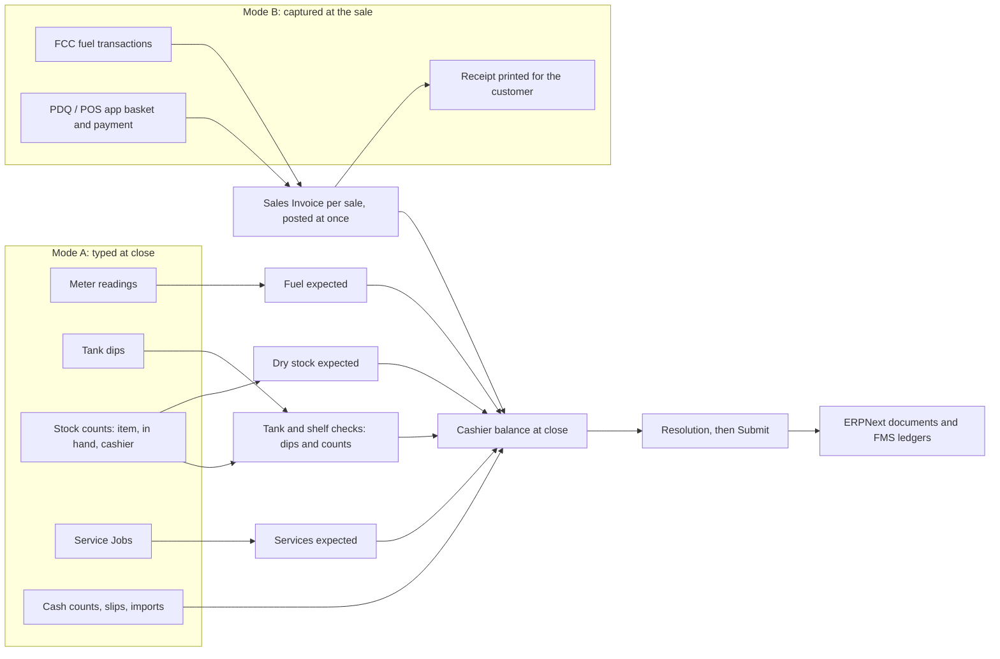
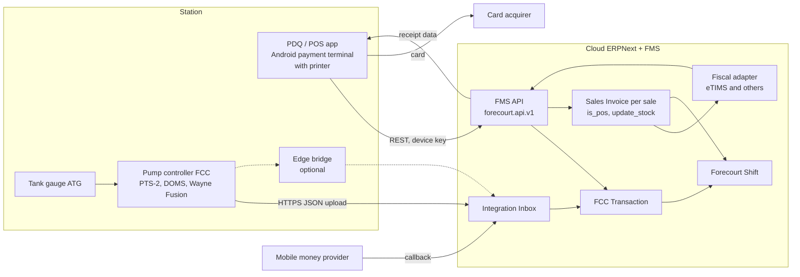
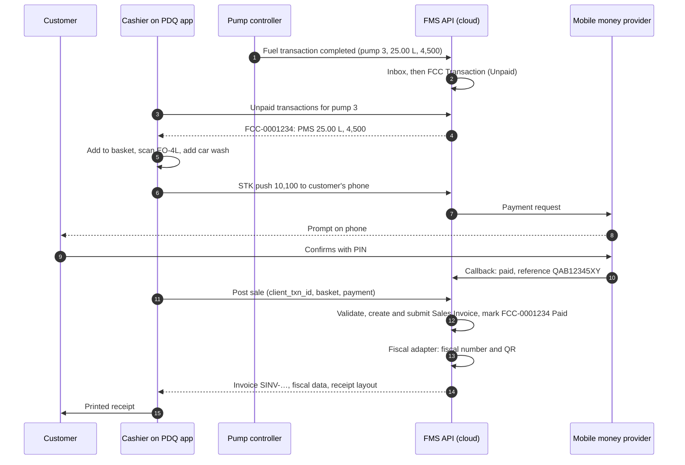

# FMS Non-Fuel Sales and Stock: Deep-Dive Design Guide

**Version:** 0.2 (draft for review)
**Date:** 2026-11-06
**Extends:** [fms.md](fms.md) v1.3 (design guide) and [catalogue.md](catalogue.md) v1.1 (DocTypes and fields, authoritative for names)
**Platform:** Frappe Framework v16, ERPNext v16 (HRMS v16 optional)
**Audience:** owner, developers, implementers, accountants
**Status:** proposal for review. Nothing here is built. Decisions D37 to D62 in section 22 are **Proposed**, in the same way as D16 to D36 of fms.md.

**Changes in 0.2**

| Change | Where |
|---|---|
| **Two operating modes.** Mode A (count-based, manual forecourt: the design of 0.1) and a new **Mode B** (transaction-based: pump controller plus a PDQ or POS app that posts each sale to the cloud ERPNext and FMS through the API and prints the customer's receipt at once) | Sections 4 and 11 |
| **Dry stock counting is dipping the shelf.** The count is now explained through the tank dip, which it closely mirrors, including where the two differ | Section 5 |
| Mode B additions to services, the cashier balance, controls, data model, error codes, roles, phasing, review list and decisions | Sections 8, 11, 14 to 22 |
| Task prefix changed from FMS-K to **FMS-Q**: FMS-K is already used in TASKS.md (Quality, scenarios and UAT) | Section 20 |
| New review items R25 to R33 | Section 21 |
| Sections renumbered. Every cross-reference inside this guide is updated. References to fms.md sections are unchanged. | Throughout |

This guide covers everything the forecourt sells that is not fuel: lubricants, LPG, spare parts, shop merchandise, and services such as car wash and tyre alignment and balancing. fms.md describes these in one line ("normal ERPNext Items and services", section 1.4). This guide gives them a full design that plugs into the existing shift, cashier and posting model, today with manual operations and later with automated forecourt equipment.

**Reading rule.** Where this guide adds to fms.md, it says so. Where it would change fms.md wording or leave a gap in it, the point is marked **⚠ Review** and collected in [section 21](#21-compatibility-review-with-fmsmd). Nothing here overrides fms.md until the owner confirms the review items.

---

## Table of contents

1. [Summary: the idea in one page](#1-summary-the-idea-in-one-page)
2. [Where fms.md stands today](#2-where-fmsmd-stands-today)
3. [Design principles for non-fuel](#3-design-principles-for-non-fuel)
4. [Two operating modes](#4-two-operating-modes)
5. [Counting dry stock is dipping the shelf](#5-counting-dry-stock-is-dipping-the-shelf)
6. [The sales streams](#6-the-sales-streams)
7. [Mode A: the stock count model](#7-mode-a-the-stock-count-model)
8. [Services: the Forecourt Services module](#8-services-the-forecourt-services-module)
9. [Mode A: the cashier balance with three streams](#9-mode-a-the-cashier-balance-with-three-streams)
10. [Mode A: posting under the hood](#10-mode-a-posting-under-the-hood)
11. [Mode B: transaction-based design](#11-mode-b-transaction-based-design)
12. [LPG](#12-lpg)
13. [Category guide: lubricants, spare parts, merchandise, car wash, tyres](#13-category-guide)
14. [Data model additions](#14-data-model-additions)
15. [Gates and error codes](#15-gates-and-error-codes)
16. [Fraud and controls for non-fuel](#16-fraud-and-controls-for-non-fuel)
17. [Corrections after close](#17-corrections-after-close)
18. [Reports, number cards and workspaces](#18-reports-number-cards-and-workspaces)
19. [Roles and permissions](#19-roles-and-permissions)
20. [Phasing and build tasks](#20-phasing-and-build-tasks)
21. [Compatibility review with fms.md](#21-compatibility-review-with-fmsmd)
22. [Open decisions](#22-open-decisions)
23. [Glossary](#23-glossary)

---

## 1. Summary: the idea in one page

Fuel is controlled by meters: the meter says what was sold, so the cashier cannot "forget" a sale. Non-fuel has no meter. The old approach (typing item sales line by line) trusts the cashier to type every sale. This design removes that trust in two ways, depending on how the station operates.

**Mode A: count-based (manual forecourt, today).** The shelf is the meter.

1. The system knows the book balance of every counted item (ERPNext stock ledger).
2. At shift close, the cashier or attendant declares what is physically **in hand**. The manager types item, in-hand quantity, and (optionally) the cashier.
3. The shift takes the book balance, adds receipts in the window, and subtracts the declared count. **The difference is what the person sold**, and its value at the station price is added to that person's expected money, next to fuel.
4. The cashier is therefore accountable for every unit that left their shelf. Understating the count only increases what they owe. Nothing needs to be typed per sale.

**Mode B: transaction-based (automated forecourt, later).** The sale is the record.

1. A **pump controller** (FCC, for example PTS-2, DOMS or Wayne Fusion) reports every fuel transaction to the cloud.
2. The cashier uses a **PDQ or POS app** on an Android payment terminal. For each customer it builds one basket: the fuel transaction from the controller, shop items by barcode, and services. It takes cash, mobile money, card or credit.
3. The app calls the **FMS API**. The cloud ERPNext posts the sale at once (invoice, stock, payments, fiscal receipt) and the app **prints the receipt for the customer**.
4. At shift close, the cashier counts cash and declares the dry stock in hand. The count is no longer the sale. It is a **check**, like a tank dip: anything missing that no sale explains is an unreceipted sale or a loss.

**Counting is dipping.** In both modes the dry stock count follows the tank dip: book balance plus receipts less recorded outflows gives an expected closing, and the physical figure is compared with it. Section 5 explains the parallel and the one place it differs.

**Who is accountable.** In Mode A the cashier on each count line comes from the **shift assignment** (roster) by default, and can be overridden on the line. In Mode B every sale carries the cashier who made it, and the count line keeps the Mode A assignment for anything the sales do not explain.

**Services** (car wash, tyre alignment and balancing, tyre fitting, puncture repair) have no stock to count. They are recorded as **Service Jobs** in a separate **Forecourt Services** module. In Mode A the shift pulls the jobs in its time window. In Mode B the job is paid on the app like any other sale.

**Posting.** In Mode A, the system turns fuel, dry stock and services into ordinary ERPNext Sales Invoices, Stock Entries and Payment Entries at shift close. In Mode B, the same documents are posted one sale at a time, as the sale happens, and the close posts only what no sale explains. In both modes the manager never builds these documents by hand.



---

## 2. Where fms.md stands today

This section is the assessment this guide is built on. It records what fms.md already handles and what it leaves open.

### 2.1 What works

- **Payments are never split by product (P2).** One mobile money payment for diesel, a car wash and an oil bottle causes no allocation problem.
- **Non-fuel items are real ERPNext Items** in a shop warehouse, so stock, valuation, COGS and purchasing work natively.
- **Reporting dimensions exist.** The Sales Ledger carries `item`, `item_group` and `is_fuel`. Cost Centers give business-line P&L (sections 4.4 and 8.8).
- **Two entry routes.** Shop sales come from POS Invoices pulled by cashier and time window, or from manually typed *Shift Item Sale* rows. Both feed the cashier's expected amount.
- **The automation path is already laid out.** Section 12 of fms.md has the Integration Inbox, Payment Feed Entries, the fiscal adapter, the handheld POS (12.4), the edge bridge and FCC (12.5), and two sales posting modes (*Shift summary* and *Per transaction*, 12.3). Mode B of this guide builds on these and invents no new integration pattern.

### 2.2 Gaps this guide closes

| # | Gap in fms.md | Consequence | Where addressed |
|---|---|---|---|
| G1 | No independent control on non-fuel sales. Typed quantities become the expected amount. | A cashier can omit a sale and keep the cash, and the shift still balances. | Sections 5, 7, 16 |
| G2 | Section 9 (fraud) is entirely about fuel. No shrinkage tolerance, no dry stock variance account. | Losses in the shop are invisible. | Sections 7, 16 |
| G3 | POS and shift interaction is under-specified. Expected excludes POS-paid items (7.2), but the cash count physically includes POS cash. | Cashier shows a false excess. | Section 7.9 |
| G4 | Negative stock blocks the close (FMS-P302), and only tank GRNs are discussed. | Late shop purchases block the shift. | Section 7.8 |
| G5 | No batch, serial or expiry support on *Shift Item Sale*. | Lubricants and spare parts cannot update stock correctly. | Section 7.13 |
| G6 | One `shop_warehouse` per station. | No separate lube bay, LPG cage or workshop store. | Section 14.4 |
| G7 | LPG is named (1.1) but never designed. | Cylinder exchange, empties and deposits are unhandled. | Section 12 |
| G8 | Car wash and tyre work are "service items" only. | No consumables, ticket control, rate control or vehicle record. | Section 8 |
| G9 | Credit gate FMS-S108 compares credit quantities with metered litres, which non-fuel does not have. | Non-fuel credit has no quantity check. | Section 7.10 |
| G10 | Fiscal: the shift-summary walk-in invoice cannot issue per-sale receipts for typed item sales. | Unfiscalised sales in e-receipt countries. | Sections 10.6, 11.7 |
| G11 | Cost Center for each invoice line is not specified. | Fuel, shop and car wash blend in one P&L line. | Section 10.5 |
| G12 | Margin reporting is per litre only. No shop stock position, no slow-mover report. | Shop profitability cannot be read. | Section 18 |
| G13 | *Per transaction* mode (12.3) and the handheld (12.4) are described for fuel only. How a mixed basket is posted, how a controller transaction is paid exactly once, how offline sales and receipts behave, and what the shift close does when sales are already posted, are not designed. | The automated forecourt cannot be built from fms.md alone. | Section 11 |
| G14 | `sales_posting_mode` is a company setting (catalogue 4.2), while fms.md 12.3 describes the mode per station. | A company cannot automate one station at a time. | Section 11.16, R25 |

---

## 3. Design principles for non-fuel

These extend P1 to P9 of fms.md. They do not replace them.

| # | Principle | Meaning |
|---|---|---|
| N1 | **The shelf is the meter (Mode A)** | Where no sale is captured, the independent figure is the physical count against the book balance. Typed sales are the exception. |
| N2 | **One accountable person per item** | Every counted item has a cashier for the shift, from the roster, with a line override. The system never guesses. |
| N3 | **Unexplained differences are sales** | For a counted item, any unit missing from the shelf (after recorded outflows and recorded sales) is treated as sold by the accountable person. Losses are settled in the cashier's money balance, not hidden in a stock variance. |
| N4 | **Recorded outflows are never charged as sales** | Damage, own use, returns, transfers and service consumption are posted as their own documents and are removed from the formula. |
| N5 | **Services are jobs, not typed item lines** | A Service Job carries a ticket number, vehicle, rate and consumables. |
| N6 | **Payments stay per cashier** | P2 is unchanged. In Mode A, dry stock and service sales add to the cashier's expected money and are not matched to individual payments. In Mode B, payments are recorded per sale, but still never split by product within a sale. |
| N7 | **Posting is invisible** | The manager types counts, jobs and money. Invoices, stock issues and ledgers are generated and verified by the system (sections 10 and 11). |
| N8 | **Nothing is cleared silently** | A suspicious count (higher than book, or an unusual jump) needs a reason or a GRN before close. This is P6 applied to dry stock. |
| N9 | **The sale is the record (Mode B)** | Where a sale is captured at the moment it happens, the posted sale is the source of truth. The shift close does not re-derive it. It only explains what the sales do not. |
| N10 | **The count is the dip** | In both modes the count is taken and treated like a tank dip (section 5). The formula is the same. Only what fills the "sales" term changes. |

---

## 4. Two operating modes

### 4.1 The two designs side by side

| Aspect | **Mode A: count-based** (manual forecourt) | **Mode B: transaction-based** (automated forecourt) |
|---|---|---|
| When a sale is recorded | At shift close, derived from meters and counts | At the moment of sale, on the PDQ or POS app |
| Documents per sale | None. One shift summary invoice per shift | One Sales Invoice (`is_pos`) per customer basket, posted at once |
| Receipt to the customer | From a separate fiscal device, or none (fms.md 12.3, *Shift summary*) | Printed by the app from the posted invoice, with the fiscal number and QR code where required |
| What proves a fuel sale | Meter readings × price | The controller's transaction (nozzle, litres, amount), paid on the app |
| What proves a dry stock sale | Book minus declared count (section 7) | The scanned line on the sale. The count is a check. |
| What proves a service sale | Service Job pulled at close | Service Job paid on the app |
| Payments | Per cashier totals, imported or typed at close | Per sale: cash tendered, mobile money confirmed by the provider, card approved by the PDQ |
| Role of the dry stock count | **The sale** (difference = sold) | **The dip** (difference = unreceipted sale or loss, should be near zero) |
| Role of the tank dip | Tank variance (unchanged) | Tank variance (unchanged), from the ATG where fitted |
| What the manager types at close | Meters, dips, counts, credit slips, cash, imports | Cash counts and dry stock counts. Meters, dips and payments come from devices. |
| Internet | Needed only for the desk | Needed at the station for each sale, with an offline queue (11.8) |
| Hardware | None beyond a PC or tablet | Pump controller (and ATG), Android payment terminals with printers, router |
| fms.md setting | `sales_posting_mode` = *Shift summary* | `sales_posting_mode` = *Per transaction* |
| Phase | 1 to 3 | 4 (app and API) and 5 (controller) |

The modes are not two products. They share every master, the shift, the cashier balance, the ledgers, the gates and the reports. Mode B changes **who fills in the fields and when**, which is the rule of fms.md 1.5: *adding a tank gauge or a pump controller later changes who fills in the fields, not the data model.*

### 4.2 Capture mode per stream

A station rarely automates everything at once. The capture mode is therefore set **per station and per stream** (D53):

| Station field | Options | Meaning |
|---|---|---|
| `fms_fuel_capture` | **Meter** (Mode A) / **Transaction** (Mode B) | Transaction: fuel is sold on the app. With a controller, each line is an FCC transaction. Without one, the attendant enters litres or amount on the app and the meters at close remain the control. |
| `fms_dry_stock_capture` | **Count** (Mode A) / **Transaction** (Mode B) | Transaction: shop items are sold on the app by barcode. The count becomes the check (section 11.9). |
| `fms_service_capture` | **Job at close** (Mode A) / **Paid at sale** (Mode B) | Paid at sale: a Service Job is paid on the app like any sale (section 11.10). |

The company's `sales_posting_mode` stays the default. The station fields override it, stream by stream (review item R25).

**Typical paths:**

| Step | Fuel | Dry stock | Services | Comment |
|---|---|---|---|---|
| Today | Meter | Count | Job at close | Mode A everywhere |
| App first | Transaction (typed on the app) | Transaction | Paid at sale | Receipts per sale. Meters still close the fuel loop. |
| Controller added | Transaction (FCC) | Transaction | Paid at sale | Full Mode B |
| Controller only | Transaction (FCC) | Count | Job at close | Fuel automated, shop still manual: a valid mix |

### 4.3 Which mode to choose

| Condition | Mode A | Mode B |
|---|---|---|
| Law requires a receipt per sale (for example Kenya eTIMS) | Only with a separate fiscal device per till | **Natural fit** |
| Station has reliable internet (fibre or 4G with fallback) | Not required | Required, with the offline queue as cover |
| Station has a pump controller | Optional | Strongly recommended for fuel |
| Many customers pay by mobile money or card | Works with imports | Better: each payment is confirmed against its sale |
| Small station, low volume, few staff | **Simplest** | Possible, but the hardware cost may not pay back |
| Owner wants live sales in the cloud | Only after each close | **Live** |

---

## 5. Counting dry stock is dipping the shelf

### 5.1 The same idea

A tank dip and a dry stock count do the same job: **they measure what is physically there and compare it with what the books say should be there.** fms.md section 5.5 reconciles a tank like this:

```
Opening + Receipts − Sales − Own use ± Transfers = Expected closing
Closing dip − Expected closing = Variance
```

The dry stock count of this guide uses the same structure. The tank becomes a shelf (a warehouse), the dip becomes the in-hand count, and own use becomes the recorded outflows.

| Tank (fms.md section 5) | Shelf (this guide) |
|---|---|
| Fuel Tank = one Warehouse | Shop, lube bay, LPG cage = one Warehouse each (*Station Stock Location*, 14.4) |
| Calibration chart turns millimetres into litres | Unit of measure and pack conversion turn cartons and drums into units and litres |
| Dip (product and water) | In-hand count (by batch or serial where tracked) |
| Fuel GRN with delivery dips, pulled into *Receipts* | Purchase Receipt for shop items, pulled into *Receipts* (B) |
| Fuel Own Use Stock Entry | *Dry Stock Adjustment* Stock Entry (damage, own use, promotion) |
| Pump test (`test_volume`) | Sample, promotion, display unit |
| Handover dip at a mid-shift event | Handover count (7.11) |
| Spot dip | Spot audit (7.16) |
| Tank Dip DocType (standalone, submittable) | Dry Stock Count DocType (standalone, submittable) |
| Wetstock Ledger Entry | Dry Stock Ledger Entry |
| Rise with no GRN blocks the close (FMS-T203) | Count above book blocks the close (FMS-D705) |
| Variance reasons (dip error, theft, leak) | Count reasons (miscount, damage not posted, theft) |

The user interface follows the same rule: the counting grid works like the dip and meter grid (*Enter* moves down one row), and the figure being measured is never pre-filled.

### 5.2 Where they differ: what fills the "sales" term

The two calculations differ in one place only: **where the sales figure comes from.**

| | Sales term | So the difference is | Posted as |
|---|---|---|---|
| **Tank** (both modes) | Independent: the **meters** (or the FCC) | A **variance**: loss or gain against an independent sales figure | Stock Reconciliation to *Fuel Stock Variance* (fms.md 5.7) |
| **Shelf, Mode A** | **None.** Nothing independent records the sale. | **The sale itself** (X in section 7.2) | Sales Invoice line, added to the cashier's expected money |
| **Shelf, Mode B** | Independent: the **sales posted by the app** | A **variance**: an unreceipted sale or a loss | Charged to the cashier as an unreceipted sale (11.9), or to *Shop Stock Variance* for store-level counts |

Mode A cannot treat the shelf difference as a variance. With no meter, a missing unit is most often a sale whose money is in the drawer. Posting it to an expense account would hide sales and leave the cash unexplained, which is gap G2. That is why principle N3 says unexplained differences are sales.

Mode B turns the shelf into a true tank. The app's sales play the role of the meters, so the count becomes a dip in the full sense: a check on a sales figure that already exists, with a difference that should be near zero.

### 5.3 Other practical differences

| | Tank dip | Dry stock count |
|---|---|---|
| Precision | A measurement: a few millimetres of error, temperature and water effects. Tolerances apply (fms.md 5.6). | Discrete and exact: an item is there or not. **No tolerance** by default (D41). |
| Who is accountable | The tank serves many nozzles and cashiers, so tank variance is not charged to one person by default. | A shelf is assigned to one cashier per segment (7.4), so the count is charged to that person. |
| Effort | One dip per tank | One figure per counted item: kept short by count policies and classes (7.12) |
| Conversion | Calibration chart, versioned | Unit of measure, not versioned |
| What a gain means | Often temperature or a dip error | A receipt not posted, or a miscount. Always blocked until explained. |
| Loose lubricant in a drum | | Measured like a small tank: a dip or measure in litres (13.2) |

### 5.4 What this means for the build

1. **One pattern, two uses.** Dry Stock Count copies the Tank Dip pattern (standalone, submittable, typed by count type). The Dry Stock Ledger copies the Wetstock Ledger. The calculation module `calc/dry_stock.py` mirrors the tank reconciliation in `calc/`.
2. **The same formula in both modes.** Section 7.2 holds in Mode B unchanged. In Mode B the app's sales are already in the stock ledger, so they fall into the *posted outflows* (C) automatically. What remains (M) is the unexplained part.
3. **Store-level counts behave like tank variance.** A full stock take, or a daily count in Mode B, is not tied to one cashier, so its difference posts as a Stock Reconciliation to *Shop Stock Variance*, exactly as a tank variance posts to *Fuel Stock Variance*.

---

## 6. The sales streams

After this guide, a cashier's expected money has three streams plus two "exact" channels. Mode B moves every stream to the exact channel.

| Stream | What proves the sale in Mode A | In Mode B | Entered by |
|---|---|---|---|
| **Fuel** | Meter readings × price (fms.md section 5.3) | FCC transaction paid on the app | A: manager types closing readings. B: controller and app. |
| **Dry stock** | Book balance minus declared in-hand count (section 7) | Scanned line on the app's sale | A: manager types in-hand per item. B: cashier scans; count still taken. |
| **Services** | Service Job with a ticket number (section 8) | Service Job paid on the app | Crew or cashier |
| **POS sales (exact)** | POS Invoice with its own payments | Every sale is in this channel | Cashier at the POS or app |
| **Credit slips (exact)** | Shift Credit Sale with slip number | Credit sale on the app: Sales Invoice to the customer at once | A: manager from the slip. B: app. |

In Mode A, **POS-paid sales are excluded from both expected and accounted** (section 7.9). **Credit slips stay inside expected**, as they do for fuel: the metered or counted quantity includes them, and the slip value appears on the accounted side. Mode B uses its own balance (section 11.11).

### 6.1 Which route for which item

Each item has a **count policy** (section 14.2). Station size and category decide the setting:

| Count policy | Item behaviour | Typical items |
|---|---|---|
| **Every Shift** | Listed in the shift's Dry Stock tab with opening filled in. Declared count required. | Lubricants, LPG cylinders, spare parts, tyres, high-value merchandise |
| **Daily** (Mode B only) | Counted on the last shift of the day. The difference is a store-level variance (11.9). | Other counted dry stock at a Mode B station |
| **POS Only** | Sold only through POS or the app. Not counted per shift. Stock handled by ERPNext as usual. | Groceries, drinks, snacks, where POS and per-sale receipts exist |
| **Not Counted** (default) | Not in the shift's count. Sold through POS, the app, a Service Job part line, or (as a fallback) *Shift Item Sale*. | Low-value items, consumables, items with no stock |

In Mode A, periodic counts (daily or weekly for slow items) are deferred (section 7.12). Mode B allows *Daily*, because the sales are already recorded and the count only measures leakage.

---

## 7. Mode A: the stock count model

This section is the default for every station until it switches dry stock to *Transaction* capture. Mode B reuses the formula, the tab and the gates of this section (section 11.9).

### 7.1 The model in plain words

For each counted item and cashier, the shift answers: *how many units left this person's shelf without any document explaining it?* Those units are sold. Their value is added to the cashier's expected money. This is a tank dip with no meter (section 5.2).

### 7.2 The formula

The owner's wording: *the shift fetches the item balance, subtracts the actual declared by the attendant, plus item receipts; the difference is the sales expected from the person.* Here it is as one calculation, with every component visible on the form.

```
A  Book balance at shift start         (ERPNext stock ledger as of shift_start)        ~ tank opening
B  + Receipts in the window            (Purchase Receipts, transfers in)                ~ fuel GRNs
C  − Outflows already posted           (POS and app sales, write-offs, own use,         ~ own use, transfers
                                        returns, transfers out)
D  = Book balance now                  (as of shift_end, before the shift posts)        ~ expected closing
                                        D = A + B − C
E  − In hand (declared by the cashier)                                                  ~ closing dip
M  = Unposted movement                 M = D − E                                        ~ variance (sign reversed)
J  − Service-job part lines            (parts sold on Service Jobs, pulled by window)
K  − Service consumption               (consumables used by Service Jobs, from standards)
X  = Counted sales quantity            X = M − J − K          <- the cashier is accountable for X
Cq   of which credit slips (qty)       (a subset of X; invoiced to the credit customer)
W  = Walk-in quantity                  W = X − Cq
Expected amount = X × price            (station price list, locked at shift start)
```

**Why the system computes D from the stock ledger instead of A + B − C by hand.** The two forms are algebraically identical. The system reads D (balance as of `shift_end`, from the stock ledger) because it is robust: everything already posted (POS, write-offs, own use, returns) is in D automatically, and only the movement with no document (M) is left. The form still shows A, B, C, D and E as separate columns, so the manager and the area manager can see how the number was reached (principle P8 and section 15.1 of fms.md).

**Credit slips and Service Jobs are not yet in the stock ledger at close**, because they are posted by the shift. That is why J, K and Cq are subtracted from M, not from the book.

**Sign convention against the tank.** Tank variance is *dip − expected*, so a loss is negative. Here M is *book − in hand*, so a missing unit is positive. The shelf uses the sales sign because, in Mode A, a missing unit is a sale. Reports that put tanks and shelves side by side show both as *variance = physical − book*.

### 7.3 Sign rules

| Result | Meaning | Handling |
|---|---|---|
| X > 0 | Units left the shelf with no document | Sold by the cashier. Value added to expected. |
| X = 0 | Everything accounted for | Nothing to post. |
| X < 0 | Count is above what the book allows | **Blocked** until a GRN is posted, or a count gain is recorded with a reason (section 7.8). Same rule as a tank rise with no GRN (FMS-T203). |
| D < 0 | Book balance negative at shift end | **Blocked** with FMS-D708: post the missing receipt first. |

### 7.4 Cashier assignment

The accountable person for each count line is found in this order. The first match wins.

| Priority | Source | Set where |
|---|---|---|
| 1 | **Line override**: cashier typed on the count line | The line (marked *Line override*) |
| 2 | Shift assignment for the **item** | Shift Template, Item Assignment table |
| 3 | Shift assignment for the **item group** | Same table |
| 4 | Shift assignment for the **warehouse** (shelf, lube bay, LPG cage) | Same table |
| 5 | The roster's **default shop cashier** | Shift Template |
| 6 | None: the line cannot be saved for submit | FMS-D703 |

The assignment table is on the **Forecourt Shift Template**, so it is copied into every new shift (fms.md section 6.3, step 2). The manager can change it on the shift. A cashier assigned to a shelf is accountable for everything on it.

**One cashier per item per segment.** If two cashiers share a shelf at the same time, split the shelf into two warehouses or two item groups, or use a handover count (section 7.11).

### 7.5 The Dry Stock tab

The shift gets a **Dry Stock** tab between Tanks and Credit. The rows are created when the shift is created (fms.md 6.3). Only items with stock, receipts or movement are listed, so the grid stays short.

| Column | Filled by | Notes |
|---|---|---|
| Item (code, name) | System | From the item and group scope of the cashiers on duty. "Add item" for unlisted items. |
| Warehouse | System | The item's location at the station |
| Cashier | System, editable | From assignment; changing it marks *Line override* |
| Opening (A) | System | Locked |
| Receipts (B) | System | Pulled by time window |
| Posted outflows (C) | System | POS and app sales, write-offs, own use, returns, transfers |
| Book now (D) | System | Can be hidden in **blind count** mode (7.15) |
| **In hand** | **Manager types** (or the cashier declares on the app, Mode B) | The only mandatory typed column. Never pre-filled, so nobody confirms a number they did not look at. |
| Counted at | System | Time of entry |
| Credit qty (Cq) | System | From credit slips on the shift |
| Service parts (J), consumption (K) | System | From pulled Service Jobs |
| Sold qty (X) | System | Shown with its formula tooltip. Labelled *Unreceipted qty* in Mode B. |
| Price | System | Locked at shift start |
| Expected amount | System | X × price |
| Flags | System | Unusual jump, count above book, serial or batch missing |

**What the manager types:** item (if adding), in-hand quantity, and optionally the cashier. Everything else is read-only. This is the owner's requirement.

**Entry speed.** The grid works like the meter and dip grids: *Enter* moves down one row. A **Confirm as book** button (optional, setting `allow_confirm_as_book`, default off) sets in-hand equal to book for low-risk items, flags the line and records the user. It is never available for items in count class A (7.12).

### 7.6 Worked example

Station Westlands, *Day* shift, cashier **Amina**. Counted items on her shelf, prices from the station price list.

| Item | A open | B receipts | C posted out | D book now | E in hand | M | J parts | K consumption | **X sold** | Cq credit | W walk-in | Price | Expected |
|---|---|---|---|---|---|---|---|---|---|---|---|---|---|
| Engine oil 4 L (EO-4L) | 24 | 12 | 1 (damaged, written off earlier) | 35 | 30 | 5 | 0 | 0 | **5** | 2 | 3 | 2,800 | 14,000 |
| Brake fluid 500 ml (BF-500) | 40 | 0 | 0 | 40 | 37 | 3 | 0 | 0 | **3** | 0 | 3 | 650 | 1,950 |
| Car wash shampoo, litres (SHAMP) | 20 | 0 | 0 | 20 | 17 | 3 | 0 | 3 | **0** | 0 | 0 | n/a | 0 |

- **EO-4L:** book now is 24 + 12 − 1 = 35. In hand is 30, so 5 units left the shelf. Two were on a credit slip (Coast Haulage). Amina is accountable for the value of all 5 (14,000). The credit slip value (5,600) appears on her accounted side. The remaining 3 units (8,400) go on the walk-in invoice.
- **BF-500:** 3 units are missing, with no document. Sold, 1,950.
- **SHAMP:** 3 litres left the shelf. Six car washes were posted during the day, and the service type's standard is 0.5 L each, so K = 3. X = 0: nothing is charged as sales.

After posting, the stock ledger shows EO-4L at 30, BF-500 at 37 and SHAMP at 17. Book equals what was counted (section 10.7 checks this), just as a tank's book equals its dip after the Stock Reconciliation.

### 7.7 Outflows that are not sales (C, J, K)

Anything that removes stock for a reason other than a sale must be a document, so it is subtracted before the count. Otherwise the cashier is charged for it.

| Reason | Document | Posted by | When it posts |
|---|---|---|---|
| Damage, expiry, spillage, breakage | Stock Entry (Material Issue), type **Dry Stock Adjustment** | Manager, with reason | When submitted |
| Own use of shop items (cleaning stock, station vehicle oil) | Same Stock Entry type, reason *Own use* | Manager | When submitted |
| Samples, promotions | Same, reason *Promotion* | Manager (limit applies) | When submitted |
| Return to supplier | Purchase Return (native) | Manager or accountant | When submitted |
| Transfer to another warehouse or station | Stock Entry (Material Transfer) | Manager | When submitted |
| Used up by a service | Service Type standard (section 8.5) | System, at close | Shift close |
| Sold on a Service Job as a part | Service Job part line (section 8.6) | Service Job, at close (Mode A) or at payment (Mode B) | Shift close or sale |
| Sold on credit | Shift Credit Sale (section 7.10) | Manager, at close | Shift close |

The first four follow the *Fuel Own Use* pattern of fms.md section 5.10: posted manually, linked to the shift and cashier, with a mandatory narration. A **draft** of any of them inside the window blocks the close (FMS-D704), like FMS-S113 does for fuel own use. The reasons come from a new master, **Stock Adjustment Reason**, which maps each reason to an expense account per company. Reasons above a value limit need area manager approval.

### 7.8 Count above book, negative book, and late receipts

| Situation | Cause | Handling |
|---|---|---|
| **X < 0** (more in hand than the book allows) | A delivery was not posted, the count is wrong, or stock was received off the books | The shift is blocked with FMS-D705 until one of: the GRN is posted (it is then pulled into B); the count is corrected; or a **count gain** resolution is recorded with a reason (it posts a Material Receipt to the dry stock variance account, needs approval above the limit). |
| **D < 0** (negative book) | A purchase was not entered, or stock moved without a document | Blocked with FMS-D708: *Post the receipt first*. Fixes the negative-stock problem of FMS-P302 for the shop. |
| **Draft GRN for non-fuel items in the window** | Receipt started, not submitted | Blocked with FMS-D704. |
| **GRN posted late** (after the shift closed) | Delivery recorded the next day | Blocked by the back-dating rule (section 10.8). The GRN must be dated at its real time or go through a Shift Correction. |

### 7.9 POS interaction (closes gap G3)

Many stations sell shop items through POS. The rule is simple: **POS-paid sales belong to the POS, not to the shift's expected and accounted.**

1. POS Invoices reduce stock when they are submitted, so they are already in C and D. The count formula never charges them as sales.
2. POS-paid sales are **excluded from expected** (this is what section 7.2 of fms.md already says) and **excluded from accounted**: whatever the customer paid through the POS (cash, mobile money, card) is already recorded on the POS Invoice and its payments.
3. The cashier's **cash count includes the POS cash**, because it is in the drawer. The shift therefore deducts the cash collected on that cashier's POS Invoices from the counted cash before computing accounted:

```
Cash for the shift = cash counted − float − cash received on POS Invoices in the window
```

   Without this line the cashier would show a false excess equal to the POS cash (this is gap G3). Section 9 uses this formula.
4. The **cash Payment Entry** the shift posts against the walk-in invoice (fms.md 6.7, item 4) uses the same net figure. POS cash is never posted a second time into the till account.
5. If a station requires **per-transaction receipts** (fms.md 12.3), counted items must be marked *POS Only*, or the station moves dry stock to Mode B. Any count movement on a *POS Only* item is a sale that bypassed POS, and it is reported as an exception (section 10.6).
6. POS Invoices and Sales Invoices created by POS (`is_pos`) are both read (fms.md D25). The POS Closing Entry is the accountant's job and is not part of the shift close.

> **To verify in the build task:** how ERPNext v16 deducts stock for POS Invoices (at submit or at consolidation). If stock moves only at consolidation, the posted outflows (C) must add the quantities of submitted, unconsolidated POS Invoices in the window. The test must cover both cases.

A station whose shop POS is in effect a separate Mode B (receipt per sale, cloud-posted) is already halfway to section 11.

### 7.10 Credit sales of non-fuel items

Credit slips for items use the existing *Shift Credit Sale* (fms.md 10.2). Two changes:

- Gate **FMS-S108** (credit litres must not exceed metered litres) is stated for **fuel**. Its non-fuel twin is **FMS-D706**: credit quantity of an item must not exceed X. A credit slip for units that the count does not show missing is a sign of a fake slip or a wrong item.
- `allowed_items` and the monthly litre limit on *Customer Vehicle* apply to fuel only. For items, the credit limit of the customer (FMS-S107) is the control.

### 7.11 Handover and mid-shift counts

Cashiers change over, or a shelf passes from one person to another. Like a meter handover (fms.md 6.5) or a handover dip, this creates a **segment**:

- A **Dry Stock Count** document of type *Handover* records the declared count at the handover time, signed by both people (witness field).
- The shift splits the item's calculation in two: opening to handover for the outgoing cashier, handover to closing for the incoming one.
- Receipts, posted outflows and Service Jobs are assigned to a segment by their time.
- The segments add up exactly to the single-segment formula, so the final book still equals the final count.

### 7.12 Count classes and periodic counts

| Class | Counted | Items | Notes |
|---|---|---|---|
| **A** | Every shift, always, with no "confirm as book" | Lubricants, LPG cylinders, spare parts, tyres | High value or high risk. Serial and batch tracked where required. |
| **B** | Every shift (Mode A). Every shift or Daily (Mode B). | Other counted dry stock | "Confirm as book" allowed if the setting is on |
| **C** | Not counted per shift | Low-value goods, groceries | *POS Only* or *Not Counted* |

In Mode A, `Every Shift` is the only counting frequency in Phases 0 to 3. **Daily and weekly cycle counts are deferred** (backlog): when an item is counted only every few days, the implied sales cover several shifts and cannot be fairly attributed to one cashier. That is why per-shift counting is the default for accountable stock. Mode B removes the objection for class B, because the sales are already recorded (section 11.9).

### 7.13 Batch, serial and expiry (closes gap G5)

| Tracking | Count entry | Under the hood |
|---|---|---|
| **Batch** (lubricants, expiry goods) | One row per batch in a sibling table, *Shift Stock Count Detail* (Frappe child tables cannot nest, same pattern as *Shift Cash Count*). Opening per batch is fetched. | The generated invoice lines carry the batch bundle matching the batches that dropped. Reports show batches expiring within N days. |
| **Serial** (spare parts with warranty, tyres) | The manager selects or scans the serial numbers in hand. | Serials on the book but not in hand are the ones sold. A serial in hand that is not on the book raises FMS-D705. |
| **None** | A single quantity | Simple |

> **To verify in the build task:** creation of ERPNext v16 Serial and Batch Bundles by the posting layer.

### 7.14 Prices of counted items

- Non-fuel prices come from the station's **price list** (Item Price) as usual. They are locked on each count line when the shift is created.
- ERPNext Item Price is valid from a *date*, not a time. A price change takes effect **from the next shift** (D45). The mid-shift price segments of fms.md 6.5a apply to fuel only.
- A discount or price override on a counted item is not available inside the shift. A price below list needs POS, the app, a Service Job line with a reason, or a correction.

### 7.15 Blind count (optional control)

A setting, `blind_count` (default off), hides **Opening, Receipts, Posted outflows and Book now** on the Dry Stock tab until the in-hand figure has been typed for that row. This stops a manager from adjusting the declared count to match the book. The values appear after entry so the manager can still review. A dip has the same property naturally: the dipstick does not know the book.

### 7.16 Full stock takes and spot counts (store-level, not cashier-level)

The shift count makes the *cashier* accountable. A separate, periodic check protects against everything the shift cannot see.

| Count type | Who | Effect | Tank equivalent |
|---|---|---|---|
| **Handover** | Outgoing and incoming cashier | Creates segments (7.11) | Handover dip |
| **Spot Audit** | Area manager or accountant, unannounced | Records the difference to book. Posts nothing. Appears on the Exception Register. | Spot dip |
| **Full Stock Take** | Accountant, monthly or quarterly | The difference to book is posted as a **Stock Reconciliation** to the *Shop Stock Variance* account. A store-level loss, not charged to a cashier. Approval above the limit. | Tank variance posting |
| **Daily** (Mode B) | Last shift of the day | Store-level variance, posted like a Full Stock Take (11.9) | Daily dip (`post_tank_variance` = *Last shift of day*) |

All four are one DocType, **Dry Stock Count**, with a `count_type`. They follow the Tank Dip pattern of fms.md (a standalone, submittable record).

---

## 8. Services: the Forecourt Services module

### 8.1 Why a separate section

Services have no stock to count and no meter. Typing them as lines on the shift (the old *Shift Item Sale*) gives no control. A separate module gives each job a ticket, a vehicle, a rate check and its consumables, and keeps the shift screen short because the jobs are posted during the day, not at the close.

**New module:** *Forecourt Services* (`forecourt/forecourt_services/`), next to the five modules of catalogue 2.1. It has its own workspace (section 18).

### 8.2 Service Type (master)

One record per service the station sells. It links to a **non-stock ERPNext Item**, so invoicing, tax and income accounts work natively.

| Field | Type | Notes |
|---|---|---|
| service_type | Data, unique | Car wash (saloon), Car wash (SUV), Wheel balancing, Wheel alignment, Tyre fitting, Puncture repair |
| item | Link Item | Non-stock service item. Its Item Group sets the income account and cost center. |
| unit | Select | Per job / per wheel / per axle |
| min_rate, max_rate | Currency | Allowed range around the station price list rate. Outside it needs a reason (FMS-D712). |
| requires_vehicle | Check | Plate number mandatory |
| consumables | Table | Item, quantity per unit, warehouse. Used to consume stock under the hood (8.5). |
| commission_pct | Percent | Optional, for crew commission reports only. Posts nothing in Phases 0 to 3. |
| default_cashier | Link Employee | Optional crew default |
| disabled | Check | |

### 8.3 Service Job (transaction)

A **submittable** record posted when the job is done. Submitting records the job and **does not post accounting**. In Mode A, revenue, stock and payment are posted when the shift closes, like a credit slip. In Mode B, they are posted when the job is paid on the app (section 11.10). Cancelling is allowed until a closed shift or a paid sale has used it.

| Field | Type | Notes |
|---|---|---|
| naming | `SJ-{station}-{YYYY}-{#####}` | Station code in the name, as for all FMS documents |
| station, company | Link | |
| performed_at | Datetime | Decides which shift pulls it |
| cashier | Link Employee, R | The person accountable for the money. From the Service Type default or the roster. |
| ticket_no | Data, R | Job card number, unique per station. Pre-printed book in Mode A (8.8). Issued by the system and printed by the app in Mode B. |
| customer | Link Customer | Default is the station's walk-in customer |
| vehicle_plate | Data | Mandatory if the service type requires it. A *Customer Vehicle* link when the customer is a fleet. |
| payment_intent | Select | Pay now / On credit. On credit requires a customer other than walk-in. |
| lines | Table: Service Job Line | service_type, item (fetched), qty (washes, wheels), rate (default from the price list), amount, rate_override_reason |
| parts | Table: Service Job Part | stock item, qty, rate, warehouse, batch or serial: parts sold on this job (8.6) |
| total_amount | Currency, RO | Lines plus parts |
| forecourt_shift | Link, RO | Set when the shift pulls it |
| sales_invoice | Link, RO | Mode B: the sale that paid the job |
| status | Select, RO | Draft / Submitted / Paid (Mode B) / Used by shift |

### 8.4 How the shift pulls services (Mode A)

1. **At shift creation:** nothing is filled. Jobs are posted as work happens.
2. **During the shift:** the **Services** tab shows the submitted jobs in the window as a read-only table (*Shift Service*: job, cashier, amount, credit or not, status). The manager can open any job.
3. **At close:** every submitted Service Job whose `performed_at` is inside the window and whose cashier is on the shift is pulled. The amounts go to each cashier's **service amount** in expected (section 9). Credit jobs become lines on the customer's credit invoice.
4. **A draft Service Job in the window blocks the close** (FMS-D710), as a draft GRN or own-use entry does.

### 8.5 Consumables (stock used by services)

A car wash uses shampoo and wax. These are stock, but they do not have a customer. The Service Type lists the **standard quantity per unit**. At close (in both modes) the system:

1. Totals the consumables for all jobs in the window (for example 6 washes × 0.5 L = 3 L of shampoo).
2. Posts a Stock Entry (Material Issue), type **Service Consumption**, to an expense account on the service's cost center.
3. Subtracts the same quantities as **K** in the dry stock formula, so the cashier is not charged for consumables as if they were sales.

This is the link between services and the count: consumable items are counted dry stock, and the standards explain their movement.

### 8.6 Parts sold on a job

A tyre fitted, a valve, a filter or a wheel weight sold to the customer is a **part line** on the job. It is a stock item sold at a rate to the customer, so:

- Its quantity is **J** in the dry stock formula (subtracted from M, so it is not counted twice). In Mode B the part is on the paid sale, so it is already in C and J is zero.
- Its amount is part of the job total, and is added to the cashier's **service** expected (Mode A) or to the sale (Mode B).
- The invoice carries it as an item line with `update_stock`, so stock reduces and COGS posts.

Parts that are not billed (bundled in the price) are **consumables** on the Service Type, not part lines.

### 8.7 Credit and discounts

- **Credit service jobs** need a customer. They join that customer's credit invoice for the shift (or a Delivery Note in monthly mode, D26) and are subject to the credit limit (FMS-S107).
- **Rate overrides.** The rate defaults to the station price list. A rate outside the service type's min and max needs a reason (FMS-D712). The Exception Register lists them.
- **Discounts** for fleets belong in a customer-specific price, not in per-job overrides.

### 8.8 Controls on service jobs

Services depend on typed data, so the controls are around the typing.

| Control | How |
|---|---|
| **Numbered job cards** | Mode A: pre-printed books. `ticket_no` is mandatory and unique per station. The *Job Ticket Register* shows gaps. Mode B: the system issues the number and the app prints the card, so gaps cannot occur. |
| **Consumables yield** | Shampoo or wax used (from counts) against jobs posted (from standards). If counts show more consumption than jobs justify, jobs may be going unrecorded. Report: *Consumables Yield*. |
| **Rate bounds** | min and max per service type |
| **Plausibility** | Jobs per hour per crew against the station history, in the Exception Register |
| **At the bay** | Mode B: the job is opened on the app at the bay with a printed ticket, and paid on the app |

### 8.9 Service categories

| Service | Unit | Typical consumables | Parts |
|---|---|---|---|
| Car wash (by vehicle class) | per job | Shampoo, wax, water | None |
| Wheel balancing | per wheel | Wheel weights | None |
| Wheel alignment | per vehicle or axle | None | None |
| Tyre fitting | per wheel | Valve, lubricant | Tyre (serial tracked), if sold |
| Puncture repair | per job | Patches, glue | None |

Packages (for example *tyre plus fitting plus balancing*), technician time and a full workshop job card are out of scope for Phases 0 to 3 (backlog).

---

## 9. Mode A: the cashier balance with three streams

This amends section 7.2 of fms.md. The structure is the same: **expected** against **accounted**, and a **difference** to resolve. Mode B uses the same structure with exact streams (section 11.11).

```
EXPECTED (what the cashier must account for)
  Fuel:        Σ net sold litres on assigned nozzles × segment price
+ Dry stock:   Σ X × price over the cashier's counted items       (includes credit slip units)
+ Services:    Σ Service Job totals for the cashier                (includes credit jobs)
+ Debt receipts collected from credit customers
= Total to account for

ACCOUNTED (what the cashier shows)
  Cash counted − opening float − cash received on POS Invoices
+ Mobile money received
+ Card receipts
+ Credit slips and credit jobs (value)
+ Vouchers and coupons
+ Expenses paid out (with receipts)
+ Cash drops made during the shift
= Total accounted

DIFFERENCE = ACCOUNTED − EXPECTED     (< 0 shortage, > 0 excess)
```

Rules that did not change: a nonzero difference needs a resolution line before the shift can close (P6, FMS-S105). A counting error in the dry stock shows up as a money difference and is resolved like any other.

### 9.1 Worked example (extending fms.md section 8.2)

Amina, Westlands, *Day* shift. Fuel figures are the same as in fms.md 8.2.

| Line | Amount |
|---|---|
| Fuel: PMS 1,200 L × 180 = 216,000, AGO 900 L × 170 = 153,000 | 369,000 |
| Dry stock: EO-4L 5 × 2,800 = 14,000, BF-500 3 × 650 = 1,950 | 15,950 |
| Services: 6 car washes × 800 = 4,800, 4 wheels balanced × 300 = 1,200 | 6,000 |
| **Expected** | **390,950** |
| Credit slips: Coast Haulage AGO 200 L (34,000) + 2 × EO-4L (5,600) | 39,600 |
| Mobile money (64 transactions) | 190,000 |
| Card (12 transactions) | 40,000 |
| Expense: forecourt cleaning | 1,500 |
| Cash counted 124,500 − float 5,000 (no POS cash) | 119,500 |
| **Accounted** | **390,600** |
| **Difference** | **−350 (shortage)** |

### 9.2 What the shift posts for this example

1. **Sales Invoice, Coast Haulage:** AGO 200 L (34,000) + EO-4L × 2 (5,600) = 39,600, from the tank and the shop warehouse, `update_stock`.
2. **Shift sales invoice (walk-in):** PMS 1,200 L (216,000), AGO 700 L (119,000), EO-4L × 3 (8,400), BF-500 × 3 (1,950), car wash × 6 (4,800), wheel balancing × 4 (1,200) = **351,350**. Stock reduces for fuel and for the two oils.
3. **Payment Entries against the walk-in invoice:** 64 mobile money (190,000), 12 card (40,000), and cash **121,350** (the balancing amount).
4. **Journal Entry:** DR Cleaning expense 1,500, DR Staff Shortage Receivable (Amina) 350, CR Cash in Till 1,850.
5. **Stock Entry (Service Consumption):** shampoo 3 L, expense to Car Wash cost center.
6. **Ledgers:** Nozzle, Sales, Cashier, Wetstock, and the new Dry Stock Ledger (section 14.5).

Check: invoices 351,350 + 39,600 = 390,950 = expected. Till: 121,350 − 1,850 = 119,500 = counted cash net of float. Amina owes 350.

The dry stock sales (8,400 + 1,950) and services (6,000) are not paid separately. They are part of what she collects, in the same pool as fuel (principle P2).

---

## 10. Mode A: posting under the hood

### 10.1 What the manager does and what the system does

| Manager | System |
|---|---|
| Types meters, dips | Computes litres, expected stock, drift |
| Types in-hand per counted item | Fetches opening, receipts, posted outflows, book; computes sold quantity and value |
| (Services posted during the day by crew) | Pulls jobs by window, totals consumables |
| Types credit slips, cash counts, imports | Builds the cashier balance, checks gates |
| Clicks Submit | Builds and verifies every ERPNext document, writes ledgers |

### 10.2 Documents created at close (additions to fms.md 6.7)

All run in one transaction, as in fms.md. Rows marked **new** are additions; the others are the existing documents with non-fuel lines added.

| # | Document | Non-fuel content |
|---|---|---|
| 1 | Sales Invoice per credit customer (or Delivery Note, D26) | Credit slip items and credit Service Jobs, with stock from the right warehouses |
| 2 | Shift sales invoice (walk-in) | **Counted sales quantity W** per item (at list price), **service lines** from Service Jobs, **job part lines**, plus fuel |
| 3 to 7 | Payment Entries, Journal Entry, transfers | Unchanged. Cash is still the balancing figure per cashier. |
| **new** | **Stock Entry, type Service Consumption** | One per consuming warehouse, from the Service Type standards |
| 8 | Stock Reconciliation | **Tanks only.** Dry stock is not reconciled by a separate entry, because the count is posted through sales (10.3). |
| 9 to 11 | Ledger rows | Plus **Dry Stock Ledger Entry** rows (section 14.5) and non-fuel Sales Ledger rows |

### 10.3 Why no Stock Reconciliation for dry stock

For tanks, fms.md posts a Stock Reconciliation to set book stock to the dip and puts the difference in an expense account. For counted dry stock in Mode A the difference is **sold by the cashier** (section 5.2), so it is posted as a sale and stock reduces through the invoice with `update_stock`. After posting, the book equals the count. A Stock Reconciliation would double-post the same movement.

Store-level losses (found only by a Full Stock Take, 7.16, or a Mode B daily count, 11.9) are the cases that do use a Stock Reconciliation, to the *Shop Stock Variance* account, in the same way as tank variance.

### 10.4 Order and posting times (extends D35)

| Document | Time |
|---|---|
| GRNs, own use, write-offs, transfers | Their own times inside the window |
| Stock Entry, Service Consumption | `shift_end − 2 minutes` |
| Sales Invoices and Delivery Notes | `shift_end − 1 minute` |
| Stock Reconciliation (tanks), Payment Entries, Journal Entries | `shift_end` |

Consumption is posted before the invoice so that stock never goes negative in the stock ledger.

### 10.5 Cost centers and income accounts (closes gap G11)

Each invoice line's **cost center** and **income account** come from, in order:

1. The **Item Default** of the item for the company.
2. The **Item Group default** (recommended: one group per business line, for example Lubricants, LPG, Spare Parts, Car Wash, Tyre Service, Shop).
3. The Station's `cost_center`.

The Station is the accounting dimension in all cases (fms.md 4.4). One walk-in invoice (or one Mode B sale) can therefore carry lines for several cost centers, and the standard P&L splits fuel, shop, lubes and car wash.

### 10.6 Fiscal and per-sale receipts (closes gap G10 for Mode A)

Counted residual sales and service lines are posted on the **shift summary** walk-in invoice, which is **not** a per-sale receipt. Where the law requires a receipt per sale, there are two routes:

- **Stay in Mode A for the shop:** dry stock items are marked **POS Only** and sold through a fiscal POS, and Service Jobs are fiscalised when posted (adapter on the job, Phase 3). Any count movement on a *POS Only* item is an *unreceipted sale*. It is posted, and listed on the Exception Register, in the same way the design handles unreceipted fuel volume.
- **Move to Mode B** (section 11): every sale is receipted at the moment it happens.

### 10.7 Verification the system runs itself

Before commit, the posting layer checks that for each counted item the stock ledger balance after posting equals the declared count, and that the generated invoices add up to the expected amounts. A failure raises FMS-D709 and nothing is posted. This is the "result oriented" safety net: the user cannot post a shift whose documents disagree with its counts.

### 10.8 Protecting closed windows

Two new hooks (proposed, D50):

- A Stock Entry, Purchase Receipt, POS Invoice or Sales Invoice with `update_stock` whose posting date and time falls **inside the window of a closed shift** at that station, for a counted item, is blocked with FMS-D718. It must be dated at its real time, or corrected through a Shift Correction. (Late Mode B syncs follow 11.8.)
- *Shift Item Sale* lines are blocked for items that are counted on the same shift (FMS-D717), to prevent a sale being counted twice.

---

## 11. Mode B: transaction-based design

Mode B is the design for a forecourt where pumps are run by a **controller** and cashiers sell on a **PDQ or POS app** that talks to the cloud ERPNext and FMS through the API. Each sale is posted at once, and the customer gets a receipt there and then. It fills gap G13 and builds on fms.md 12.1 (Integration Inbox), 12.2 (payments), 12.3 (*Per transaction* mode), 12.4 (handheld) and 12.5 (edge bridge and FCC).

### 11.1 What changes and what stays

| Stays exactly as in Mode A | Changes in Mode B |
|---|---|
| Masters: Items, Service Types, prices, customers, vehicles, stations, tanks, nozzles | A sale is a **Sales Invoice per basket**, posted at the moment of sale |
| The shift as the unit of accountability (P4), its window, its gates and its close | Fuel quantities come from **FCC transactions**, not from meter differences per cashier |
| Tank reconciliation with dips (from the ATG where fitted) | Payments are recorded **per sale** and confirmed by the provider or the PDQ |
| The dry stock count, its tab and its formula (7.2) | The count's difference is **unreceipted** movement, not the sale (11.9) |
| The cashier balance structure: expected, accounted, difference, resolution (P6) | Expected is built from posted sales plus unreceipted residuals (11.11) |
| Ledgers, reports, corrections | The shift close posts only residuals and adjustments |

### 11.2 Architecture



- **The controller** uploads every completed fuel transaction (pump, nozzle, litres, amount, price, totalisers, attendant tag, time) over HTTPS, either directly (controllers such as PTS-2 act as an HTTP client and upload pump transactions, tank measurements and deliveries to a configured server) or through the edge bridge of fms.md 12.5. It enters through the **Integration Inbox**, idempotent by the controller's transaction id, and becomes an **FCC Transaction** record.
- **The PDQ or POS app** runs on an Android payment terminal with a printer (Sunmi, PAX, Telpo, as in fms.md 12.4) or on a counter tablet with a printer. It talks **only to FMS endpoints** (fms.md 12.4), never to core ERPNext APIs.
- **The cloud** posts the sale, fiscalises it through the existing fiscal adapter (catalogue: the `on_submit` hook on Sales Invoice), and returns the receipt data.
- **Mobile money** confirmations arrive through the provider callback into the Integration Inbox as Payment Feed Entries (fms.md 12.2). **Card** payments are approved on the PDQ by the acquirer's own payment application, and the approval is passed to the sale.

### 11.3 The sale flow



**One basket, one invoice.** Fuel, shop items and services bought by the same customer at the same time are one Sales Invoice with one set of payments. P2 still holds: the payment is not split by product.

**Who is the cashier.** The cashier logged into the app session is the accountable person for the sale (`fms_cashier` on the invoice). The fuel line also keeps the controller's attendant tag, so reports can show both who dispensed and who collected.

### 11.4 The FMS API

All endpoints are whitelisted methods under `forecourt/api/` (fms.md 16.1), versioned as `forecourt.api.v1.*`. They are thin wrappers over the same service functions the desk uses, so there is one set of rules.

| Endpoint | Purpose | Notes |
|---|---|---|
| `device.heartbeat` | Device alive, app version, unsynced queue depth, printer state | Every 60 s. Feeds the close gate FMS-I420. |
| `session.open` / `session.close` | Cashier logs in on a device with a PIN or tag. Binds device, station, cashier and the open shift. | Refused if the cashier is not on the shift roster (FMS-I416) |
| `catalog.sync` | Items, barcodes, prices (with price list version), Service Types, payment modes, customer and vehicle lists, changed since a timestamp | For lookups and the offline cache |
| `pump.unpaid` | Unpaid FCC transactions for a pump or for the station | Fuel lines are always taken from here when a controller is connected. They cannot be typed or edited on the app. |
| `customer.check` | Vehicle or customer lookup, credit limit, allowed items, monthly litre limit | Same rules as fms.md 10.2 and *Customer Vehicle* |
| `payment.stk_push` | Request a mobile money push to the customer's phone | Returns a request id. The app polls `payment.status`. |
| `payment.find_mobile` | Unused mobile money receipts on the station's till in the last N minutes, for customers who paid to the till directly | A receipt used on one sale is marked used and cannot be picked again (FMS-I414) |
| `sale.post` | Post one sale: basket, payments, customer, `client_txn_id` | Idempotent by `client_txn_id` (11.5). Returns the invoice, fiscal data and the receipt layout. |
| `sale.void` | Reverse a sale | Credit Note against the invoice. Needs a supervisor PIN and a reason (11.13). |
| `service_job.open` / `service_job.pay` | Open a job at the bay and print the ticket; pay it later as part of a sale | 11.10 |
| `count.declare` | The cashier declares in-hand figures at handover or close | Blind: the app never shows the book (11.9) |
| `cash.drop` | Record a cash drop to the safe | Same record as the desk (fms.md 7.5) |
| `shift.summary` | The cashier's running totals for the session | Read-only, for the cashier's own balance screen |
| `receipt.reprint` | Reprint an earlier receipt, marked *Copy* | Logged |

**Authentication.** Each device is a registered **Forecourt Device** with its own API key (fms.md 14.3: API keys per handheld device, revocable individually). The cashier's PIN opens a session on that device. Every request carries the device key and the session token. A revoked or suspended device is refused (FMS-I415).

**The server decides.** Prices, taxes, accounts, warehouses and stock checks are applied by the server. The app sends *what* was sold and *how* it was paid. For fuel, the controller's amount is used. For items and services, the station price list is used (see 11.8 for offline prices).

### 11.5 What is posted, and when

**At the sale** (`sale.post`, synchronous, one database transaction):

| Basket type | Document | Content |
|---|---|---|
| Walk-in, paid | **Sales Invoice**, `is_pos` = 1, `update_stock` = 1, customer = station walk-in | Item lines with item-level warehouse (tank for fuel, shop location for items), service lines, part lines. **Payments** table: cash, mobile money (with reference), card (with approval code). |
| Credit customer | **Sales Invoice** to the customer (not `is_pos`), `update_stock` = 1, or a **Delivery Note** when the company invoices monthly (D26) | Same lines. Signature captured on the app or on the printed slip. |
| Mixed (part credit, part paid) | Not allowed in one basket | Two sales. Keeps credit and walk-in apart, as in Mode A. |

The invoice carries `fms_forecourt_shift` (the open shift, catalogue 12), `fms_station`, `fms_cashier`, `fms_device`, `fms_client_txn_id` and `fms_sale_source` = *Device*. Each fuel line carries `fms_fcc_transaction`. On submit, the FCC Transaction becomes *Paid* and the used Payment Feed Entry becomes *Used*. Then the existing fiscal hook sends the invoice to the fiscal adapter.

**Why a Sales Invoice with `is_pos`, and not a POS Invoice (D54).** A submitted Sales Invoice posts its stock and general ledger at once, so the cloud is live after every sale. The fiscal adapter already hooks Sales Invoice `on_submit` (catalogue, hooks table). A POS Invoice would need a consolidation step before it reaches the ledger and the fiscal hook. ERPNext requires a POS Profile for `is_pos` invoices, so each station (or device) has one, carrying the payment modes and the till account.

> **To verify in the build task:** the POS Profile and POS Opening Entry rules of ERPNext v16 for `is_pos` Sales Invoices created through the API; the time to submit a basket with stock under load (target: under 2 seconds from the app's request to the receipt data, excluding the fiscal round trip).

**Idempotency.** The app generates `client_txn_id` (a UUID) when the basket is started and keeps it through every retry. The server stores it on the invoice with a unique index. A repeated `sale.post` with the same id returns the existing invoice and does not post again (FMS-I411 is informational). An FCC transaction can be on only one submitted invoice (FMS-I412).

**At the shift close:** only what the sales do not explain is posted (11.11): unreceipted fuel, unreceipted shelf movement, consumables, cash differences, tank variance, store-level count variance.

### 11.6 Fuel transactions from the controller

**FCC Transaction** (new log DocType, Forecourt Integrations module) is the domain record of fms.md 12.1.

| Status | Meaning | Set by |
|---|---|---|
| **Unpaid** | Dispensed, not yet on a sale | Inbox processing |
| **Paid** | On a submitted Sales Invoice or Delivery Note | `sale.post` |
| **Own use** | Assigned to a Fuel Own Use entry (fms.md 5.10) | Manager, with the Own Use form |
| **Pump test** | Poured back into the tank (fms.md 5.3) | Manager, within the nozzle's test limit |
| **Unreceipted** | Still unpaid at close, charged to a cashier | Shift close |

**Meters in Mode B.** Opening and closing readings for every nozzle are taken from the controller's **totalisers** at `shift_start` and `shift_end` (source = FCC, fms.md 12.5). The shift then checks, per nozzle:

```
Δ totaliser (volume) = Σ litres of FCC transactions on the nozzle in the window
```

A difference beyond the drift tolerance means transactions were lost (controller offline, upload failed, manual pump mode) and blocks the close with FMS-I419 until the missing transactions arrive or the manager records the gap with a reason. The gap is then treated as unreceipted volume. This is the same meter check as Mode A, now used to prove the transaction list is complete.

**Unpaid transactions at close.** Each one must be resolved before submit. The default is *Unreceipted*: the value is charged to the cashier, found by the controller's attendant tag, or else by the nozzle assignment of the shift (fms.md 7.1). It is posted on the residual invoice and listed on the Exception Register. This is the "unreceipted metered volume" of fms.md 12.3.

**Without a controller** (`fms_fuel_capture` = *Transaction*, no FCC): the cashier enters litres or amount for each fuel sale on the app. At close the meters are read as in Mode A, and unreceipted volume = metered litres − litres sold on the app, per cashier's assigned nozzles. The receipts are per sale, but the fuel control is still the meter.

### 11.7 Receipts and fiscalisation

- The receipt is printed by the app **from the server's response**, never from the app's own figures. It carries the invoice number, station, cashier, lines, payments, change given, and the fiscal number and QR code where a fiscal adapter is configured.
- **Waiting for the fiscal signature.** Station setting `receipt_waits_for_fiscal` (default on where the law requires fiscal data on the receipt) makes the app wait up to `fiscal_wait_seconds` (default 10) for the fiscal data. If the adapter does not answer in time, the receipt prints with *Fiscal receipt to follow*, and the fiscal receipt is sent by SMS or printed with `receipt.reprint` once signed. The invoice is never held back.
- An e-receipt by SMS or WhatsApp (fms.md 12.6 messaging) is optional and can replace paper on request.
- Reprints are marked *Copy* and logged.
- Fiscal rules differ by country and by the fiscal device type (online signing or a local device that signs offline). The adapter decides; the app only displays what the server returns (principle P9).

### 11.8 Offline operation

The internet will fail. The design must keep selling without losing a sale or posting one twice.

| Setting (Station) | Options | Default |
|---|---|---|
| `offline_sales` | Not allowed / Allowed within limits | **Allowed within limits** |
| `offline_max_minutes` | Minutes since the last successful sync | 60 |
| `offline_max_amount` | Total value of unsynced sales per device | Set by the company |
| `offline_payment_modes` | Which payment modes work offline | Cash only. Mobile money push needs the network; card follows the acquirer's own offline rules. |

**How it works:**

1. The app keeps the catalogue and the price list version in its local database (refreshed by `catalog.sync`).
2. Offline, a sale is stored locally with its `client_txn_id`, the device time and the price list version used. The app prints a **provisional receipt** that says so, with the `client_txn_id` as a reference.
3. When the network returns, the queue is sent in order. The server posts each sale at its **device time** (`set_posting_time`), inside the shift that was open at that time.
4. **Prices.** If the device's price list version was current at the device time, the device price stands. If not, the server price is used and the difference is flagged (FMS-I413).
5. **Fuel offline.** With a direct controller-to-cloud link, the controller buffers its own uploads (controllers keep a local transaction store and retry). The app cannot fetch unpaid transactions while offline, so it records the pump number and amount from the pump display, and the server matches the sale to the FCC transaction when both arrive. A sale that matches no transaction stays on the Exception Register.
6. **Close.** A shift cannot close while any active device at the station reports unsynced sales inside the window (FMS-I420). A lost or broken device can be **released** by the manager with a reason. If its sales arrive later, they go through a Shift Correction (section 17), never straight into a closed window (D718).

### 11.9 Dry stock in Mode B: the count becomes the dip

Shop items are sold on the app by barcode, so their stock moves at the sale and they are already in the posted outflows (C) at close. The count is still taken, and the formula of 7.2 is used unchanged. Only the meaning of the result changes:

| Term | Mode A | Mode B |
|---|---|---|
| C | Write-offs, own use, POS | **App sales**, write-offs, own use, POS |
| J | Parts on Service Jobs | Zero (parts are on the paid sale) |
| X | **Sold quantity** | **Unreceipted quantity**: should be zero |
| X × price | Added to expected as the sale | Added to expected as an **unreceipted sale**, with an exception |

**Handling the result, per count policy:**

| Policy | X > 0 | X < 0 |
|---|---|---|
| **Every Shift** | Charged to the accountable cashier (7.4) as unreceipted sale, posted on the residual invoice, and listed on the Exception Register. A reason is required (FMS-D721). | Blocked (FMS-D705), as in Mode A |
| **Daily** (last shift of the day) | **Store-level variance**: posted as a Stock Reconciliation to *Shop Stock Variance* at cost, not charged to a cashier. Approval above the write-off limit. | Same, as a gain, with a reason |
| **POS Only** | Not counted per shift. Full Stock Take only. | |

This is the tank rule exactly: per-shift checks make a person accountable, and day-level or periodic checks post a store variance (section 5.4).

**Declaring on the app.** At handover or close, the cashier declares the in-hand figures on the app with `count.declare`. The app shows the item list but **never the book figures** (a blind count by design). The figures land in the in-hand column of the Dry Stock tab with source = *Handheld*. The manager confirms or recounts on the desk. Spot audits and full stock takes are unchanged (7.16).

### 11.10 Services in Mode B

1. **Open at the bay.** The crew or cashier opens the Service Job on the app (`service_job.open`): service, vehicle plate, crew. The system issues the ticket number and the app prints the job card. The job is *Submitted* (work done) but not paid.
2. **Pay at the till.** When the customer pays, the cashier adds the open job to the basket (by ticket number or plate). `sale.post` puts the service and part lines on the invoice and sets the job to *Paid* with the invoice link.
3. **Credit jobs** are posted to the customer's credit invoice at once (11.5).
4. **Consumables** are still posted at close, in total, by the Service Type standards (8.5), so the count stays explained.
5. **Unpaid jobs at close.** A submitted job that is not paid blocks the close (FMS-D722). The manager either takes payment, moves it to credit, or charges it to the cashier as unreceipted (a car washed and driven off without paying is a loss for the cashier, by policy N3).

### 11.11 The shift in Mode B

The shift keeps its window, its tabs and its gates. What the manager does at close becomes short:

| Tab | Mode A | Mode B |
|---|---|---|
| Readings | Manager types closing meters | Filled from FCC totalisers. Transaction check (11.6). Unpaid FCC transactions resolved. |
| Tanks | Manager types dips | From ATG where fitted, or typed. Unchanged reconciliation. |
| Dry Stock | Manager types in-hand | Cashier's declared figures, manager confirms. X is unreceipted. |
| Services | Pulled jobs | Paid jobs, shown read-only. Unpaid jobs resolved. |
| Credit | Manager types slips | Credit sales already posted. Shown read-only. |
| Cashiers | Cash counts, imports | Cash counts only. Mobile money and card are already on the sales. |

**The cashier balance** keeps the fms.md 7.2 structure, with every stream exact except the residuals:

```
EXPECTED
  Σ totals of the cashier's sales in the window          (from posted Sales Invoices, walk-in and credit)
+ Unreceipted fuel                                       (unpaid FCC transactions or metered gap, × price)
+ Unreceipted dry stock                                  (X × price on Every Shift items)
+ Unpaid service jobs charged to the cashier
+ Debt receipts collected from credit customers
= Total to account for

ACCOUNTED
  Credit sales (value)                                   (exact: invoices to customers)
+ Mobile money on the cashier's sales                    (exact: confirmed by the provider)
+ Card on the cashier's sales                            (exact: approved on the PDQ)
+ Cash counted − opening float
+ Expenses paid out (with receipts)
+ Cash drops made during the shift
= Total accounted

DIFFERENCE = ACCOUNTED − EXPECTED
```

Because non-cash payments are exact, the difference is in practice **a cash difference plus the unreceipted residuals**. The resolution rules are unchanged (P6, FMS-S105).

**Mobile money with no sale.** A mobile money receipt on the station's till that no sale used, and that is not a debt receipt, is still unmatched at close. It blocks the close as today (FMS-S111) and is resolved by attaching it to a sale (posted late, with a reason), retyping it to *Debt Receipt*, or recording a refund. This catches a sale recorded as cash while the customer paid by phone.

### 11.12 Worked example (Mode B)

Amina, Westlands, *Day* shift, same trade as section 9.1. The station has a controller, PDQ apps, and dry stock and services on *Transaction*.

**During the shift**, 142 sales were posted on her app:

| Sales on the app | Amount |
|---|---|
| Fuel: PMS 1,200 L × 180 = 216,000, AGO 900 L × 170 = 153,000 (AGO 200 L to Coast Haulage on credit) | 369,000 |
| Dry stock: EO-4L 4 × 2,800 = 11,200 (2 on the credit sale), BF-500 3 × 650 = 1,950 | 13,150 |
| Services: 6 car washes × 800 = 4,800, 4 wheels balanced × 300 = 1,200 | 6,000 |
| **Total of posted sales** | **388,150** |
| of which credit (Coast Haulage): 34,000 + 5,600 | 39,600 |
| of which mobile money (64 sales) | 190,000 |
| of which card (12 sales) | 40,000 |
| of which cash | 118,550 |

**At close:**

- **Fuel.** Totalisers agree with the transactions. One FCC transaction, PMS 10 L (1,800) on pump 2 with Amina's tag, is still unpaid. The manager confirms it as *Unreceipted*.
- **Dry stock.** EO-4L: A 24, B 12, C 1 write-off + 4 sold on the app = 5, so D = 31. Amina declares 30. X = 1, unreceipted, 2,800, reason *Sold without scanning*. BF-500: D 37, in hand 37, X = 0.
- **Cash.** Counted 126,300 − float 5,000 = 121,300. Expense paid out: forecourt cleaning 1,500.

| Line | Amount |
|---|---|
| Posted sales | 388,150 |
| Unreceipted fuel (PMS 10 L) | 1,800 |
| Unreceipted dry stock (EO-4L × 1) | 2,800 |
| **Expected** | **392,750** |
| Credit sales | 39,600 |
| Mobile money on sales | 190,000 |
| Card on sales | 40,000 |
| Expense | 1,500 |
| Cash counted net of float | 121,300 |
| **Accounted** | **392,400** |
| **Difference** | **−350 (shortage)** |

**What the close posts** (the sales themselves were posted during the day):

1. **Residual walk-in Sales Invoice**, flagged `fms_unreceipted`: PMS 10 L (1,800) from the tank, EO-4L × 1 (2,800) from the shop = 4,600. Fiscalised at close by the adapter.
2. **Payment Entry**, cash, 4,600 against the residual invoice.
3. **Journal Entry:** DR Cleaning expense 1,500, DR Staff Shortage Receivable (Amina) 350, CR Cash in Till 1,850.
4. **Stock Entry (Service Consumption):** shampoo 3 L.
5. **Stock Reconciliation (tanks)** from the dips, as in fms.md.
6. **Ledgers.**

Check: till = cash on sales 118,550 + residual 4,600 − 1,850 = 121,300 = counted cash net of float. Stock: EO-4L book 30 = count. Amina owes 350.

### 11.13 Controls specific to Mode B

| Risk | Control |
|---|---|
| Selling without scanning (cash pocketed) | The count catches it as unreceipted (11.9). Class A items every shift. |
| Fuel dispensed, not put on a sale | FCC transaction stays *Unpaid* and is charged to the attendant at close (11.6) |
| Lost or deleted fuel transactions | Totaliser check per nozzle (FMS-I419) |
| A fuel transaction paid twice, or used on two baskets | Unique link from invoice line to FCC transaction (FMS-I412) |
| A mobile money receipt claimed for two sales | Feed entry marked *Used* by the first sale (FMS-I414) |
| Sale recorded as cash although paid by phone | Unmatched mobile money at close (FMS-S111, 11.11) |
| Voids and refunds to take cash | `sale.void` needs a supervisor PIN and reason, posts a Credit Note, and the *Voids and Refunds* report lists them by cashier |
| Price changed on the device | Prices come from the server. Offline prices are checked against the price list version (FMS-I413). |
| Offline mode abused to delay or hide sales | Limits per device (11.8), heartbeat queue depth, close blocked by unsynced sales (FMS-I420), offline sales listed per cashier |
| Device shared between cashiers | Session per cashier with a PIN or tag, automatic lock after idle time, one session per device |
| Stolen device | Revoke the device key (fms.md 14.3); open sessions end |
| Receipt not given to the customer | Customer-side check: optional *ask for your receipt* campaigns, SMS e-receipt. Reprints are logged. |

### 11.14 Devices

**Forecourt Device** (new master, Forecourt Integrations module) registers every app device and controller link.

| Field | Notes |
|---|---|
| device_id | Unique (terminal serial, or the controller's board id) |
| device_type | PDQ / POS app · Counter POS · Pump controller · Edge bridge |
| station | Link Station |
| api_user | Integration user whose API key the device uses |
| pos_profile | For app devices: the POS Profile used on `is_pos` invoices |
| printer, fiscal_device | Optional |
| status | Active / Suspended / Revoked |
| last_seen, app_version, queue_depth | From `device.heartbeat`, read-only |

Registering, suspending and revoking a device is a Station Manager action (approval by the Area Manager for registration), logged like other sensitive operations (fms.md 14.3).

### 11.15 Data model for Mode B (summary)

The full list is in section 14. In short:

| New | Kind |
|---|---|
| FCC Transaction | Log DocType (Forecourt Integrations) |
| Forecourt Device | Master (Forecourt Integrations) |
| Custom fields on Sales Invoice | `fms_client_txn_id` (unique), `fms_device`, `fms_cashier`, `fms_sale_source`, `fms_offline`, `fms_device_time`, `fms_unreceipted` |
| Custom field on Sales Invoice Item | `fms_fcc_transaction`, `fms_service_job` |
| Fields on Payment Feed Entry | `used_by_invoice` and status *Used* |
| Fields on Station | `fms_fuel_capture`, `fms_dry_stock_capture`, `fms_service_capture`, offline settings, `receipt_waits_for_fiscal` |

### 11.16 Mixed mode and migration

- **Per stream, per station** (4.2). A station can automate fuel first and keep counting the shop, or the reverse.
- **Switch at a shift boundary.** A change of capture mode takes effect from the next shift created. A shift never mixes modes for the same stream.
- **The first Mode B shifts.** Run the count every shift for all counted items, even class B, for the first month. Unreceipted X should fall to near zero; where it does not, staff need training on scanning.
- **Nothing is migrated.** Mode A history stays as it is. Reports read both, because the ledgers do not change (the Sales Ledger `quantity_source` shows *Meter*, *Count* or *Device*).
- **Group rollout.** Because `sales_posting_mode` is set per company today, the station fields of 4.2 are needed before the first station is automated (review item R25).

---

## 12. LPG

### 12.1 Two different products

| Form | Examples | Model |
|---|---|---|
| **Bulk LPG** (autogas, dispensed through a nozzle) | Auto LPG | **Reuse the fuel engine**: Fuel Tank, Nozzle, meters. A pressurised tank is often read as a gauge percentage, so use dip entry mode *Litres entered directly* (fms.md 5.2, D6a). Sold by litre. In Mode B, the controller handles it like any other grade. |
| **Cylinders** (6 kg, 13 kg, 50 kg) | Domestic and commercial LPG | **Dry stock** with an exchange rule (12.2) |

The rest of this section is about cylinders.

### 12.2 Cylinder exchange

Most cylinder sales are exchanges: the customer hands in an empty and takes a full one. The station counts **full** and **empty** cylinders as two items.

| Item | Role |
|---|---|
| LPG 6 kg Full | Counted. Each unit sold reduces the count. |
| LPG 6 kg Empty | Counted. Empties received from customers increase the count. |

Master: an **LPG Product** pairing a Full item and an Empty item, with two prices:

- **Exchange (refill) price:** gas only, customer returns an empty.
- **Outright price:** gas plus cylinder, no empty returned.

**The rule (Mode A).** The shift counts both items. Let *F* be the full cylinders sold (X for the Full item) and *E* the empties received (the increase in the Empty count). Then:

```
Exchange sales     = min(F, E)          at the exchange price
Outright sales     = F − exchange sales at the outright price
Empties received without a full sold = E − F  (flagged, FMS-D720)
```

Expected money is therefore driven by the two counts. A cashier who keeps back an empty makes the sale look like an outright one and owes the higher amount, which removes the incentive to hide empties.

**Mode B.** The cashier sells *LPG 6 kg Exchange* or *LPG 6 kg Outright* on the app. An exchange sale posts the Full item out and the Empty item in, in the same invoice. The two counts at close are then dips on both items: missing fulls are unreceipted sales, and a gap in empties is flagged with FMS-D720 as before.

### 12.3 Under the hood

- The Full item is sold on the walk-in invoice (or the Mode B sale), one line at the exchange price and one at the outright price (same item, two rates).
- The empties received are posted as a **Material Receipt** of the Empty item, offset to a *Cylinder Float* account so that profit and loss is not affected.
- Supplier swaps: a Purchase Receipt of fulls plus a Stock Entry or Purchase Return of empties sent back. The shift pulls both by window.
- Cylinder deposits (if the company charges a refundable deposit on outright sales) are modelled by a company setting, `lpg_cylinder_model` = *Outright sale* or *Deposit*. *Deposit* posts the cylinder portion to a liability account.

> **For the accountant (D48):** this guide fixes the quantities and the money rule. The valuation of empty cylinders, the Cylinder Float account and the deposit treatment are confirmed with the accountant in the build task, because they vary by supplier contract and country.

### 12.4 LPG controls

- **Exchange balance:** empties received against fulls sold, per cashier and station (*LPG Cylinder Reconciliation*). A persistent gap suggests unrecorded sales, or customers leaving empties.
- **Safety stock limits** by cylinder count (insurance and licensing); a warning on the stock position report when exceeded.
- **Serial tracking** for 50 kg and commercial cylinders where the supplier tracks them.

---

## 13. Category guide

### 13.1 Summary

| Category | Mode A route | Mode B route | Count class | Under the hood | Main controls |
|---|---|---|---|---|---|
| **Lubricants (packed)** | Count | Scanned on the app, counted every shift | A | Batch and expiry tracked | Count per shift, expiry report, adjustment reasons |
| **Lubricants (loose, by the litre)** | Count in litres (default) | Sold by litre on the app, drum measured | A | Litre UOM with pack conversions | Drum dip or measure; optional metered dispenser (13.2) |
| **LPG cylinders** | Count with exchange rule | Exchange or outright on the app | A | Full and Empty items, exchange split | Exchange balance report |
| **LPG bulk (autogas)** | Fuel engine | Controller | n/a | Tank, nozzle, litres entered directly | Wetstock controls |
| **Spare parts, tyres** | Count (serial or batch) plus Service Job part lines | Scanned, or as job parts | A | Serials, warranty | Count per shift, serial reconciliation |
| **Merchandise, shop** | POS (recommended), count as control | Scanned on the app | B or C | Invoices per sale, residual flagged | Spot audits, full stock take, daily count |
| **Car wash** | Service Job | Job opened at the bay, paid on the app | n/a | Consumables, no stock sold | Ticket book or system tickets, consumables yield |
| **Tyre alignment, balancing, fitting** | Service Job | Same | n/a | Consumables, parts | Tickets, rate bounds |

### 13.2 Lubricants

- **Packed oil** sells in cans. Count by unit and batch. Expiry reports use batch dates.
- **Loose oil** is sold from a drum or bulk tank by the litre. By default it is a dry stock item in litres: the book balance is in litres and the declared count is the measured litres. This is the case where the count is most literally a dip (section 5). For a station with a **metered lube dispenser**, the dispenser can be modelled as a tank and nozzle (the fuel engine), with an item flag `fms_is_metered_liquid` (proposed, optional) so the meter is the control. A controller-connected lube dispenser then reports transactions like a fuel pump. This is an option, not part of the default build.
- A pack-and-bulk conversion (decanting a drum into cans) is a Stock Entry (Repack), posted manually and pulled as an outflow and inflow.

### 13.3 Spare parts and tyres

- Serial tracked where warranty matters. Count by serial (7.13).
- Sold mostly through Service Jobs (fitment), POS or the app. The count is the control in every case.
- **Supplier returns and warranty claims** use native Purchase Returns, pulled as outflows.
- High value: always count class A. Unannounced spot audits (7.16) apply.

### 13.4 Merchandise and shop

- The best-supported case. Use POS or the app where possible. The count then acts as a control: X should be near zero because the sales are already recorded, and a non-zero X is a sale that bypassed the till.
- Where there is no POS or app, the count is the sales record (Mode A), and class B applies for items that matter.
- A shop with hundreds of low-value lines should not count every shift. Use *POS Only* for these and rely on Full Stock Takes, or *Daily* counts in Mode B.

### 13.5 Car wash and tyre services

See section 8 (and 11.10 for Mode B). A bay crew can be a separate person or team whose money is collected by a cashier. Set the **default cashier** on the Service Type or the shift assignment (priority rules in 7.4 apply to Service Types too).

---

## 14. Data model additions

Names follow catalogue conventions (section 1 of catalogue.md). The catalogue stays authoritative once these are accepted into it (see section 21).

### 14.1 New DocTypes

| DocType | Module | Kind | Submittable | Naming | Mode |
|---|---|---|---|---|---|
| **Service Type** (+ Service Type Consumable) | Forecourt Services | Master | | `field:service_type` | A, B |
| **Service Job** (+ Service Job Line, Service Job Part) | Forecourt Services | Transaction | Yes | `SJ-{station}-{YYYY}-{#####}` | A, B |
| **Dry Stock Count** (+ Dry Stock Count Item) | Wetstock | Transaction | Yes | `DSC-{station}-{YYYY}-{#####}` | A, B |
| **Stock Adjustment Reason** (+ Stock Adjustment Reason Account) | Forecourt Setup | Master | | `field:reason` | A, B |
| **LPG Product** | Forecourt Setup | Master | | `field:name` | A, B |
| **Dry Stock Ledger Entry** | Forecourt Finance | Ledger | | `hash` | A, B |
| **FCC Transaction** | Forecourt Integrations | Log | | `FCC-{station}-{#######}` | B |
| **Forecourt Device** | Forecourt Integrations | Master | | `field:device_id` | B |

**Child tables of Forecourt Shift** (new): *Shift Stock Count*, *Shift Stock Count Detail* (batch and serial rows, sibling table), *Shift Service* (read-only summary of pulled or paid jobs), *Shift FCC Exception* (Mode B: unpaid transactions and totaliser gaps with their resolution).
**Child tables of Forecourt Shift Template** (new): *Shift Template Item Assignment*.
**Child table of Station** (new): *Station Stock Location*.

Dry Stock Count lives in the Wetstock module because it is the dry stock counterpart of Tank Dip (section 5).

### 14.2 Fields on existing DocTypes

| DocType | Field | Type | Purpose |
|---|---|---|---|
| Item | `fms_count_policy` | Select: Every Shift / Daily / POS Only / Not Counted, D Not Counted | Count route per item. *Daily* only takes effect at Mode B stations. |
| Item | `fms_count_class` | Select: A / B / C | Controls "confirm as book" and spot audit priority |
| Item | `fms_is_metered_liquid` | Check (optional, 13.2) | Metered lube dispenser |
| Item Group | `fms_count_policy` | Select | Default for items in the group |
| Customer | none | | Service Jobs use the existing walk-in customer |
| Stock Entry | `fms_adjustment_reason` (Link Stock Adjustment Reason) | | Dry stock write-off, own use, promotion |
| Stock Entry | `fms_service_type` (Link) | | Service Consumption entries |
| Sales Invoice, POS Invoice, Delivery Note, Stock Entry, Stock Reconciliation | `fms_forecourt_shift` | Link | Already planned (catalogue 12) |
| Purchase Receipt, Stock Entry | station dimension | | Already planned |
| Sales Invoice (Mode B) | `fms_client_txn_id` (Data, unique), `fms_device` (Link Forecourt Device), `fms_cashier` (Link Employee), `fms_sale_source` (Select: Device / Desk / Shift close), `fms_offline` (Check), `fms_device_time` (Datetime), `fms_unreceipted` (Check) | | Sale from the app, idempotency, residual invoices |
| Sales Invoice Item, Delivery Note Item (Mode B) | `fms_fcc_transaction` (Link FCC Transaction), `fms_service_job` (Link Service Job) | | Paid exactly once (FMS-I412) |
| Payment Feed Entry (Mode B) | `used_by_invoice` (Link Sales Invoice), status option *Used* | | One receipt, one sale (FMS-I414) |
| Station (Mode B) | `fms_fuel_capture`, `fms_dry_stock_capture`, `fms_service_capture`, `offline_sales`, `offline_max_minutes`, `offline_max_amount`, `offline_payment_modes`, `receipt_waits_for_fiscal`, `fiscal_wait_seconds`, `pos_profile` | | Section 4.2, 11.7, 11.8 |

Fixtures also add **Stock Entry Types**: *Dry Stock Adjustment* (Material Issue), *Service Consumption* (Material Issue).

### 14.3 Settings

**Forecourt Settings** (site-wide):

| Field | Default | Notes |
|---|---|---|
| `dry_stock_counting_enabled` | On | Turns the Dry Stock tab on |
| `blind_count` | Off | 7.15. Always on for counts declared on the app (11.9). |
| `allow_confirm_as_book` | Off | 7.5 |
| `count_anomaly_multiple` | 3 | Sold quantity above this multiple of the item's 30-day shift average needs a reason (FMS-D707) |
| `count_anomaly_min_value` | | Below this value no anomaly check applies |
| `service_rate_tolerance_pct` | 10 | Default range when a Service Type has no min and max |
| `require_service_ticket` | On | 8.8 |
| `device_heartbeat_seconds` | 60 | Mode B, 11.4 |
| `session_idle_lock_minutes` | 5 | Mode B, 11.13 |

**Forecourt Company Settings** (per company): `dry_stock_writeoff_account`, `shop_stock_variance_account` (expense, used for count gains, Full Stock Takes, Mode B daily counts), `service_consumption_account`, `cylinder_float_account`, `cylinder_deposit_account`, `lpg_cylinder_model`, `writeoff_approval_limit`. `sales_posting_mode` stays here as the company default, overridden per station and stream (4.2).

### 14.4 Station: multiple stock locations (closes gap G6)

`shop_warehouse` stays as the default. A new child table **Station Stock Location** lets a station declare several locations.

| Field | Notes |
|---|---|
| purpose | Shop / Lubes / LPG cage / Workshop / Wash consumables |
| warehouse | Link Warehouse, same company |
| cost_center | Default for lines from this location |
| default_cashier | Optional, used by assignment priority 4 and 5 |

### 14.5 Dry Stock Ledger Entry

Append-only, written by `posting/ledgers.py`, same conventions as the other ledgers (catalogue section 10: `in_create`, `is_cancelled`, `superseded_by`, `correction`). It is the shelf counterpart of the Wetstock Ledger Entry.

| Field group | Fields |
|---|---|
| Keys | company, station, posting_date, forecourt_shift, shift_template, cashier, item, item_group, warehouse, segment_no |
| Quantities | opening_qty (A), receipt_qty (B), posted_outflow_qty (C), of which device_sales_qty (Mode B), book_qty (D), counted_qty (E), movement_qty (M), service_part_qty (J), consumption_qty (K), sold_qty (X), credit_qty (Cq), walkin_qty (W) |
| Money | price, expected_amount, valuation_rate, cost_value |
| Flags | capture_mode (Count / Transaction), result_type (Sale / Unreceipted / Store variance), cashier_source (Roster / Line override), confirmed_as_book, count_gain, anomaly_reason |
| Source | source (Manual / Handheld / Import) |

Composite indexes: (`item`, `posting_date`), (`cashier`, `posting_date`).

### 14.6 Changes to existing ledgers

| Ledger | Change |
|---|---|
| Sales Ledger Entry | New fields `quantity_source` (Meter / Count / POS / Device / Service Job / Credit Slip / Manual / Unreceipted), `service_job` (Link), `fcc_transaction` (Link). `basis` (Exact or Attributed) is unchanged: it describes how the payment type was assigned. Mode B sales are always *Exact*. |
| Cashier Ledger Entry | New fields `service_amount`, `device_sales_amount`, `unreceipted_amount`. The existing `item_amount` now holds the counted dry stock amount (Mode A). |
| Nozzle Ledger Entry | New field `fcc_transaction_volume` (Mode B), next to the totaliser difference, for the completeness check (11.6) |

### 14.7 Shift Template Item Assignment

| Field | Notes |
|---|---|
| scope_type | Item / Item Group / Warehouse / Service Type |
| scope | Dynamic Link to the scope type |
| cashier | Link Employee, R |

### 14.8 FCC Transaction

| Field | Notes |
|---|---|
| station, company | Link |
| controller | Link Forecourt Device |
| external_id | Controller transaction number with the controller id. Unique. |
| pump, nozzle, tank, item | Nozzle from the controller's pump and nozzle numbers (mapped on the Nozzle); tank and item fetched |
| volume, amount, price | As reported |
| totaliser_volume, totaliser_amount | Totalisers after the transaction |
| started_at, ended_at | Device times |
| attendant_tag, attendant | Tag from the controller, mapped to an Employee |
| status | Unpaid / Paid / Own use / Pump test / Unreceipted |
| sales_invoice, own_use_entry, forecourt_shift | Links, read-only |
| inbox | Link Integration Inbox |

Price check: if `amount` differs from `volume × station price` beyond the price cross-check (fms.md 5.6), the transaction is flagged: the pump's programmed price may be wrong.

---

## 15. Gates and error codes

### 15.1 Dry stock and services (FMS-D7xx)

A new range, **FMS-D7xx: dry stock and services** (D40, proposed). All codes are defined in `forecourt/errors.py`, as in fms.md 15.3. The existing gate S108 is clarified to apply to fuel (D7xx twin: D706).

| Code | Message | Likely cause | Fix |
|---|---|---|---|
| FMS-D701 | Opening of EO-4L (24) does not match the previous count (23) | Stock moved between shifts, or the previous shift was corrected | Check documents between the shifts, or re-fetch openings |
| FMS-D702 | Item BF-500 has no in-hand figure | Not counted | Enter the in-hand quantity |
| FMS-D703 | Count line for EO-4L has no cashier | No assignment matches and no line override | Assign the item, group or shelf to a cashier, or set the cashier on the line |
| FMS-D704 | Draft stock document in the shift window | Write-off, own-use, GRN or return started but not submitted | Submit or delete the draft |
| FMS-D705 | Count above book on EO-4L (+4) | Delivery not posted, miscount, or serial not on the book | Post the GRN, correct the count, or record a count gain with a reason |
| FMS-D706 | Credit quantity of EO-4L (6) exceeds the sold quantity (5) | Fake or wrong slip, or count too high | Check slips and count |
| FMS-D707 | Sold quantity of EO-4L (40) is far above the 30-day average (4) | Count error, or a large undeclared sale | Re-count, or choose a reason |
| FMS-D708 | Book balance of BF-500 is negative (−6) at shift end | Receipt not posted | Post the GRN first |
| FMS-D709 | Posting check failed: stock after posting does not equal the count | Document moved stock during close, or setup error | Read the log, fix the setting, retry. Nothing was posted. |
| FMS-D710 | Draft Service Job in the shift window | Job started but not submitted | Submit or delete |
| FMS-D711 | Service Job has no ticket number, or the ticket is used twice | Ticket not entered, or duplicate | Enter the ticket from the job card |
| FMS-D712 | Rate 450 for Car wash (saloon) is outside 700 to 900 without a reason | Price override or typing error | Correct the rate, or give a reason |
| FMS-D713 | Service Job cashier is not on this shift | Roster gap | Add the cashier to the shift |
| FMS-D714 | Credit Service Job has no customer, or is over the credit limit | Walk-in selected for credit | Select the customer, or collect payment |
| FMS-D715 | POS Invoice in the window has no cashier | POS user not mapped to an Employee | Map the POS user to a cashier |
| FMS-D716 | Serial or batch missing for EO-4L | Tracked item counted without detail | Select the serials or batches in hand |
| FMS-D717 | EO-4L is counted on this shift and also typed as a Shift Item Sale | Double entry | Remove the Shift Item Sale line |
| FMS-D718 | Posting time falls inside the closed shift SH-… | Back-dated stock document, or a late device sync | Date it at its real time, or raise a Shift Correction |
| FMS-D719 | Count class A item cannot be confirmed as book | Confirm as book on a high-risk item | Enter the real count |
| FMS-D720 | Cylinder exchange imbalance: 3 empties received without a full sold | Unrecorded sales, or customer-owned cylinders | Choose a reason |
| FMS-D721 | Unreceipted quantity on EO-4L (1) at a Mode B station needs a reason | Item sold without scanning, or miscount | Re-count, or choose a reason. The value stays charged to the cashier. |
| FMS-D722 | Service Job SJ-… is submitted but not paid | Customer not charged, or the job was not added to the sale | Take payment, move to credit, or charge to the cashier |

### 15.2 Device API and controller (FMS-I41x, Mode B)

These extend the existing **FMS-I4xx: Integrations** range of fms.md 15.3. The API returns the code and message to the app, which shows the message in plain words.

| Code | Message | Likely cause | Fix |
|---|---|---|---|
| FMS-I411 | Sale already posted as SINV-… (same client transaction id) | Retry after a timeout | None. The app shows the existing receipt. (Informational.) |
| FMS-I412 | Fuel transaction FCC-… is already paid on SINV-… | Same transaction picked on two devices, or twice | Refresh the unpaid list |
| FMS-I413 | Offline sale used an old price list (version 41, current 42) | Device offline over a price change | Server price used. Difference listed for the manager. |
| FMS-I414 | Mobile money receipt QAB12345XY is already used | Same receipt claimed twice | Ask the customer for the right receipt, or take another payment |
| FMS-I415 | Device is not registered, suspended or revoked | New device, or device blocked | Register or reactivate the device |
| FMS-I416 | No open shift at the station, or the cashier is not on it | Shift not created, roster gap | Create the shift, or add the cashier |
| FMS-I417 | Credit sale refused: limit, vehicle or product rule | Same checks as FMS-S107 and *Customer Vehicle* | Take payment, or ask the accountant |
| FMS-I418 | Offline limit reached on this device | Offline too long or too much value | Restore the network, or sell from another device |
| FMS-I419 | Nozzle 3: totaliser moved 1,240 L, transactions total 1,230 L | Lost uploads, controller in manual mode, or offline period | Wait for the uploads, or record the gap with a reason (charged as unreceipted) |
| FMS-I420 | Device PDQ-07 has 4 unsynced sales in this shift | Device offline at close | Bring it online, or release the device with a reason |

---

## 16. Fraud and controls for non-fuel

Section 9 of fms.md covers fuel only. This section extends it (proposed as section 9.3). Mode B adds the controls of section 11.13.

| Fraud | How it shows up | Control |
|---|---|---|
| **Overstating in-hand** (hiding sales by declaring more stock than exists) | Next cashier's count is lower, or spot audit finds a gap | Handover counts witnessed by both cashiers (7.11), blind count (7.15), unannounced spot audits (7.16), count class A has no "confirm as book" |
| **Understating in-hand** | Cashier owes more | Self-correcting: it increases their expected money |
| **Selling stock that was never received** (off-book purchases) | Count above book, or unexplained supplier invoices | FMS-D705, GRN matched to the supplier invoice, Open Items report |
| **Sales through POS or the app bypassed** | Count movement on a *POS Only* item, or unreceipted X at a Mode B station | Exception Register, unreceipted sale warning (10.6, 11.9), FMS-D721 |
| **Fake credit slips** | Credit quantity above counted movement | FMS-D706, vehicle and customer checks of fms.md. Mode B: credit sales are checked online before the slip is printed. |
| **Inflated write-offs** | Damage or own use above normal | Reasons, limits, approval, trend report per cashier and reason |
| **Unrecorded service jobs** | Consumables used with few jobs posted | Consumables Yield report, ticket book gaps (Mode A), system tickets (Mode B) |
| **Service rate cuts** | Rate below list, difference pocketed | Rate bounds, FMS-D712, override listing |
| **Collusion between manager and cashier on counts** | Everything agrees, shelf is short | Area manager spot audits, Full Stock Take, count class A history, manager-level approval on large write-offs |
| **Count timing** (selling after the count) | Mismatch between count time and last sale | `counted_at` recorded, window ends at the count |
| **Theft by third parties** | Loss on a cashier's shelf | Charged to the accountable cashier by policy (N3). Company policy can write off with approval on the resolution line (P6). |
| **Fuel dispensed and not put on a sale** (Mode B) | FCC transaction unpaid at close | Charged to the attendant (11.6) |
| **Void after the customer leaves** (Mode B) | Voids clustered on one cashier | Supervisor PIN, *Voids and Refunds* report |

**Segregation of duties.** The manager who enters counts cannot approve the write-offs that clear the resulting differences (same rule as tank variances, fms.md 6.2). The Full Stock Take is done by the accountant or area manager, not the station manager.

---

## 17. Corrections after close

Extends section 6.8 of fms.md. The rule is unchanged: FMS data is never edited in place, and native documents are corrected individually.

| Correction | Example | How it is applied |
|---|---|---|
| **Dry stock count** | In-hand for EO-4L typed 30 instead of 29 | A **Shift Correction** with type *Dry stock count*. Writes superseding Dry Stock Ledger and Sales Ledger rows for **this** shift. Because the next shift opens from book, it also re-bases the next shift's opening and sold quantity (the same cascade as dips, D22). The sale is adjusted with a Credit Note or an additional Sales Invoice. Both cashiers' balances are recalculated. New differences need a resolution inside the correction. |
| **Service Job** | Wrong cashier, wrong rate, wrong service | The job is cancelled and amended before the shift closes. After the close, a Shift Correction cancels and amends the generated invoice lines through a Credit Note or an additional invoice, with superseding rows. |
| **Adjustment reason** | Wrong reason on a write-off | Reclassification (FMS fields only, with a native fix if the account changes) |
| **Count above book recorded as gain** | Wrong gain reason | Reclassification |
| **Mode B sale, same shift** | Wrong item scanned, customer returns the item | `sale.void` or a return on the app: Credit Note, supervisor PIN, reason |
| **Mode B sale after close** | Error found the next day | Shift Correction: Credit Note and, if needed, a new invoice, with superseding ledger rows. The original fiscal receipt is cancelled through the adapter (`fiscal_cancel`). |
| **Late device sync** (Mode B) | A released device comes back with sales inside a closed shift | Shift Correction of type *Late device sales*: posts the sales at their device time through the correction, reduces the unreceipted amounts already charged where they match, and recalculates the cashier balance |

---

## 18. Reports, number cards and workspaces

### 18.1 Reports

| Report | Source | For | Mode |
|---|---|---|---|
| Dry Stock Sales by Cashier | Dry Stock Ledger | Station manager | A |
| Dry Stock Count Exceptions (count above book, anomalies, confirm-as-book use, unreceipted) | Dry Stock Ledger | Area manager | A, B |
| Shop Stock Position (book, last count, days of cover, reorder) | Stock Ledger, Dry Stock Ledger | Station manager | A, B |
| Tank and Shelf Variance (dips and counts side by side, *physical − book*) | Wetstock and Dry Stock Ledgers | Area manager | A, B |
| Slow Movers and Dead Stock | Stock Ledger, Sales Ledger | Accountant | A, B |
| Expiry and Batch Report | Batch, Stock Ledger | Station manager | A, B |
| Margin by Item Group | Sales Ledger, GL | Accountant, director | A, B |
| Write-off and Adjustment Trend | Stock Entry by reason | Area manager | A, B |
| POS Bypass Exceptions | Dry Stock Ledger (POS Only items) | Area manager | A |
| Service Sales by Type, Crew and Day | Sales Ledger | Station manager | A, B |
| Job Ticket Register (gaps, duplicates) | Service Job | Station manager | A |
| Consumables Yield | Dry Stock Ledger, Service Job | Area manager | A, B |
| LPG Cylinder Reconciliation | Dry Stock Ledger | Station manager | A, B |
| Cashier Mix by Stream (fuel, dry stock, services) | Cashier Ledger | Area manager | A, B |
| Live Sales by Station (today, by hour and stream) | Sales Ledger, Sales Invoice | Director, area manager | B |
| Unreceipted Sales by Cashier (fuel and dry stock) | Sales Ledger (`quantity_source` = Unreceipted) | Area manager | B |
| Unpaid FCC Transactions | FCC Transaction | Station manager | B |
| Nozzle Completeness (totaliser against transactions) | Nozzle Ledger | Area manager | B |
| Voids and Refunds | Credit Notes with `fms_sale_source` = Device | Area manager | B |
| Offline Sales | Sales Invoice (`fms_offline`) | Area manager | B |
| Device Health (last seen, queue, app version) | Forecourt Device | Station manager | B |

The Station Comparison, Exception Register and Daily Station Report of fms.md also gain the non-fuel columns. The **FMS Health** report adds: draft Service Jobs older than the back-dating limit, items with count policy *Every Shift* never counted in 7 days, items below reorder level, and (Mode B) devices not seen for an hour, unpaid FCC transactions older than one shift, Integration Inbox failures from controllers.

### 18.2 Number cards and charts (additions)

| Card or chart | Source |
|---|---|
| Dry stock sales today | Dry Stock Ledger (A), Sales Ledger (B) |
| Service sales today | Sales Ledger (`quantity_source` = Service Job) |
| Items below reorder | ERPNext reorder levels (custom method) |
| Count exceptions this month | Dry Stock Ledger |
| Sales by stream, last 30 days (fuel, dry stock, services) | Sales Ledger, donut |
| Live sales now (Mode B) | Sales Invoice, today |
| Unpaid fuel transactions now (Mode B) | FCC Transaction |
| Devices offline (Mode B) | Forecourt Device |

### 18.3 Workspaces

A new workspace **Services** (module Forecourt Services; roles Station Manager, Area Manager, Forecourt Sales Operator).

| Block | Content |
|---|---|
| Shortcuts | **New Service Job** · **Open Service Jobs** (docstatus 0) · **Dry Stock Count** · **Stock Adjustment** (Stock Entry, type Dry Stock Adjustment) |
| Link cards | *Services*: Service Job, Service Type · *Stock*: Dry Stock Count, Stock Adjustment Reason, LPG Product · *Reports*: Service Sales, Job Ticket Register, Consumables Yield, Shop Stock Position |
| Number cards | Service sales today, Dry stock sales today |

The Forecourt workspace gains shortcuts for **New Service Job** and **Stock Count** next to New Shift and New GRN. For Mode B stations, the Integrations workspace gains **Forecourt Device**, **FCC Transaction** and the Mode B reports and cards.

---

## 19. Roles and permissions

fms.md section 14 and catalogue section 2.2 use different role names (see review note R21). The table uses the fms.md names, with the catalogue equivalent in brackets.

| DocType or action | Create and edit | Submit | Read |
|---|---|---|---|
| Service Type | Forecourt Administrator | | All FMS roles |
| Service Job | Forecourt Cashier (Site Cashier), Station Manager, Supervisor (Forecourt Sales Operator) | Station Manager, Supervisor (Mode B: the cashier, from the app) | Station roles, Accountant |
| Dry Stock Count (Handover) | Station Manager, Supervisor | Station Manager | Station roles |
| Dry Stock Count (Spot Audit) | Area Manager, Accountant | Area Manager, Accountant | Station Manager |
| Dry Stock Count (Full Stock Take) | Forecourt Accountant | Forecourt Accountant, with Area Manager approval over the limit | Station roles |
| Stock Adjustment (Stock Entry) | Station Manager | Station Manager, Area Manager above the limit | Accountant |
| Stock Adjustment Reason, LPG Product | Forecourt Administrator | | All FMS roles |
| Dry Stock Ledger Entry | No one (written by code) | | All FMS desk roles |
| Sale on the app (Mode B) | Forecourt Cashier, through the API only | Submitted by the API | Own sales on the app; station roles on the desk |
| Void or return on the app (Mode B) | Forecourt Cashier with a Supervisor or Station Manager PIN | Through the API | Area Manager |
| Forecourt Device | Station Manager (register, suspend); Area Manager approves registration; Forecourt Administrator revokes | | Station roles |
| FCC Transaction | No one (written by the integration). Station Manager sets *Own use* or *Pump test*. | | Station roles |

Row-level restriction uses the existing User Permissions on Station and Company. **No FMS role can cancel a submitted Service Job after a closed shift or a paid sale has used it.** Device API users have no desk access (fms.md 14.1: the Forecourt Cashier uses the handheld app only).

---

## 20. Phasing and build tasks

Aligned to the phases of fms.md section 18. Task prefix **FMS-Q** (proposed; FMS-K is already *Quality, scenarios and UAT* in TASKS.md). Mode B tasks belong to the backlog epics P3 (handheld POS app) and P5 (edge bridge, ATG and FCC drivers) of TASKS.md, and are split into tasks when those epics are scheduled.

| Phase | Scope | Tasks |
|---|---|---|
| **0. Foundation** | Stock Adjustment Reason, Station Stock Location, Item and Item Group count fields, accounts (shop stock variance, write-off, consumption), Stock Entry types, Forecourt Services module and workspace skeleton, new FMS-D7xx range | FMS-Q01 to Q04 |
| **1. Manual operations (Mode A)** | Shift Template Item Assignment, Dry Stock tab and *Shift Stock Count*, count formula in `calc/dry_stock.py` (pure Python), Service Type and Service Job, Shift Service tab, posting additions (walk-in lines, Service Consumption), POS exclusion and cash deduction, Dry Stock Ledger, gates D701 to D720, Dry Stock Count (Handover), correction types, back-dating hooks | FMS-Q05 to Q16 |
| **2. Control and reporting** | Dry Stock Count (Spot Audit, Full Stock Take), batch and serial support, LPG Product and exchange rule, reports and cards of section 18 (Mode A), blind count, FMS Health additions | FMS-Q17 to Q24 |
| **3. Money integrations** | Fiscal adapter on Service Jobs and POS-only items for per-transaction countries | with the fiscal adapter task |
| **4. App and API (Mode B, epic P3)** | Capture mode fields per station and stream (4.2); Forecourt Device and keys; the API of 11.4; `sale.post` with `is_pos` Sales Invoices, idempotency, payments, credit; receipt layout and fiscal wait; offline queue and late posting; Mode B count (11.9) and services (11.10); Mode B shift close and residual invoice (11.11); gates D721, D722, I411 to I418, I420; Mode B reports | FMS-Q30 to Q41 |
| **5. Controller (Mode B, epic P5)** | Controller upload endpoint into the Integration Inbox; FCC Transaction; nozzle mapping; totaliser readings at shift start and end; completeness check (I419); unpaid transaction resolution; ATG dips | FMS-Q42 to Q46 |
| **Backlog** | Optional: metered lube dispensers (13.2), barcode and RFID counting, cycle counts in Mode A | |

**Recommendation.** The Phase 1 pilot should include dry stock counts and Service Jobs, because they change the cashier's expected money. A pilot that only handles fuel would produce false excesses wherever the station also sells lubricants, LPG or services. Build the Phase 1 count so that its formula and tab work unchanged in Mode B (section 11.9): this is what makes Phase 4 an addition rather than a rewrite.

**Tests (extend fms.md 16.3):**

- Pure calculations: count formula, sign rules, segments, LPG exchange split, consumption totals, rounding; the same formula with device sales in C (Mode B).
- Document behaviour: shift creation fills the Dry Stock tab, gates D701 to D722 and I411 to I420, posting creates the expected documents.
- Accounting integrity: stock after posting equals counts, invoices equal expected, till equals counted cash net of float and POS cash (Mode A) or net of cash on sales and residuals (Mode B).
- API: idempotent retries (same `client_txn_id` ten times, one invoice), two devices claiming one FCC transaction, one mobile money receipt on two sales, offline queue replay in order, price change while offline, late sync after close.
- Scenarios: normal shift with counts, count above book, handover, POS plus count, credit item slip, service job with parts and consumables, LPG exchange with imbalance, each correction type; Mode B normal shift (section 11.12), unpaid FCC transaction, totaliser gap, unscanned item, unpaid job, device lost at close.

---

## 21. Compatibility review with fms.md

This is the review list the owner asked for. **Status key:**

- ✅ **Compatible.** Consistent with fms.md as written.
- ➕ **Extends.** fms.md is silent or general. A line should be added there.
- ⚠ **Review.** fms.md wording, a decision, or a number would change, or its silence leaves a gap that matters. Needs the owner's confirmation.

| # | fms.md reference | This guide | Status | Proposed action |
|---|---|---|---|---|
| R1 | 1.5 and 6.4: close screen has five sections and takes under 10 minutes for about 25 entries | Adds **Dry Stock** and **Services** sections (seven in total). Counted items add one typed number each, about 2 to 4 minutes for 10 to 20 lines. Mode B removes most typing. | ⚠ | Restate the target: *under 10 minutes for fuel and credit plus up to 15 counted lines*, or confirm that counted lines extend the budget. Services are posted during the day, so they add little at close. |
| R2 | 7.2: expected includes "items sold by the cashier (not already paid on a POS invoice)" | Splits it into counted dry stock and services. POS-paid sales are excluded from both sides. Cash counted is reduced by cash received on POS Invoices before accounted is computed. | ⚠ | Add the POS-cash deduction to 7.2. Without it a cashier with POS cash shows a false excess. |
| R3 | 10.2: *Shift Item Sale* "item line not on POS" | Becomes a fallback for items that are *Not Counted* and not on POS. Blocked for counted items (FMS-D717). | ⚠ | Confirm the demotion and update the catalogue description. |
| R4 | 6.6: gate S108 compares credit and voucher quantities to metered litres | Stated for fuel. Non-fuel twin is D706. | ➕ | Add "(fuel)" to S108 and reference D706. |
| R5 | 15.3: error code ranges S, W, T, P, I, C, M | New range **FMS-D7xx**. New codes **I411 to I420** inside the existing I4xx range. | ➕ | Record D7xx as a decision like D36 (D40). Add the I41x codes to the catalogue of 15.3. |
| R6 | 6.7: documents created at close | Walk-in invoice gains counted, service and part lines. New Stock Entry *Service Consumption*. No Stock Reconciliation for dry stock, except store-level counts. In Mode B, the close posts only the residual invoice. | ➕ | Add the rows of sections 10.2 and 11.5 to 6.7. |
| R7 | D35: posting times | Adds Service Consumption at `shift_end − 2 minutes`. Invoices stay at `shift_end − 1 minute`. Mode B sales post at their own (or device) time. | ⚠ | Confirm the amended D35. |
| R8 | 6.1 and 6.3: shift creation pre-fills readings, tanks, prices | Also creates Dry Stock rows with opening from the stock ledger, and copies the item assignment table from the template. In Mode B, opening readings come from controller totalisers. | ➕ | Add steps to 6.3. Add the table to the Shift Template (catalogue 8.1). |
| R9 | 6.5: mid-shift events | Adds the **handover count**. States that non-fuel prices change from the next shift. | ➕ | Add rows to the 6.5 table. |
| R10 | 5.1, 4.1, catalogue 5.1: one `shop_warehouse` per station | Adds *Station Stock Location* (several warehouses by purpose). `shop_warehouse` stays the default. | ⚠ | Confirm the Station change. |
| R11 | P5, 4.2a (item 3), 10.4: **four** FMS ledgers | Adds a **fifth**, *Dry Stock Ledger Entry*, and new fields on Sales, Cashier and Nozzle ledgers. | ⚠ | Update "four" wherever it appears. Add the fifth ledger to the Group Sync unit. Update the catalogue totals. |
| R12 | 8.1: chart of accounts additions | Adds: Dry Stock Write-off, Shop Stock Variance, Service Consumption, Cylinder Float, Cylinder Deposit | ➕ | Add to the 8.1 table and to *Create default accounts*. |
| R13 | 12.3: per-transaction receipting describes only unreceipted **fuel** volume | Counted residual on *POS Only* items, unreceipted dry stock at Mode B stations and service lines are also unreceipted | ⚠ | Extend 12.3 to non-fuel, as in sections 10.6 and 11.9. |
| R14 | 9: fraud and controls are fuel only | Adds section 16 as a new 9.3, and the Mode B controls of 11.13 | ➕ | Add 9.3. |
| R15 | 11 and catalogue 13: reports, cards, charts | Adds the reports and cards of section 18 | ➕ | Add. Update catalogue totals. |
| R16 | 6.8: corrections | Adds *Dry stock count*, *Service Job*, *Mode B sale* and *Late device sales* correction types. The count correction cascades to the next shift, like dips (D22). | ➕ | Add rows. |
| R17 | Catalogue 2.1 and 14: five modules, seven workspaces | Adds module **Forecourt Services** and workspace **Services** (eight workspaces) | ➕ | Add. |
| R18 | 1.4: non-fuel products are "normal ERPNext Items and services" | Items stay normal Items. Services get a Service Type and Service Job. | ⚠ | Reword 1.4 so "services" are not understood as typed item lines. |
| R19 | 5.10 and S113: Fuel Own Use pattern | Extended to dry stock with *Dry Stock Adjustment* and D704. Own Use Purpose is for fuel only. A new master covers dry stock reasons. | ➕ | Add. |
| R20 | 8.9: back-dating limited by `allow_backdated_shift_days` for shifts | Adds a block on stock documents dated inside a closed shift window (D718), including late device syncs | ⚠ | Confirm the new hook (D50). |
| R21 | 14 versus catalogue 2.2: role names differ | This guide uses the fms.md names with the catalogue equivalents. Not caused by this guide. | ⚠ | Reconcile the role lists once, in either document. |
| R22 | P2, P4, P6, P9, D1 to D36 | Preserved: payments per cashier, shift as the unit, variances cleared before close, no overrides of core DocTypes, deployment-neutral | ✅ | None |
| R23 | 7.3: differences are resolved before close | A dry stock count error becomes a money difference resolved the same way, in both modes | ✅ | None |
| R24 | 10.3a: shift link on native documents | Applies to the new Service Consumption entries, counted invoices and Mode B sales | ✅ | None |
| R25 | 12.3 describes the sales posting mode **per station**; catalogue 4.2 has `sales_posting_mode` on **Forecourt Company Settings** | Station fields per stream (`fms_fuel_capture`, `fms_dry_stock_capture`, `fms_service_capture`) override the company default (4.2) | ⚠ | Confirm the station override (D53). Without it, a company cannot automate one station at a time. |
| R26 | 12.3, *Per transaction* mode: "each sale is a **POS Invoice**" | Mode B uses a **Sales Invoice with `is_pos`**, submitted at the sale (D54), because it posts stock and ledger at once and the fiscal hook is on Sales Invoice | ⚠ | Reword 12.3, or keep POS Invoice and add consolidation and a fiscal hook on POS Invoice. |
| R27 | 12.4: handheld records sales, "**cash sales optional**; credit and mobile money mandatory" | Mode B records **every** sale, cash included. An unrecorded cash sale shows as unreceipted fuel or dry stock and is charged to the cashier. | ⚠ | Confirm. Optional cash sales would leave receipts unissued in e-receipt countries and weaken the count. |
| R28 | 12.4: the handheld talks only to FMS REST endpoints; offline queue with device-generated unique id | Same rules, detailed in 11.4 and 11.8 | ✅ | None |
| R29 | 12.5: "Sales per cashier: FCC transactions tagged with attendant ID"; totalisers become the readings | Adds paid-once linking, unpaid resolution at close, and the totaliser completeness check (11.6) | ➕ | Add to 12.5. |
| R30 | 12.1: the domain records list "FCC Transaction" | Defines it (14.8) and adds **Forecourt Device** (11.14). Neither is in the catalogue yet. | ➕ | Add both to the catalogue (Forecourt Integrations). |
| R31 | 14.3: API keys per handheld device and per edge bridge | Device registry with suspend and revoke (11.14) | ✅ | None |
| R32 | 10.4, Sales Ledger `basis`: handheld and FCC transactions become *Exact* | Mode B sales are *Exact*; new `quantity_source` values *Device* and *Unreceipted* | ✅ | None |
| R33 | TASKS.md: FMS-K is *Quality, scenarios and UAT* | This guide's tasks moved to FMS-Q (0.1 used FMS-K) | ➕ | Add an FMS-Q section to TASKS.md when the guide is accepted. |

**No contradictions with decided items.** D17 (Staff Shortage Receivable) and D19 (shift status model) are untouched. All ⚠ items are about wording, a number, or a gap, not about a reversal of a decided point.

---

## 22. Open decisions

D37 to D62 follow D1 to D36 of fms.md. All are **Proposed** unless noted. Confirm or change them before building.

| # | Status | Decision | Proposed default | Alternative |
|---|---|---|---|---|
| D37 | Owner direction (2026-11-06), to confirm | Dry stock recorded by count (Mode A): sold quantity is book balance (opening plus receipts less posted outflows) minus the declared in-hand quantity | As section 7 | Typed sales per line |
| D38 | Proposed | Cashier assignment for counts | Roster by item, group, warehouse or default shop cashier, with a line override | Per-line cashier only |
| D39 | Proposed | Services as a separate module | *Forecourt Services* with *Service Job*, pulled by time window at close (Mode A) or paid at the sale (Mode B). Submitting a job posts no accounting. | Typed service lines on the shift; or jobs that post at submit |
| D40 | Proposed | Error range for dry stock and services | FMS-D7xx | Reuse existing ranges |
| D41 | Proposed | Differences on counted items | No tolerance: any missing unit is a sale (A) or unreceipted (B). The cashier settles it in money, with write-off by resolution line. | A tolerance in units per item class |
| D42 | Proposed | POS handling (Mode A) | POS-paid sales excluded from expected and accounted. POS cash deducted from counted cash. | Include POS in both sides |
| D43 | Proposed | Count policy | Every Shift, Daily (Mode B only), POS Only, Not Counted per item and item group. Mode A cycle counts deferred. | Cycle counts in Phase 1 |
| D44 | Proposed | Blind count | Option, default off on the desk; always on for counts declared on the app | On by default for class A |
| D45 | Proposed | Non-fuel price changes | Take effect from the next shift. Locked on count lines at shift start. | Time-stamped item price changes |
| D46 | Proposed | Service ticket numbers | Mandatory, unique per station, with a gaps report (A); issued by the system (B) | Optional |
| D47 | Proposed | Service consumption | Standard quantity per unit on the Service Type, posted as a Stock Entry at close | Counted consumption only |
| D48 | Proposed | LPG cylinders | Full and Empty items. Exchange sales equal the lower of fulls sold and empties received, the rest sold outright. Valuation and deposit treatment confirmed with the accountant. | Typed exchange counts |
| D49 | Proposed | Stock adjustments | Stock Entry types *Dry Stock Adjustment* and *Service Consumption*, and a *Stock Adjustment Reason* master | Reuse Own Use Purpose |
| D50 | Proposed | Closed windows | Block stock documents dated inside a closed shift window for counted items (D718); late device sales go through a Shift Correction | Allow with reposting |
| D51 | Proposed | Ledger | *Dry Stock Ledger Entry* as the fifth FMS ledger | Fold into the Sales Ledger |
| D52 | Proposed | Station stock locations | Several warehouses per station by purpose, one default | Single `shop_warehouse` |
| D53 | Proposed | Operating modes | Two capture modes, set **per station and per stream** (fuel, dry stock, services), overriding the company `sales_posting_mode`; changes take effect from the next shift | One mode per company |
| D54 | Proposed | Mode B sale document | One **Sales Invoice with `is_pos`** (or a credit Sales Invoice or Delivery Note) per basket, submitted at the sale | POS Invoice with consolidation |
| D55 | Proposed | Device API | FMS endpoints only (`forecourt.api.v1`), idempotent by `client_txn_id`, prices and accounts decided by the server | Direct ERPNext REST from the app |
| D56 | Proposed | Controller transactions | *FCC Transaction* paid exactly once; unpaid at close default to *Unreceipted*, charged to the attendant tag, else the nozzle assignment; totaliser completeness check per nozzle | Unpaid transactions posted to tank variance |
| D57 | Proposed | Offline sales | Allowed within limits per device, cash only, provisional receipt, posted at device time; close blocked by unsynced sales unless the device is released | No offline sales |
| D58 | Proposed | Dry stock count in Mode B | Formula unchanged. Per-shift difference charged to the cashier as unreceipted sale with a reason. *Daily* count difference posted as store variance. | All differences to store variance |
| D59 | Proposed | Services in Mode B | Job opened at the bay with a system ticket, paid as part of a sale; unpaid jobs block the close | Pay at the bay only |
| D60 | Proposed | Fiscal receipt timing | Receipt waits up to `fiscal_wait_seconds` (10) for fiscal data, then prints *fiscal receipt to follow* | Always wait; or never wait |
| D61 | Proposed | Device registry | *Forecourt Device* with per-device API keys, suspend and revoke; registration approved by the Area Manager | Keys per station |
| D62 | Proposed | Mixed credit and paid baskets | Not allowed: two sales | One invoice with a partial payment |

---

## 23. Glossary

| Term | Meaning |
|---|---|
| Book balance | Stock quantity according to the ERPNext stock ledger |
| Blind count | Count entry that hides the book balance until the in-hand figure is typed |
| Capture mode | How a stream is recorded at a station: Meter or Count (Mode A), Transaction (Mode B) |
| `client_txn_id` | Unique id the app gives each sale, so retries never post twice |
| Consumable | Stock used up by a service, not sold to the customer |
| Count class | A, B or C: how closely an item is controlled |
| Count policy | Every Shift, Daily, POS Only or Not Counted |
| Dry stock | Non-liquid-fuel inventory: lubricants, LPG cylinders, parts, merchandise |
| Edge bridge | Small service at the station that relays controller and gauge data to the cloud (fms.md 12.5) |
| Exchange | LPG sale where the customer returns an empty cylinder |
| FCC Transaction | One fuel delivery reported by the pump controller: nozzle, litres, amount, time, attendant |
| Forecourt Device | A registered app terminal, counter POS, controller or edge bridge, with its own API key |
| Handover count | Declared count when a shelf passes from one cashier to another |
| In hand | The quantity physically present, declared by the cashier |
| Mode A | Count-based operation: sales derived at close from meters and counts |
| Mode B | Transaction-based operation: each sale posted at once from the app, with a receipt |
| Outright sale | LPG cylinder sold with the cylinder, no empty returned |
| PDQ | Card payment terminal. Here: an Android payment terminal with a printer running the FMS app |
| POS Only | Item that may be sold only through POS or the app |
| Residual invoice | Mode B: the walk-in invoice posted at close for unreceipted fuel and dry stock |
| Service Job | A submitted record of a service performed, with a ticket number |
| Service Type | Master defining a service, its item, rate range and consumables |
| Shelf dip | Informal name for the dry stock count, which mirrors a tank dip (section 5) |
| Spot audit | Unannounced count by the area manager or accountant |
| Stock take (full) | Periodic count of all stock, posted as a store-level variance |
| Totaliser | Cumulative meter in the pump, read by the controller |
| Unreceipted | Sold (or missing) with no sale recorded: unpaid fuel transactions, metered gaps, unscanned items |
| X (sold quantity) | Units that left a cashier's shelf with no document: a sale in Mode A, unreceipted in Mode B |
