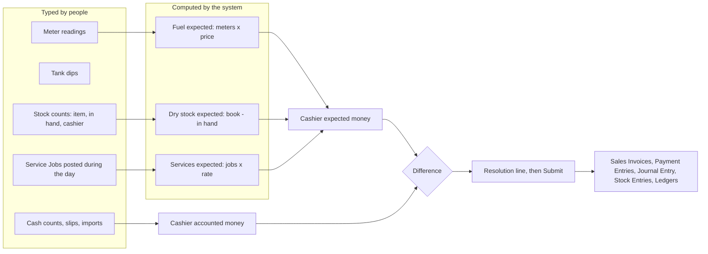

# FMS Non-Fuel Sales and Stock: Deep-Dive Design Guide

**Version:** 0.1 (draft for review)
**Date:** 2026-11-06
**Extends:** [fms.md](fms.md) v1.3 (design guide) and [catalogue.md](catalogue.md) v1.1 (DocTypes and fields, authoritative for names)
**Platform:** Frappe Framework v16, ERPNext v16 (HRMS v16 optional)
**Audience:** owner, developers, implementers, accountants
**Status:** proposal for review. Nothing here is built. Decisions D37 to D52 in section 19 are **Proposed**, in the same way as D16 to D36 of fms.md.

This guide covers everything the forecourt sells that is not fuel: lubricants, LPG, spare parts, shop merchandise, and services such as car wash and tyre alignment and balancing. fms.md describes these in one line ("normal ERPNext Items and services", section 1.4). This guide gives them a full design that plugs into the existing shift, cashier and posting model.

**Reading rule.** Where this guide adds to fms.md, it says so. Where it would change fms.md wording or leave a gap in it, the point is marked **⚠ Review** and collected in [section 18](#18-compatibility-review-with-fmsmd). Nothing here overrides fms.md until the owner confirms the review items.

---

## Table of contents

1. [Summary: the idea in one page](#1-summary-the-idea-in-one-page)
2. [Where fms.md stands today](#2-where-fmsmd-stands-today)
3. [Design principles for non-fuel](#3-design-principles-for-non-fuel)
4. [The sales streams](#4-the-sales-streams)
5. [Dry stock: the stock count model](#5-dry-stock-the-stock-count-model)
6. [Services: the Forecourt Services module](#6-services-the-forecourt-services-module)
7. [The cashier balance with three streams](#7-the-cashier-balance-with-three-streams)
8. [Posting under the hood](#8-posting-under-the-hood)
9. [LPG](#9-lpg)
10. [Category guide: lubricants, spare parts, merchandise, car wash, tyres](#10-category-guide)
11. [Data model additions](#11-data-model-additions)
12. [Gates and error codes (FMS-D7xx)](#12-gates-and-error-codes-fms-d7xx)
13. [Fraud and controls for non-fuel](#13-fraud-and-controls-for-non-fuel)
14. [Corrections after close](#14-corrections-after-close)
15. [Reports, number cards and workspaces](#15-reports-number-cards-and-workspaces)
16. [Roles and permissions](#16-roles-and-permissions)
17. [Phasing and build tasks](#17-phasing-and-build-tasks)
18. [Compatibility review with fms.md](#18-compatibility-review-with-fmsmd)
19. [Open decisions](#19-open-decisions)
20. [Glossary](#20-glossary)

---

## 1. Summary: the idea in one page

Fuel is controlled by meters: the meter says what was sold, so the cashier cannot "forget" a sale. Non-fuel has no meter. The old approach (typing item sales line by line) trusts the cashier to type every sale. This design removes that trust by using **the shelf as the meter**.

**Dry stock** (lubricants, LPG cylinders, spare parts, merchandise):

1. The system knows the book balance of every counted item (ERPNext stock ledger).
2. At shift close, the cashier or attendant declares what is physically **in hand**. The manager types item, in-hand quantity, and (optionally) the cashier.
3. The shift takes the book balance, adds receipts in the window, and subtracts the declared count. **The difference is what the person sold**, and its value at the station price is added to that person's expected money, next to fuel.
4. The cashier is therefore accountable for every unit that left their shelf. Understating the count only increases what they owe. Nothing needs to be typed per sale.

**Who is accountable.** The cashier on each count line comes from the **shift assignment** (roster) by default, and can be overridden on the line.

**Services** (car wash, tyre alignment and balancing, tyre fitting, puncture repair) have no stock to count. They are posted as **Service Jobs** in a separate **Forecourt Services** module, and the shift pulls the jobs in its time window, in the same way it pulls GRNs and own-use entries.

**Posting.** At shift close, the system turns fuel, dry stock and services into ordinary ERPNext Sales Invoices, Stock Entries and Payment Entries. The manager never builds these. The result is a close that is quick for the user, with the work done under the hood.



---

## 2. Where fms.md stands today

This section is the assessment this guide is built on. It records what fms.md already handles and what it leaves open.

### 2.1 What works

- **Payments are never split by product (P2).** One mobile money payment for diesel, a car wash and an oil bottle causes no allocation problem.
- **Non-fuel items are real ERPNext Items** in a shop warehouse, so stock, valuation, COGS and purchasing work natively.
- **Reporting dimensions exist.** The Sales Ledger carries `item`, `item_group` and `is_fuel`. Cost Centers give business-line P&L (sections 4.4 and 8.8).
- **Two entry routes.** Shop sales come from POS Invoices pulled by cashier and time window, or from manually typed *Shift Item Sale* rows. Both feed the cashier's expected amount.

### 2.2 Gaps this guide closes

| # | Gap in fms.md | Consequence | Where addressed |
|---|---|---|---|
| G1 | No independent control on non-fuel sales. Typed quantities become the expected amount. | A cashier can omit a sale and keep the cash, and the shift still balances. | Sections 5, 13 |
| G2 | Section 9 (fraud) is entirely about fuel. No shrinkage tolerance, no dry stock variance account. | Losses in the shop are invisible. | Sections 5, 13 |
| G3 | POS and shift interaction is under-specified. Expected excludes POS-paid items (7.2), but the cash count physically includes POS cash. | Cashier shows a false excess. | Section 5.9 |
| G4 | Negative stock blocks the close (FMS-P302), and only tank GRNs are discussed. | Late shop purchases block the shift. | Section 5.8 |
| G5 | No batch, serial or expiry support on *Shift Item Sale*. | Lubricants and spare parts cannot update stock correctly. | Section 5.13 |
| G6 | One `shop_warehouse` per station. | No separate lube bay, LPG cage or workshop store. | Section 11.4 |
| G7 | LPG is named (1.1) but never designed. | Cylinder exchange, empties and deposits are unhandled. | Section 9 |
| G8 | Car wash and tyre work are "service items" only. | No consumables, ticket control, rate control or vehicle record. | Section 6 |
| G9 | Credit gate FMS-S108 compares credit quantities with metered litres, which non-fuel does not have. | Non-fuel credit has no quantity check. | Section 5.10 |
| G10 | Fiscal: the shift-summary walk-in invoice cannot issue per-sale receipts for typed item sales. | Unfiscalised sales in e-receipt countries. | Section 8.6 |
| G11 | Cost Center for each invoice line is not specified. | Fuel, shop and car wash blend in one P&L line. | Section 8.5 |
| G12 | Margin reporting is per litre only. No shop stock position, no slow-mover report. | Shop profitability cannot be read. | Section 15 |

---

## 3. Design principles for non-fuel

These extend P1 to P9 of fms.md. They do not replace them.

| # | Principle | Meaning |
|---|---|---|
| N1 | **The shelf is the meter** | For dry stock, the independent figure is the physical count against the book balance. Typed sales are the exception. |
| N2 | **One accountable person per item** | Every counted item has a cashier for the shift, from the roster, with a line override. The system never guesses. |
| N3 | **Differences are sales** | For a counted item, any unit missing from the shelf (after recorded outflows) is treated as sold by the accountable person. Losses are settled in the cashier's money balance, not hidden in a stock variance. |
| N4 | **Recorded outflows are never charged as sales** | Damage, own use, returns, transfers and service consumption are posted as their own documents and are removed from the formula. |
| N5 | **Services are jobs, not typed item lines** | A Service Job carries a ticket number, vehicle, rate and consumables. It is posted when the work is done, and the shift pulls it. |
| N6 | **Payments stay per cashier** | P2 is unchanged. Dry stock and service sales add to the cashier's expected money. They are not matched to individual payments. |
| N7 | **Posting is invisible** | The manager types counts, jobs and money. Invoices, stock issues and ledgers are generated and verified by the system (section 8). |
| N8 | **Nothing is cleared silently** | A suspicious count (higher than book, or an unusual jump) needs a reason or a GRN before close. This is P6 applied to dry stock. |

---

## 4. The sales streams

After this guide, a cashier's expected money has three streams plus two "exact" channels.

| Stream | What proves the sale | Independent of the cashier? | Entered by |
|---|---|---|---|
| **Fuel** | Meter readings × price (fms.md section 5.3) | Yes (meter) | Manager types closing readings |
| **Dry stock** | Book balance minus declared in-hand count (section 5) | Partly (book balance is system-owned, count is declared) | Manager types in-hand per item |
| **Services** | Service Job with a ticket number (section 6) | No (typed), controlled by tickets and consumables | Crew or cashier posts the job |
| **POS sales (exact)** | POS Invoice with its own payments | Yes | Cashier at the POS |
| **Credit slips (exact)** | Shift Credit Sale with slip number | Customer signature | Manager types from the slip |

**POS-paid sales are excluded from both expected and accounted** (section 5.9). **Credit slips stay inside expected**, as they do for fuel: the metered or counted quantity includes them, and the slip value appears on the accounted side.

### 4.1 Which route for which item

Each item has a **count policy** (section 11.2). Station size and category decide the setting:

| Count policy | Item behaviour | Typical items |
|---|---|---|
| **Every Shift** | Listed in the shift's Dry Stock tab with opening filled in. Declared count required. | Lubricants, LPG cylinders, spare parts, tyres, high-value merchandise |
| **POS Only** | Sold only through POS. Not counted per shift. Stock handled by ERPNext as usual. | Groceries, drinks, snacks, where POS and per-sale receipts exist |
| **Not Counted** (default) | Not in the shift's count. Sold through POS, a Service Job part line, or (as a fallback) *Shift Item Sale*. | Low-value items, consumables, items with no stock |

Periodic counts (daily or weekly for slow items) are deferred (section 5.12).

---

## 5. Dry stock: the stock count model

### 5.1 The model in plain words

For each counted item and cashier, the shift answers: *how many units left this person's shelf without any document explaining it?* Those units are sold. Their value is added to the cashier's expected money.

### 5.2 The formula

The owner's wording: *the shift fetches the item balance, subtracts the actual declared by the attendant, plus item receipts; the difference is the sales expected from the person.* Here it is as one calculation, with every component visible on the form.

```
A  Book balance at shift start         (ERPNext stock ledger as of shift_start)
B  + Receipts in the window            (Purchase Receipts, transfers in)
C  − Outflows already posted           (POS, write-offs, own use, returns, transfers out)
D  = Book balance now                  (as of shift_end, before the shift posts)   D = A + B − C
E  − In hand (declared by the cashier)
M  = Unposted movement                 M = D − E
J  − Service-job part lines            (parts sold on Service Jobs, pulled by window)
K  − Service consumption               (consumables used by Service Jobs, from standards)
X  = Counted sales quantity            X = M − J − K          <- the cashier is accountable for X
Cq   of which credit slips (qty)       (a subset of X; invoiced to the credit customer)
W  = Walk-in quantity                  W = X − Cq
Expected amount = X × price            (station price list, locked at shift start)
```

**Why the system computes D from the stock ledger instead of A + B − C by hand.** The two forms are algebraically identical. The system reads D (balance as of `shift_end`, from the stock ledger) because it is robust: everything already posted (POS, write-offs, own use, returns) is in D automatically, and only the movement with no document (M) is left. The form still shows A, B, C, D and E as separate columns, so the manager and the area manager can see how the number was reached (principle P8 and section 15.1 of fms.md).

**Credit slips and Service Jobs are not yet in the stock ledger at close**, because they are posted by the shift. That is why J, K and Cq are subtracted from M, not from the book.

### 5.3 Sign rules

| Result | Meaning | Handling |
|---|---|---|
| X > 0 | Units left the shelf with no document | Sold by the cashier. Value added to expected. |
| X = 0 | Everything accounted for | Nothing to post. |
| X < 0 | Count is above what the book allows | **Blocked** until a GRN is posted, or a count gain is recorded with a reason (section 5.8). |
| D < 0 | Book balance negative at shift end | **Blocked** with FMS-D708: post the missing receipt first. |

### 5.4 Cashier assignment

The accountable person for each count line is found in this order. The first match wins.

| Priority | Source | Set where |
|---|---|---|
| 1 | **Line override**: cashier typed on the count line | The line (marked *Line override*) |
| 2 | Shift assignment for the **item** | Shift Template, Item Assignment table |
| 3 | Shift assignment for the **item group** | Same table |
| 4 | Shift assignment for the **warehouse** (shelf, lube bay, LPG cage) | Same table |
| 5 | The roster's **default shop cashier** | Shift Template |
| 6 | None: the line cannot be saved for submit | FMS-D703 |

The assignment table is on the **Forecourt Shift Template**, so it is copied into every new shift (fms.md section 6.3, step 2). The manager can change it on the shift. A cashier assigned to a shelf is accountable for everything on it.

**One cashier per item per segment.** If two cashiers share a shelf at the same time, split the shelf into two warehouses or two item groups, or use a handover count (section 5.11).

### 5.5 The Dry Stock tab

The shift gets a **Dry Stock** tab between Tanks and Credit. The rows are created when the shift is created (fms.md 6.3). Only items with stock, receipts or movement are listed, so the grid stays short.

| Column | Filled by | Notes |
|---|---|---|
| Item (code, name) | System | From the item and group scope of the cashiers on duty. "Add item" for unlisted items. |
| Warehouse | System | The item's location at the station |
| Cashier | System, editable | From assignment; changing it marks *Line override* |
| Opening (A) | System | Locked |
| Receipts (B) | System | Pulled by time window |
| Posted outflows (C) | System | POS, write-offs, own use, returns, transfers |
| Book now (D) | System | Can be hidden in **blind count** mode (5.15) |
| **In hand** | **Manager types** | The only mandatory typed column. Never pre-filled, so nobody confirms a number they did not look at. |
| Counted at | System | Time of entry |
| Credit qty (Cq) | System | From credit slips on the shift |
| Service parts (J), consumption (K) | System | From pulled Service Jobs |
| Sold qty (X) | System | Shown with its formula tooltip |
| Price | System | Locked at shift start |
| Expected amount | System | X × price |
| Flags | System | Unusual jump, count above book, serial or batch missing |

**What the manager types:** item (if adding), in-hand quantity, and optionally the cashier. Everything else is read-only. This is the owner's requirement.

**Entry speed.** The grid works like the meter grid: *Enter* moves down one row. A **Confirm as book** button (optional, setting `allow_confirm_as_book`, default off) sets in-hand equal to book for low-risk items, flags the line and records the user. It is never available for items in count class A (5.12).

### 5.6 Worked example

Station Westlands, *Day* shift, cashier **Amina**. Counted items on her shelf, prices from the station price list.

| Item | A open | B receipts | C posted out | D book now | E in hand | M | J parts | K consumption | **X sold** | Cq credit | W walk-in | Price | Expected |
|---|---|---|---|---|---|---|---|---|---|---|---|---|---|
| Engine oil 4 L (EO-4L) | 24 | 12 | 1 (damaged, written off earlier) | 35 | 30 | 5 | 0 | 0 | **5** | 2 | 3 | 2,800 | 14,000 |
| Brake fluid 500 ml (BF-500) | 40 | 0 | 0 | 40 | 37 | 3 | 0 | 0 | **3** | 0 | 3 | 650 | 1,950 |
| Car wash shampoo, litres (SHAMP) | 20 | 0 | 0 | 20 | 17 | 3 | 0 | 3 | **0** | 0 | 0 | n/a | 0 |

- **EO-4L:** book now is 24 + 12 − 1 = 35. In hand is 30, so 5 units left the shelf. Two were on a credit slip (Coast Haulage). Amina is accountable for the value of all 5 (14,000). The credit slip value (5,600) appears on her accounted side. The remaining 3 units (8,400) go on the walk-in invoice.
- **BF-500:** 3 units are missing, with no document. Sold, 1,950.
- **SHAMP:** 3 litres left the shelf. Six car washes were posted during the day, and the service type's standard is 0.5 L each, so K = 3. X = 0: nothing is charged as sales.

After posting, the stock ledger shows EO-4L at 30, BF-500 at 37 and SHAMP at 17. Book equals what was counted (section 8.7 checks this).

### 5.7 Outflows that are not sales (C, J, K)

Anything that removes stock for a reason other than a sale must be a document, so it is subtracted before the count. Otherwise the cashier is charged for it.

| Reason | Document | Posted by | When it posts |
|---|---|---|---|
| Damage, expiry, spillage, breakage | Stock Entry (Material Issue), type **Dry Stock Adjustment** | Manager, with reason | When submitted |
| Own use of shop items (cleaning stock, station vehicle oil) | Same Stock Entry type, reason *Own use* | Manager | When submitted |
| Samples, promotions | Same, reason *Promotion* | Manager (limit applies) | When submitted |
| Return to supplier | Purchase Return (native) | Manager or accountant | When submitted |
| Transfer to another warehouse or station | Stock Entry (Material Transfer) | Manager | When submitted |
| Used up by a service | Service Type standard (section 6.5) | System, at close | Shift close |
| Sold on a Service Job as a part | Service Job part line (section 6.6) | Service Job, at close | Shift close |
| Sold on credit | Shift Credit Sale (section 5.10) | Manager, at close | Shift close |

The first four follow the *Fuel Own Use* pattern of fms.md section 5.10: posted manually, linked to the shift and cashier, with a mandatory narration. A **draft** of any of them inside the window blocks the close (FMS-D704), like FMS-S113 does for fuel own use. The reasons come from a new master, **Stock Adjustment Reason**, which maps each reason to an expense account per company. Reasons above a value limit need area manager approval.

### 5.8 Count above book, negative book, and late receipts

| Situation | Cause | Handling |
|---|---|---|
| **X < 0** (more in hand than the book allows) | A delivery was not posted, the count is wrong, or stock was received off the books | The shift is blocked with FMS-D705 until one of: the GRN is posted (it is then pulled into B); the count is corrected; or a **count gain** resolution is recorded with a reason (it posts a Material Receipt to the dry stock variance account, needs approval above the limit). |
| **D < 0** (negative book) | A purchase was not entered, or stock moved without a document | Blocked with FMS-D708: *Post the receipt first*. Fixes the negative-stock problem of FMS-P302 for the shop. |
| **Draft GRN for non-fuel items in the window** | Receipt started, not submitted | Blocked with FMS-D704. |
| **GRN posted late** (after the shift closed) | Delivery recorded the next day | Blocked by the back-dating rule (section 8.8). The GRN must be dated at its real time or go through a Shift Correction. |

### 5.9 POS interaction (closes gap G3)

Many stations sell shop items through POS. The rule is simple: **POS-paid sales belong to the POS, not to the shift's expected and accounted.**

1. POS Invoices reduce stock when they are submitted, so they are already in C and D. The count formula never charges them as sales.
2. POS-paid sales are **excluded from expected** (this is what section 7.2 of fms.md already says) and **excluded from accounted**: whatever the customer paid through the POS (cash, mobile money, card) is already recorded on the POS Invoice and its payments.
3. The cashier's **cash count includes the POS cash**, because it is in the drawer. The shift therefore deducts the cash collected on that cashier's POS Invoices from the counted cash before computing accounted:

```
Cash for the shift = cash counted − float − cash received on POS Invoices in the window
```

   Without this line the cashier would show a false excess equal to the POS cash (this is gap G3). Section 7 uses this formula.
4. The **cash Payment Entry** the shift posts against the walk-in invoice (fms.md 6.7, item 4) uses the same net figure. POS cash is never posted a second time into the till account.
5. If a station requires **per-transaction receipts** (fms.md 12.3), counted items must be marked *POS Only*. Any count movement on a *POS Only* item is a sale that bypassed POS, and it is reported as an exception (section 8.6).
6. POS Invoices and Sales Invoices created by POS (`is_pos`) are both read (fms.md D25). The POS Closing Entry is the accountant's job and is not part of the shift close.

> **To verify in the build task:** how ERPNext v16 deducts stock for POS Invoices (at submit or at consolidation). The design reads the stock ledger, so it does not depend on the answer, but the test must cover it.

### 5.10 Credit sales of non-fuel items

Credit slips for items use the existing *Shift Credit Sale* (fms.md 10.2). Two changes:

- Gate **FMS-S108** (credit litres must not exceed metered litres) is stated for **fuel**. Its non-fuel twin is **FMS-D706**: credit quantity of an item must not exceed X. A credit slip for units that the count does not show missing is a sign of a fake slip or a wrong item.
- `allowed_items` and the monthly litre limit on *Customer Vehicle* apply to fuel only. For items, the credit limit of the customer (FMS-S107) is the control.

### 5.11 Handover and mid-shift counts

Cashiers change over, or a shelf passes from one person to another. Like a meter handover (fms.md 6.5), this creates a **segment**:

- A **Dry Stock Count** document of type *Handover* records the declared count at the handover time, signed by both people (witness field).
- The shift splits the item's calculation in two: opening to handover for the outgoing cashier, handover to closing for the incoming one.
- Receipts, posted outflows and Service Jobs are assigned to a segment by their time.
- The segments add up exactly to the single-segment formula, so the final book still equals the final count.

### 5.12 Count classes and periodic counts

| Class | Counted | Items | Notes |
|---|---|---|---|
| **A** | Every shift, always, with no "confirm as book" | Lubricants, LPG cylinders, spare parts, tyres | High value or high risk. Serial and batch tracked where required. |
| **B** | Every shift | Other counted dry stock | "Confirm as book" allowed if the setting is on |
| **C** | Not counted per shift | Low-value goods, groceries | *POS Only* or *Not Counted* |

`Every Shift` is the only counting frequency in Phases 0 to 3. **Daily and weekly cycle counts are deferred** (backlog): when an item is counted only every few days, the implied sales cover several shifts and cannot be fairly attributed to one cashier. That is why per-shift counting is the default for accountable stock.

### 5.13 Batch, serial and expiry (closes gap G5)

| Tracking | Count entry | Under the hood |
|---|---|---|
| **Batch** (lubricants, expiry goods) | One row per batch in a sibling table, *Shift Stock Count Detail* (Frappe child tables cannot nest, same pattern as *Shift Cash Count*). Opening per batch is fetched. | The generated invoice lines carry the batch bundle matching the batches that dropped. Reports show batches expiring within N days. |
| **Serial** (spare parts with warranty, tyres) | The manager selects or scans the serial numbers in hand. | Serials on the book but not in hand are the ones sold. A serial in hand that is not on the book raises FMS-D705. |
| **None** | A single quantity | Simple |

> **To verify in the build task:** creation of ERPNext v16 Serial and Batch Bundles by the posting layer.

### 5.14 Prices of counted items

- Non-fuel prices come from the station's **price list** (Item Price) as usual. They are locked on each count line when the shift is created.
- ERPNext Item Price is valid from a *date*, not a time. A price change takes effect **from the next shift** (D45). The mid-shift price segments of fms.md 6.5a apply to fuel only.
- A discount or price override on a counted item is not available inside the shift. A price below list needs POS, a Service Job line with a reason, or a correction.

### 5.15 Blind count (optional control)

A setting, `blind_count` (default off), hides **Opening, Receipts, Posted outflows and Book now** on the Dry Stock tab until the in-hand figure has been typed for that row. This stops a manager from adjusting the declared count to match the book. The values appear after entry so the manager can still review.

### 5.16 Full stock takes and spot counts (store-level, not cashier-level)

The shift count makes the *cashier* accountable. A separate, periodic check protects against everything the shift cannot see.

| Count type | Who | Effect |
|---|---|---|
| **Handover** | Outgoing and incoming cashier | Creates segments (5.11) |
| **Spot Audit** | Area manager or accountant, unannounced | Records the difference to book. Posts nothing. Appears on the Exception Register. |
| **Full Stock Take** | Accountant, monthly or quarterly | The difference to book is posted as a **Stock Reconciliation** to the *Shop Stock Variance* account. A store-level loss, not charged to a cashier. Approval above the limit. |

All three are one DocType, **Dry Stock Count**, with a `count_type`. They follow the Tank Dip pattern of fms.md (a standalone, submittable record).

---

## 6. Services: the Forecourt Services module

### 6.1 Why a separate section

Services have no stock to count and no meter. Typing them as lines on the shift (the old *Shift Item Sale*) gives no control. A separate module gives each job a ticket, a vehicle, a rate check and its consumables, and keeps the shift screen short because the jobs are posted during the day, not at the close.

**New module:** *Forecourt Services* (`forecourt/forecourt_services/`), next to the five modules of catalogue 2.1. It has its own workspace (section 15).

### 6.2 Service Type (master)

One record per service the station sells. It links to a **non-stock ERPNext Item**, so invoicing, tax and income accounts work natively.

| Field | Type | Notes |
|---|---|---|
| service_type | Data, unique | Car wash (saloon), Car wash (SUV), Wheel balancing, Wheel alignment, Tyre fitting, Puncture repair |
| item | Link Item | Non-stock service item. Its Item Group sets the income account and cost center. |
| unit | Select | Per job / per wheel / per axle |
| min_rate, max_rate | Currency | Allowed range around the station price list rate. Outside it needs a reason (FMS-D712). |
| requires_vehicle | Check | Plate number mandatory |
| consumables | Table | Item, quantity per unit, warehouse. Used to consume stock under the hood (6.5). |
| commission_pct | Percent | Optional, for crew commission reports only. Posts nothing in Phases 0 to 3. |
| default_cashier | Link Employee | Optional crew default |
| disabled | Check | |

### 6.3 Service Job (transaction)

A **submittable** record posted when the job is done. Submitting records the job and **does not post accounting**: revenue, stock and payment are posted when the shift closes, like a credit slip. Cancelling is allowed until a closed shift has used it.

| Field | Type | Notes |
|---|---|---|
| naming | `SJ-{station}-{YYYY}-{#####}` | Station code in the name, as for all FMS documents |
| station, company | Link | |
| performed_at | Datetime | Decides which shift pulls it |
| cashier | Link Employee, R | The person accountable for the money. From the Service Type default or the roster. |
| ticket_no | Data, R | Job card number, unique per station. Pre-printed book (6.8). |
| customer | Link Customer | Default is the station's walk-in customer |
| vehicle_plate | Data | Mandatory if the service type requires it. A *Customer Vehicle* link when the customer is a fleet. |
| payment_intent | Select | Pay now / On credit. On credit requires a customer other than walk-in. |
| lines | Table: Service Job Line | service_type, item (fetched), qty (washes, wheels), rate (default from the price list), amount, rate_override_reason |
| parts | Table: Service Job Part | stock item, qty, rate, warehouse, batch or serial: parts sold on this job (6.6) |
| total_amount | Currency, RO | Lines plus parts |
| forecourt_shift | Link, RO | Set when the shift pulls it |
| status | Select, RO | Draft / Submitted / Used by shift |

### 6.4 How the shift pulls services

1. **At shift creation:** nothing is filled. Jobs are posted as work happens.
2. **During the shift:** the **Services** tab shows the submitted jobs in the window as a read-only table (*Shift Service*: job, cashier, amount, credit or not, status). The manager can open any job.
3. **At close:** every submitted Service Job whose `performed_at` is inside the window and whose cashier is on the shift is pulled. The amounts go to each cashier's **service amount** in expected (section 7). Credit jobs become lines on the customer's credit invoice.
4. **A draft Service Job in the window blocks the close** (FMS-D710), as a draft GRN or own-use entry does.

### 6.5 Consumables (stock used by services)

A car wash uses shampoo and wax. These are stock, but they do not have a customer. The Service Type lists the **standard quantity per unit**. At close the system:

1. Totals the consumables for all pulled jobs (for example 6 washes × 0.5 L = 3 L of shampoo).
2. Posts a Stock Entry (Material Issue), type **Service Consumption**, to an expense account on the service's cost center.
3. Subtracts the same quantities as **K** in the dry stock formula, so the cashier is not charged for consumables as if they were sales.

This is the link between services and the count: consumable items are counted dry stock, and the standards explain their movement.

### 6.6 Parts sold on a job

A tyre fitted, a valve, a filter or a wheel weight sold to the customer is a **part line** on the job. It is a stock item sold at a rate to the customer, so:

- Its quantity is **J** in the dry stock formula (subtracted from M, so it is not counted twice).
- Its amount is part of the job total, and is added to the cashier's **service** expected.
- The shift invoice carries it as an item line with `update_stock`, so stock reduces and COGS posts.

Parts that are not billed (bundled in the price) are **consumables** on the Service Type, not part lines.

### 6.7 Credit and discounts

- **Credit service jobs** need a customer. They join that customer's credit invoice for the shift (or a Delivery Note in monthly mode, D26) and are subject to the credit limit (FMS-S107).
- **Rate overrides.** The rate defaults to the station price list. A rate outside the service type's min and max needs a reason (FMS-D712). The Exception Register lists them.
- **Discounts** for fleets belong in a customer-specific price, not in per-job overrides.

### 6.8 Controls on service jobs

Services depend on typed data, so the controls are around the typing.

| Control | How |
|---|---|
| **Numbered job cards** | Pre-printed books. `ticket_no` is mandatory and unique per station. The *Job Ticket Register* shows gaps. |
| **Consumables yield** | Shampoo or wax used (from counts) against jobs posted (from standards). If counts show more consumption than jobs justify, jobs may be going unrecorded. Report: *Consumables Yield*. |
| **Rate bounds** | min and max per service type |
| **Plausibility** | Jobs per hour per crew against the station history, in the Exception Register |
| **Handheld** | In Phase 4 the job is posted from the handheld at the bay with a printed ticket |

### 6.9 Service categories

| Service | Unit | Typical consumables | Parts |
|---|---|---|---|
| Car wash (by vehicle class) | per job | Shampoo, wax, water | None |
| Wheel balancing | per wheel | Wheel weights | None |
| Wheel alignment | per vehicle or axle | None | None |
| Tyre fitting | per wheel | Valve, lubricant | Tyre (serial tracked), if sold |
| Puncture repair | per job | Patches, glue | None |

Packages (for example *tyre plus fitting plus balancing*), technician time and a full workshop job card are out of scope for Phases 0 to 3 (backlog).

---

## 7. The cashier balance with three streams

This amends section 7.2 of fms.md. The structure is the same: **expected** against **accounted**, and a **difference** to resolve.

```
EXPECTED (what the cashier must account for)
  Fuel:        Σ net sold litres on assigned nozzles × segment price
+ Dry stock:   Σ X × price over the cashier's counted items       (includes credit slip units)
+ Services:    Σ Service Job totals for the cashier                (includes credit jobs)
+ Debt receipts collected from credit customers
= Total to account for

ACCOUNTED (what the cashier shows)
  Cash counted − opening float − cash received on POS Invoices
+ Mobile money received
+ Card receipts
+ Credit slips and credit jobs (value)
+ Vouchers and coupons
+ Expenses paid out (with receipts)
+ Cash drops made during the shift
= Total accounted

DIFFERENCE = ACCOUNTED − EXPECTED     (< 0 shortage, > 0 excess)
```

Rules that did not change: a nonzero difference needs a resolution line before the shift can close (P6, FMS-S105). A counting error in the dry stock shows up as a money difference and is resolved like any other.

### 7.1 Worked example (extending fms.md section 8.2)

Amina, Westlands, *Day* shift. Fuel figures are the same as in fms.md 8.2.

| Line | Amount |
|---|---|
| Fuel: PMS 1,200 L × 180 = 216,000, AGO 900 L × 170 = 153,000 | 369,000 |
| Dry stock: EO-4L 5 × 2,800 = 14,000, BF-500 3 × 650 = 1,950 | 15,950 |
| Services: 6 car washes × 800 = 4,800, 4 wheels balanced × 300 = 1,200 | 6,000 |
| **Expected** | **390,950** |
| Credit slips: Coast Haulage AGO 200 L (34,000) + 2 × EO-4L (5,600) | 39,600 |
| Mobile money (64 transactions) | 190,000 |
| Card (12 transactions) | 40,000 |
| Expense: forecourt cleaning | 1,500 |
| Cash counted 124,500 − float 5,000 (no POS cash) | 119,500 |
| **Accounted** | **390,600** |
| **Difference** | **−350 (shortage)** |

### 7.2 What the shift posts for this example

1. **Sales Invoice, Coast Haulage:** AGO 200 L (34,000) + EO-4L × 2 (5,600) = 39,600, from the tank and the shop warehouse, `update_stock`.
2. **Shift sales invoice (walk-in):** PMS 1,200 L (216,000), AGO 700 L (119,000), EO-4L × 3 (8,400), BF-500 × 3 (1,950), car wash × 6 (4,800), wheel balancing × 4 (1,200) = **351,350**. Stock reduces for fuel and for the two oils.
3. **Payment Entries against the walk-in invoice:** 64 mobile money (190,000), 12 card (40,000), and cash **121,350** (the balancing amount).
4. **Journal Entry:** DR Cleaning expense 1,500, DR Staff Shortage Receivable (Amina) 350, CR Cash in Till 1,850.
5. **Stock Entry (Service Consumption):** shampoo 3 L, expense to Car Wash cost center.
6. **Ledgers:** Nozzle, Sales, Cashier, Wetstock, and the new Dry Stock Ledger (section 11.5).

Check: invoices 351,350 + 39,600 = 390,950 = expected. Till: 121,350 − 1,850 = 119,500 = counted cash net of float. Amina owes 350.

The dry stock sales (8,400 + 1,950) and services (6,000) are not paid separately. They are part of what she collects, in the same pool as fuel (principle P2).

---

## 8. Posting under the hood

### 8.1 What the manager does and what the system does

| Manager | System |
|---|---|
| Types meters, dips | Computes litres, expected stock, drift |
| Types in-hand per counted item | Fetches opening, receipts, posted outflows, book; computes sold quantity and value |
| (Services posted during the day by crew) | Pulls jobs by window, totals consumables |
| Types credit slips, cash counts, imports | Builds the cashier balance, checks gates |
| Clicks Submit | Builds and verifies every ERPNext document, writes ledgers |

### 8.2 Documents created at close (additions to fms.md 6.7)

All run in one transaction, as in fms.md. Rows marked **new** are additions; the others are the existing documents with non-fuel lines added.

| # | Document | Non-fuel content |
|---|---|---|
| 1 | Sales Invoice per credit customer (or Delivery Note, D26) | Credit slip items and credit Service Jobs, with stock from the right warehouses |
| 2 | Shift sales invoice (walk-in) | **Counted sales quantity W** per item (at list price), **service lines** from Service Jobs, **job part lines**, plus fuel |
| 3 to 7 | Payment Entries, Journal Entry, transfers | Unchanged. Cash is still the balancing figure per cashier. |
| **new** | **Stock Entry, type Service Consumption** | One per consuming warehouse, from the Service Type standards |
| 8 | Stock Reconciliation | **Tanks only.** Dry stock is not reconciled by a separate entry, because the count is posted through sales (8.3). |
| 9 to 11 | Ledger rows | Plus **Dry Stock Ledger Entry** rows (section 11.5) and non-fuel Sales Ledger rows |

### 8.3 Why no Stock Reconciliation for dry stock

For tanks, fms.md posts a Stock Reconciliation to set book stock to the dip and puts the difference in an expense account. For counted dry stock the difference is **sold by the cashier**, so it is posted as a sale and stock reduces through the invoice with `update_stock`. After posting, the book equals the count. A Stock Reconciliation would double-post the same movement.

Store-level losses (found only by a Full Stock Take, 5.16) are the case that does use a Stock Reconciliation, to the *Shop Stock Variance* account.

### 8.4 Order and posting times (extends D35)

| Document | Time |
|---|---|
| GRNs, own use, write-offs, transfers | Their own times inside the window |
| Stock Entry, Service Consumption | `shift_end − 2 minutes` |
| Sales Invoices and Delivery Notes | `shift_end − 1 minute` |
| Stock Reconciliation (tanks), Payment Entries, Journal Entries | `shift_end` |

Consumption is posted before the invoice so that stock never goes negative in the stock ledger.

### 8.5 Cost centers and income accounts (closes gap G11)

Each invoice line's **cost center** and **income account** come from, in order:

1. The **Item Default** of the item for the company.
2. The **Item Group default** (recommended: one group per business line, for example Lubricants, LPG, Spare Parts, Car Wash, Tyre Service, Shop).
3. The Station's `cost_center`.

The Station is the accounting dimension in all cases (fms.md 4.4). One walk-in invoice can therefore carry lines for several cost centers, and the standard P&L splits fuel, shop, lubes and car wash.

### 8.6 Fiscal and per-sale receipts (closes gap G10)

Counted residual sales and service lines are posted on the **shift summary** walk-in invoice, which is **not** a per-sale receipt. Where the law requires a receipt per sale, the station sets its sales posting mode to *Per transaction* (fms.md 12.3), and then:

- Dry stock items are marked **POS Only**, and Service Jobs are fiscalised when posted (adapter on the job, Phase 3).
- Any count movement on a *POS Only* item is an *unreceipted sale*. It is posted, and listed on the Exception Register, in the same way the design handles unreceipted fuel volume.

### 8.7 Verification the system runs itself

Before commit, the posting layer checks that for each counted item the stock ledger balance after posting equals the declared count, and that the generated invoices add up to the expected amounts. A failure raises FMS-D709 and nothing is posted. This is the "result oriented" safety net: the user cannot post a shift whose documents disagree with its counts.

### 8.8 Protecting closed windows

Two new hooks (proposed, D50):

- A Stock Entry, Purchase Receipt or POS Invoice whose posting date and time falls **inside the window of a closed shift** at that station, for a counted item, is blocked with FMS-D718. It must be dated at its real time, or corrected through a Shift Correction.
- *Shift Item Sale* lines are blocked for items that are counted on the same shift (FMS-D717), to prevent a sale being counted twice.

---

## 9. LPG

### 9.1 Two different products

| Form | Examples | Model |
|---|---|---|
| **Bulk LPG** (autogas, dispensed through a nozzle) | Auto LPG | **Reuse the fuel engine**: Fuel Tank, Nozzle, meters. A pressurised tank is often read as a gauge percentage, so use dip entry mode *Litres entered directly* (fms.md 5.2, D6a). Sold by litre. |
| **Cylinders** (6 kg, 13 kg, 50 kg) | Domestic and commercial LPG | **Dry stock** with an exchange rule (9.2) |

The rest of this section is about cylinders.

### 9.2 Cylinder exchange

Most cylinder sales are exchanges: the customer hands in an empty and takes a full one. The station counts **full** and **empty** cylinders as two items.

| Item | Role |
|---|---|
| LPG 6 kg Full | Counted. Each unit sold reduces the count. |
| LPG 6 kg Empty | Counted. Empties received from customers increase the count. |

Master: an **LPG Product** pairing a Full item and an Empty item, with two prices:

- **Exchange (refill) price:** gas only, customer returns an empty.
- **Outright price:** gas plus cylinder, no empty returned.

**The rule.** The shift counts both items. Let *F* be the full cylinders sold (X for the Full item) and *E* the empties received (the increase in the Empty count). Then:

```
Exchange sales     = min(F, E)          at the exchange price
Outright sales     = F − exchange sales at the outright price
Empties received without a full sold = E − F  (flagged, FMS-D720)
```

Expected money is therefore driven by the two counts. A cashier who keeps back an empty makes the sale look like an outright one and owes the higher amount, which removes the incentive to hide empties.

### 9.3 Under the hood

- The Full item is sold on the walk-in invoice, one line at the exchange price and one at the outright price (same item, two rates).
- The empties received are posted as a **Material Receipt** of the Empty item, offset to a *Cylinder Float* account so that profit and loss is not affected.
- Supplier swaps: a Purchase Receipt of fulls plus a Stock Entry or Purchase Return of empties sent back. The shift pulls both by window.
- Cylinder deposits (if the company charges a refundable deposit on outright sales) are modelled by a company setting, `lpg_cylinder_model` = *Outright sale* or *Deposit*. *Deposit* posts the cylinder portion to a liability account.

> **For the accountant (D48):** this guide fixes the quantities and the money rule. The valuation of empty cylinders, the Cylinder Float account and the deposit treatment are confirmed with the accountant in the build task, because they vary by supplier contract and country.

### 9.4 LPG controls

- **Exchange balance:** empties received against fulls sold, per cashier and station (*LPG Cylinder Reconciliation*). A persistent gap suggests unrecorded sales, or customers leaving empties.
- **Safety stock limits** by cylinder count (insurance and licensing); a warning on the stock position report when exceeded.
- **Serial tracking** for 50 kg and commercial cylinders where the supplier tracks them.

---

## 10. Category guide

### 10.1 Summary

| Category | Route | Count class | Under the hood | Main controls |
|---|---|---|---|---|
| **Lubricants (packed)** | Count | A | Batch and expiry tracked | Count per shift, expiry report, adjustment reasons |
| **Lubricants (loose, by the litre)** | Count in litres (default) | A | Litre UOM with pack conversions | Drum dip or measure; optional metered dispenser (see 10.2) |
| **LPG cylinders** | Count with exchange rule | A | Full and Empty items, exchange split | Exchange balance report |
| **LPG bulk (autogas)** | Fuel engine | n/a | Tank, nozzle, litres entered directly | Wetstock controls |
| **Spare parts, tyres** | Count (serial or batch) plus Service Job part lines | A | Serials, warranty | Count per shift, serial reconciliation |
| **Merchandise, shop** | POS (recommended), count as control | B or C | POS Invoices, residual flagged | Spot audits, full stock take |
| **Car wash** | Service Job | n/a | Consumables, no stock sold | Ticket book, consumables yield |
| **Tyre alignment, balancing, fitting** | Service Job | n/a | Consumables, parts | Ticket book, rate bounds |

### 10.2 Lubricants

- **Packed oil** sells in cans. Count by unit and batch. Expiry reports use batch dates.
- **Loose oil** is sold from a drum or bulk tank by the litre. By default it is a dry stock item in litres: the book balance is in litres and the declared count is the measured litres. For a station with a **metered lube dispenser**, the dispenser can be modelled as a tank and nozzle (the fuel engine), with an item flag `fms_is_metered_liquid` (proposed, optional) so the meter is the control. This is an option, not part of the default build.
- A pack-and-bulk conversion (decanting a drum into cans) is a Stock Entry (Repack), posted manually and pulled as an outflow and inflow.

### 10.3 Spare parts and tyres

- Serial tracked where warranty matters. Count by serial (5.13).
- Sold mostly through Service Jobs (fitment) or POS. The count is the control on both.
- **Supplier returns and warranty claims** use native Purchase Returns, pulled as outflows.
- High value: always count class A. Unannounced spot audits (5.16) apply.

### 10.4 Merchandise and shop

- The best-supported case. Use POS where possible. The count then acts as a control: sold quantity X should be near zero because POS already recorded the sales, and a non-zero X is a sale that bypassed POS.
- Where there is no POS, the count is the sales record, and class B applies for items that matter.
- A shop with hundreds of low-value lines should not count every shift. Use *POS Only* for these and rely on Full Stock Takes.

### 10.5 Car wash and tyre services

See section 6. A bay crew can be a separate person or team whose money is collected by a cashier. Set the **default cashier** on the Service Type or the shift assignment (priority rules in 5.4 apply to Service Types too).

---

## 11. Data model additions

Names follow catalogue conventions (section 1 of catalogue.md). The catalogue stays authoritative once these are accepted into it (see section 18).

### 11.1 New DocTypes

| DocType | Module | Kind | Submittable | Naming |
|---|---|---|---|---|
| **Service Type** (+ Service Type Consumable) | Forecourt Services | Master | | `field:service_type` |
| **Service Job** (+ Service Job Line, Service Job Part) | Forecourt Services | Transaction | Yes | `SJ-{station}-{YYYY}-{#####}` |
| **Dry Stock Count** (+ Dry Stock Count Item) | Wetstock | Transaction | Yes | `DSC-{station}-{YYYY}-{#####}` |
| **Stock Adjustment Reason** (+ Stock Adjustment Reason Account) | Forecourt Setup | Master | | `field:reason` |
| **LPG Product** | Forecourt Setup | Master | | `field:name` |
| **Dry Stock Ledger Entry** | Forecourt Finance | Ledger | | `hash` |

**Child tables of Forecourt Shift** (new): *Shift Stock Count*, *Shift Stock Count Detail* (batch and serial rows, sibling table), *Shift Service* (read-only summary of pulled jobs).
**Child tables of Forecourt Shift Template** (new): *Shift Template Item Assignment*.
**Child table of Station** (new): *Station Stock Location*.

Dry Stock Count lives in the Wetstock module because it is the dry stock counterpart of Tank Dip.

### 11.2 Fields on existing DocTypes

| DocType | Field | Type | Purpose |
|---|---|---|---|
| Item | `fms_count_policy` | Select: Every Shift / POS Only / Not Counted, D Not Counted | Count route per item |
| Item | `fms_count_class` | Select: A / B / C | Controls "confirm as book" and spot audit priority |
| Item | `fms_is_metered_liquid` | Check (optional, 10.2) | Metered lube dispenser |
| Item Group | `fms_count_policy` | Select | Default for items in the group |
| Customer | none | | Service Jobs use the existing walk-in customer |
| Stock Entry | `fms_adjustment_reason` (Link Stock Adjustment Reason) | | Dry stock write-off, own use, promotion |
| Stock Entry | `fms_service_type` (Link) | | Service Consumption entries |
| Sales Invoice, POS Invoice, Delivery Note, Stock Entry, Stock Reconciliation | `fms_forecourt_shift` | Link | Already planned (catalogue 12) |
| Purchase Receipt, Stock Entry | station dimension | | Already planned |

Fixtures also add **Stock Entry Types**: *Dry Stock Adjustment* (Material Issue), *Service Consumption* (Material Issue).

### 11.3 Settings

**Forecourt Settings** (site-wide):

| Field | Default | Notes |
|---|---|---|
| `dry_stock_counting_enabled` | On | Turns the Dry Stock tab on |
| `blind_count` | Off | 5.15 |
| `allow_confirm_as_book` | Off | 5.5 |
| `count_anomaly_multiple` | 3 | Sold quantity above this multiple of the item's 30-day shift average needs a reason (FMS-D707) |
| `count_anomaly_min_value` | | Below this value no anomaly check applies |
| `service_rate_tolerance_pct` | 10 | Default range when a Service Type has no min and max |
| `require_service_ticket` | On | 6.8 |

**Forecourt Company Settings** (per company): `dry_stock_writeoff_account`, `shop_stock_variance_account` (expense, used for count gains, Full Stock Takes), `service_consumption_account`, `cylinder_float_account`, `cylinder_deposit_account`, `lpg_cylinder_model`, `writeoff_approval_limit`.

### 11.4 Station: multiple stock locations (closes gap G6)

`shop_warehouse` stays as the default. A new child table **Station Stock Location** lets a station declare several locations.

| Field | Notes |
|---|---|
| purpose | Shop / Lubes / LPG cage / Workshop / Wash consumables |
| warehouse | Link Warehouse, same company |
| cost_center | Default for lines from this location |
| default_cashier | Optional, used by assignment priority 4 and 5 |

### 11.5 Dry Stock Ledger Entry

Append-only, written by `posting/ledgers.py`, same conventions as the other ledgers (catalogue section 10: `in_create`, `is_cancelled`, `superseded_by`, `correction`).

| Field group | Fields |
|---|---|
| Keys | company, station, posting_date, forecourt_shift, shift_template, cashier, item, item_group, warehouse, segment_no |
| Quantities | opening_qty (A), receipt_qty (B), posted_outflow_qty (C), book_qty (D), counted_qty (E), movement_qty (M), service_part_qty (J), consumption_qty (K), sold_qty (X), credit_qty (Cq), walkin_qty (W) |
| Money | price, expected_amount, valuation_rate, cost_value |
| Flags | cashier_source (Roster / Line override), confirmed_as_book, count_gain, anomaly_reason |
| Source | source (Manual / Handheld / Import) |

Composite indexes: (`item`, `posting_date`), (`cashier`, `posting_date`).

### 11.6 Changes to existing ledgers

| Ledger | Change |
|---|---|
| Sales Ledger Entry | New fields `quantity_source` (Meter / Count / POS / Service Job / Credit Slip / Manual) and `service_job` (Link). `basis` (Exact or Attributed) is unchanged: it describes how the payment type was assigned. |
| Cashier Ledger Entry | New field `service_amount`. The existing `item_amount` now holds the counted dry stock amount. |

### 11.7 Shift Template Item Assignment

| Field | Notes |
|---|---|
| scope_type | Item / Item Group / Warehouse / Service Type |
| scope | Dynamic Link to the scope type |
| cashier | Link Employee, R |

---

## 12. Gates and error codes (FMS-D7xx)

A new range, **FMS-D7xx: dry stock and services** (D40, proposed). All codes are defined in `forecourt/errors.py`, as in fms.md 15.3. The existing gate S108 is clarified to apply to fuel (D7xx twin: D706).

| Code | Message | Likely cause | Fix |
|---|---|---|---|
| FMS-D701 | Opening of EO-4L (24) does not match the previous count (23) | Stock moved between shifts, or the previous shift was corrected | Check documents between the shifts, or re-fetch openings |
| FMS-D702 | Item BF-500 has no in-hand figure | Not counted | Enter the in-hand quantity |
| FMS-D703 | Count line for EO-4L has no cashier | No assignment matches and no line override | Assign the item, group or shelf to a cashier, or set the cashier on the line |
| FMS-D704 | Draft stock document in the shift window | Write-off, own-use, GRN or return started but not submitted | Submit or delete the draft |
| FMS-D705 | Count above book on EO-4L (+4) | Delivery not posted, miscount, or serial not on the book | Post the GRN, correct the count, or record a count gain with a reason |
| FMS-D706 | Credit quantity of EO-4L (6) exceeds the sold quantity (5) | Fake or wrong slip, or count too high | Check slips and count |
| FMS-D707 | Sold quantity of EO-4L (40) is far above the 30-day average (4) | Count error, or a large undeclared sale | Re-count, or choose a reason |
| FMS-D708 | Book balance of BF-500 is negative (−6) at shift end | Receipt not posted | Post the GRN first |
| FMS-D709 | Posting check failed: stock after posting does not equal the count | Document moved stock during close, or setup error | Read the log, fix the setting, retry. Nothing was posted. |
| FMS-D710 | Draft Service Job in the shift window | Job started but not submitted | Submit or delete |
| FMS-D711 | Service Job has no ticket number, or the ticket is used twice | Ticket not entered, or duplicate | Enter the ticket from the job card |
| FMS-D712 | Rate 450 for Car wash (saloon) is outside 700 to 900 without a reason | Price override or typing error | Correct the rate, or give a reason |
| FMS-D713 | Service Job cashier is not on this shift | Roster gap | Add the cashier to the shift |
| FMS-D714 | Credit Service Job has no customer, or is over the credit limit | Walk-in selected for credit | Select the customer, or collect payment |
| FMS-D715 | POS Invoice in the window has no cashier | POS user not mapped to an Employee | Map the POS user to a cashier |
| FMS-D716 | Serial or batch missing for EO-4L | Tracked item counted without detail | Select the serials or batches in hand |
| FMS-D717 | EO-4L is counted on this shift and also typed as a Shift Item Sale | Double entry | Remove the Shift Item Sale line |
| FMS-D718 | Posting time falls inside the closed shift SH-… | Back-dated stock document | Date it at its real time, or raise a Shift Correction |
| FMS-D719 | Count class A item cannot be confirmed as book | Confirm as book on a high-risk item | Enter the real count |
| FMS-D720 | Cylinder exchange imbalance: 3 empties received without a full sold | Unrecorded sales, or customer-owned cylinders | Choose a reason |

---

## 13. Fraud and controls for non-fuel

Section 9 of fms.md covers fuel only. This section extends it (proposed as section 9.3).

| Fraud | How it shows up | Control |
|---|---|---|
| **Overstating in-hand** (hiding sales by declaring more stock than exists) | Next cashier's count is lower, or spot audit finds a gap | Handover counts witnessed by both cashiers (5.11), blind count (5.15), unannounced spot audits (5.16), count class A has no "confirm as book" |
| **Understating in-hand** | Cashier owes more | Self-correcting: it increases their expected money |
| **Selling stock that was never received** (off-book purchases) | Count above book, or unexplained supplier invoices | FMS-D705, GRN matched to the supplier invoice, Open Items report |
| **Sales through POS bypassed** | Count movement on a *POS Only* item | Exception Register, unreceipted sale warning (8.6) |
| **Fake credit slips** | Credit quantity above counted movement | FMS-D706, vehicle and customer checks of fms.md |
| **Inflated write-offs** | Damage or own use above normal | Reasons, limits, approval, trend report per cashier and reason |
| **Unrecorded service jobs** | Consumables used with few jobs posted | Consumables Yield report, ticket book gaps |
| **Service rate cuts** | Rate below list, difference pocketed | Rate bounds, FMS-D712, override listing |
| **Collusion between manager and cashier on counts** | Everything agrees, shelf is short | Area manager spot audits, Full Stock Take, count class A history, manager-level approval on large write-offs |
| **Count timing** (selling after the count) | Mismatch between count time and last sale | `counted_at` recorded, window ends at the count |
| **Theft by third parties** | Loss on a cashier's shelf | Charged to the accountable cashier by policy (N3). Company policy can write off with approval on the resolution line (P6). |

**Segregation of duties.** The manager who enters counts cannot approve the write-offs that clear the resulting differences (same rule as tank variances, fms.md 6.2). The Full Stock Take is done by the accountant or area manager, not the station manager.

---

## 14. Corrections after close

Extends section 6.8 of fms.md. The rule is unchanged: FMS data is never edited in place, and native documents are corrected individually.

| Correction | Example | How it is applied |
|---|---|---|
| **Dry stock count** | In-hand for EO-4L typed 30 instead of 29 | A **Shift Correction** with type *Dry stock count*. Writes superseding Dry Stock Ledger and Sales Ledger rows for **this** shift. Because the next shift opens from book, it also re-bases the next shift's opening and sold quantity (the same cascade as dips, D22). The sale is adjusted with a Credit Note or an additional Sales Invoice. Both cashiers' balances are recalculated. New differences need a resolution inside the correction. |
| **Service Job** | Wrong cashier, wrong rate, wrong service | The job is cancelled and amended before the shift closes. After the close, a Shift Correction cancels and amends the generated invoice lines through a Credit Note or an additional invoice, with superseding rows. |
| **Adjustment reason** | Wrong reason on a write-off | Reclassification (FMS fields only, with a native fix if the account changes) |
| **Count above book recorded as gain** | Wrong gain reason | Reclassification |

---

## 15. Reports, number cards and workspaces

### 15.1 Reports

| Report | Source | For |
|---|---|---|
| Dry Stock Sales by Cashier | Dry Stock Ledger | Station manager |
| Dry Stock Count Exceptions (count above book, anomalies, confirm-as-book use) | Dry Stock Ledger | Area manager |
| Shop Stock Position (book, last count, days of cover, reorder) | Stock Ledger, Dry Stock Ledger | Station manager |
| Slow Movers and Dead Stock | Stock Ledger, Sales Ledger | Accountant |
| Expiry and Batch Report | Batch, Stock Ledger | Station manager |
| Margin by Item Group | Sales Ledger, GL | Accountant, director |
| Write-off and Adjustment Trend | Stock Entry by reason | Area manager |
| POS Bypass Exceptions | Dry Stock Ledger (POS Only items) | Area manager |
| Service Sales by Type, Crew and Day | Sales Ledger | Station manager |
| Job Ticket Register (gaps, duplicates) | Service Job | Station manager |
| Consumables Yield | Dry Stock Ledger, Service Job | Area manager |
| LPG Cylinder Reconciliation | Dry Stock Ledger | Station manager |
| Cashier Mix by Stream (fuel, dry stock, services) | Cashier Ledger | Area manager |

The Station Comparison, Exception Register and Daily Station Report of fms.md also gain the non-fuel columns. The **FMS Health** report adds: draft Service Jobs older than the back-dating limit, items with count policy *Every Shift* never counted in 7 days, items below reorder level.

### 15.2 Number cards and charts (additions)

| Card or chart | Source |
|---|---|
| Dry stock sales today | Dry Stock Ledger |
| Service sales today | Sales Ledger (`quantity_source` = Service Job) |
| Items below reorder | ERPNext reorder levels (custom method) |
| Count exceptions this month | Dry Stock Ledger |
| Sales by stream, last 30 days (fuel, dry stock, services) | Sales Ledger, donut |

### 15.3 Workspaces

A new workspace **Services** (module Forecourt Services; roles Station Manager, Area Manager, Forecourt Sales Operator).

| Block | Content |
|---|---|
| Shortcuts | **New Service Job** · **Open Service Jobs** (docstatus 0) · **Dry Stock Count** · **Stock Adjustment** (Stock Entry, type Dry Stock Adjustment) |
| Link cards | *Services*: Service Job, Service Type · *Stock*: Dry Stock Count, Stock Adjustment Reason, LPG Product · *Reports*: Service Sales, Job Ticket Register, Consumables Yield, Shop Stock Position |
| Number cards | Service sales today, Dry stock sales today |

The Forecourt workspace gains shortcuts for **New Service Job** and **Stock Count** next to New Shift and New GRN.

---

## 16. Roles and permissions

fms.md section 14 and catalogue section 2.2 use different role names (see review note R21). The table uses the fms.md names, with the catalogue equivalent in brackets.

| DocType | Create and edit | Submit | Read |
|---|---|---|---|
| Service Type | Forecourt Administrator | | All FMS roles |
| Service Job | Forecourt Cashier (Site Cashier), Station Manager, Supervisor (Forecourt Sales Operator) | Station Manager, Supervisor | Station roles, Accountant |
| Dry Stock Count (Handover) | Station Manager, Supervisor | Station Manager | Station roles |
| Dry Stock Count (Spot Audit) | Area Manager, Accountant | Area Manager, Accountant | Station Manager |
| Dry Stock Count (Full Stock Take) | Forecourt Accountant | Forecourt Accountant, with Area Manager approval over the limit | Station roles |
| Stock Adjustment (Stock Entry) | Station Manager | Station Manager, Area Manager above the limit | Accountant |
| Stock Adjustment Reason, LPG Product | Forecourt Administrator | | All FMS roles |
| Dry Stock Ledger Entry | No one (written by code) | | All FMS desk roles |

Row-level restriction uses the existing User Permissions on Station and Company. **No FMS role can cancel a submitted Service Job after a closed shift has used it.**

---

## 17. Phasing and build tasks

Aligned to the phases of fms.md section 18. Task prefix **FMS-K** (proposed; align with TASKS.md).

| Phase | Scope | Tasks |
|---|---|---|
| **0. Foundation** | Stock Adjustment Reason, Station Stock Location, Item and Item Group count fields, accounts (shop stock variance, write-off, consumption), Stock Entry types, Forecourt Services module and workspace skeleton, new FMS-D7xx range | FMS-K01 to K04 |
| **1. Manual operations** | Shift Template Item Assignment, Dry Stock tab and *Shift Stock Count*, count formula in `calc/dry_stock.py` (pure Python), Service Type and Service Job, Shift Service tab, posting additions (walk-in lines, Service Consumption), POS exclusion and cash deduction, Dry Stock Ledger, gates D701 to D720, Dry Stock Count (Handover), corrections types, back-dating hooks | FMS-K05 to K16 |
| **2. Control and reporting** | Dry Stock Count (Spot Audit, Full Stock Take), batch and serial support, LPG Product and exchange rule, reports and cards of section 15, blind count, FMS Health additions | FMS-K17 to K24 |
| **3. Money integrations** | Fiscal adapter on Service Jobs and POS-only items for per-transaction countries | with the fiscal adapter task |
| **4. Handheld POS** | Cashier declares counts on the handheld, service jobs posted at the bay with a printed ticket, POS integration | with the handheld phase |
| **5. Devices** | Optional: metered lube dispensers (10.2), barcode and RFID counting | backlog |

**Recommendation.** The Phase 1 pilot should include dry stock counts and Service Jobs, because they change the cashier's expected money. A pilot that only handles fuel would produce false excesses wherever the station also sells lubricants, LPG or services.

**Tests (extend fms.md 16.3):**

- Pure calculations: count formula, sign rules, segments, LPG exchange split, consumption totals, rounding.
- Document behaviour: shift creation fills the Dry Stock tab, gates D701 to D720, posting creates the expected documents.
- Accounting integrity: stock after posting equals counts, invoices equal expected, till equals counted cash net of float and POS cash.
- Scenarios: normal shift with counts, count above book, handover, POS plus count, credit item slip, service job with parts and consumables, LPG exchange with imbalance, each correction type.

---

## 18. Compatibility review with fms.md

This is the review list the owner asked for. **Status key:**

- ✅ **Compatible.** Consistent with fms.md as written.
- ➕ **Extends.** fms.md is silent or general. A line should be added there.
- ⚠ **Review.** fms.md wording, a decision, or a number would change, or its silence leaves a gap that matters. Needs the owner's confirmation.

| # | fms.md reference | This guide | Status | Proposed action |
|---|---|---|---|---|
| R1 | 1.5 and 6.4: close screen has five sections and takes under 10 minutes for about 25 entries | Adds **Dry Stock** and **Services** sections (seven in total). Counted items add one typed number each, about 2 to 4 minutes for 10 to 20 lines. | ⚠ | Restate the target: *under 10 minutes for fuel and credit plus up to 15 counted lines*, or confirm that counted lines extend the budget. Services are posted during the day, so they add little at close. |
| R2 | 7.2: expected includes "items sold by the cashier (not already paid on a POS invoice)" | Splits it into counted dry stock and services. POS-paid sales are excluded from both sides. Cash counted is reduced by cash received on POS Invoices before accounted is computed. | ⚠ | Add the POS-cash deduction to 7.2. Without it a cashier with POS cash shows a false excess. |
| R3 | 10.2: *Shift Item Sale* "item line not on POS" | Becomes a fallback for items that are *Not Counted* and not on POS. Blocked for counted items (FMS-D717). | ⚠ | Confirm the demotion and update the catalogue description. |
| R4 | 6.6: gate S108 compares credit and voucher quantities to metered litres | Stated for fuel. Non-fuel twin is D706. | ➕ | Add "(fuel)" to S108 and reference D706. |
| R5 | 15.3: error code ranges S, W, T, P, I, C, M | New range **FMS-D7xx** | ➕ | Record as a decision like D36 (D40). |
| R6 | 6.7: documents created at close | Walk-in invoice gains counted, service and part lines. New Stock Entry *Service Consumption*. No Stock Reconciliation for dry stock. | ➕ | Add the rows of section 8.2 to 6.7. |
| R7 | D35: posting times | Adds Service Consumption at `shift_end − 2 minutes`. Invoices stay at `shift_end − 1 minute`. | ⚠ | Confirm the amended D35. |
| R8 | 6.1 and 6.3: shift creation pre-fills readings, tanks, prices | Also creates Dry Stock rows with opening from the stock ledger, and copies the item assignment table from the template. | ➕ | Add steps to 6.3. Add the table to the Shift Template (catalogue 8.1). |
| R9 | 6.5: mid-shift events | Adds the **handover count**. States that non-fuel prices change from the next shift. | ➕ | Add rows to the 6.5 table. |
| R10 | 5.1, 4.1, catalogue 5.1: one `shop_warehouse` per station | Adds *Station Stock Location* (several warehouses by purpose). `shop_warehouse` stays the default. | ⚠ | Confirm the Station change. |
| R11 | P5, 4.2a (item 3), 10.4: **four** FMS ledgers | Adds a **fifth**, *Dry Stock Ledger Entry*, and new fields on Sales and Cashier ledgers. | ⚠ | Update "four" wherever it appears. Add the fifth ledger to the Group Sync unit. Update the catalogue totals. |
| R12 | 8.1: chart of accounts additions | Adds: Dry Stock Write-off, Shop Stock Variance, Service Consumption, Cylinder Float, Cylinder Deposit | ➕ | Add to the 8.1 table and to *Create default accounts*. |
| R13 | 12.3: per-transaction receipting describes only unreceipted **fuel** volume | Counted residual on *POS Only* items and service lines are also unreceipted | ⚠ | Extend 12.3 to non-fuel, as in section 8.6. |
| R14 | 9: fraud and controls are fuel only | Adds section 13 as a new 9.3 | ➕ | Add 9.3. |
| R15 | 11 and catalogue 13: reports, cards, charts | Adds the reports and cards of section 15 | ➕ | Add. Update catalogue totals. |
| R16 | 6.8: corrections | Adds *Dry stock count* and *Service Job* correction types. The count correction cascades to the next shift, like dips (D22). | ➕ | Add rows. |
| R17 | Catalogue 2.1 and 14: five modules, seven workspaces | Adds module **Forecourt Services** and workspace **Services** (eight workspaces) | ➕ | Add. |
| R18 | 1.4: non-fuel products are "normal ERPNext Items and services" | Items stay normal Items. Services get a Service Type and Service Job. | ⚠ | Reword 1.4 so "services" are not understood as typed item lines. |
| R19 | 5.10 and S113: Fuel Own Use pattern | Extended to dry stock with *Dry Stock Adjustment* and D704. Own Use Purpose is for fuel only. A new master covers dry stock reasons. | ➕ | Add. |
| R20 | 8.9: back-dating limited by `allow_backdated_shift_days` for shifts | Adds a block on stock documents dated inside a closed shift window (D718) | ⚠ | Confirm the new hook (D50). |
| R21 | 14 versus catalogue 2.2: role names differ | This guide uses the fms.md names with the catalogue equivalents. Not caused by this guide. | ⚠ | Reconcile the role lists once, in either document. |
| R22 | P2, P4, P6, P9, D1 to D36 | Preserved: payments per cashier, shift as the unit, variances cleared before close, no overrides of core DocTypes, deployment-neutral | ✅ | None |
| R23 | 7.3: differences are resolved before close | A dry stock count error becomes a money difference resolved the same way | ✅ | None |
| R24 | 10.3a: shift link on native documents | Applies to the new Service Consumption entries and counted invoices | ✅ | None |

**No contradictions with decided items.** D19 (shift status model) and D17 (Staff Shortage Receivable) are untouched. All ⚠ items are about wording, a number, or a gap, not about a reversal of a decided point.

---

## 19. Open decisions

D37 to D52 follow D1 to D36 of fms.md. All are **Proposed** unless noted. Confirm or change them before building.

| # | Status | Decision | Proposed default | Alternative |
|---|---|---|---|---|
| D37 | Owner direction (2026-11-06), to confirm | Dry stock recorded by count: sold quantity is book balance (opening plus receipts less posted outflows) minus the declared in-hand quantity | As section 5 | Typed sales per line |
| D38 | Proposed | Cashier assignment for counts | Roster by item, group, warehouse or default shop cashier, with a line override | Per-line cashier only |
| D39 | Proposed | Services as a separate module | *Forecourt Services* with *Service Job*, pulled by time window at close. Submitting a job posts no accounting. | Typed service lines on the shift; or jobs that post at submit |
| D40 | Proposed | Error range for dry stock and services | FMS-D7xx | Reuse existing ranges |
| D41 | Proposed | Differences on counted items | No tolerance: any missing unit is a sale. The cashier settles it in money, with write-off by resolution line. | A tolerance in units per item class |
| D42 | Proposed | POS handling | POS-paid sales excluded from expected and accounted. POS cash deducted from counted cash. | Include POS in both sides |
| D43 | Proposed | Count policy | Every Shift, POS Only, Not Counted per item and item group. Daily and weekly cycle counts deferred. | Cycle counts in Phase 1 |
| D44 | Proposed | Blind count | Option, default off | On by default for class A |
| D45 | Proposed | Non-fuel price changes | Take effect from the next shift. Locked on count lines at shift start. | Time-stamped item price changes |
| D46 | Proposed | Service ticket numbers | Mandatory, unique per station, with a gaps report | Optional |
| D47 | Proposed | Service consumption | Standard quantity per unit on the Service Type, posted as a Stock Entry at close | Counted consumption only |
| D48 | Proposed | LPG cylinders | Full and Empty items. Exchange sales equal the lower of fulls sold and empties received, the rest sold outright. Valuation and deposit treatment confirmed with the accountant. | Typed exchange counts |
| D49 | Proposed | Stock adjustments | Stock Entry types *Dry Stock Adjustment* and *Service Consumption*, and a *Stock Adjustment Reason* master | Reuse Own Use Purpose |
| D50 | Proposed | Closed windows | Block stock documents dated inside a closed shift window for counted items (D718) | Allow with reposting |
| D51 | Proposed | Ledger | *Dry Stock Ledger Entry* as the fifth FMS ledger | Fold into the Sales Ledger |
| D52 | Proposed | Station stock locations | Several warehouses per station by purpose, one default | Single `shop_warehouse` |

---

## 20. Glossary

| Term | Meaning |
|---|---|
| Book balance | Stock quantity according to the ERPNext stock ledger |
| Blind count | Count entry that hides the book balance until the in-hand figure is typed |
| Consumable | Stock used up by a service, not sold to the customer |
| Count class | A, B or C: how closely an item is controlled |
| Count policy | Every Shift, POS Only or Not Counted |
| Dry stock | Non-liquid-fuel inventory: lubricants, LPG cylinders, parts, merchandise |
| Exchange | LPG sale where the customer returns an empty cylinder |
| Handover count | Declared count when a shelf passes from one cashier to another |
| In hand | The quantity physically present, declared by the cashier |
| Outright sale | LPG cylinder sold with the cylinder, no empty returned |
| POS Only | Item that may be sold only through POS |
| Service Job | A submitted record of a service performed, with a ticket number |
| Service Type | Master defining a service, its item, rate range and consumables |
| Spot audit | Unannounced count by the area manager or accountant |
| Stock take (full) | Periodic count of all stock, posted as a store-level variance |
| X (sold quantity) | Units that left a cashier's shelf with no document |
