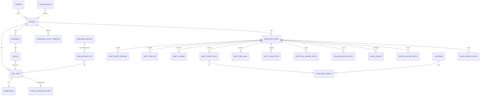

# Forecourt Management System on ERPNext: Design Guide

**Version:** 1.1 (revised after owner review)
**Date:** 2026-10-19
**Platform:** Frappe Framework v16, ERPNext v16 (HRMS v16 optional)
**Audience:** owner, developers, implementers, accountants
**Status:** proposal for review. Nothing here is built yet.

This guide redesigns the Forecourt Management System (FMS) from first principles on ERPNext. It does not carry over the earlier Odoo design. It covers what an FMS is, wetstock, shifts, cashiers, financial management, how ERPNext supports each part, how the data model stays easy to query, how the system grows into automation (handheld POS, tank gauges, pump controllers, mobile money and tax integrations), and how the design compares with forecourt systems already on the market.

---

## Table of contents

1. [What an FMS is and what this one must do](#1-what-an-fms-is-and-what-this-one-must-do)
2. [Design principles](#2-design-principles)
3. [The market: what other forecourt systems offer](#3-the-market-what-other-forecourt-systems-offer)
4. [Organisation model: groups, companies, stations](#4-organisation-model-groups-companies-stations)
5. [Wetstock management](#5-wetstock-management)
6. [Shifts](#6-shifts)
7. [Cashiers and attendants](#7-cashiers-and-attendants)
8. [Financial management](#8-financial-management)
9. [Fraud protection and controls](#9-fraud-protection-and-controls)
10. [Data model reference](#10-data-model-reference)
11. [Reporting and querying](#11-reporting-and-querying)
12. [Integrations and automation](#12-integrations-and-automation)
13. [Multi-jurisdiction design](#13-multi-jurisdiction-design)
14. [Security, roles and permissions](#14-security-roles-and-permissions)
15. [Troubleshooting by design](#15-troubleshooting-by-design)
16. [Development approach](#16-development-approach)
17. [Comparison of this design with the market](#17-comparison-of-this-design-with-the-market)
18. [Phased roadmap](#18-phased-roadmap)
19. [Open decisions](#19-open-decisions)
20. [Glossary](#20-glossary)
21. [Sources](#21-sources)

---

## 1. What an FMS is and what this one must do

### 1.1 The forecourt in one paragraph

A fuel station buys fuel by the tanker load, stores it in underground tanks, and sells it through dispensers (pumps). Each dispenser has one or more nozzles, and each nozzle draws from one tank and has a meter (totaliser) that counts every litre. People on the forecourt fill vehicles and collect money in cash, mobile money, cards, fuel vouchers or on credit for account customers. Most stations also sell other things: lubricants, LPG, car wash, a shop, tyre service. The station manager has to know, every shift, that the fuel that left the tanks matches what the meters counted, and that the money collected matches what the meters say was sold.

### 1.2 The three questions an FMS answers

| Question | Domain | Failure looks like |
|---|---|---|
| **Is the fuel all there?** | Wetstock | Tank dip lower than expected: leak, theft, short delivery, meter tampering, water ingress, bad dip |
| **Is the money all there?** | Shift and cashier reconciliation | Cash short, mobile money sent to a personal number, fake credit slips, fake expenses |
| **What did we earn, and what do we owe and are owed?** | Financial management | Margins wrong, receivables untracked, tax wrong, group reports late or inconsistent |

Everything in this design serves one of those three questions.

### 1.3 Who uses it

| User | What they do | Where |
|---|---|---|
| **Station manager** | Posts each shift after it ends: meter readings, dips, cash counts, credit slips, expenses. Reviews variances. Main user. | Station, desktop or tablet |
| **Cashier** (the person accountable for money; often also the pump attendant) | Today: hands over money and slips. Future: uses a handheld POS for receipts, credit sales and mobile money. | Forecourt |
| **Area or operations manager** | Approves variances above thresholds, compares stations, investigates exceptions. | Office or mobile |
| **Accountant** | Bank and mobile money reconciliation, supplier invoices, receivables, period close, tax returns. | Office |
| **Directors and investors** | Read-only dashboards and financial statements across their stations. | Anywhere |

### 1.4 Scope decisions taken with the owner

These answers (2026-10-19) shape the whole design:

| Topic | Decision |
|---|---|
| Station size | Any size. Typical is 3 to 8 islands with 2 dispensers each. Nothing in the model limits counts. |
| Money accountability | One accountable person per set of nozzles, called the **Cashier**. A cashier may also pump fuel (most sites) or may be a separate person collecting for several attendants (busy sites). The system only tracks the accountable person. Attendants who do not collect money are optional information. |
| Non-fuel products | Normal ERPNext Items and services. The range varies by site. |
| Credit customers | Yes: fleets and companies, with credit limits, vehicles and statements. |
| Ownership | Mixed. Some stations are company-owned, some dealer or investor-owned. Each legal owner is an ERPNext Company. Groups need consolidated views. |
| Fuel supply | Bought from suppliers and delivered by truck. |
| Price changes | Per station, and only between shifts. A price never changes inside a shift. |
| Guide scope | Design and architecture, no full code. |
| Language and currency | English, multi-currency, East African examples where useful. Must work in any jurisdiction. |
| Extra requirements | Shift close must be fast and accurate. Anything the system can already know must be filled in for the user, never typed again. |
| Sales and payment reporting | Payments are accounted per cashier, and sales and payments must also be reportable per product, tank, pump, nozzle and shift. |
| Variances | Every variance must be cleared before a shift can close. Nothing is carried as pending. |
| Deployment | Not decided. The design must work either as one shared site or as separate sites (section 4.2). |
| Fuel receipts | The GRN (ERPNext Purchase Receipt) for each fuel delivery is posted manually by the manager or accountant. The FMS adds the dip checks to it and never creates it automatically. |

### 1.5 What success looks like

- A manager closes a shift at an 8-nozzle, 3-tank, 2-cashier station in **under 10 minutes**, typing only what only a human can know: closing meter readings, dips, cash counted and slips.
- Every litre and every unit of money is explained. Nothing is left in an "unaccounted" bucket.
- Every shift becomes ordinary ERPNext accounting and stock entries automatically. There is no parallel bookkeeping.
- A director can open one dashboard and see sales, margin, cash position, receivables and fuel losses across all their stations, as of last night.
- When a number looks wrong, anyone can click from the report down to the shift, down to the reading, down to the person who entered it and when.
- Adding a tank gauge or a pump controller later changes **who fills in the fields**, not the data model.

---

## 2. Design principles

### P1. Enter once, derive everything else

The user types only facts the system cannot know. Everything else is fetched, carried forward or computed.

| Value | Where it comes from |
|---|---|
| Station, date, shift type | Defaults from the user's station and the last shift |
| Cashiers on duty and their nozzles | The station's shift template (roster), editable |
| Opening meter readings | Previous shift's closing readings (locked, not editable) |
| Opening tank stock | Previous shift's closing dip, or the ERPNext book stock |
| Fuel prices | The station's price list, effective at shift start |
| Deliveries during the shift | Fuel GRNs (Purchase Receipts) posted manually and dated inside the shift window |
| Non-fuel sales | ERPNext POS Invoices for that cashier in the shift window, if the shop uses POS |
| Mobile money and card receipts | Payment feeds from the provider, matched to the station and till (once integrated) |
| Opening float | The station's float policy, or what the previous shift left |
| Expected cash | Computed |
| Litres sold, amounts, variances | Computed |
| Accounting and stock entries | Generated on close |

### P2. Separate *what was sold* from *how it was paid*

This is the most important structural decision. The meters tell us what was sold (litres × price). Payments tell us how money came in (cash, mobile money, card, credit, voucher). The two are reconciled per cashier, **not per product**.

A cashier who receives one mobile money payment of 250,000 for "diesel plus a car wash plus a bottle of oil" causes no problem, because payments are never split by product. The old "lumped sales" or "residual allocation" problem disappears: the system never has to guess which product a payment belonged to.

### P3. Use ERPNext for what it already does well

ERPNext already provides the general ledger, stock ledger, valuation, sales and purchase invoices, receivables and payables, credit limits, taxes, bank reconciliation, multi-company consolidation, permissions, workflow, audit trail, reports and dashboards. The FMS app adds only the fuel-specific layer: tanks, nozzles, meters, dips, shifts, cashier accountability and wetstock analytics. **No core DocType is overridden.** The app uses custom fields, hooks and generated standard documents.

### P4. The shift is the unit of accountability

Everything that happens on the forecourt belongs to a shift. One submittable document, the **Forecourt Shift**, holds all readings, dips, cashier counts and slips. Submitting it closes the shift and posts everything. Cancelling it reverses everything. There is never a half-posted shift.

### P5. Append-only ledgers for analytics

Following ERPNext's own pattern (GL Entry, Stock Ledger Entry), every closed shift writes flat, immutable rows to four FMS ledgers:

- **Wetstock Ledger Entry**: one row per tank per shift (opening, receipts, sales, expected, dip, variance).
- **Cashier Ledger Entry**: one row per cashier per shift (expected, collected by type, variance).
- **Nozzle Ledger Entry**: one row per nozzle per cashier segment per shift (meters, litres, amount).
- **Sales Ledger Entry**: one row per shift × cashier × product (and nozzle, tank, dispenser for fuel) × payment type, so sales and payments can be reported along any of those dimensions (section 11.2).

Reports read these flat tables, not deeply nested documents. That keeps queries fast, simple, and usable by anyone with Report Builder or a BI tool.

### P6. Every variance is cleared before the shift closes

**A shift cannot close while any variance is uncleared.** Cleared means the variance has been resolved inside the shift itself, so that after closing nothing is left open or "pending":

- A **cash difference** is cleared by a resolution line in the shift: the manager charges the shortage to the cashier, writes it off (with approval), or records the excess. Once resolved, the cashier's balance for the shift is exactly zero, and the resolution is posted as its own accounting line.
- A **tank variance** within tolerance is accepted as normal operational loss or gain. Outside tolerance, it needs a reason and an approval before the shift can be submitted.
- **Credit, delivery and payment-feed mismatches** must be resolved too: an over-limit sale approved, a missing GRN posted, an unmatched payment assigned.

There is no "pending investigation" status and no "close anyway" button. This is strict without pushing managers to fake numbers: the true difference is recorded as a visible resolution line, never hidden inside the counts. Repeated resolutions show up on the exception reports for the next level up.

### P7. The source of every reading is recorded

Each meter reading and dip carries a `source` (Manual, Handheld, ATG, FCC, Import) and who or what entered it. When automation arrives, the same fields are filled by machines, and reports can compare manual and automatic values.

### P8. Designed to be debugged

Every generated document links back to its shift. Every validation error has a code with a documented fix. Every integration message lands in an inbox that can be inspected and retried. See [section 15](#15-troubleshooting-by-design).

### P9. Jurisdiction-neutral core, country adapters at the edge

Taxes, fiscal receipts, mobile money providers and banks differ by country. The core never names a country. Country specifics live in configuration (tax templates, chart of accounts) and pluggable adapters (fiscal device, payment provider). See [section 13](#13-multi-jurisdiction-design).

---

## 3. The market: what other forecourt systems offer

This section surveys the main kinds of forecourt systems so the design can borrow what works and avoid what doesn't. Product details come from vendor pages and comparison sites listed in [Sources](#21-sources); claims about specific products should be re-checked before any purchase decision.

### 3.1 Categories of product

The market is layered. Few products cover every layer; most stations combine several.

```
┌──────────────────────────────────────────────────────────────────┐
│ Head office / ERP / BI      PDI Enterprise, ERPs (SAP, ERPNext…)│
├──────────────────────────────────────────────────────────────────┤
│ Wetstock analytics (cloud)  Insite360, DX Wetstock, Titan Cloud │
├──────────────────────────────────────────────────────────────────┤
│ Back office (site)          Petrosoft, Passport BOS, LIGO BOS,   │
│                             regional "petrol bunk" software      │
├──────────────────────────────────────────────────────────────────┤
│ Point of sale               Passport, Verifone Commander, Prizma │
│                             FuelPOS, LIGO, KORONA, Clover…       │
├──────────────────────────────────────────────────────────────────┤
│ Forecourt controller (FCC)  DOMS PSS 5000, Wayne Fusion, Orpak   │
│                             SiteOmat, DFS Edge                   │
├──────────────────────────────────────────────────────────────────┤
│ Field devices               Dispensers, ATG probes (Veeder-Root, │
│                             ProGauge, OPW), attendant tags, AVI  │
└──────────────────────────────────────────────────────────────────┘
```

### 3.2 Product survey

| Product | Category | Notable features | Typical market |
|---|---|---|---|
| **Gilbarco Passport** (Vontier) | POS + back office | Integrated pump control with Gilbarco hardware, offline buffering, shift and end-of-day reconciliation, loyalty, fleet cards | Large US/Australian networks on Gilbarco hardware |
| **Gilbarco LIGO** (MEA) | Cloud fuel POS + BOS | Pre-pay and post-pay modes, attendant sales reports, shift reports with pump counter readings, wetstock functions, local account customers, link to Retail Head Office | Middle East and Africa |
| **DOMS PSS 5000** (Gilbarco) | Forecourt controller | Controls mixed-brand dispensers and tank gauges, open protocol for third-party POS | Global, strong in Europe, MEA, Asia |
| **Orpak SiteOmat / Orpak Fleet** (Gilbarco) | FCC + fleet | Site automation, automatic vehicle identification (AVI) tags, fleet and home-base fuel control, head-office management | Fleets, national oil companies, Africa and Middle East |
| **Insite360 Fuel / FuelQuest** (Gilbarco) | Cloud wetstock | Variance alerts within minutes, meter drift detection per nozzle, flow-rate deterioration, cloud tank calibration, delivery shortage detection, network drill-down | Mid to large networks |
| **Dover Fueling Solutions: Wayne Fusion, DFS Edge, Prizma FuelPOS, ProGauge** | FCC, POS, ATG | Fusion site automation server (tens of thousands installed), head-office control, integrated tank gauges | Global |
| **DX Wetstock** (Dover) | Cloud wetstock | Real-time polling from FCC and ATG, loss detection from delivery to nozzle, delivery variance, statistical inventory reconciliation (SIR), calibration and flow analysis, network-to-tank drill-down | Networks with Dover or mixed equipment |
| **Verifone Commander** | POS + FCC | Pump authorisation, shift reconciliation, transaction traceability, central multi-site configuration | US convenience and fuel retail |
| **Titan Cloud** | Cloud analytics | API-first, wetstock variance by product, tank, site, region; root-cause split (temperature, calibration, delivery, sales, anomaly); delivery reconciliation; run-out forecasting; nozzle flow analytics | Multi-site networks, UK and US |
| **Petrosoft** | Back office (cloud) | Pump journaling, wetstock, shift reconciliation, inventory, workforce tools, loss-prevention analytics | Multi-site fuel and convenience operators |
| **PDI Technologies** | Enterprise ERP and fuel | Fuel pricing, wholesale and logistics, back office, loyalty, head-office accounting | Large chains, wholesalers |
| **Pesapal PFMS** (Kenya) | Payments + forecourt | Card, M-Pesa, Airtel Money and fleet card payments tied to pump and attendant, Wayne Fusion pump integration, KRA eTIMS e-receipts, dry-stock POS, remote monitoring | East Africa |
| **Indian "petrol bunk" software** (PetroByte, Pumpmate, PumpCount, My Lucky Meter, SOFTGUN and many more) | Site software | Daily sales report (DSR), meter and dip entry, density charts, nozzle and attendant assignment, credit billing by vehicle and party, tanker tracking, GST, Tally export | India and South Asia, small operators |
| **ECOSIRE Fuel Station POS for ERPNext** | ERPNext app (build-to-order) | Tank, Pump, Nozzle, Shift, Shift Reading, Tank Dip, Fuel Card Account DocTypes; calibration charts; variance reports; tolerance-based close blocking; posts native Sales Invoices and Stock Entries | ERPNext users |

### 3.3 Feature patterns that recur across the market

The following features appear in most serious products. They form the feature checklist for this design (section 17 scores the design against it).

| # | Feature | Found in |
|---|---|---|
| F1 | Nozzle meter reading per shift, opening carried from last close | Nearly all |
| F2 | Tank dip entry with calibration chart conversion | Nearly all site software |
| F3 | Automatic tank gauge (ATG) integration | OEM stacks, cloud wetstock |
| F4 | Tank reconciliation: opening + deliveries − sales = expected vs actual | All wetstock products |
| F5 | Delivery reconciliation: invoiced vs received, dip before and after | Titan, DX, Insite360, Indian software |
| F6 | Variance tolerances and alerts | All wetstock products |
| F7 | Cumulative variance trend, meter drift, leak detection (SIR) | Cloud wetstock (Insite360, DX, Titan) |
| F8 | Pump test and calibration volumes returned to tank | Most site software |
| F9 | Attendant or cashier accountability and shift balance | All POS and back office |
| F10 | Multiple payment types including mobile money and fleet cards | All; mobile money in African products |
| F11 | Credit customers: limits, vehicles, slips, statements | Back office, Indian software, LIGO |
| F12 | Dry stock (shop, lubes, LPG) in the same system | Most |
| F13 | Price change management | All |
| F14 | Daily sales report (DSR) and end-of-day | All |
| F15 | Head-office multi-site view, drill-down | OEM head office, cloud products |
| F16 | Pump control and authorisation (FCC) | OEM POS stacks |
| F17 | Fiscal / e-invoice integration | Regional products (eTIMS in Kenya, GST in India) |
| F18 | Full accounting (GL, AR, AP, consolidation) | Rare in forecourt products; usually exported to Tally, Sage or an ERP |
| F19 | Run-out forecasting and order suggestions | Titan, Insite360, PDI |
| F20 | Loyalty and fleet programmes | OEM POS, Pesapal, PDI |

### 3.4 What the market teaches

1. **Wetstock and money are separate disciplines.** Good products reconcile litres by tank and money by person. Mixing them (allocating payments to products) creates guesswork.
2. **Automation beats discipline.** Cloud wetstock vendors detect losses within minutes because they read ATG and FCC data continuously. Manual dips once a shift catch losses days later. The design must be ready for automated feeds from day one, even if the first phase is manual.
3. **The pump controller is the real fraud barrier.** Where an FCC records every transaction, meter manipulation and "missing sales" become nearly impossible. Until an FCC is connected, the FMS relies on readings typed by people, so it needs strong cross-checks (section 9).
4. **Forecourt products are weak at accounting.** Most export to a separate accounting package, which is exactly the parallel bookkeeping this design avoids. ERPNext gives full accounting in the same database, which is this design's main advantage.
5. **Regional fit matters.** In East Africa, mobile money and eTIMS integration are table stakes. In India, density checks and GST are. A jurisdiction-neutral core with adapters (section 13) handles this.

---

## 4. Organisation model: groups, companies, stations

### 4.1 The hierarchy

```
Group (the Frappe site, one per business group)
 └─ Company (legal entity in ERPNext; can have a parent company)
     └─ Station (FMS DocType; a physical site)
         ├─ Fuel Tanks          (each is an ERPNext Warehouse)
         ├─ Dispensers          (pumps)
         │   └─ Nozzles         (each linked to exactly one tank)
         ├─ Shop warehouse      (ERPNext Warehouse for non-fuel stock)
         ├─ Tills and safe      (ERPNext Accounts: cash in till, safe)
         └─ Forecourt Shifts    (one per shift worked)
```

### 4.2 Company versus station

| Situation | Model |
|---|---|
| A company owns one station | 1 Company, 1 Station |
| A company owns several stations | 1 Company, n Stations. Station is an accounting dimension, so one company's P&L can be split by station. |
| An investor owns several companies, each with stations | Several Companies under a parent Company, consolidated in ERPNext |
| A dealer-operated station under the group's brand | Its own Company. The group sees it through the Station Group tree and read-only permissions. |

### 4.2a Deployment options (not yet decided)

The owner has not chosen a deployment model, so the design works under both.

| | **Option A: one shared site** | **Option B: separate sites with a group reporting site** |
|---|---|---|
| Shape | All companies and stations in one Frappe site (one database) | One site per company, dealer or investor. A separate *group site* receives summaries |
| Consolidation | Native ERPNext consolidated statements and consolidated trial balance (v16) | Group site holds summary ledgers and imported trial balances. Full consolidation needs the TBs imported each period |
| Data isolation | By User Permissions on Company and Station | Physical. Each owner's data is in its own database |
| Fits | Company-owned networks, or investors happy to share one system | Independent dealers, owners who want their own system, very different jurisdictions or hosting rules |
| Upgrades and support | One system to upgrade | Many systems to keep on the same app version |
| Cost | Lowest | Higher (more servers, sync jobs) |
| Failure impact | One outage affects all stations | Isolated outages |

A **mix** is also possible: company-owned stations share one site, and each independent dealer runs its own site that feeds the same group site.

**What keeps both options open** (rules for development, whichever is chosen):

1. **Globally unique station codes** (for example `KE-NBO-WSTL`), used in every document name, so records from different sites never collide when merged.
2. **Every FMS record carries company and station**, never relying on "the only company in this site".
3. **The FMS ledgers (section 10.4) are the sync unit.** A small *Group Sync* job pushes new and cancelled ledger rows (Wetstock, Nozzle, Sales, Cashier) plus a daily trial balance by station to the group site through the REST API, idempotent by row name. On a shared site, the job is simply switched off.
4. **Masters that the group defines** (fuel items, station groups, variance reasons, expense types) are exported from the group site as fixtures, so names match everywhere.
5. **Group reports read only the ledgers and the trial balance**, so they give the same answers on a shared site and on the group site.

Section 19 records this as decision D1.

### 4.3 Station grouping for aggregate reports

Directors want to see data by brand, by region, or by investor portfolio, and these groupings do not always match the legal Company tree. The **Station Group** tree (a Frappe tree DocType, like Territory) gives a flexible rollup:

```
All Stations
 ├─ Brand: Brand A
 │   ├─ Region: Nairobi
 │   │   ├─ Station: Westlands
 │   │   └─ Station: Karen
 │   └─ Region: Mombasa
 └─ Portfolio: Investor A
```

Each Station also has plain fields `brand`, `region`, `country` and `ownership_type` (Company-owned, Dealer-owned, Investor-owned, Franchise) for quick filtering.

### 4.4 Station as an accounting dimension

The **Station** DocType is registered as an ERPNext **Accounting Dimension**. Every GL Entry and Stock Ledger Entry created by the FMS, and every purchase or expense the accountant books, carries the station. This means every standard ERPNext financial report (P&L, Balance Sheet, General Ledger, Trial Balance, Accounts Receivable) can be filtered or grouped by station without custom code.

Cost Centers stay available for a second cut, for example *Fuel*, *Shop*, *Car Wash*, *Lubes*, so margin by business line also comes out of standard reports.

---

## 5. Wetstock management

Wetstock means the liquid fuel inventory: what was bought, delivered, stored, dispensed, lost or gained.

### 5.1 Physical model

| Object | FMS DocType | ERPNext object | Notes |
|---|---|---|---|
| Fuel product (Petrol/PMS, Diesel/AGO, Kerosene, etc.) | — | **Item**, stock UOM Litre, flag `is_fuel` | Valuation: moving average |
| Tank | **Fuel Tank** | **Warehouse** (one per tank, under the station's warehouse group) | Capacity, safe fill, dead stock, product, calibration chart, tolerances |
| Calibration (strapping) chart | **Tank Calibration Chart** (versioned) | — | Depth (mm) → volume (L) table, with valid-from date |
| Dispenser (pump) | **Dispenser** | — | Island, brand, serial, number of sides |
| Nozzle (hose) | **Nozzle** | — | Links to tank (and therefore product), meter type, meter max value, current state |
| Manifolded tanks | Tank field `manifold_group` | Separate warehouses | Tanks joined by a pipe are reconciled together as one group |

**Why one Warehouse per tank:** ERPNext's stock ledger then *is* the tank ledger. Book stock per tank, stock valuation, stock reports, negative-stock protection and Stock Reconciliation all work unchanged.

### 5.2 Calibration charts

Tanks are measured by depth. A calibration chart converts depth to litres.

- Stored as rows of (depth_mm, volume_litres), typically every 10 mm. Values between rows are linearly interpolated.
- Versioned with `valid_from`. A re-calibrated tank gets a new chart, and old dips keep their old conversion.
- Supports an optional water reading: water depth → water volume, subtracted from the product volume.
- Optional temperature and density capture (section 5.8).

Validation on save: depths strictly increasing, volumes strictly increasing, the last volume roughly equal to the tank capacity (warning if more than 2% apart).

### 5.3 Meters

Each nozzle has a cumulative totaliser. The FMS stores **volume** totals (litres). Electronic dispensers also show an **amount** total; when entered, it is used as a cross-check (amount ÷ volume should equal the shift price).

| Case | Handling |
|---|---|
| Normal | Sold = closing − opening |
| Rollover (meter passes its maximum and restarts at zero) | If closing < opening and the user ticks *Rollover*, sold = (max − opening) + closing. Without the tick, the system blocks with error FMS-W102. |
| Meter replaced or reset by a technician | A **Meter Change** document records old final reading and new starting reading, with the technician's name. The next shift opens from the new value. |
| Pump test (litres dispensed into a test can and poured back into the tank) | `test_volume` on the reading. Counts as dispensed by the meter but not sold, and not removed from the tank. |
| Own use (generator, company vehicles) | `own_use_volume` on the reading. Not sold. Removed from the tank as an internal consumption (Stock Entry, Material Issue). |
| Nozzle out of service | Nozzle state *Out of service*. It is skipped in shifts, and its reading must not change. |

**Net sold volume per nozzle** = (closing − opening) − test_volume − own_use_volume.

### 5.4 Deliveries

A tanker delivery is the moment of greatest financial exposure: one load can be worth more than a month's margin.

**The GRN is posted manually.** The manager or accountant creates the standard ERPNext **Purchase Receipt** (GRN) for each delivery, as they would for any purchase. The FMS does not create it. Instead, the FMS adds a **Fuel Delivery** section to the Purchase Receipt form (custom fields and a child table), so the dips are recorded on the same document:

| Field group | Fields (on the Purchase Receipt) |
|---|---|
| Standard GRN | Supplier, Purchase Order (optional), items (fuel, quantity as invoiced on the delivery note), warehouse = the tank, rate, taxes |
| Delivery header (FMS) | Station, delivery note number, truck, driver, transporter, seal numbers, witness |
| Delivery dips (FMS child table, one row per tank) | Tank, dip before (mm), dip after (mm), volumes from the calibration chart, litres sold through the tank's nozzles during the drop, received volume, delivery variance, variance %, reason |

**Received volume** = volume after − volume before + litres sold through that tank's nozzles during the drop.

**Delivery variance** = received volume − invoiced volume.

What the FMS does with the GRN (it adds checks and records, it does not post extra documents on its own):

1. **On validate:** if the GRN contains fuel items going into tank warehouses and the company requires delivery dips, a dip row is mandatory for each tank. Volumes and variance are computed automatically from the calibration chart.
2. **On submit:** writes a **Wetstock Ledger Entry** of type *Delivery* (invoiced, received, variance, supplier, transporter, driver). The GRN's stock posting itself is standard ERPNext.
3. **Delivery shortage beyond tolerance** (default −0.3% of invoiced volume): the GRN cannot be submitted without a reason. The form then offers a **Record delivery shortage** button, which prepares a draft **Stock Entry (Material Issue)** from the tank to the *Delivery Shortage Claims* account for the measured shortage. The manager or accountant reviews and submits it manually, then raises a debit note to the supplier or a claim against the transporter. Posting it keeps the shortage out of the next shift's tank variance.
4. Landed costs such as separately invoiced transport go through ERPNext's Landed Cost Voucher, as usual.

Small variances within tolerance are not adjusted. They show up as part of the next shift's tank variance and the cumulative trend.

**Link to the shift:** at shift close, the FMS pulls every submitted fuel GRN for the station whose posting time falls inside the shift window into the tank reconciliation as *Receipts*. The manager types nothing for deliveries at close. If a tank's dip shows a rise that no GRN explains, the shift is blocked with FMS-T203 until the GRN is posted (section 6.6).

### 5.5 Tank reconciliation per shift

For every tank, at every shift close where dips are taken:

```
Opening stock           (previous closing dip, or book stock if no dip)
+ Receipts              (GRN quantity, less any delivery shortage posted)
− Net meter sales       (sum of net sold volume of the tank's nozzles)
− Own use
± Transfers             (tank to tank, rare)
= Expected closing stock

Closing dip volume      (measured)
Variance                = closing dip − expected closing
Variance % of sales     = variance ÷ net meter sales × 100
```

| Variance | Typical causes |
|---|---|
| Negative (loss) | Theft, leak, unrecorded sales, meter under-reading, short delivery not caught, evaporation, bad dip |
| Positive (gain) | Meter over-reading, temperature expansion, delivery over-measured, dip error, previous shift's dip too low |

### 5.6 Tolerances

Tolerances are set per company, can be overridden per station and per tank, and are checked on every close.

| Tolerance | Default | Check |
|---|---|---|
| Tank variance, % of sales | ±0.5% | Per shift, per tank |
| Tank variance, absolute litres | ±20 L | Per shift, per tank (the larger of the two limits applies, so tiny sales don't trigger alerts) |
| Cumulative variance, % of sales, rolling 30 days | ±0.3% | Daily report and alert |
| Delivery variance | −0.3% of invoiced | Per delivery |
| Price cross-check | ±1 unit of currency | Meter amount vs volume × price |

Outside tolerance, the manager must choose a **variance reason** (Dip error, Suspected leak, Suspected theft, Meter fault, Temperature, Delivery, Unknown) and add a note. Above an *approval* threshold (default 2× tolerance), the shift goes to the area manager for approval before it can be submitted (Frappe Workflow).

### 5.7 Posting tank variance

On shift submit, each tank with a closing dip gets a **Stock Reconciliation** line setting book stock to the dipped volume. The difference posts to the *Fuel Stock Variance* expense account with the station dimension. This keeps the ERPNext book stock equal to the physical stock, and every litre lost or gained has a cost in the P&L.

A company setting lets a group choose instead to post only on the **last shift of the day** (daily dip) or only when outside tolerance. Per-shift posting is the default because the shift is the unit of accountability.

### 5.8 Temperature and density (optional)

Fuel expands by roughly 0.1% per °C. Some markets trade and tax at a reference temperature (15 °C) and require density checks at delivery.

- Each dip and delivery can record observed temperature and density.
- If the company enables temperature compensation, volumes are converted to standard volume using the configured petroleum measurement tables (ASTM D1250 / API MPMS 11.1). Both observed and standard volumes are stored.
- Default: **off**. Most small stations reconcile at observed volume.

### 5.9 Wetstock analytics

Built on the Wetstock Ledger (section 10.4):

- Tank variance per shift, day, month, with trend line.
- **Cumulative variance %**: the standard industry measure. A steadily falling line means a slow leak or regular theft. A sawtooth means dip errors.
- **Variance by cashier** for nozzles they were assigned (a pattern of losses on one person's shifts is a red flag).
- **Meter drift:** nozzle meter sales compared with tank movement over 30 days, per nozzle where tanks have a single nozzle.
- **Delivery variance by supplier, transporter and driver.**
- **Days of cover and run-out date** per tank from the average daily sales, with a reorder suggestion (creates a draft Purchase Order or Material Request).
- **Ullage** (empty space) per tank, so the manager knows how much a delivery can take.

When ATG data arrives (Phase 5), the same reports gain hourly granularity, and statistical leak checks can be added.

---

## 6. Shifts

### 6.1 Shift setup

| Object | Purpose |
|---|---|
| **Forecourt Shift Template** (per station) | Named shifts with start and end times, for example *Day 06:00–18:00*, *Night 18:00–06:00*. Default cashiers and nozzle assignments (the roster). Default float per cashier. Whether dips are required at this shift's close. |
| **Forecourt Shift** (submittable) | One per shift worked. The document the manager fills in. |

Rules:

- Shifts at a station form a chain. Shift *n+1* opens from shift *n*'s closing values.
- Only one open (draft) shift per station at a time, unless the company allows overlapping shifts.
- A shift's time window (start, end) decides which deliveries, POS invoices and payment feed transactions belong to it.

### 6.2 Shift lifecycle

```mermaid
stateDiagram-v2
    [*] --> Open: Create (opening values auto-filled)
    Open --> Counting: Closing readings entered
    Counting --> Reconciled: All cashiers and tanks balanced or classified
    Reconciled --> PendingApproval: Variance above approval threshold
    PendingApproval --> Reconciled: Area manager approves
    PendingApproval --> Counting: Area manager rejects (with comment)
    Reconciled --> Closed: Submit (posts everything)
    Closed --> Cancelled: Cancel (reverses everything; only the latest shift)
    Cancelled --> Open: Amend
```



Technically, *Open*, *Counting*, *Reconciled* and *PendingApproval* are values of a `status` field on a draft document (docstatus 0). *Closed* is docstatus 1, *Cancelled* docstatus 2. Frappe Workflow drives the approval step.

### 6.3 What happens when a shift is created

The manager picks the station and shift template (both defaulted). The system:

1. Finds the previous submitted shift at the station.
2. Copies the roster: cashiers, their floats, their nozzle assignments.
3. Creates one **meter reading row** per active nozzle, with the opening reading copied and locked from the previous closing.
4. Creates one **tank row** per active tank, with opening stock from the previous closing dip.
5. Stamps the current price for each fuel item from the station's price list.
6. Sets the shift window from the template and date.

At this point the form shows every nozzle and tank, ready for closing values only.

### 6.4 The shift close screen

The close is designed as one screen with five sections, in the order the manager actually works:

| Step | Section | What the manager types | What the system shows |
|---|---|---|---|
| 1 | **Meters** | Closing reading per nozzle (and optional test and own-use litres, and optional photo) | Litres sold, amount, warnings (rollover, unusual volume compared with the 30-day average) |
| 2 | **Tanks** | Closing dip (mm) and water (mm) per tank | Volume from chart, expected, variance, tolerance status |
| 3 | **Credit and vouchers** | Credit slips: customer, vehicle, product, litres (or amount), slip number. Pre-filled from the handheld once that exists. | Customer credit limit status, amount at price |
| 4 | **Cashiers** | Per cashier: cash counted (by currency, optionally by denomination), mobile money and card totals (pre-filled once feeds exist), expenses paid out with receipts | Expected, collected, difference, with a live breakdown |
| 5 | **Review** | Reasons for any difference, then *Submit* | A one-page reconciliation summary for the whole shift, and a list of documents that will be created |

Keyboard flow: the meter and tank grids are editable tables where *Enter* moves to the next row, so a manager with a paper sheet can type straight down.

**Time budget for a typical station (8 nozzles, 3 tanks, 2 cashiers, 5 credit slips):** 8 readings + 3 dips + 5 slips + 2 cash counts + a few expenses ≈ 25 entries, about 5–8 minutes.

### 6.5 Mid-shift events

| Event | Handling |
|---|---|
| Cashier swaps nozzles mid-shift | Add a second reading row for the nozzle with an intermediate reading. The first row closes at that reading for cashier A, the second opens at it for cashier B. |
| Cashier leaves early or joins late | Same as above. The cashier gets their own count at the handover. |
| Delivery during shift | The manager posts the GRN (Purchase Receipt) with its delivery dips. The shift picks it up automatically by time window. |
| Cash drop to safe during shift | A collection line of type *Drop* on the cashier, with the safe receipt number. Reduces the cash the cashier must hold. |
| Power cut, manual sales | No special handling: meters still count. If dispensers were operated manually with a bypass, record a manual meter adjustment with a reason. |
| Price change | Not allowed inside a shift (owner decision). A **Fuel Price Change** takes effect from the next shift. If a regulator forces an immediate change, close the shift early and open a new one. |

### 6.6 Shift validations (gates)

A shift cannot be submitted unless:

| Code | Gate |
|---|---|
| FMS-S101 | Every active nozzle has a closing reading ≥ opening (or rollover ticked) |
| FMS-S102 | Opening readings equal the previous shift's closing readings (continuity) |
| FMS-S103 | Every tank requiring a dip has one |
| FMS-S104 | Every nozzle reading is assigned to a cashier |
| FMS-S105 | Every cashier's balance is zero after resolution: any shortage or excess has a resolution line (charge to cashier, approved write-off, or excess) with a reason |
| FMS-S106 | Every tank variance outside tolerance has a reason; above the approval threshold, it is approved |
| FMS-S107 | Every credit slip has a customer, and the customer is within the credit limit (or the over-limit is approved) |
| FMS-S108 | Credit and voucher litres per product do not exceed metered litres for that product |
| FMS-S109 | Every expense has an expense type and an amount below the per-expense limit |
| FMS-S110 | Shift window does not overlap another submitted shift at the station |
| FMS-S111 | Every mobile money and card feed entry for the station's tills in the shift window is assigned to a cashier (once feeds exist) |
| FMS-T203 | No tank shows a rise beyond tolerance that is not explained by a submitted GRN in the shift window |
| FMS-T204 | Every fuel GRN in the shift window has its delivery dips and is submitted (drafts block the close) |

Error codes are documented in the troubleshooting catalogue (section 15.3).

### 6.7 What submit creates

All of this happens in one database transaction. If any step fails, nothing is posted and the error is shown.

| # | Document | Purpose |
|---|---|---|
| 1 | **Sales Invoice** per credit customer | Credit fuel and items, update_stock from tank warehouses, posted to the customer's receivable |
| 2 | **Sales Invoice** for the shift's walk-in sales (*shift sales invoice*) | Remaining metered fuel and non-POS items, update_stock, with payment lines per Mode of Payment (cash, mobile money, card, voucher) |
| 3 | **Journal Entry**: cashier differences and expenses | Shortage to the cashier's receivable, excess to *Cash Over* income, expenses to expense accounts |
| 4 | **Payment Entry** (Internal Transfer) per drop | Till to safe or bank |
| 5 | **Payment Entry** per debt collected at the station | Customer pays an old balance in cash or mobile money |
| 6 | **Stock Entry** (Material Issue) | Own-use fuel |
| 7 | **Stock Reconciliation** | Tank book stock set to dipped stock |
| 8 | **Wetstock Ledger Entry** rows | One per tank |
| 9 | **Cashier Ledger Entry** rows | One per cashier |
| 10 | **Nozzle Ledger Entry** and **Sales Ledger Entry** rows | Per nozzle segment, and per sales line × payment type (section 10.4) |

Each generated document carries `forecourt_shift` (a custom link field) and the Station dimension. The shift form's *Connections* tab lists them all.

Section 8 explains the accounting in detail. Section 12.3 explains how the walk-in invoice changes when per-transaction receipts are legally required.

### 6.8 Cancellation and corrections

- Only the **latest** submitted shift at a station can be cancelled, because the next shift's opening values depend on it. To fix an older shift, cancel back down the chain, or post a correcting entry in the current shift (recommended).
- Cancelling a shift cancels all its generated documents in reverse order and marks its ledger rows cancelled, exactly like ERPNext's own cancellation.
- Amend creates *SHIFT-0001-1*, pre-filled with the old values for correction.
- Shifts in a closed accounting period cannot be cancelled (ERPNext Accounting Period).

---

## 7. Cashiers and attendants

### 7.1 Who is accountable

Every unit of money belongs to one person in one shift: the **Cashier**.

| Site practice | How the FMS models it |
|---|---|
| Attendant pumps and collects (most sites) | The attendant is the Cashier. Their nozzles are assigned to them. |
| Separate cashier collects for several attendants (busy sites) | The cashier is the Cashier. All nozzles of their attendants are assigned to them. Attendants can be recorded on the reading rows for information but carry no balance. |
| Shop cashier | A Cashier with no nozzles, only item sales. |

The term in the user interface is configurable (*Cashier* by default, *Salesperson* as an option) via a company setting, because some companies call the role differently.

A Cashier is an **Employee** record (ERPNext/HRMS) with the flag `is_forecourt_cashier`, so payroll deductions, advances and attendance can use standard HR features. A casual worker without an employee record can be created as a minimal Employee.

### 7.2 The cashier balance

For each cashier in a shift:

```
EXPECTED (what the cashier must account for)
  Fuel: Σ net sold litres on assigned nozzles × shift price
+ Items sold by the cashier (not already paid on a POS invoice)
+ Debt receipts collected from credit customers
= Total to account for

ACCOUNTED (what the cashier shows)
  Cash counted, minus the opening float
+ Mobile money received
+ Card receipts
+ Credit slips (value)
+ Vouchers and coupons
+ Expenses paid out (with receipts)
+ Cash drops made during the shift
= Total accounted

DIFFERENCE = ACCOUNTED − EXPECTED
  < 0  shortage
  > 0  excess
```

### 7.3 Handling differences

| Difference | Policy (configurable per company) |
|---|---|
| Zero | Nothing to do. |
| Shortage | The manager adds a resolution line: *Charge to cashier* or *Write off*. A write-off above the small-difference limit (default 0.1% of expected, or a fixed amount) needs area manager approval. The company policy pre-selects the usual choice, but the manager must confirm it. Nothing is resolved silently. |
| Excess | The manager confirms the excess, which is posted to *Cash Over* income. Repeated excesses are flagged, because they can hide under-recording of earlier sales. |
| Not yet known | Not allowed. The shift stays open until the difference is resolved (FMS-S105). If the cause is found later, the correction is a new document (for example, reversing a shortage charge with a Journal Entry), never an edit of the closed shift. |

Shortages charged to a cashier post to an **Employee** party on a *Staff Shortage Receivable* account. Recovery happens through a salary deduction (HRMS Additional Salary) or a cash repayment (Payment Entry). The **Cashier Statement** report shows each person's running balance.

### 7.4 Cashier performance and fraud signals

From the Cashier Ledger:

- Shortage frequency and amount per cashier, per month.
- Tank variance on shifts where the cashier worked, compared with other cashiers on the same tanks.
- Share of sales by payment type compared with the station average (a cashier with far less mobile money than colleagues may be redirecting payments to a personal number).
- Pump test litres per cashier (abuse of test volumes hides sales).
- Volume sold per hour on duty.

### 7.5 Cash counting

- Count per currency. Stations near borders or in dollarised markets (for example Somalia, with USD and SOS) take several currencies. Each currency has its own till account and Mode of Payment, and the shift converts at the company's exchange rate for the date.
- Optional denomination breakdown (notes and coins), helpful for spotting counting errors and for the safe.
- Float: defaulted from the template. The cashier's count includes the float, and the system subtracts it; the float stays in the till for the next shift or is returned to the safe, by setting.

---

## 8. Financial management

### 8.1 Chart of accounts additions

The FMS installs a small set of accounts per company (names configurable, mapped in **Forecourt Settings**):

| Account | Type | Use |
|---|---|---|
| Cash in Till – {Station} | Cash | Cashiers' cash, per station (and per currency) |
| Station Safe – {Station} | Cash | Cash dropped from tills |
| Mobile Money Clearing – {Provider} | Bank | Mobile money received, cleared against the provider statement |
| Card Clearing – {Acquirer} | Bank | Card sales, cleared against the acquirer settlement |
| Voucher Clearing | Current asset | Prepaid fuel vouchers redeemed |
| Staff Shortage Receivable | Receivable (party type Employee) | Cash shortages charged to cashiers |
| Cash Short (expense) / Cash Over (income) | Expense / Income | Written-off shortages and excesses |
| Fuel Stock Variance | Expense (or Stock Adjustment) | Tank gains and losses |
| Delivery Shortage Claims | Receivable | Shortages claimed from suppliers or transporters |
| Fuel Own Use | Expense | Generator and company vehicles |
| Fuel Sales, Shop Sales, Car Wash Income… | Income | Through Item defaults or Item Group defaults |

Everything else (receivables, payables, tax, COGS, stock in hand) is standard ERPNext.

### 8.2 Posting the shift: worked example

Station Westlands, *Day* shift, KES. Prices: PMS (petrol) 180.00/L, AGO (diesel) 170.00/L, tax inclusive.

**Cashier Amina** (nozzles N1–N4) sold, net of tests: PMS 1,200 L, AGO 900 L, plus lubricants 3,500.

| Line | Amount |
|---|---|
| PMS 1,200 L × 180 | 216,000 |
| AGO 900 L × 170 | 153,000 |
| Lubricants | 3,500 |
| **Expected** | **372,500** |
| Credit slip: Coast Haulage, AGO 200 L | 34,000 |
| Mobile money | 180,000 |
| Card | 40,000 |
| Expense: forecourt cleaning | 1,500 |
| Cash counted (121,500 in drawer − 5,000 float) | 116,500 |
| **Accounted** | **372,000** |
| **Difference** | **−500 (shortage)** |

Documents created for Amina's part (in a real shift the walk-in invoice combines all cashiers):

1. **Sales Invoice, Coast Haulage**: AGO 200 L × 170 = 34,000, from tank T2. DR Debtors 34,000, CR Fuel Sales and tax. Stock: −200 L from T2, COGS posted.
2. **Shift sales invoice (walk-in)**: PMS 1,200 L (216,000) + AGO 700 L (119,000) + lubricants (3,500) = 338,500. Payments: Mobile money 180,000, Card 40,000, Cash 118,500. DR the three clearing and till accounts, CR sales and tax. Stock: −1,200 L from T1, −700 L from T2, lubricants from the shop warehouse.
3. **Journal Entry**: DR Cleaning Expense 1,500, DR Staff Shortage Receivable (Amina) 500, CR Cash in Till 2,000.

Result: the till account holds 118,500 − 2,000 = 116,500, which is exactly what was counted (plus the float that was already there). Receivables, stock and P&L are all correct, and Amina owes 500.

The walk-in invoice's cash payment line is always the balancing amount (invoice total − non-cash payments). The real cash position is then corrected by the journal entry. This keeps the invoice simple and fully paid, and keeps every cash difference visible as its own line.

### 8.3 Fuel purchases and payables

| Step | ERPNext document |
|---|---|
| Order | Purchase Order to the supplier (optional; can be auto-suggested from run-out forecast) |
| Delivery | Purchase Receipt (GRN) posted manually into the tank warehouses, with the FMS delivery dips section |
| Bill | Purchase Invoice against the receipt (price, taxes, levies) |
| Transport, if separate | Landed Cost Voucher spreading freight onto the fuel's valuation |
| Shortage claim | Draft Stock Entry from *Record delivery shortage*, reviewed and submitted manually, then a Debit Note to the supplier or a Journal Entry against the transporter |
| Payment | Payment Entry from bank |

Many suppliers require prepayment. Prepayments are ordinary ERPNext advance Payment Entries, allocated to the Purchase Invoice later.

### 8.4 Receivables and credit customers

| Need | ERPNext feature |
|---|---|
| Credit limit per customer and company | Customer → Credit Limits, enforced on Sales Invoice |
| Fleet vehicles | **Customer Vehicle** (FMS DocType): plate, customer, allowed products, monthly litre limit, active flag |
| Authorised drivers | Optional child table on Customer Vehicle |
| Credit slips (pre-printed, numbered) | Slip number field, unique per customer per book, with missing-number report |
| Monthly statements | ERPNext *Process Statement of Accounts* (scheduled, emailed PDF) |
| Ageing | Accounts Receivable report |
| Invoicing cycle | Default: one Sales Invoice per customer per shift. Option: Delivery Notes per shift, and one monthly consolidated invoice per customer (useful where e-invoicing fees are per invoice). |
| Prepaid accounts and fuel cards | Customer advance (Payment Entry) drawn down by Sales Invoices; balance shown on the slip check |

### 8.5 Mobile money, cards and banks

The shift posts mobile money and card sales to **clearing accounts**. The accountant (or, later, automation) clears them:

1. Import the provider statement or settlement (ERPNext Bank Statement Import, or API feed, section 12).
2. Match with ERPNext's Bank Reconciliation Tool against the shift sales invoices' payment lines.
3. Provider fees post as bank charges.
4. When the provider pays out to the bank, a Payment Entry (Internal Transfer) moves the balance from clearing to bank.

A clearing account that does not return to zero means money was declared but not received, or received but not declared. The **Clearing Account Ageing** report shows this per station.

### 8.6 Cash management

```
Till (per cashier during shift)
  └─ Drop → Station Safe
              └─ Banking → Bank (Payment Entry, deposit slip attached)
```

- Bank deposits are Payment Entries (Internal Transfer) from Safe to Bank, with deposit slip number and an image.
- **Cash in transit** is a separate account if a cash-in-transit company collects from the station.
- Report *Cash Position by Station*: till + safe + in transit + clearing balances, per station, per day.

### 8.7 Expenses at the station

Small expenses paid from the till (cleaning, water, minor repairs) are expense lines on the cashier in the shift, posted by the shift's Journal Entry. Each line needs an **Expense Type** (mapped to an account), an amount under the per-line limit and, by setting, an attached receipt image. Larger expenses go through the accountant as Purchase Invoices.

### 8.8 Margins and profitability

Because fuel stock is valued at moving average and every sale posts COGS, ERPNext gives margin directly:

- **Gross margin per litre** per product, station, day: (sales − COGS) ÷ litres.
- **Station P&L** filtered by the Station dimension, with fuel losses, cash shorts and own use visible as separate lines.
- **Business-line P&L** by Cost Center (fuel, shop, car wash, lubes).
- **Group consolidation** through ERPNext parent companies and v16's Consolidated Trial Balance and custom financial statement templates.

### 8.9 Period close

- Daily: all shifts closed, cash banked, clearing accounts matched (operational target, not enforced).
- Monthly: Accounting Period closed per company. FMS documents in a closed period cannot be cancelled or back-dated.
- Settings: `allow_backdated_shift_days` (default 2) limits how late a shift may be posted without approval.

---

## 9. Fraud protection and controls

The manager is the main user and the first line of protection, but the manager is also in a position to commit fraud. Controls therefore protect the station from staff, and protect the company from the station.

### 9.1 Common forecourt fraud and the matching controls

| Fraud | How it shows up | Control in this design |
|---|---|---|
| Recording a lower closing meter reading | Missing sales, tank variance negative | Opening of next shift is locked to this closing, so a low closing creates an impossible jump later; tank variance; optional mandatory meter photo; FCC or handheld readings later |
| Inflating pump test litres | Sales hidden as tests | Test volume limits per nozzle per shift; test-litres-per-cashier report; tests must return to the tank, so tank variance catches fake tests |
| Fake credit slips | Receivable from a customer who never fuelled | Numbered slip books; vehicle must belong to customer; customer statement disputes; monthly litre limit per vehicle |
| Diverting mobile money to a personal number | Low mobile money share for one cashier | Payment feed from the provider (actual vs declared); share-by-type report per cashier |
| Fake expenses | Cash taken as "expenses" | Expense type and limit; receipt image; expense trend per station |
| Dip manipulation | Tank variance hidden | Dip and meters cross-check; cumulative variance; area manager spot dips; ATG later |
| Short delivery (supplier or driver) | Delivery variance | Delivery dips before and after on the GRN, seals, witness; supplier and driver variance report |
| Product theft from tanks (siphoning) | Unexplained losses, often at night | Night shift tank variance; quiet-period checks once ATG exists |
| Price manipulation | Charging more than the system price | Prices only change through an approved Fuel Price Change; meter amount vs volume × price cross-check |
| Back-dated corrections | Changing history to hide losses | Submitted documents are immutable; cancellation only of the latest shift; period locking; full version history |
| Collusion between manager and cashier | Everything balances but the tank loses | Tank variance is independent of cash; area manager sees cumulative variance by station and cashier |

### 9.2 Built-in controls

- **Immutability:** submitted shifts and ledgers cannot be edited. Corrections are new documents.
- **Continuity:** opening values are system-set and locked.
- **Segregation:** the manager closes shifts; the area manager approves large variances and price changes; the accountant reconciles banks and clearing accounts.
- **Audit trail:** Frappe's Version log on every document, plus the `source` and `entered_by` fields on readings.
- **Exception dashboard:** one workspace per area manager listing every shift with a variance reason, every write-off, every over-limit credit sale, every back-dated post.
- **Evidence:** optional photo attachments on meter readings, dips, expenses and deposit slips.

---

## 10. Data model reference

### 10.1 Overview



### 10.2 FMS DocTypes

**Masters and setup**

| DocType | Type | Key fields |
|---|---|---|
| Forecourt Settings | Single | Default accounts mapping per company, tolerances, policies, UI term for cashier, delivery dips required (yes/no) |
| Station | Master | company, station_group, brand, region, country, ownership_type, warehouse_group, shop_warehouse, till accounts, price_list, timezone, active |
| Station Group | Tree | parent, group_type (Brand, Region, Portfolio, Other) |
| Fuel Tank | Master | station, warehouse, item, capacity, safe_fill, dead_stock, manifold_group, tolerances, status |
| Tank Calibration Chart | Master | tank, valid_from, rows (depth_mm, volume_l), water rows |
| Dispenser | Master | station, island, make, model, serial, status |
| Nozzle | Master | dispenser, tank, item (fetched from tank), number, meter_max, meter_decimals, last_reading (read-only), status |
| Forecourt Shift Template | Master | station, name, start_time, end_time, dips_required, roster rows (cashier, nozzles, float) |
| Customer Vehicle | Master | customer, plate, allowed_items, monthly_litre_limit, drivers, active |
| Expense Type | Master | account, max_per_line, receipt_required |
| Variance Reason | Master | name, applies_to (Tank, Cashier, Delivery), requires_approval |

**Transactions**

| DocType | Submittable | Purpose |
|---|---|---|
| Forecourt Shift | Yes | The shift (section 6) |
| Tank Dip | Yes | Ad hoc or spot dip outside a shift close, e.g. area manager audit. Does not post stock. |
| Fuel Price Change | Yes | New prices per station and item, effective from a shift. Updates Item Price on submit. |
| Meter Change | Yes | Meter replacement or reset |
| Tank Transfer | Yes | Fuel moved between tanks (wraps a Stock Entry, Material Transfer) |

**Child tables of Forecourt Shift**

| Child table | One row per | Key fields |
|---|---|---|
| Shift Meter Reading | Nozzle (per cashier segment) | nozzle, tank, item, cashier, opening, closing, rollover, test_volume, own_use_volume, net_volume, price, amount, meter_amount, source, photo |
| Shift Tank Dip | Tank | tank, opening_volume, receipts, sales, own_use, expected, dip_mm, water_mm, dip_volume, variance, variance_pct, reason, source |
| Shift Cashier | Cashier | cashier, float, expected, cash_counted (by currency child), mobile, card, credit, voucher, expenses, drops, accounted, difference, policy, reason |
| Shift Credit Sale | Slip | cashier, customer, vehicle, item, qty, rate, amount, slip_no, driver, odometer |
| Shift Item Sale | Item line not on POS | cashier, item, qty, rate, amount, warehouse |
| Shift Collection | Payment or cash movement | cashier, type (Mobile, Card, Voucher, Expense, Drop, Debt Receipt), mode_of_payment, customer, expense_type, reference, amount, feed_entry, attachment |

### 10.3 Custom fields on ERPNext DocTypes

| DocType | Field | Why |
|---|---|---|
| Item | is_fuel | Distinguishes fuel items |
| Employee | is_forecourt_cashier, default_station | Cashier selection |
| Sales Invoice, Journal Entry, Payment Entry, Stock Entry, Stock Reconciliation | forecourt_shift | Link back for troubleshooting and Connections tab |
| Purchase Receipt | station, delivery_note_no, truck, driver, transporter, seals, witness, **GRN Delivery Dip** child table (tank, dip_before_mm, dip_after_mm, volume_before, volume_after, sales_during_drop, received_volume, invoiced_volume, variance, variance_pct, reason) | Manual GRN carries the delivery dips (section 5.4) |
| Stock Entry | purchase_receipt | Links a delivery shortage adjustment to its GRN |
| POS Invoice | cashier | Pulling shop sales into the cashier's balance |
| All GL-posting DocTypes | station (Accounting Dimension) | Added automatically by ERPNext when the dimension is created |

### 10.4 Ledger tables for analytics

These are the main reporting tables. They are not submittable documents; they are written by FMS code on submit, never edited, and flagged `is_cancelled` on cancel (the same convention as ERPNext's Stock Ledger Entry).

**Wetstock Ledger Entry**

| Field | Notes |
|---|---|
| posting_date, posting_time, shift_start, shift_end | |
| company, station, tank, item | Indexed together with posting_date |
| voucher_type, voucher_no | Forecourt Shift, Purchase Receipt, Tank Transfer, Meter Change |
| entry_type | Shift, Delivery, Transfer, Adjustment |
| opening_volume, receipt_volume, sales_volume, test_volume, own_use_volume, transfer_volume | |
| expected_volume, dip_volume, variance_volume, variance_pct | |
| invoiced_volume, delivery_variance | Deliveries only |
| supplier, transporter, driver | Deliveries only |
| cashiers (comma list), reason, approved_by | |
| source | Manual, ATG, FCC… |
| valuation_rate, variance_value | Money value of the variance |
| is_cancelled | |

**Cashier Ledger Entry**

| Field | Notes |
|---|---|
| posting_date, company, station, cashier, shift | Indexed |
| fuel_volume, fuel_amount, item_amount, debt_receipts, float | |
| cash, mobile, card, credit, voucher, expenses, drops | |
| expected, accounted, difference, policy, reason | |
| is_cancelled | |

**Nozzle Ledger Entry**: one row per nozzle per cashier segment per shift.

| Field | Notes |
|---|---|
| posting_date, company, station, shift, shift_template | Indexed |
| island, dispenser, nozzle, tank, item, cashier, attendant | Every physical and people dimension, copied at posting so reports need no joins |
| opening, closing, rollover, gross_volume, test_volume, own_use_volume, net_volume | |
| price, amount, meter_amount, source | |
| is_cancelled | |

**Sales Ledger Entry**: the table that answers "how much was sold, and how was it paid, by product, tank, pump, nozzle, shift and cashier".

One row per shift × cashier × sales line × payment type, where a sales line is a nozzle (fuel) or an item (non-fuel).

| Field | Notes |
|---|---|
| posting_date, company, station, shift, shift_template, cashier | Indexed |
| item, item_group, is_fuel, nozzle, dispenser, island, tank | Blank where not applicable (non-fuel has no nozzle) |
| payment_type | Cash, Mobile Money, Card, Credit, Voucher |
| mode_of_payment, customer, customer_vehicle | Customer only for credit |
| volume, amount | Litres (fuel) or quantity, and value |
| basis | **Exact** or **Attributed** (see below) |
| is_cancelled | |

How payment type is assigned to each sales line:

- **Exact:** credit slips (customer, product and litres are on the slip), POS Invoices, and, later, handheld or FCC transactions. The product and payment are known together.
- **Attributed:** the rest of a cashier's collections (cash, mobile money, card) are spread over the rest of that cashier's sales lines in proportion to their value. For example, if after credit slips a cashier's remaining sales are 60% PMS and 40% AGO, and they collected 180,000 by mobile money, the ledger attributes 108,000 to PMS and 72,000 to AGO.

Attribution is for reporting only. It never changes the accounting, which stays per cashier. Reports show the basis, so nobody mistakes an attributed figure for a measured one. As the handheld POS and FCC take over (Phases 4 and 5), more rows become *Exact* without any change to the reports.

### 10.5 Naming

| DocType | Series |
|---|---|
| Forecourt Shift | `SH-{station_code}-.YYYY.-.#####` |
| Tank Dip | `DIP-{station_code}-.YYYY.-.#####` |
| Fuel Price Change | `FPC-.YYYY.-.#####` |

Station codes are short (for example `WSTL`) so names are readable on paper and on the phone.

---

## 11. Reporting and querying

### 11.1 Principles

- **Flat ledgers first.** Most FMS reports read the Wetstock, Nozzle, Sales and Cashier Ledger Entries plus ERPNext's GL and Stock Ledger. No report needs to unpack nested shift documents.
- **Every report filters by company, station group, station, date range**, and respects User Permissions automatically.
- **Every number drills down**: report → ledger row → shift → reading.
- **Standard tools first:** Query Reports and Script Reports for fixed reports; Report Builder for ad hoc lists; Number Cards and Dashboard Charts for workspaces; Frappe Insights for self-service analysis; the REST API or a read replica for external BI.

### 11.2 Station reports (manager)

| Report | Content |
|---|---|
| Shift Report (print format) | One page per shift: meters, tanks, cashiers, credit, expenses, resolutions, signatures |
| Sales by Product | Litres or quantity and value per product, per shift, day or month, with payment type split |
| Sales by Tank | Litres dispensed per tank, with payment type split, alongside tank receipts and variance |
| Sales by Pump and Nozzle | Litres and value per dispenser, island and nozzle; idle nozzles; share of station volume |
| Sales by Shift | Each shift side by side: volume, value, payment mix, cashier count, resolutions |
| Sales by Cashier | Per cashier, per product and payment type, with resolutions |
| Payment Mix Matrix | A pivot of any two dimensions (product × payment type, nozzle × payment type, shift × payment type…) with the Exact/Attributed basis shown |
| Daily Station Report (DSR) | All shifts of the day: litres and amount by product, by payment type, tank positions, deliveries, cash banked, variances |
| Tank Stock Position | Current book stock, last dip, ullage, days of cover per tank |
| Credit Slips Register | Slips by customer, vehicle, slip-number gaps |
| Cashier Statement | Per cashier: shifts, differences, recoveries, balance |
| Open Items | Draft shifts, draft GRNs, unbanked cash, unmatched mobile money, GRNs without a supplier invoice |

### 11.3 Operations reports (area manager)

| Report | Content |
|---|---|
| Wetstock Variance | By tank, station, product, period; shift, daily and cumulative %; outliers highlighted |
| Delivery Variance | By supplier, transporter, driver, station |
| Cashier Variance Ranking | Shortages and excesses across stations |
| Exception Register | Every reason-coded variance, write-off, over-limit credit, back-dated post, rejected approval |
| Meter Drift | Nozzle volume vs tank movement trend |
| Sales Mix by Payment Type | Per station and per cashier, compared with the network average |
| Run-out Forecast | Tanks expected to run dry within N days, with order suggestion |
| Station Comparison | Litres per day, margin per litre, losses per 1,000 L, shortage per 1,000 sold |

### 11.4 Finance and director reports

| Report | Source |
|---|---|
| Station P&L, Group P&L, Balance Sheet | ERPNext financial statements with Station dimension; v16 custom financial statements for formula-driven layouts |
| Consolidated Trial Balance | ERPNext v16 |
| Accounts Receivable and statements | ERPNext |
| Accounts Payable (fuel suppliers) | ERPNext |
| Cash Position by Station | FMS script report over GL balances of till, safe, in-transit and clearing accounts |
| Clearing Account Ageing | FMS script report |
| Volume and Margin Dashboard | Workspace with Number Cards: litres yesterday, month to date vs last year, margin per litre, losses %, receivables, cash position |

### 11.5 Ad hoc querying

Because the ledgers are flat and indexed, typical questions are one query. For example, the 30-day cumulative variance per tank across a station group:

```sql
SELECT wle.station, wle.tank,
       SUM(wle.variance_volume)                     AS variance_l,
       SUM(wle.sales_volume)                        AS sales_l,
       100 * SUM(wle.variance_volume) / NULLIF(SUM(wle.sales_volume), 0) AS variance_pct
FROM `tabWetstock Ledger Entry` wle
JOIN `tabStation` s ON s.name = wle.station
WHERE wle.is_cancelled = 0
  AND wle.posting_date >= CURDATE() - INTERVAL 30 DAY
  AND s.station_group IN (/* descendants of the chosen group */)
GROUP BY wle.station, wle.tank
ORDER BY variance_pct;
```

For heavy analytics across many stations and years, the group can replicate the database to a read replica, or export the ledger tables nightly to a column store (for example DuckDB, ClickHouse or BigQuery) for dashboards, without loading the live system.

---

## 12. Integrations and automation

### 12.1 Integration architecture: the inbox pattern

All external data enters through one generic pattern, so every integration is built and debugged the same way.

```
External system ──► Endpoint or poller ──► Integration Inbox (raw message, idempotent by external id)
                                                │
                                   background job (retry with backoff)
                                                │
                                                ▼
                                    Domain record (Payment Feed Entry,
                                    ATG Reading, FCC Transaction, …)
                                                │
                                                ▼
                                    Matched into Forecourt Shift at close
```

- **Integration Inbox** (DocType): provider, direction, external_id (unique per provider), payload (JSON), status (Received, Processed, Failed, Ignored), error, attempts, processed_record.
- Every message is stored **before** processing, so nothing is lost and anything can be replayed.
- Duplicates are ignored by external_id.
- A failed message shows its error and has a *Retry* button.
- Outbound calls (fiscal receipts, bank API calls) use the same table with direction *Out*.

### 12.2 Payments: mobile money, cards, banks

| Integration | Mechanism | Result |
|---|---|---|
| Mobile money (M-Pesa Daraja C2B and Buy Goods, Airtel Money, MTN MoMo, EVC Plus, Zaad, Sahal, and others) | Provider callback (webhook) per payment, or periodic statement pull | **Payment Feed Entry** per transaction: provider, till or paybill number, amount, payer phone and name, reference, time |
| Card acquirer | Daily settlement file (SFTP or email) or API | Payment Feed Entries of type Card, plus fee lines |
| Bank | Statement import (CSV, MT940, CAMT.053) or bank API | ERPNext Bank Transactions for the Bank Reconciliation Tool |
| Payment links / STK push from handheld | Outbound request through the provider API | Customer pays at the pump; result arrives as a feed entry |

**Matching to shifts:** each Station (and optionally each cashier) is mapped to its till numbers or terminal IDs. At shift close, feed entries inside the shift window for that till are summed into the cashier's mobile money and card totals automatically. The manager sees *declared vs received*. Unmatched entries stay on a list until assigned.

### 12.3 Tax and fiscal systems

Countries differ in what they demand:

| Requirement style | Examples | Design response |
|---|---|---|
| Periodic VAT return only | Many jurisdictions | Standard ERPNext tax templates and reports |
| Real-time e-invoice or e-receipt per sale | Kenya eTIMS, Saudi Arabia ZATCA, Egypt ETA, India e-invoice (B2B), Malaysia MyInvois, Tanzania VFD/EFD, Uganda EFRIS, Rwanda EBM | **Fiscal Adapter** per country, triggered on submit of Sales Invoice or POS Invoice |
| Fiscal printer or device at the till | Several African and Eastern European markets | Device driver behind the same adapter interface, called from the handheld or a local bridge |

The **Fiscal Adapter** interface has three methods: `submit(invoice)`, `status(invoice)`, `cancel(invoice)`. Fiscal signatures, QR codes and receipt numbers are stored on the invoice in standard custom fields and printed on receipts.

**Per-transaction receipting:** where the law requires a receipt for every fuel sale, the shift's single walk-in sales invoice (section 6.7) is not enough. The design supports two **sales posting modes** per station:

| Mode | When | How |
|---|---|---|
| **Shift summary** (default, Phase 1) | Receipts are issued by a separate fiscal device, or the law allows a daily summary | One walk-in Sales Invoice per shift |
| **Per transaction** | Handheld POS or FCC issues fiscal receipts per sale | Each sale is a POS Invoice (fiscalised at the time of sale). The shift then posts only the *unreceipted* metered volume, which should be near zero, and reports it as an exception. |

### 12.4 Handheld POS for cashiers (Phase 4)

Android payment terminals with printers (for example Sunmi, PAX, Telpo) running a light FMS cashier app:

- Cashier logs in at shift start (PIN or tag) and sees their nozzles.
- Records sales: product, litres or amount, payment type. Cash sales optional; credit and mobile money mandatory.
- Credit sale: scan or select vehicle, check limit online, print slip with signature line.
- Mobile money: STK push to the customer's phone, wait for confirmation.
- Prints fiscal receipt where required.
- Offline queue: transactions stored locally and synced when online, each with a device-generated unique id so retries never duplicate.
- Talks only to FMS REST endpoints (whitelisted methods), never to core ERPNext APIs directly.

With the handheld, credit slips and payment totals are already in the system at shift close, and the manager only confirms them.

### 12.5 Tank gauges (ATG) and forecourt controllers (FCC) (Phase 5)

| Device | Protocols | What it provides |
|---|---|---|
| ATG (Veeder-Root TLS, ProGauge, OPW SiteSentinel, Franklin…) | Serial or TCP, vendor command sets (for example TLS function codes) | Product and water level, volume, temperature every few minutes; delivery detection; alarms |
| FCC (DOMS PSS 5000, Wayne Fusion, Orpak SiteOmat, DFS Edge) | IFSF over TCP/IP, vendor APIs, or the FCC's own head-office interface | Every fuel transaction (nozzle, volume, amount, time); live totaliser readings; pump authorisation |

**Edge bridge:** a small service at the station (Raspberry Pi class device or the station PC) talks to the ATG and FCC locally and posts to the FMS Integration Inbox over HTTPS. It buffers when the internet is down. One bridge design, many drivers.

What changes when devices are connected:

| Field | Before | After |
|---|---|---|
| Closing meter readings | Typed by manager | Taken from FCC totalisers at shift end (source = FCC). Manager can still enter a manual reading, which is compared. |
| Closing dips | Typed by manager | Taken from ATG at shift end (source = ATG) |
| Deliveries | Dips typed on the GRN | ATG delivery detection pre-fills the dips on the GRN. The GRN itself is still posted by a person. |
| Sales per cashier | Meters per assigned nozzle | FCC transactions tagged with attendant ID |
| Wetstock analytics | Per shift | Hourly; leak checks in quiet periods |

The data model does not change. Only the `source` of values changes.

### 12.6 Other integrations

| Integration | Purpose |
|---|---|
| Supplier portals or EDI | Delivery notes and invoices pre-filled before the truck arrives |
| Regulator price feeds (for example EPRA monthly maximum prices in Kenya) | Draft Fuel Price Change created for review |
| Loyalty and fleet card networks | Later phase, through the same inbox |
| Messaging (WhatsApp, SMS, email) | Daily station summary to directors; alerts for out-of-tolerance variance and low stock |

---

## 13. Multi-jurisdiction design

| Concern | Approach |
|---|---|
| Currency | Each Company has its base currency. Stations can accept several currencies for cash (section 7.5). Group reports convert with ERPNext exchange rates. |
| Units | Litres by default. Stock UOM is configurable (US gallon, imperial gallon) per Item; conversion factors handled by ERPNext UOM. |
| Taxes | ERPNext Item Tax Templates and Sales Taxes Templates. Fuel prices are usually tax inclusive; set `included_in_print_rate`. Fixed per-litre levies (road levy, fuel levy) are modelled as Item Tax with *On Item Quantity* charge type or built into price, by country. |
| Fiscalisation | Fiscal Adapter per country (section 12.3) |
| Chart of accounts | Per company, from ERPNext country templates; FMS accounts mapped in settings, never hard-coded |
| Language | Frappe translations; all FMS strings wrapped for translation (`_()`). Arabic and other right-to-left languages supported by Frappe. |
| Time zones | Station time zone stored; shift windows computed in station local time |
| Regulation | Tolerances, temperature compensation, data retention and receipt rules are settings, not code |
| Payment providers | Payment Adapter per provider behind the inbox pattern |

---

## 14. Security, roles and permissions

### 14.1 Roles

| Role | Can | Cannot |
|---|---|---|
| **Forecourt Cashier** | Use the handheld app; see own shifts and statement | Desk access, other cashiers' data |
| **Station Manager** | Create and submit shifts, deliveries, dips for their station; view station reports | Approve own large variances, change prices, cancel shifts older than the latest, see other stations |
| **Area Manager** | Approve variances and price changes; view and compare stations in their groups; spot dips | Edit accounting settings |
| **Forecourt Accountant** | Bank and clearing reconciliation, supplier invoices, receivables, period close | Submit shifts (by default) |
| **Director / Investor** | Read-only dashboards and financial reports for their companies or portfolio | Any edit |
| **Forecourt Administrator** | Masters (stations, tanks, nozzles, charts), settings | — |

### 14.2 Row-level access

- **User Permissions** on Station restrict managers and cashiers to their stations. Linked documents (shifts, deliveries, invoices with the station dimension) follow automatically.
- **User Permissions** on Company restrict directors and accountants to their companies.
- Area managers get permission on a **Station Group**; a permission query hook expands it to all stations in that branch of the tree.

### 14.3 Sensitive operations

- Price changes, write-offs, over-limit credit and cancellations require a role above the person who entered the data.
- Two-factor authentication for managers and above (Frappe built-in).
- API keys per handheld device and per edge bridge, revocable individually.

---

## 15. Troubleshooting by design

When something goes wrong at 7 a.m. with a queue at the pumps, the person fixing it should be able to find the cause without a developer.

### 15.1 Make the reasoning visible

- The shift form's **Reconciliation Summary** shows, for every cashier and every tank, the full calculation as a list of lines (like section 8.2's table), not just the final difference.
- The **Connections** tab lists every document the shift created, with links.
- Every computed value has a tooltip naming its formula and sources.

### 15.2 Make posting predictable

- Posting is **deterministic**: the same shift data always produces the same documents. Fixing a mistake is *cancel, amend, resubmit*.
- Posting code is in one module (`posting.py`) with one function per generated document, so a developer looking for "where does the shortage journal come from" finds it in one place.
- Posting runs inside the submit transaction; there is no partial state to clean up.

### 15.3 Error catalogue

Every validation raises a coded message with a plain-language cause and fix. The catalogue is a page in the app's help and a section of this guide.

| Code | Message | Likely cause | Fix |
|---|---|---|---|
| FMS-S101 | Closing reading below opening on nozzle N3 | Typing error, or meter rolled over | Correct the reading, or tick *Rollover* if the meter passed its maximum |
| FMS-S102 | Opening reading does not match previous closing | Previous shift was cancelled or amended | Re-fetch openings (button), or check the previous shift |
| FMS-S105 | Cashier Amina has an unclassified difference of −500 | Shortage not classified | Choose *Charge to cashier* or *Write off* and add a reason |
| FMS-S107 | Customer Coast Haulage is over its credit limit | Unpaid invoices | Ask the area manager to approve, or collect payment first |
| FMS-S108 | Credit litres for AGO exceed metered AGO | Slip entered with wrong product, or meter reading too low | Check slips and meter readings |
| FMS-W102 | Meter value exceeds the nozzle's maximum | Wrong meter_max on the nozzle or typing error | Check the nozzle master |
| FMS-T201 | No calibration chart valid on this date for tank T2 | Chart missing or dated later | Add or re-date the chart |
| FMS-T202 | Dip exceeds the chart's maximum depth | Wrong tank or typing error | Re-check the dip |
| FMS-P301 | Mode of Payment *Mobile Money* has no account for company X | Setup gap | Set the default account on the Mode of Payment |
| FMS-P302 | Negative stock in tank warehouse | Delivery GRN not posted before the shift | Post and submit the GRN first, then the shift |
| FMS-T203 | Tank T1 rose by 9,950 L with no GRN in the shift window | GRN for a delivery not posted yet, or posted with the wrong date or tank | Post the GRN (or fix its posting time or warehouse), then re-check the shift |
| FMS-T204 | Draft GRN in the shift window | GRN started but not submitted | Complete the delivery dips and submit the GRN |
| FMS-I401 | Payment feed message failed | Provider changed format, or till not mapped | Open the Integration Inbox entry, read the error, map the till, retry |

### 15.4 Health checks

A scheduled **FMS Health** report (daily, emailed to the administrator and area managers) lists:

- Stations with no shift submitted in the last 24 hours.
- Draft shifts older than the back-dating limit.
- Nozzles whose last reading has not changed in 7 days while active.
- Tanks with book stock below zero or above capacity.
- Clearing accounts with items older than 3 days.
- Integration Inbox messages in *Failed* status.
- Calibration charts expiring or missing.

### 15.5 Logs

- Frappe Error Log for unexpected exceptions (with the shift name in the title).
- Integration Inbox for all external traffic.
- Version history for all edits.
- Optional structured logging of posting steps at debug level, toggled in settings.

---

## 16. Development approach

### 16.1 App layout

One Frappe app, `forecourt`, installed on top of ERPNext (HRMS optional).

```
forecourt/
├── hooks.py                     # doc_events, scheduler, fixtures, permission hooks
├── forecourt/                   # module: Setup (Station, Tank, Nozzle, charts, settings)
├── wetstock/                    # module: GRN delivery dips (Purchase Receipt hooks), Tank Dip, Tank Transfer, Meter Change, ledgers
├── shift/                       # module: Forecourt Shift and child tables, templates
├── finance/                     # module: posting, cashier ledger, clearing reports
├── integrations/                # module: Integration Inbox, Payment Feed Entry, adapters
│   ├── payment_adapters/        #   mpesa.py, airtel.py, evc.py, …
│   └── fiscal_adapters/         #   etims.py, zatca.py, …
├── api/                         # whitelisted endpoints for handheld and edge bridge
├── reports/                     # query and script reports
├── calc/                        # PURE PYTHON: no frappe imports
│   ├── meters.py                #   net volume, rollover
│   ├── calibration.py           #   depth → volume interpolation
│   ├── wetstock.py              #   tank reconciliation, tolerances
│   └── cashier.py               #   cashier balance
├── posting/                     # builds ERPNext documents from a shift
│   ├── sales.py
│   ├── journals.py
│   ├── stock.py
│   └── ledgers.py
├── fixtures/                    # custom fields, roles, workspaces, variance reasons
└── tests/
```

### 16.2 Why this is easy to develop and maintain

| Choice | Benefit |
|---|---|
| All arithmetic in `calc/` with no Frappe dependency | Unit-tested in milliseconds with plain pytest; the business rules are readable on their own |
| Posting in `posting/`, one function per generated document | Easy to find, easy to test, easy to change one accounting rule |
| No overrides of core DocType classes | ERPNext upgrades do not break the app |
| Custom fields via fixtures | Reproducible installs |
| Standard ERPNext documents for all money and stock | No custom GL code; ERPNext reports just work |
| Ledger tables written in one place | Reporting changes never touch posting logic |

### 16.3 Testing

| Layer | Tool | Examples |
|---|---|---|
| Pure calculations | pytest | Calibration interpolation, rollover, cashier balance, variance %, tolerance edge cases |
| Document behaviour | Frappe `FrappeTestCase` (`bench run-tests --app forecourt`) | Shift creation pre-fill, gates, submit creates the expected documents with correct amounts, cancel reverses |
| Accounting integrity | Integration tests | After a shift, GL balances: till = counted cash, receivable = credit slips, stock = dips |
| Scenarios | Fixture-driven end-to-end tests | Normal shift; shortage; rollover; delivery during shift; credit over limit; multi-currency cash; cancel and amend |
| UI | Manual test scripts per release, Cypress or Playwright later | Shift close in under 10 minutes on a tablet |

### 16.4 User interface

- Phase 1 uses the standard **Desk form** for the shift, with a carefully ordered layout (section 6.4), editable grids, and a client script for live calculations.
- When usage shows where the friction is, a dedicated **Shift Close page** (Frappe UI / Vue, mobile-first) can replace the form for managers, calling the same server methods. The data model is unchanged.
- Workspaces: *Station* (manager), *Operations* (area manager), *Finance*, *Director*.

---

## 17. Comparison of this design with the market

### 17.1 Feature checklist (from section 3.3)

Legend: ✅ in Phase 1–3 · 🔜 later phase · ➖ not planned (use a partner product)

| # | Feature | This design | Typical OEM stack (Passport/LIGO/Fusion) | Cloud wetstock (Insite360/DX/Titan) | Back office (Petrosoft) | Regional site software | ECOSIRE ERPNext app |
|---|---|---|---|---|---|---|---|
| F1 | Meter readings with carried openings | ✅ | ✅ (automatic) | ✅ | ✅ | ✅ | ✅ |
| F2 | Dips with calibration charts | ✅ versioned | ✅ | ✅ | ✅ | ✅ | ✅ |
| F3 | ATG integration | 🔜 Phase 5 | ✅ | ✅ | ✅ | Some | Not stated |
| F4 | Tank reconciliation | ✅ | ✅ | ✅ | ✅ | ✅ | ✅ |
| F5 | Delivery reconciliation with dips | ✅ with shortage claims | Partial | ✅ | ✅ | ✅ | ✅ |
| F6 | Tolerances and alerts | ✅ with approval workflow | ✅ | ✅ | ✅ | Some | ✅ |
| F7 | Cumulative variance, drift, leak detection | ✅ cumulative and drift; 🔜 statistical leak detection with ATG | Partial | ✅ (core strength) | Partial | Rare | Partial |
| F8 | Pump test and own use | ✅ | ✅ | ✅ | ✅ | ✅ | ✅ |
| F9 | Cashier accountability | ✅ per cashier ledger | ✅ | ➖ | ✅ | ✅ | ✅ |
| F10 | Mobile money and cards | ✅ manual; 🔜 automatic feeds Phase 3 | Cards; mobile money regional | ➖ | Cards | Regional | Not stated |
| F11 | Credit customers, vehicles, statements | ✅ full ERPNext AR | Basic | ➖ | ✅ | ✅ | ✅ |
| F12 | Dry stock | ✅ native ERPNext stock and POS | ✅ | ➖ | ✅ | ✅ | ✅ |
| F13 | Price change management | ✅ approved, per station | ✅ (pushes to pumps) | ➖ | ✅ | ✅ | ✅ |
| F14 | Daily sales report | ✅ | ✅ | ✅ | ✅ | ✅ | ✅ |
| F15 | Multi-site head office and drill-down | ✅ station groups, consolidation | ✅ (extra product) | ✅ | ✅ | Rare | Partial |
| F16 | Pump control | ➖ (FCC partner) | ✅ | ➖ | Via POS | ➖ | ➖ |
| F17 | Fiscal / e-invoice | 🔜 adapters Phase 3 | Regional | ➖ | US-centric | Regional | Not stated |
| F18 | Full accounting and consolidation | ✅ native ERPNext | ➖ (export) | ➖ | Partial | Export to Tally | ✅ |
| F19 | Run-out forecast and ordering | ✅ basic; 🔜 smarter | Partial | ✅ | ✅ | Rare | ✅ basic |
| F20 | Loyalty | 🔜 later | ✅ | ➖ | ✅ | Some | ➖ |

### 17.2 Where this design is stronger

1. **One database for operations and accounting.** Forecourt products almost always hand off to a separate accounting system. Here a shift close *is* the accounting entry, and director reports are live.
2. **Built for mixed ownership and group views.** Companies, consolidation, station groups and row-level permissions are part of the core.
3. **Payments separated from products.** No allocation guesswork, simpler reconciliation, fewer arguments.
4. **Explained differences rather than forced zeros.** Managers have no reason to fake numbers to close.
5. **Automation-ready data model.** Manual today, ATG and FCC later, same tables.
6. **Open and modifiable.** Open-source stack, no per-site licence lock-in, local partners can support it.
7. **Jurisdiction-neutral with adapters.** One product for several countries.

### 17.3 Where it is weaker, and what to do about it

| Gap | Mitigation |
|---|---|
| No pump control or pump-level transaction capture in early phases, so fraud controls rely on manual readings | Strong cross-checks (section 9); handheld POS (Phase 4); FCC integration (Phase 5) with established controllers rather than building one |
| No certified statistical leak detection | Partner with a cloud wetstock provider for regulated sites, or add SIR once hourly ATG data exists |
| No loyalty programme | Later phase, or integrate a loyalty provider |
| ERPNext Desk is less polished than a dedicated POS UI for very fast entry | Ordered form layout first; dedicated Shift Close page if needed |
| ERPNext needs a server and some IT skill | Frappe Cloud or a managed host; one site per group |

---

## 18. Phased roadmap

| Phase | Scope | Exit criteria |
|---|---|---|
| **0. Foundation** | App skeleton, Station, Station Group, Tank (Warehouse), Calibration Chart, Dispenser, Nozzle, settings, accounts, roles, accounting dimension, fixtures | A station can be fully set up from a checklist in under an hour |
| **1. Manual operations** | Forecourt Shift with all child tables, pre-fill, gates, posting, cancel; delivery dips on manual GRNs; Fuel Price Change; Meter Change; Tank Dip; all four ledgers; Shift Report, DSR and the sales-by-product, tank, pump and shift reports | A real station closes every shift in the FMS for two weeks; GL, stock and cash agree with physical counts |
| **2. Control and reporting** | Wetstock Variance, Delivery Variance, Cashier reports, Exception Register, workspaces, approvals workflow, health checks, alerts, Customer Vehicle and credit features, statements | Area manager runs the week from dashboards; directors receive a daily summary |
| **3. Money integrations** | Integration Inbox, mobile money adapters, card settlement import, bank statement automation, first Fiscal Adapter | Mobile money totals in shifts are filled automatically; clearing accounts reconcile daily |
| **4. Handheld POS** | Cashier app, credit sales at the pump, STK push, per-transaction receipts, offline sync | Credit slips and mobile money no longer typed by managers |
| **5. Devices** | Edge bridge, ATG drivers, FCC drivers, automatic readings, hourly wetstock analytics | Closing meters and dips arrive automatically; manual entry is the exception |

Phases 0 and 1 deliver value on their own. Each later phase removes typing and adds detection, without reworking earlier data.

---

## 19. Open decisions

These are the points where this guide picked a default. Confirm or change them before building.

| # | Decision | Default in this guide | Alternative |
|---|---|---|---|
| D1 | Deployment | **Open: owner undecided.** The design supports a shared site, separate sites with a group site, or a mix (section 4.2a) | — |
| D2 | Tank variance posting | Every shift with dips | Last shift of the day only; or only outside tolerance |
| D3 | Shortage resolution | Manager always confirms a resolution line; write-offs above a small limit need approval (confirmed: variances must be cleared before close) | Always charge to cashier; no write-offs at all |
| D4 | Credit invoicing | One Sales Invoice per customer per shift | Delivery Notes per shift, monthly invoice |
| D5 | Walk-in sales posting | One shift sales invoice | Per-transaction POS Invoices (required by some fiscal laws, needs handheld or FCC) |
| D6 | Cash count | Including float, system subtracts it | Excluding float |
| D7 | Temperature compensation | Off | On, for markets that trade at 15 °C |
| D8 | UI term for the accountable person | Cashier | Salesperson |
| D9 | First fiscal and mobile money adapters | Kenya eTIMS and M-Pesa, plus EVC Plus for Somalia | Owner's first target market |

---

## 20. Glossary

| Term | Meaning |
|---|---|
| AGO | Automotive gas oil (diesel) |
| ATG | Automatic tank gauge: probe system that measures tank levels |
| Book stock | Stock according to the system (ERPNext stock ledger) |
| Calibration (strapping) chart | Table converting tank depth to volume |
| Cashier | The person accountable for money in a shift (may also pump fuel) |
| Clearing account | Temporary account for money declared but not yet confirmed by a provider or bank |
| Dip | Manual depth measurement of a tank with a dipstick |
| DSR | Daily sales (or station) report |
| FCC | Forecourt controller: device that controls pumps and records transactions |
| Float | Change money given to a cashier at shift start |
| IFSF | International Forecourt Standards Forum, publisher of forecourt communication standards |
| Manifold | Pipe connecting tanks so they act as one |
| Meter / totaliser | Cumulative counter of volume dispensed by a nozzle |
| Nozzle | Hose and handle on a dispenser; one product, one tank |
| PMS | Premium motor spirit (petrol) |
| SIR | Statistical inventory reconciliation, a leak-detection method |
| Ullage | Empty space in a tank |
| Variance | Difference between expected and measured stock or money |
| Wetstock | Liquid fuel inventory |

---

## 21. Sources

Vendor and market information used in sections 3 and 17:

- Gilbarco MEA, *Reconciliation Explained – Taking Control of Your Forecourt*: https://mea.gilbarco.com/blog/reconciliation-explained-taking-control-of-your-forecourt
- Gilbarco, *Insite360 – Wetstock management from tank, to nozzle, to cloud*: https://www.gilbarco.com/eu/products/insite360
- Gilbarco MEA, *LIGO Fuel POS booklet*: https://www.gilbarco.com/mea/sites/gilbarco.com.mea/files/NEW-Ligo-Booklet-MEA.pdf
- Gilbarco, *DOMS PSS 5000 forecourt controller*: https://www.gilbarco.com/eu/products/forecourt-control/pss-5000
- Gilbarco, *Orpak Fleet Solution*: https://gilbarco.com/eu/our-solutions/commercial-industrial-solutions/orpak-fleet-solution
- Dover Fueling Solutions, *DX Wetstock brochure*: https://www.doverfuelingsolutions.com/content/dam/dfs/Brochures/Asset%20Management/DX%20Wetstock%20Brochure%20(EN)1.pdf
- Fuels Market News, *Wayne Fusion site automation server installations*: https://fuelsmarketnews.com/wayne-fueling-systems-celebrates-40000-wayne-fusion-site-automation-server-units-installed-worldwide/
- Titan Cloud, *Fuel Analytics product sheet 2026*: https://www.titancloud.com/wp-content/uploads/2026/04/Product_Sheet_Fuel-Analytics_2026.pdf
- Petrosoft: https://petrosoftinc.com/about-us/
- Gitnux, *Top 10 Best Fuel Station Software of 2026*: https://gitnux.org/best/fuel-station-software/
- Pesapal, *Petroleum Forecourt Management System*: https://pesapal.com/business/forecourt-management-solution
- Techjockey, *Best Petrol Pump Management Software 2026*: https://www.techjockey.com/blog/top-petrol-pump-management-software/amp
- ECOSIRE, *Fuel Station / Forecourt POS for ERPNext*: https://ecosire.com/apps/erpnext/erpnext-fuel-station-pos
- Frappe, *ERPNext version 16*: https://frappe.io/erpnext/version-16

Details for PDI Technologies, Verifone Commander and Gilbarco Passport come from general industry knowledge and the comparison listing above. Verify them with the vendors before relying on them.

