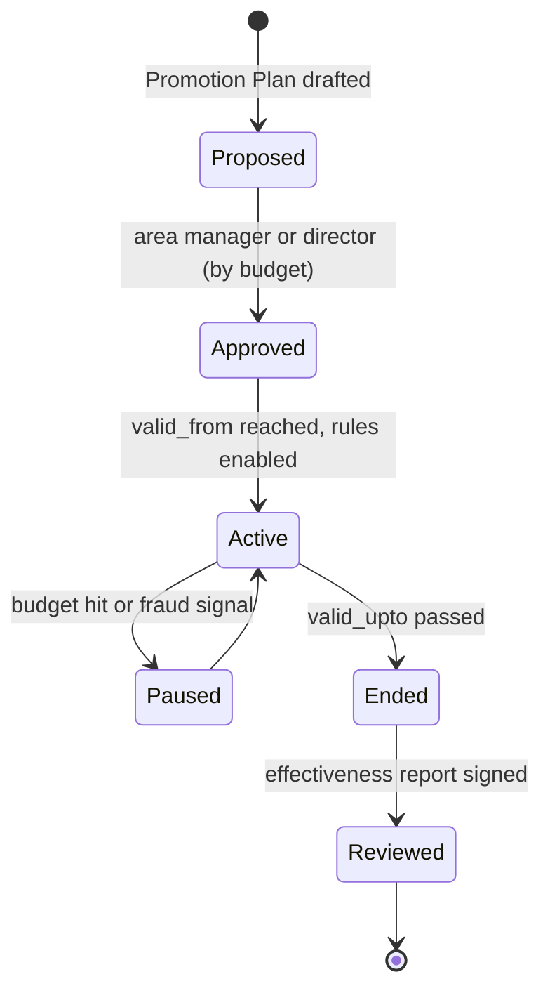
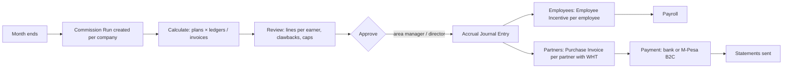
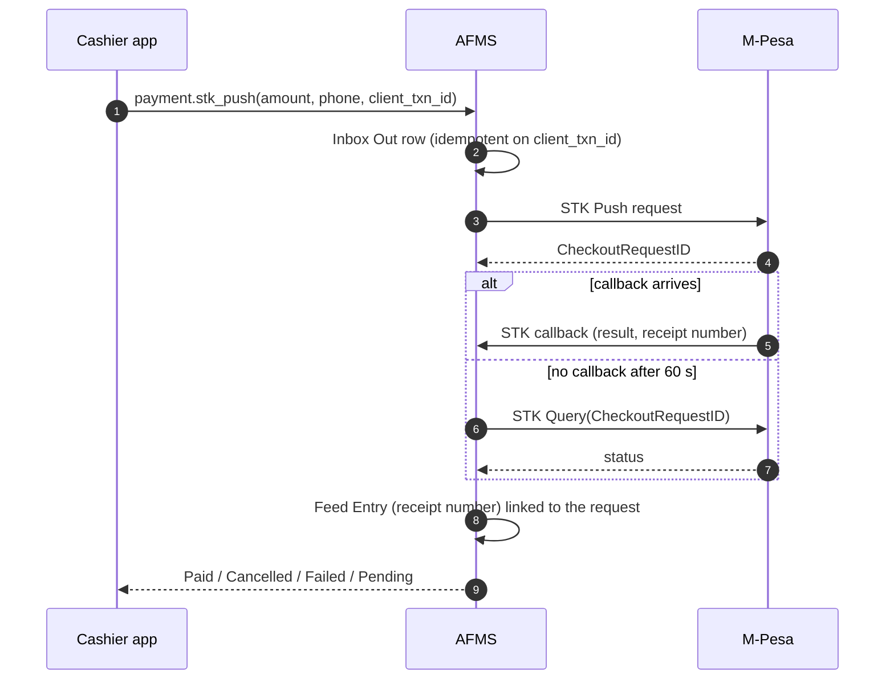

# AFMS Loyalty, Promotions, Discounts, Payments and Commissions

**Version:** 0.1 (draft for review)
**Date:** 2026-11-06
**Applies to:** the `forecourt` app (AFMS) on Frappe Framework v16, ERPNext v16, HRMS v16 (for employee commissions)
**Companion documents:** [fms.md](fms.md) v1.3 · [catalogue.md](catalogue.md) v1.2 · [fms-nonfuel.md](fms-nonfuel.md) v0.2 (Mode B) · [reporting-catalogue.md](reporting-catalogue.md) v1.0 · [test-cases.md](test-cases.md) v1.0 · [ui-ux-design-guide.md](ui-ux-design-guide.md) v1.0
**Audience:** owner, accountants, developers, AI coding agents
**Status:** proposal. Decisions LP-01 to LP-30 (section 25) are **Proposed**.

This guide designs how AFMS gives **discounts**, runs **promotions**, operates a **loyalty programme**, sells and accepts **vouchers and cards**, takes **payments** (with M-Pesa as the reference integration), and pays **commissions** to employees and to external brokers and dealers. For each, it says how values are **calculated**, how they are **posted**, what they do to the **accounts**, and how their **effectiveness** is measured.

**Rule of this guide: native first.** ERPNext already has Pricing Rule, Promotional Scheme, Coupon Code, Loyalty Program, Loyalty Point Entry, Campaign, Sales Partner, Sales Person, Budget, Tax Withholding Category, and HRMS has Employee Incentive and Additional Salary. AFMS uses them as they are. It adds only what fuel retail needs and ERPNext lacks, and every addition is justified in the text.

**Marks.** **[Native]** an ERPNext or HRMS feature used as is. **[FMS]** an AFMS addition. **[Verify]** a native behaviour to confirm on v16 in the build task before relying on it. **[Accountant]** a treatment to confirm with the company's accountant or tax adviser. **[Legal]** to confirm with a lawyer.

---

## Table of contents

1. [Summary](#1-summary)
2. [Principles](#2-principles)
3. [How this fits AFMS: Mode A and Mode B](#3-how-this-fits-afms-mode-a-and-mode-b)
4. [Native building blocks](#4-native-building-blocks)
5. [Discounts](#5-discounts)
6. [Promotions and campaigns](#6-promotions-and-campaigns)
7. [Loyalty programme](#7-loyalty-programme)
8. [Vouchers, gift cards, prepaid and fleet cards](#8-vouchers-gift-cards-prepaid-and-fleet-cards)
9. [Calculation reference and worked examples](#9-calculation-reference-and-worked-examples)
10. [Accounting effects](#10-accounting-effects)
11. [Employee commissions and incentives](#11-employee-commissions-and-incentives)
12. [External brokers, agents and dealers](#12-external-brokers-agents-and-dealers)
13. [The commission run](#13-the-commission-run)
14. [Payment methods and good practice](#14-payment-methods-and-good-practice)
15. [M-Pesa and other payment systems](#15-m-pesa-and-other-payment-systems)
16. [Matching and reconciliation algorithms](#16-matching-and-reconciliation-algorithms)
17. [Measuring effectiveness](#17-measuring-effectiveness)
18. [Controls and fraud](#18-controls-and-fraud)
19. [Integration with the shift and the cashier balance](#19-integration-with-the-shift-and-the-cashier-balance)
20. [Data model additions](#20-data-model-additions)
21. [Roles and approvals](#21-roles-and-approvals)
22. [Reports](#22-reports)
23. [Test cases](#23-test-cases)
24. [Phasing and build tasks](#24-phasing-and-build-tasks)
25. [Decisions and open questions](#25-decisions-and-open-questions)

---

## 1. Summary

| Topic | Native core | AFMS adds | Accounting effect |
|---|---|---|---|
| **Discounts** (fleet per-litre, volume tiers, payment-method, bundles) | Pricing Rule, Promotional Scheme | Fuel price from Fuel Price Change feeds the rule's base; a *Promotion* collection line for discounts given at the pump in Mode A | Reduces revenue; with discount accounting on, shown in a *Discount Allowed* account |
| **Promotions** (campaigns, coupons, free items) | Promotional Scheme, Coupon Code, Campaign, Budget | Promotion approval, budget per station, effectiveness reports | Discount or free-item cost; capped by Budget |
| **Loyalty** (points per spend, tiers, redemption, expiry) | Loyalty Program, Loyalty Point Entry, Customer | Member identification at the pump (phone, card, STK push), earning by litre, fraud limits, **IFRS 15 points liability** (native does not accrue it) | Revenue deferred to a points liability at earning; released at redemption or expiry |
| **Vouchers and cards** (gift vouchers, prepaid fuel, third-party fleet cards) | Mode of Payment, Coupon Code (Gift Card type is a discount, not stored value) | Stored-value voucher register and liability; fleet-card receivable | Liability on sale, revenue on use; receivable from card issuer |
| **Employee commissions** | Sales Person, Sales Team, HRMS Employee Incentive, Additional Salary | Per-litre and per-shift plans, monthly commission run, clawback | Accrued monthly, paid through payroll |
| **Broker and dealer commissions** | Sales Partner, Supplier, Purchase Invoice, Tax Withholding Category | Per-litre and tiered plans, partner statements, M-Pesa B2C payout | Accrued monthly, paid as supplier invoices with withholding tax |
| **Payments** | Mode of Payment, Payment Entry, Bank Reconciliation | Provider adapters through the Integration Inbox; matching engine (section 16) | One Payment Entry per transaction into clearing; cleared on settlement |

**The single most important constraint.** Native loyalty, coupons and per-customer discounts work on a **Sales Invoice (or POS Invoice) with a named customer**. Today's walk-in fuel sales are summarised into one walk-in invoice per shift (Mode A). Per-customer loyalty for walk-in motorists therefore needs **per-sale invoices**: POS, the Mode B PDQ app, or at least an STK-push payment that identifies the customer (section 3).

---

## 2. Principles

| # | Principle | Meaning |
|---|---|---|
| LP-P1 | **Native first** | Pricing Rule, Loyalty Program, Coupon Code, Sales Partner, Sales Person, Budget, Employee Incentive are used before any FMS DocType |
| LP-P2 | **One price source** | The pump price comes from the Fuel Price Change (fms.md 6.5a). Discounts are applied *to* that price, never instead of it. |
| LP-P3 | **Every reduction has a reason, an owner and a ledger** | No discount, free item, point or commission exists without a rule or scheme, an approver and an accounting entry |
| LP-P4 | **Points are a liability** | A point earned is revenue the company has not yet earned. It is accrued when earned, released when redeemed or expired (IFRS 15) **[Accountant]** |
| LP-P5 | **Budgets cap generosity** | Every promotion and discount account has a budget per station and period (native Budget) |
| LP-P6 | **Commissions are accrued when earned, paid when approved** | Monthly run; never paid from the till |
| LP-P7 | **Payments exactly once** | Every external payment has an idempotency key; matching never creates or drops money (fms.md 12.1, test catalogue INV-12) |
| LP-P8 | **Measure against a baseline** | A promotion is effective only if it beats what would have happened without it (section 17) |
| LP-P9 | **Cash balances never absorb promotions** | A discount given at the pump is a recorded collection line, not a cashier shortage |
| LP-P10 | **Personal data minimised** | Members are identified by the least data needed; consent recorded **[Legal]** |

---

## 3. How this fits AFMS: Mode A and Mode B

| Capability | Mode A (count-based, shift summary) | Mode A + POS / STK push | Mode B (transaction-based, PDQ app) |
|---|---|---|---|
| Fleet discounts for credit customers | ✔ on the credit invoice (named customer) | ✔ | ✔ |
| Discount for a walk-in motorist (coupon, payment-method promo) | Only as a *Promotion* collection line at close (19.2) | ✔ per sale | ✔ per sale |
| Loyalty points for walk-in motorists | ✖ (no customer on the walk-in invoice) | ✔ when the sale is a POS Invoice or an STK-push payment tied to a member | ✔ native, per invoice |
| Loyalty for credit customers | ✔ on the credit invoice | ✔ | ✔ |
| Coupons | Promotion collection line with coupon reference | ✔ | ✔ |
| Employee commission per sale | Per shift, from ledgers (cashier litres) | Per shift or per sale | Per sale (Sales Team on each invoice) |
| Broker commission | On credit invoices (Sales Partner) | ✔ | ✔ |

**Recommendation (LP-01).** Launch fleet discounts and broker commissions in Mode A (they work on credit invoices). Launch walk-in loyalty and coupons with Mode B, or earlier at stations that run a fiscal POS or STK push per sale. Do not build walk-in loyalty on top of the shift summary invoice: points would have to be allocated to customers the invoice does not know.

### 3.1 Identifying a walk-in member

| Method | How | Data held | Strength |
|---|---|---|---|
| **STK push** (payment request to the member's phone) | Cashier types the phone; the provider confirms the payment | Phone (needed to send the request) | Strong: the payer is the phone owner |
| **Loyalty card or QR** | Card number scanned on the app or POS | Card number linked to Customer | Strong if cards are not shared |
| **Phone typed** for a cash or card payment | Cashier types the phone; an SMS one-time code confirms | Phone | Medium (needs OTP to prevent staff farming points, 18.2) |
| **Vehicle plate** | Plate typed or read by OCR | Plate on Customer Vehicle | Weak for private cars (shared vehicles) |
| **C2B Buy Goods payment** (customer pays the till directly) | Payer number in the callback | Possibly masked **[Verify]** current Daraja behaviour | Weak: providers may mask the payer number |

---

## 4. Native building blocks

| DocType | Module | Used for | Key fields | Gaps for fuel retail |
|---|---|---|---|---|
| **Pricing Rule** | Accounts | Discounts and free items | `apply_on` (Item Code, Item Group, Brand, Transaction), `price_or_product_discount`, `rate_or_discount` (Discount Percentage, Discount Amount, Rate), `min_qty`, `max_qty`, `min_amt`, `max_amt`, `applicable_for` (Customer, Customer Group, Territory, Sales Partner, Campaign…), `valid_from`, `valid_upto`, `priority`, `apply_multiple_pricing_rules`, `is_cumulative`, `coupon_code_based`, `condition` | Validity is by **date**, not time (no native happy hour); base rate must come from the Fuel Price Change, not the price list |
| **Promotional Scheme** | Selling | Slab-based campaigns that generate Pricing Rules | Price and product discount slabs, applicability, campaign | Same as Pricing Rule |
| **Coupon Code** | Selling | Single or limited-use codes | `coupon_type` (Promotional, Gift Card), `pricing_rule`, `maximum_use`, `used`, `valid_from`, `valid_upto`, `customer` | *Gift Card* type is a discount code, **not** stored value. Availability of the coupon field on Sales Invoice and POS **[Verify]** |
| **Campaign** | CRM | Grouping promotions for measurement | Name, description, schedules | Not on every transaction **[Verify]** which v16 transactions carry `campaign` |
| **Loyalty Program** | Accounts | Points | `loyalty_program_type` (Single Tier, Multiple Tier), collection rules (`tier_name`, `min_spent`, `collection_factor`), `conversion_factor`, `expiry_duration`, `expense_account`, `cost_center`, `customer_group`, `customer_territory`, `auto_opt_in`, from and to dates | Earns on **amount**, not litres; posts no liability at earning; tiers on cumulative spend **[Verify]** |
| **Loyalty Point Entry** | Accounts | Point ledger | Customer, program, points, expiry date, invoice, redeem against | |
| **Customer** | Selling | Member record | `loyalty_program`, `loyalty_program_tier`, customer group | One Customer per member |
| **Sales Partner** | Selling | Brokers, agents, dealers | `partner_type`, `commission_rate` (%), territory, targets | Percentage only; no per-litre or tiered plans |
| **Sales Person**, Sales Team | Selling | Employee attribution | `commission_rate`, `employee`, allocated percentage on the invoice | Percentage only; posts nothing |
| **Item** `grant_commission` | Stock | Which items earn commission | Check | |
| **Budget** | Accounts | Promotion and commission caps | Account, cost center, monthly distribution, action *Stop* or *Warn* | |
| **Tax Withholding Category** | Accounts | Withholding tax on partner commissions | Rates, thresholds | **[Accountant]** rates |
| **Employee Incentive**, **Additional Salary** | HRMS | Employee commission payouts | Salary component, amount, payroll date | |
| **Mode of Payment** | Accounts | Tenders | Default account per company | |
| **Accounts Settings / Selling Settings**: *Enable Discount Accounting for Selling* | Accounts | Post discounts to a *Discount Allowed* account instead of netting them | Item-level discount account, additional discount account | **[Verify]** v16 location of the setting |

**Native reports used as is:** Sales Partner Commission Summary, Sales Partner Transaction Summary, Sales Partner Target Variance, Sales Person Commission Summary, Sales Person-wise Transaction Summary, Sales Person Target Variance, Budget Variance Report.

---

## 5. Discounts

### 5.1 Discount types a station uses

| Type | Example | Native setup | Applies to |
|---|---|---|---|
| **Fleet per-litre discount** | Coast Haulage pays 2.00 less per litre of AGO | Pricing Rule: `apply_on` Item Code AGO, `applicable_for` Customer (or Customer Group *Fleet A*), `rate_or_discount` *Discount Amount* 2.00 | Credit invoices; Mode B sales to the customer |
| **Volume tier** | Fleets above 20,000 L a month get 3.00 per litre | Promotional Scheme with price slabs by monthly volume. Native slabs are per transaction (`min_qty` on one document), so the **monthly** volume tier is set by moving the customer into Customer Group *Fleet Tier 2* each month (FMS job, 5.4) | Credit customers |
| **Payment-method discount** | 1.00 per litre off when paying by M-Pesa this month | Pricing Rule with `condition` on the payment method **[Verify]** (payments are often added after pricing); simpler and recommended: a *Promotion* applied after payment (19.2) | Mode B; Mode A by promotion line |
| **Bundle or cross-sell** | Free car wash with 40 L or more; 10% off oil with an oil change | Product-discount Pricing Rule (free item) or price discount on Item Group | Mode B, POS |
| **Lubricant and shop discounts** | Buy 2 get 1 | Product discount with `same_item`, `recurse_for` | POS, Mode B |
| **Staff discount** | Employees 5% on shop items | Pricing Rule on Customer Group *Staff* (employee as customer) | POS; never on fuel unless policy says so |
| **Happy hour / time-bound** | 1.00 off 14:00–16:00 | **Not native** (validity is by date). Options: `condition` on `posting_time` **[Verify]**, or a Coupon distributed for that slot. Recommended: avoid until Mode B. | |
| **Manual discount** | Manager reduces a price for a complaint | Not a Pricing Rule; a *Promotion* line with reason *Goodwill* and approval above a limit | All |

### 5.2 The fuel price and Pricing Rule

The FMS `validate` hook on Sales Invoice and POS Invoice sets fuel rates from the **Fuel Price Change** in force at the posting time (fms.md 6.5a). Pricing Rules apply discounts to the item's `price_list_rate`. To keep both:

1. The FMS hook sets **`price_list_rate`** of fuel lines to the Fuel Price Change price (the pump price), not `rate`.
2. ERPNext then applies Pricing Rules: `rate = price_list_rate − discount`.
3. If no rule applies, `rate = price_list_rate`.
4. The hook runs **before** pricing rules are applied, and re-runs if posting time changes. **[Verify]** hook order on v16 (`validate` versus the client-side `apply_pricing_rule`); the server must recompute pricing rules after setting the price, so the result does not depend on the browser.

### 5.3 Stacking and priority

| Rule | Setting |
|---|---|
| One discount per line by default | `apply_multiple_pricing_rules` off |
| Higher `priority` wins | Fleet contract priority 10, promotions 5, general 1 |
| A coupon never stacks with a fleet contract | Coupon rules priority below fleet; fleet customers excluded from coupon rules (`applicable_for` Customer Group excluding fleets) |
| Floor price | No rule may take the rate below **cost + minimum margin**. Native has no floor; FMS adds a validation on invoices at FMS stations: rate ≥ moving average cost of the tank + `min_margin_per_litre` (company setting), else coded message **FMS-Y901** (LP-05). |
| Regulated maximum price | Discounts only lower the price; a regulated cap (where one exists) is never exceeded by the base price (reporting catalogue CMP-04) |

### 5.4 Monthly volume tiers (FMS job)

```
On the 1st of each month, for each fleet customer:
    litres_last_month = Σ Sales Ledger qty (fuel, customer, last month)
    tier = highest tier whose min_litres ≤ litres_last_month
    if tier changed: set Customer.customer_group = tier.customer_group
                     log to the customer's timeline
```

The Pricing Rules attached to each tier's Customer Group then apply all month. This keeps pricing native and the tier rule visible.

### 5.5 Posting

| Channel | How the discount reaches the books |
|---|---|
| Credit invoice (shift close, Mode A) | The credit Sales Invoice is built per customer at close. Pricing Rules apply on the server. The **credit slip is still recorded at pump price** for the cashier (the cashier handed fuel worth the pump price); the discount is a revenue reduction on the invoice, not a cashier difference. |
| POS Invoice, Mode B sale | Native: the rule applies on the line |
| Walk-in summary invoice (Mode A) | Discounts given at the pump are *Promotion* lines on the cashier (19.2), posted as an **additional discount** on the walk-in invoice to the *Discount Allowed* account |
| Discount accounting | Turn on *Enable Discount Accounting for Selling* so that discounts post to **Discount Allowed** (by cost center and station) and revenue is shown gross **[Verify]** |

---

## 6. Promotions and campaigns

### 6.1 Lifecycle



| Stage | Native | FMS |
|---|---|---|
| Plan | Campaign (name, dates) | **Promotion Plan** (FMS, light): objective, target KPI, stations, budget, control stations, approver (20.1) |
| Rules | Promotional Scheme or Pricing Rules linked to the Campaign; Coupon Codes | |
| Budget | Budget on *Discount Allowed* (and *Promotion Free Goods*) per cost center, monthly, action *Stop* | Pre-check in readiness for Mode A promotion lines |
| Run | Rules applied on invoices | Promotion lines at close (Mode A) |
| Review | Native sales reports | PRM reports (section 22) |

### 6.2 Coupons

| Use | Setup | Control |
|---|---|---|
| Single-use code sent by SMS | Coupon Code, `maximum_use` 1, linked Pricing Rule | Code used once; `used` counter |
| Multi-use public code (radio campaign) | `maximum_use` high, valid dates short | Per-customer limit not native → FMS check: one use per member per day (Y903) |
| Personal code for a fleet driver | `customer` set | Only that customer |

**Coupon codes are generated** with a cryptographically random generator (at least 8 characters from an alphabet without look-alike characters), never sequentially, so they cannot be guessed.

### 6.3 Free items (product discounts)

A free car wash or free item is a line at rate 0 (native product discount). Its **cost** is the item's valuation (for stock items) or the service cost; the revenue forgone shows in discount accounting. For services (car wash), there is no stock cost; the promotion cost is the forgone revenue only, which matters for measurement (17.3).

---

## 7. Loyalty programme

### 7.1 Programme design

| Element | Recommended | Native setting |
|---|---|---|
| Type | Multiple tier: *Blue*, *Silver*, *Gold* | `loyalty_program_type` Multiple Tier |
| Earning | 1 point per 100 of spend on fuel and shop (example) | `collection_factor` = 100 per tier (lower for higher tiers, for example 80 for Gold) |
| Value of a point | 1 point = 0.50 (example) | `conversion_factor` 0.5 |
| Expiry | 12 months | `expiry_duration` 365 |
| Enrolment | Automatic for customers in group *Loyalty Members* | `auto_opt_in`, `customer_group` |
| Redemption | As tender on a sale, minimum 100 points | Sales Invoice *Redeem Loyalty Points* |
| Accounts | Redemption expense or points liability; cost center per station | `expense_account`, `cost_center` |

**Earning by litre.** Native earning is by amount. Fuel retailers often prefer "points per litre" so price changes do not change earning. Options:

| Option | How | Verdict |
|---|---|---|
| A. Earn by amount (native) | `collection_factor` | **Recommended to start**: native, simple, explains itself on receipts |
| B. Earn by litre | FMS hook after invoice submit writes the Loyalty Point Entry from fuel litres instead of the native calculation | Only if the owner insists; it overrides native behaviour |

### 7.2 What happens on a sale (Mode B or POS)

```mermaid
sequenceDiagram
    autonumber
    participant C as Customer
    participant A as Cashier app
    participant S as Cloud (ERPNext + FMS)
    C->>A: Phone or card
    A->>S: customer.check
    S-->>A: Member Amina W., Silver, 1,240 points (= 620.00)
    C->>A: Pays 5,000 by STK push; redeems 400 points
    A->>S: sale.post (customer = member, redeem 400 points)
    S->>S: Sales Invoice: grand total 5,000; loyalty amount 200.00; balance 4,800 via M-Pesa
    S->>S: Native Loyalty Point Entry: −400 redeemed; earned on the eligible amount
    S->>S: FMS: points liability entries (10.3)
    S-->>A: Receipt with points earned and new balance
```

### 7.3 Tiers

Native tiers compare a customer's spend with each tier's `min_spent` **[Verify]** whether v16 uses spend since the programme start or a window. Fuel programmes usually use a **rolling 12-month** spend. If native behaviour is lifetime spend, an FMS monthly job sets `loyalty_program_tier` from rolling spend (same pattern as 5.4), with downgrade allowed only once a year to avoid customers losing status after one quiet month.

### 7.4 Expiry

Native expiry: each Loyalty Point Entry has an expiry date; expired points cannot be redeemed. Redemption consumes the **oldest points first** (FIFO) **[Verify]**. FMS adds an expiry notice by SMS 30 days before (Notification), and the breakage posting of 10.3.

### 7.5 Returns and cancellations

| Event | Native effect | Rule |
|---|---|---|
| Invoice cancelled | Its Loyalty Point Entries cancelled | Points earned are removed; if already redeemed, the customer's balance can go negative **[Verify]**; FMS blocks cancellation of an invoice whose points were redeemed, unless a manager confirms the negative balance (Y905) |
| Credit Note (return) | Points reduced for returned amount **[Verify]** | Same |
| Redemption on a cancelled invoice | Points restored | |

### 7.6 Fraud limits (FMS)

| Limit | Default | Code |
|---|---|---|
| Points earned per member per day | 5 fills or a value cap | FMS-Y902 |
| Same member at two stations within an impossible interval | 30 minutes, more than 50 km apart | Flag |
| Member's phone differs from the STK payer | Earning only on the payer's own membership | FMS-Y904 |
| Staff phone numbers enrolled as members | Allowed, but staff cannot earn on sales they process | FMS-Y906 |
| Redemption above a limit per transaction | Policy | FMS-Y907 |

### 7.7 Data protection **[Legal]**

Collect only what is needed (name, phone; no ID numbers), record **consent** to the programme and, separately, to marketing messages; allow withdrawal and deletion of personal data while keeping anonymised accounting entries; keep member data inside the company. Kenya's data protection law and registration requirements are to be confirmed with a lawyer before launch.

---

## 8. Vouchers, gift cards, prepaid and fleet cards

Native **Coupon Code (Gift Card)** gives a discount; it does not hold a balance. Real stored value needs a liability. Four instruments, four treatments:

| Instrument | What it is | Native pieces | FMS addition | Accounting |
|---|---|---|---|---|
| **Fuel voucher** (paper or code, fixed value, sold to companies for staff) | Prepaid stored value | Mode of Payment *Fuel Voucher* with the *Voucher Liability* account | **Voucher Register** (FMS): serial, value, buyer, sold on, expires on, status (Issued, Redeemed, Expired, Cancelled) | Sale: Dr Bank, Cr Voucher Liability. Redemption at the pump: tender *Fuel Voucher* (Dr Voucher Liability, Cr Debtors of the sale). Expiry: Dr Voucher Liability, Cr Breakage income **[Accountant]** |
| **Prepaid account** (fleet pays in advance, draws down) | Customer advance | Customer with advance Payment Entry; invoices allocated against the advance | Low-balance alert | Advance is a liability on the customer until invoices consume it (native) |
| **Third-party fleet card** (issued by an oil company or a card network) | Payment by a card the issuer settles | Mode of Payment *Fleet Card <issuer>* with a receivable or clearing account | Card transactions in the Payment Feed (import of the issuer's statement) | Dr Card Issuer Clearing, Cr sale; settled when the issuer pays, less fees |
| **Promotional gift card** (free 500 for new members) | Discount | Coupon Code *Gift Card* + Pricing Rule (discount amount) | Budget | Discount Allowed |

**Shift integration (Mode A).** The existing collection type *Voucher* (fms.md 7.2) records the voucher serial. At close, each voucher serial must exist in the Voucher Register with status *Issued* and not be expired (FMS-Y910); it becomes *Redeemed*. A serial used twice is refused (Y911).

---

## 9. Calculation reference and worked examples

### 9.1 Fleet discount (per litre)

Coast Haulage, AGO pump price 170.00, contract discount 2.00/L, 200 L.

| Step | Value |
|---|---|
| Price list rate (from Fuel Price Change) | 170.00 |
| Pricing Rule discount amount | 2.00 |
| Rate | 168.00 |
| Amount | 200 × 168.00 = 33,600.00 |
| Discount (with discount accounting) | 200 × 2.00 = 400.00 to *Discount Allowed* |
| Cashier credit slip value | 200 × 170.00 = 34,000.00 (the cashier gave fuel worth 34,000 at the pump price) |
| Cashier balance effect | None: the slip covers the litres; the 400 is a revenue reduction, not a shortage |

### 9.2 Monthly volume tier

| Tier | Min litres last month | Discount |
|---|---|---|
| Fleet Tier 1 | 0 | 1.00/L |
| Fleet Tier 2 | 20,000 | 2.00/L |
| Fleet Tier 3 | 50,000 | 3.00/L |

Coast Haulage bought 23,400 L in October → Tier 2 for November: 2.00/L on every litre in November.

### 9.3 Loyalty points

Programme: Silver `collection_factor` 100 (1 point per 100 spent), `conversion_factor` 0.50, expiry 365 days. Sale: 5,000.00; member redeems 400 points.

| Step | Value |
|---|---|
| Redemption value | 400 × 0.50 = 200.00 |
| Amount paid by M-Pesa | 5,000 − 200 = 4,800.00 |
| Points earned | floor(eligible amount ÷ 100). Eligible amount: whole grand total or after redemption **[Verify]** native basis. If after redemption: floor(4,800 ÷ 100) = 48 points |
| Value of points earned | 48 × 0.50 = 24.00 |
| **Effective reward rate** | 24.00 ÷ 4,800 = 0.5% of spend |

### 9.4 Points liability (IFRS 15 style) **[Accountant]**

The value of a point is not the full redemption value, because some points never get used (**breakage**).

```
Expected redemption rate r      = points redeemed ÷ points expired or redeemed, trailing 12 months
                                  (start with a planning estimate, e.g. 70%, until history exists)
Liability per point earned      = conversion_factor × r
Revenue deferred at earning     = points earned × conversion_factor × r
```

Example: 48 points × 0.50 × 0.70 = **16.80** deferred from the 4,800 sale.

At **redemption** of 400 points: release 400 × 0.50 × r_at_earning (FIFO cost of the points) from the liability; the difference to the 200.00 redemption value is recognised as an adjustment.

At **expiry**: release the remaining liability of expired points to revenue (breakage).

**Simpler alternative** (if the accountant agrees the amounts are not material): native behaviour only, i.e. redemption posted to a *Loyalty Expense* account at redemption time, plus a **month-end provision** Journal Entry for outstanding points × conversion × r, reversed on the 1st of the next month. This keeps ERPNext native and gives a correct balance sheet at each month end. **Recommended (LP-10)** for Phase 1 of the programme.

### 9.5 Promotion cost and ROI

```
Promotion cost        = Σ discounts given + Σ free-item cost + Σ points value issued under the promotion + marketing cost
Incremental litres    = actual litres − baseline litres          (section 17.2)
Incremental margin    = incremental litres × margin per litre (before promotion) − cannibalised margin
ROI                   = (incremental margin − promotion cost) ÷ promotion cost
Cost per incremental litre = promotion cost ÷ incremental litres
```

Example: 1.00/L M-Pesa promotion for one month at Westlands. Litres 410,000 (baseline 380,000, from control stations and last year's trend); 60% paid by M-Pesa → discount cost 246,000. Incremental litres 30,000 × margin 8.00 = 240,000. ROI = (240,000 − 246,000) ÷ 246,000 = **−2.4%**: the promotion gave away more than it earned. Without a baseline, the 410,000 litres would have looked like success.

### 9.6 Commission examples

| Plan | Basis | Example |
|---|---|---|
| Employee per-litre | 0.10 per litre sold on own nozzles, shifts with no unresolved shortage | Amina: 21,300 L → 2,130.00 |
| Employee lube sales | 5% of net lubricant sales | 48,000 net → 2,400.00 |
| Car wash crew | 50.00 per wash | 180 washes → 9,000.00 |
| Loyalty sign-up bonus | 20.00 per new verified member | 35 members → 700.00 |
| Broker (fleet introducer) | 0.30 per litre bought by introduced fleets, for 12 months | Coast Haulage 23,400 L → 7,020.00 |
| Broker tiered | 1% of net up to 1 million, 1.5% above, per month | 1.4 million → 10,000 + 6,000 = 16,000.00 |
| Dealer margin | Fixed per litre on the dealer's station volume | 180,000 L × 1.20 = 216,000.00 |

---

## 10. Accounting effects

### 10.1 Accounts to add (per company)

| Account | Type | Used for |
|---|---|---|
| Discount Allowed – Fuel / Shop / Services | Expense (contra-revenue presentation) | Discounts with discount accounting on |
| Promotion Free Goods | Expense | Cost of free items |
| Loyalty Points Liability | Liability (current) | Deferred revenue for points (IFRS 15 option) |
| Loyalty Points Provision | Liability (current) | Month-end provision (simpler option) |
| Loyalty Expense | Expense | Native redemption account (simpler option) |
| Loyalty Breakage Income | Income | Expired points released |
| Voucher Liability | Liability | Sold, unredeemed vouchers |
| Voucher Breakage Income | Income | Expired vouchers |
| Fleet Card Clearing – <issuer> | Asset (receivable) | Third-party card sales until settled |
| Commission Expense – Employees | Expense | Employee commissions |
| Commission Expense – Partners | Expense | Broker and dealer commissions |
| Accrued Commission | Liability | Month-end accrual |
| Withholding Tax Payable | Liability | Tax withheld from partner payouts **[Accountant]** |
| M-Pesa B2C Clearing | Asset or liability | Payouts sent, awaiting confirmation |

Each is mapped in Forecourt Company Settings, never hard-coded (fms.md 13).

### 10.2 Posting matrix

| Event | Document | Dr | Cr |
|---|---|---|---|
| Sale with discount (discount accounting on) | Sales Invoice | Debtors (net) · Discount Allowed | Revenue (gross) · Output tax |
| Sale with free item | Sales Invoice | Debtors · COGS (via stock) | Revenue · Stock (free item) |
| Points earned (IFRS 15 option) | FMS Journal Entry per day or per invoice | Revenue | Loyalty Points Liability |
| Points redeemed (native) | Sales Invoice redemption | Loyalty Expense (or Points Liability in the IFRS option) | Debtors |
| Points expired | FMS Journal Entry, daily job | Loyalty Points Liability | Loyalty Breakage Income |
| Month-end provision (simpler option) | Journal Entry, auto-reversing on the 1st | Loyalty Expense | Loyalty Points Provision |
| Voucher sold | Sales Invoice for a non-stock item *Fuel Voucher* with income account = Voucher Liability, or Journal Entry | Bank / Debtors | Voucher Liability |
| Voucher redeemed | Payment by Mode of Payment *Fuel Voucher* | Voucher Liability | Debtors (sale) |
| Fleet card sale | Payment Entry by Mode *Fleet Card* | Fleet Card Clearing | Debtors |
| Fleet card settlement | Payment Entry (issuer pays) | Bank · Bank charges (fees) | Fleet Card Clearing |
| Commission accrual (month end) | Journal Entry | Commission Expense | Accrued Commission |
| Partner payout | Purchase Invoice (partner as Supplier) with Tax Withholding Category, then Payment Entry | Accrued Commission | Supplier → then Supplier Dr / Bank or B2C Clearing Cr; WHT Payable Cr |
| Employee payout | HRMS Employee Incentive → Additional Salary → Salary Slip | Accrued Commission (or Commission Expense) | Payroll Payable |
| B2C payout confirmed | Payment Entry from B2C Clearing to Bank | B2C Clearing | Bank (M-Pesa float account) |

### 10.3 Tax **[Accountant]**

- **Discounts at the point of sale** reduce the taxable price on the receipt (the customer pays less).
- **Loyalty redemption** is posted natively as a **payment**, so the invoice's tax is computed on the full price. Whether redemptions should reduce the taxable value depends on local tax rules; confirm before launch. If they should, redemption must be modelled as a discount (Pricing Rule triggered by the redemption) instead of a payment.
- **Fiscal receipts** must carry discounts as the fiscal system expects (line discount fields). The fiscal adapter (fms.md 12.3) maps native discount fields; **[Verify]** the field mapping per country.
- **Partner commissions** may be subject to withholding tax; use native Tax Withholding Category on the Supplier.
- **Employee commissions** are employment income processed through payroll with statutory deductions.

### 10.4 Period-end checklist

| Step | Check |
|---|---|
| Points liability or provision posted | Equals report LOY-04 (outstanding points × value × r) |
| Breakage posted | Expired points to income |
| Voucher liability | Equals Voucher Register issued and not expired |
| Fleet card clearing | Only unsettled transactions remain (aged) |
| Commission accrual | Equals the commission run for the month |
| Budget variance | Promotion and commission budgets reviewed |

---

## 11. Employee commissions and incentives

### 11.1 Plans that fit a forecourt

| Plan | Earned by | Basis | Native fit |
|---|---|---|---|
| Fuel volume | Cashiers, attendants | Litres sold on their nozzles | **Not native** (per litre) → Commission Plan (FMS) from the Nozzle Ledger |
| Shop and lubricant sales | Cashiers, lube bay staff | % of net sales of commissionable items | **Native**: Sales Person with `commission_rate`; Item `grant_commission` |
| Services | Car wash crew | Per job | FMS Commission Plan from Service Jobs (fms-nonfuel.md) |
| Loyalty sign-ups | Cashiers | Per verified new member | FMS plan from Customer creation with consent and first purchase |
| Clean shift bonus | Cashiers | Shifts with zero shortage | FMS plan from the Cashier Ledger |
| Targets | Managers | % above station target | Native targets on Sales Person **[Verify]** or FMS plan |

### 11.2 Attribution

| Mode | How the employee is attached to sales |
|---|---|
| Mode A | Ledgers: Nozzle Ledger and Sales Ledger carry the cashier per row. Commission is computed from ledgers, not invoices. The walk-in invoice may carry a Sales Team table with each cashier's share **[optional]**, so native Sales Person reports work too. |
| Mode B, POS | Each invoice's Sales Team has the cashier at 100%. Native reports apply directly. |

### 11.3 Rules

| Rule | Detail |
|---|---|
| Eligibility | Only items with `grant_commission`; only submitted, non-cancelled sales; returns reduce the basis (clawback in the month they happen) |
| Quality conditions | A plan may require: no unresolved shortage on the shift; no fraud signal open (CTL-06); minimum shifts |
| No netting against shortages automatically | Shortages are recovered by the separate process (fms.md 7.3). Any deduction from pay must follow employment law and the employee's agreement **[Legal]** |
| Payout | Through payroll (HRMS Employee Incentive → Additional Salary), never in cash from the till |
| Visibility | Employees see their own commission statement (COM-02) |

---

## 12. External brokers, agents and dealers

### 12.1 Who they are

| Partner type | Example | Earns on |
|---|---|---|
| **Fleet broker / introducer** | Brings transport companies to buy on credit | Litres or net sales of introduced customers, for a period |
| **Sales agent** | Sells vouchers or lubricants to businesses | % of their sales |
| **Dealer** (dealer-operated station) | Runs a station under the company's brand | Dealer margin per litre, or a share of profit **[Open]** |
| **Payment or loyalty partner** | A bank whose card holders get a discount | Usually the partner funds the discount (section 12.4) |

### 12.2 Native setup

- **Sales Partner** for each partner (partner type, territory, commission rate for % plans, targets).
- The same party as a **Supplier** (for payouts), linked by a field on Sales Partner (`fms_supplier`), with the right **Tax Withholding Category**.
- **Customer** has a default Sales Partner, so every invoice to an introduced fleet carries `sales_partner` automatically.
- Native % commission: Sales Invoice `commission_rate`, `total_commission` computed from `amount_eligible_for_commission`.

### 12.3 Plans not covered natively

Per litre, tiered slabs, time-limited (first 12 months of a customer), caps, minimums. These use the FMS **Commission Plan** (20.2). Native fields (`sales_partner` on the invoice) still provide the attribution, and native reports still show the sales by partner.

### 12.4 Partner-funded discounts

When a bank or brand funds a discount (for example 3.00/L off for its card holders):

| Step | Posting |
|---|---|
| Discount at sale | Discount Allowed (as any discount), tagged with the Campaign |
| Claim to the partner | Sales Invoice to the partner (as Customer) for Σ discounts of the campaign, monthly, income account *Discount Recovery* |
| Net effect | Discount cost offset by the recovery; PRM-03 shows the net |

---

## 13. The commission run

### 13.1 Flow



### 13.2 Calculation

```
for each active Commission Plan p:
    for each earner e in p (Sales Person, Employee, Sales Partner):
        basis = query(p.basis, e, period)            # litres, net amount, jobs, members, shifts
        basis -= returns_in_period(p, e)              # clawback
        if p.conditions fail for a shift or sale: exclude it
        amount = apply_slabs(p.slabs, basis)          # flat, per unit, tiered (marginal or whole-band)
        amount = clamp(amount, p.min_payout, p.max_payout)
        add line(e, p, basis, amount, sources)        # sources: list of ledger rows / invoices
```

| Slab method | Meaning | Example (1% to 1M, 1.5% above, basis 1.4M) |
|---|---|---|
| **Marginal** | Each band's rate on the part in that band | 10,000 + 6,000 = 16,000 |
| **Whole band** | The rate of the band reached applies to all | 1.5% × 1.4M = 21,000 |

The plan states which; marginal is the default (LP-20), because whole-band plans create cliff effects people game.

### 13.3 Controls

- A run is **idempotent per period and plan**: re-running replaces the draft, never duplicates a submitted run.
- Submitted runs are immutable; corrections are adjustment lines in the next run.
- Each line keeps its **sources** (ledger rows, invoices), so any amount can be explained to the earner.
- The approver cannot be an earner in the run.
- Caps per earner and per run guard against errors (Y920 above cap).

---

## 14. Payment methods and good practice

### 14.1 Methods at a station

| Method | Mode of Payment | Account | Confirmation | Settlement | Main risk |
|---|---|---|---|---|---|
| Cash (per currency) | Cash KES, Cash USD… | Till per cashier → Safe → Bank (fms.md 8.6) | Count | Banking | Theft, counterfeit, counting errors |
| M-Pesa Buy Goods (till) / Paybill | Mobile Money – M-Pesa | M-Pesa Clearing | Callback (C2B) or STK result | Sweep to bank | Diverted to personal numbers; fake SMS "confirmations" shown by customers |
| M-Pesa STK push | Same | Same | STK callback, Query API | Same | Timeouts mistaken for failures (double charge) |
| Other mobile money (Airtel Money, EVC Plus, Zaad…) | One per provider | Clearing per provider | Callback or statement | Provider payout | Same |
| Card (PDQ) | Card – <acquirer> | Card Clearing | Terminal approval code / RRN | Acquirer settlement less fees | Chargebacks, offline approvals |
| Bank transfer, EFT, RTGS, PesaLink (fleets) | Bank Transfer | Bank (direct) | Bank statement | Immediate | Unidentified receipts |
| Credit account | (no tender: credit slip) | Debtors | Slip signature | Customer payment | Fake slips, over-limit |
| Fuel voucher | Fuel Voucher | Voucher Liability | Serial check | Already prepaid | Copies, reuse |
| Third-party fleet card | Fleet Card – <issuer> | Fleet Card Clearing | Issuer authorisation | Issuer settlement | Card misuse, rejected claims |
| Loyalty points | (native redemption) | Loyalty Expense / Liability | Member verification | n/a | Staff farming points |

### 14.2 Good practice

| # | Practice | How AFMS enforces it |
|---|---|---|
| 1 | **One clearing account per provider and company**; never post non-cash directly to bank | Mode of Payment accounts (FMS-M602 checks type and company) |
| 2 | **One Payment Entry per non-cash transaction** with the provider reference | Shift close (fms.md 6.7) |
| 3 | **Daily reconciliation** of every clearing account to zero for settled items | PAY-01, PAY-02 (reporting catalogue) |
| 4 | **Never accept an SMS shown by the customer as proof** of an M-Pesa payment; only the provider feed or STK result counts | Mode B: sale posts only on confirmed payment; Mode A: unmatched references flagged |
| 5 | **Refunds go back by the same method** to the same payer | Refund flow (14.3) |
| 6 | **Separate duties**: cashiers take payments, accountants reconcile, managers approve exceptions | Roles (section 21) |
| 7 | **Secrets in Password fields**, rotated, never in logs | Integration settings |
| 8 | **Idempotency on every inbound and outbound call** | Integration Inbox external id; outbound request ids |
| 9 | **Bank cash daily** and record deposit slips | CSH-05 Banking Register |
| 10 | **Chargebacks** are tracked per card transaction with evidence (receipt, signature) | Card dispute register (Phase 3, 24) |
| 11 | **Payouts (commissions, refunds) only to verified recipients**, with approval and limits | Payout Request (15.4) |
| 12 | **No personal phones or tills** for business payments | Station till mapping; payments to unknown tills are not assigned |

### 14.3 Refunds and reversals

| Case | Process | Posting |
|---|---|---|
| Customer overpaid by M-Pesa (paid 5,000 for 4,500 of fuel) | Mode B: refund the 500 by B2C to the payer, or keep as customer credit with consent | Payment Entry (Pay) from M-Pesa B2C Clearing; or customer advance |
| Wrong payment to the till (customer meant another business) | Provider reversal request; never refund in cash | Reversal arrives as a negative feed entry; matched to the original (16.6) |
| Card refund | Through the PDQ (refund transaction) | Negative card collection and Payment Entry |
| Reversal after the shift closed | Accountant handles through a Native document correction (fms.md 6.8), not the next shift | Reverses the original Payment Entry |

---

## 15. M-Pesa and other payment systems

All providers plug into the **Integration Inbox** (fms.md 12.1) through a **Payment Adapter** per provider. M-Pesa (Safaricom Daraja API) is the reference implementation. API names and fields below follow the Daraja documentation as generally published; **[Verify]** each against the current Daraja version before building.

### 15.1 Daraja APIs used

| API | Direction | Used for | AFMS record |
|---|---|---|---|
| OAuth (client credentials) | Out | Access token (short-lived, cached and refreshed) | Token cache |
| **C2B Register URL** | Out (once per shortcode) | Registers confirmation and validation URLs | Payment Provider settings |
| **C2B Confirmation** | In (callback) | Every payment to a till or paybill | Integration Inbox → Payment Feed Entry |
| **C2B Validation** (optional, enabled by Safaricom on request) | In, must answer within seconds | Accept or reject a paybill payment (for example, unknown account number) | Fast response from cache only; never blocks on the database |
| **STK Push** (M-Pesa Express) | Out | Payment request to the customer's phone (Mode B, loyalty) | Outbound inbox row with `CheckoutRequestID` |
| **STK Callback** | In | Result of the request | Inbox → Feed Entry linked to the request |
| **STK Query** | Out | Status when the callback is late | Same request |
| **Transaction Status** | Out (async result) | Verify any transaction by receipt number | Verification log |
| **Account Balance** | Out (async result) | Daily balance check of each shortcode | Balance reconciliation (16.7) |
| **Reversal** | Out (async result) | Reverse a wrong payment (with approval) | Reversal request |
| **B2C** | Out (async result) | Payouts: commissions, refunds, cashback | Payout Request |

### 15.2 Inbound: C2B confirmation

| Field (typical) | Use |
|---|---|
| `TransID` | **Idempotency key** (external id) and the reference on the Payment Entry |
| `TransTime` | Station-window matching after conversion from provider time to station time |
| `TransAmount` | Amount |
| `BusinessShortCode` | Till or paybill → Station (and cashier where mapped) |
| `BillRefNumber` | Account reference typed by the payer (paybill): invoice, customer account, plate. Parsed in 16.3. |
| `MSISDN`, names | Payer; may be masked or hashed by the provider **[Verify]**; stored hashed for matching, shown masked (reporting catalogue PAY-03) |
| `OrgAccountBalance` | Running balance; used in 16.7 |

**Handling rule.** The endpoint stores the raw message in the Integration Inbox and returns success immediately; processing happens in a background job. A slow database must never cause the provider to retry, and if it does retry, `TransID` makes the retry harmless.

### 15.3 Outbound: STK push (Mode B and loyalty)



| Result | App behaviour |
|---|---|
| Paid | Sale posts (fms-nonfuel.md 11.4) |
| Cancelled by the customer | Offer another method; nothing posted |
| Timeout or unknown | **Do not resend a new STK push** until the query returns a final status. A blind retry can charge the customer twice. |
| Failed (insufficient funds, wrong PIN…) | Show the reason in plain words |

### 15.4 Outbound: B2C payouts

| Rule | Detail |
|---|---|
| Source | An approved **Payout Request**: commission (from a Commission Run), refund, cashback |
| Recipient | Verified phone of the employee or partner (verified by a 1-unit test payout or by documented KYC) |
| Idempotency | One request id per payout; the provider's originator id stored; a duplicate request is refused (Y930) |
| Limits | Per payout, per day, per recipient; above the limit needs a director |
| Result | Async result callback updates the request; a Payment Entry (Pay) posts only on success |
| Unknown result | Transaction Status query before any retry |
| Reconciliation | B2C Clearing account and the Account Balance check (16.7) |

### 15.5 Security of the M-Pesa integration

| Threat | Control |
|---|---|
| Fake callbacks posted to the endpoint | HTTPS only; secret token in the callback URL; IP allow-list of the provider's published ranges; for unexpected or high-value callbacks, confirm with **Transaction Status** before matching. Daraja callbacks are generally not signed **[Verify]**, so these controls matter. |
| Replay of an old callback | `TransID` idempotency; callbacks older than a window flagged |
| Stolen API credentials | Password fields; separate credentials per environment; rotation; alerts on unusual outbound calls |
| B2C misuse | Approvals, limits, verified recipients, two-person rule for new recipients |
| Callback endpoint overload | Rate limiting; store-then-process |

### 15.6 Other providers

Each adapter implements the same interface: `parse_callback(payload) → FeedEntry`, `request_payment(...)`, `query(...)`, `payout(...)`, `balance()`, `statement(date)`. Airtel Money, card acquirers (settlement files), bank APIs and other mobile money systems (EVC Plus, Zaad, Sahal, MTN MoMo) differ only in the adapter.

---

## 16. Matching and reconciliation algorithms

Matching decides **which sale, cashier, customer or invoice a payment belongs to**. It must never create or lose money, must explain every decision, and must leave anything uncertain to a person.

### 16.1 Layers

| Layer | Question | Method | Automatic? |
|---|---|---|---|
| L0 | Have we seen this payment before? | Idempotency key (`TransID`, `CheckoutRequestID`), fingerprint for keyless rows | Yes |
| L1 | Does the payment name its target? | Deterministic: STK request link; parsed account reference | Yes |
| L2 | Which station and cashier? | Till or terminal mapping + shift window (fms.md 12.2) | Yes |
| L3 | Which sale (Mode B) or debt? | Scored candidate matching | Above threshold with margin |
| L4 | Several payments, several sales at once? | Global assignment (minimum cost) | Above threshold |
| L5 | One payment, several invoices? | Exact subset match, else oldest first | Yes, with log |
| L6 | Do callbacks, statements and bank agree? | Three-way reconciliation | Exceptions to people |
| L7 | Is anything unusual? | Robust statistics and rules | Flags only |

### 16.2 L0: duplicates

```
key = provider + external_id                       # unique index in the Integration Inbox
if key missing (some statement formats):
    fp = (provider, till, amount, minute(time), last3(payer_hash))
    candidates = feed entries with same fp within ±2 minutes
    if candidates: mark as *Possible duplicate* (never merged automatically)
```

### 16.3 L1: parsing the account reference

Paybill payers type an account reference. It may be an invoice number, a customer account code, a vehicle plate or rubbish.

```
ref = upper(strip(BillRefNumber)); ref = remove(ref, " -_/.")
try in order:
  1. invoice pattern (e.g. ACC-SINV-…)  → exact invoice of this company, unpaid
  2. customer account code              → Customer
  3. vehicle plate                      → Customer Vehicle
       normalise look-alikes only in letter-or-digit positions of the plate format (O↔0, I↔1, S↔5, B↔8)
       if no exact hit: Levenshtein distance ≤ 1 against plates of credit customers
       accept only if exactly one plate is within distance 1
  4. nothing                            → unassigned (L2 decides the cashier; accountant decides the customer)
```

### 16.4 L3: scoring candidates (Mode B, debt receipts)

For a payment *p* and a candidate *c* (an unpaid FCC transaction or basket, or an open invoice):

| Feature | f(p, c) in [0, 1] | Weight |
|---|---|---|
| Amount | 1 if equal; else max(0, 1 − abs(Δ)/tolerance), tolerance 1.00 | 0.35 |
| Time | exp(−abs(t_p − t_c) / τ), τ = 180 s | 0.25 |
| Place | 1 if same till and station, else 0 (and cross-station is never auto-matched) | 0.15 |
| Session | 1 if the cashier session that owns *c* initiated or awaited *p* | 0.15 |
| Reference | similarity of parsed reference to *c*'s customer, plate or invoice | 0.05 |
| History | 1 if the payer hash has paid this customer before | 0.05 |

```
score(p, c) = Σ w_i · f_i(p, c)
auto-match  if best ≥ 0.90 and best − second_best ≥ 0.15
suggest     if 0.60 ≤ best < 0.90 (shown to the cashier or accountant with the reasons)
manual      otherwise
```

Weights and thresholds are settings, tuned on the pilot's data (LP-24). Every decision writes a **Payment Match Log** row: payment, candidate, score, each feature, decision, user (if manual). The log is how an auditor checks that matching did not move money arbitrarily.

### 16.5 L4: many payments, many sales

Greedy matching (take the best pair, repeat) can make two wrong matches where a global choice makes two right ones. When several unmatched payments and candidates fall in the same short window at the same till:

```
cost(p, c) = 1 − score(p, c)          (infinite if not allowed: other station, already matched, closed shift)
solve the assignment problem (Hungarian algorithm) on the window's matrix
accept pairs whose score passes the L3 thresholds; leave the rest unmatched
```

Windows are small (a few minutes, a handful of candidates), so a pure-Python implementation is enough; no heavy dependency is required.

### 16.6 L5: one payment, several invoices (and reversals)

A fleet pays 245,300 for several open invoices.

```
open = customer's unpaid invoices, oldest first (limit 20)
if an exact subset sums to the amount (dynamic programming on integer cents):
    choose the subset with the oldest invoices (tie: fewest invoices)
else:
    allocate oldest first (FIFO); remainder as a customer advance
```

**Reversals** (negative feed entries) match the original by the provider's original-transaction field when present, otherwise by amount, till and payer hash within 72 hours, and always go to a person when the original is in a closed shift.

### 16.7 L6: three-way and balance reconciliation

| Check | Formula | Frequency |
|---|---|---|
| Callbacks vs statement | Every statement line has a feed entry (and the reverse), by `TransID` | Daily |
| Statement vs bank | Σ settlements in the statement = bank receipts from the provider | Daily |
| Balance continuity | opening balance + Σ C2B − Σ B2C − Σ charges − Σ sweeps = closing balance (Account Balance API) | Daily |
| Clearing vs unsettled | Clearing account balance = Σ unsettled Payment Entries (test catalogue INV-14) | Daily |

Differences open an exception for the accountant; they are never adjusted automatically.

### 16.8 L7: anomaly signals

| Signal | Method |
|---|---|
| A cashier's mobile money share far below the station's | Robust z-score using median and MAD over 30 days |
| Many round-amount payments late at night | Rule plus z-score of the share of round amounts |
| One payer paying many members' fills | Payer hash linked to more than *n* members in a week |
| Refund or reversal rate above normal | Rate per cashier and station vs network |
| Payments to the till just after the shift ended | Count per cashier |

Signals feed CTL-06 (reporting catalogue). They never block a sale or a close by themselves.

---

## 17. Measuring effectiveness

### 17.1 KPIs

| Area | KPI | Definition |
|---|---|---|
| Discounts | Discount rate | Discount Allowed ÷ gross revenue |
| | Discount per litre | Discount Allowed (fuel) ÷ litres |
| | Leakage | Discounts given outside rules (manual, goodwill) ÷ all discounts |
| Promotions | Incremental litres, ROI, cost per incremental litre | Section 9.5 |
| | Coupon redemption rate | Coupons used ÷ issued |
| Loyalty | Active members (30, 90 days) | Members with at least one purchase |
| | Member share of volume | Member litres ÷ station litres |
| | Visit frequency, average fill | Purchases per active member per month; litres per purchase |
| | Retention, churn | Share of members active in month m who are active in m + 1 |
| | Redemption rate, breakage | Points redeemed ÷ points earned (lagged); expired ÷ earned |
| | Programme cost | (Points value issued + operating cost) ÷ member revenue |
| | Liability | Outstanding points × value × r |
| Commissions | Commission per litre | Commission ÷ litres |
| | Partner ROI | (Margin from the partner's customers − commission) ÷ commission |
| | Payback | Months until a broker's customers' margin covers the commission |
| Payments | Auto-match rate | Payments matched at L0 to L5 automatically ÷ all |
| | Unmatched age | Oldest unmatched payment (days) |
| | Payment cost | Fees ÷ amount, per method |

### 17.2 Baselines: what would have happened anyway

| Method | When | How |
|---|---|---|
| **Control stations** (difference in differences) | Station promotions | Choose similar stations without the promotion. Incremental = (T_after − T_before) − (C_after − C_before) × (T_before ÷ C_before) |
| **Holdout group** | Member campaigns (coupons by SMS) | Randomly keep 10% of eligible members out; compare their spend with the treated group |
| **Same period last year with trend** | When no control exists | Last year's same weeks × this year's trend before the promotion |
| **Pre and post** | Last resort | Shown with a warning: seasonality and price changes are not removed |

**Confounders to check** every time: fuel price changes (EPRA monthly reviews), competitor openings, road works, holidays, supply outages. The Promotion Plan records them in its review.

### 17.3 Cannibalisation and pull-forward

- **Cannibalisation:** members who would have bought anyway now get a discount. Measured by the holdout group.
- **Pull-forward:** customers fill more during the promotion and less after. The review window includes **four weeks after** the promotion ends.
- **Cross-station shift:** customers move from a company station without the promotion. Network-level comparison.

---

## 18. Controls and fraud

| Risk | Example | Control |
|---|---|---|
| Points farming by staff | Cashier enters own phone for customers' cash sales | OTP to the member's phone for non-STK sales; staff cannot earn on own sales (Y906); member ≠ payer flag (Y904); daily earning limit (Y902) |
| Coupon abuse | Same code shared online | `maximum_use`; one use per member per day (Y903); short validity; random codes |
| Fake discounts in Mode A | Cashier claims discounts to cover a shortage | Promotion line needs a valid rule or coupon and is limited by budget (Y908, Y909); exception report PRM-04 |
| Manual price overrides | Price lowered for friends | No rate edit on fuel lines for station roles; goodwill discounts need approval |
| Voucher fraud | Copied voucher serials | Register, single use (Y911), security features on paper vouchers |
| Commission manipulation | Brokers claiming customers they did not bring | Default Sales Partner set on the Customer by the accountant only; change history |
| Commission on reversed sales | Sale returned after payout | Clawback in the next run |
| Payout fraud | B2C to an employee's own number for a partner | Verified recipients, two-person approval for new recipients, limits (Y931) |
| Fake M-Pesa SMS | Customer shows a forged SMS | Only feed or STK result counts (14.2 rule 4) |
| Payments to personal numbers | Staff ask customers to pay a personal number | Signage with the official till; mobile share signal (16.8) |

---

## 19. Integration with the shift and the cashier balance

### 19.1 Mode B and POS

Native: discounts, coupons and loyalty apply on each invoice. The cashier balance (fms-nonfuel.md 11.11) already uses posted sales, so discounts and redemptions are inside the sale totals.

### 19.2 Mode A: promotion lines

New collection type **Promotion** on *Shift Collection* (FMS):

| Field | Rule |
|---|---|
| cashier | Who gave it |
| promotion source | Pricing Rule or Coupon Code (one required) |
| campaign | Fetched from the rule |
| item, litres | What was discounted |
| amount | Discount value (calculated from the rule × litres; editable only for goodwill with approval) |
| reference | Coupon code, M-Pesa receipt (for payment-method promotions), or a manager's approval |

**Effect on the balance:** the line sits on the **accounted** side, like an expense: the cashier collected less money because a discount was given, and the line explains it.

**Posting:** Σ promotion lines become an **additional discount** on the shift's walk-in Sales Invoice, to the *Discount Allowed* account, with the campaign recorded for reporting.

**Gates:**

| Code | Gate |
|---|---|
| FMS-Y908 | Every promotion line has a valid, active rule or unused coupon for the shift date and station, and its amount matches the rule |
| FMS-Y909 | The promotion budget (native Budget on Discount Allowed for the cost center and month) is not exceeded; with *Warn*, an attention item; with *Stop*, a block |
| FMS-Y910, Y911 | Vouchers issued, not expired, not used twice (section 8) |

### 19.3 Commission from shifts

Employee commission plans with a fuel-volume basis read the **Nozzle Ledger** (litres per cashier per shift) and the **Cashier Ledger** (shortage conditions) of submitted, non-superseded rows. A Shift Correction after the commission run produces an adjustment line in the next run.

---

## 20. Data model additions

Only what native DocTypes cannot do.

### 20.1 New DocTypes (FMS, proposed)

| DocType | Module | Why native is not enough | Key fields |
|---|---|---|---|
| **Promotion Plan** | Forecourt Finance | Native Campaign has no objective, budget, control stations or review | campaign (Link), objective, KPI, stations, control stations, budget, approver, status, review notes |
| **Commission Plan** (+ Slab, + Earner) | Forecourt Finance | Native commission is a flat % only | earner type (Sales Person, Employee, Sales Partner), basis (net amount, litres, jobs, members, clean shifts), item group filter, slabs (from, to, rate, unit), slab method (marginal, whole band), conditions, duration per customer, min and max payout, valid from and to |
| **Commission Run** (+ Line) | Forecourt Finance | Native has reports, not runs | company, period, status (Draft, Approved, Posted), lines (earner, plan, basis, amount, clawback, sources), accrual JE, payouts |
| **Fuel Voucher** (register) | Forecourt Finance | Coupon Gift Card holds no balance | serial, value, buyer, sold invoice, expiry, status, redeemed in shift |
| **Payout Request** | Forecourt Integrations | B2C payouts need approval, limits, async results | recipient, phone (verified), amount, source (commission run, refund), approval, provider request id, result, Payment Entry |
| **Payment Match Log** | Forecourt Integrations | Explainability of matching | payment, candidate, layer, score, features, decision, user |

### 20.2 Custom fields

| DocType | Field | Purpose |
|---|---|---|
| Customer | `fms_loyalty_card_no`, `fms_consent_programme`, `fms_consent_marketing`, `fms_consent_at`, `fms_payer_hash` | Member identification and consent |
| Sales Partner | `fms_supplier` (Link Supplier), `fms_payout_phone` | Payouts |
| Sales Invoice, POS Invoice | `fms_campaign` (if native `campaign` is absent **[Verify]**), `fms_member_verified` | Measurement, fraud |
| Shift Collection | type *Promotion*, `pricing_rule`, `coupon_code`, `campaign` | 19.2 |
| Forecourt Company Settings | `min_margin_per_litre`, `loyalty_daily_earning_limit`, `loyalty_expected_redemption_rate`, `match_auto_threshold`, `match_suggest_threshold`, `match_margin`, B2C limits, loyalty and commission account mappings | Settings |

### 20.3 Error codes

New range **FMS-Y9xx: loyalty, promotions, commissions and payouts** (proposed; Y is unused).

| Code | Meaning |
|---|---|
| FMS-Y901 | Rate below cost plus minimum margin |
| FMS-Y902 | Member's daily earning limit reached |
| FMS-Y903 | Coupon already used by this member today |
| FMS-Y904 | Payer differs from the member: points not earned |
| FMS-Y905 | Invoice has redeemed points; cancelling makes the balance negative |
| FMS-Y906 | Staff member cannot earn points on a sale they process |
| FMS-Y907 | Redemption above the per-transaction limit |
| FMS-Y908 | Promotion line without a valid rule or coupon, or amount differs from the rule |
| FMS-Y909 | Promotion budget exceeded |
| FMS-Y910 | Voucher not issued, expired or cancelled |
| FMS-Y911 | Voucher already redeemed |
| FMS-Y920 | Commission above the plan or run cap |
| FMS-Y921 | Approver is an earner in the commission run |
| FMS-Y930 | Duplicate payout request |
| FMS-Y931 | Payout recipient not verified, or above limit |

---

## 21. Roles and approvals

| Action | Prepared by | Approved by |
|---|---|---|
| Fleet discount (Pricing Rule for a customer) | Accountant | Area manager; director above a discount per litre set by the company |
| Promotion Plan and its rules | Area manager or marketing | Director (by budget) |
| Coupon batch | Marketing / accountant | Area manager |
| Loyalty Program changes (earning, value, expiry) | Accountant | Director |
| Goodwill discount at the station | Station manager | Area manager above the limit |
| Voucher batch issue | Accountant | Director |
| Commission Plan | Accountant / HR | Director |
| Commission Run | Accountant | Area manager (employees), director (partners); never an earner (Y921) |
| Payout Request (B2C) | Accountant | Second approver; director above the limit |
| M-Pesa reversal request | Accountant | Area manager |

---

## 22. Reports

New report domains, built with the reporting catalogue's framework (filters, totals profiles, permissions).

| ID | Title | Answers | Prof. |
|---|---|---|---|
| LOY-01 | Loyalty Programme Summary | Members, active members, points earned, redeemed, expired, liability | T-WTD |
| LOY-02 | Member Activity and Cohorts | Retention by month of joining; frequency; average fill | T-WTD |
| LOY-03 | Member Statement | Points history for one member | T-BAL |
| LOY-04 | Points Liability | Outstanding points by expiry month × value × r; equals the GL | T-ADD |
| LOY-05 | Loyalty Fraud Signals | Members paid by others, staff-linked members, velocity | T-RANK |
| PRM-01 | Discount Register | Every discount by rule, campaign, customer, station | T-REG |
| PRM-02 | Promotion Effectiveness | Baseline, actual, incremental, cost, ROI, with method | T-WTD |
| PRM-03 | Campaign Cost and Recovery | Discount cost, partner recovery, net | T-ADD |
| PRM-04 | Promotion Exceptions (Mode A) | Promotion lines by cashier, without coupons, near budget | T-REG |
| PRM-05 | Coupon Usage | Issued, used, rate, abuse flags | T-REG |
| COM-01 | Commission Run Detail | Lines with sources, clawbacks, caps | T-REG |
| COM-02 | Commission Statement | One earner's commission history and payouts | T-BAL |
| COM-03 | Partner Performance | Partner customers' litres, margin, commission, ROI, payback | T-RANK |
| COM-04 | Commission Accrual Check | Run total = accrual JE = payable movements | T-ADD |
| PMT-01 | Payment Match Log | Decisions by layer, score, user; auto-match rate | T-REG |
| PMT-02 | M-Pesa Balance Reconciliation | Daily balance continuity per shortcode | T-BAL |
| PMT-03 | Payout Register | B2C payouts, status, approvals, results | T-REG |
| PMT-04 | Voucher Register | Issued, redeemed, expired, liability | T-BAL |
| PMT-05 | Fleet Card Settlement | Card sales vs issuer settlements, fees, ageing | T-ADD |

Native reports listed in section 4 are linked from the same workspace cards.

---

## 23. Test cases

Written in the format of test-cases.md (to be merged there as sections when accepted).

| ID | Case | Expected | Pri |
|---|---|---|---|
| TC-LPD-001 | Fleet Pricing Rule 2.00/L on AGO at pump price 170 | Rate 168.00; discount 400.00 for 200 L to Discount Allowed | P0 |
| TC-LPD-002 | Price change at 14:00; credit sale at 14:30 | Discount applied to the new pump price | P0 |
| TC-LPD-003 | Two rules apply; multiple rules off | Higher priority only | P0 |
| TC-LPD-004 | Discount takes rate below cost + minimum margin | FMS-Y901 | P0 |
| TC-LPD-005 | Credit slip with a fleet discount | Cashier balance unaffected; invoice discounted | P0 |
| TC-LPD-006 | Monthly tier job moves a customer from Tier 1 to Tier 2 | Customer group changed; November invoices use Tier 2 rules | P1 |
| TC-LPD-007 | Pricing rule result computed on the server, not trusted from the client | Same rate when the client sends a different one | P0 |
| TC-LPD-010 | Promotion line in Mode A with a valid coupon | Accounted side; additional discount on walk-in invoice | P0 |
| TC-LPD-011 | Promotion line without rule or coupon, or wrong amount | FMS-Y908 | P0 |
| TC-LPD-012 | Promotion budget *Stop* exceeded | FMS-Y909 blocks; *Warn* shows attention | P0 |
| TC-LPD-013 | Coupon used twice beyond `maximum_use` | Refused | P0 |
| TC-LPD-020 | Loyalty earning on a 5,000 sale with 400 points redeemed | Points per the native basis **[Verify]**; liability entry 9.4 | P0 |
| TC-LPD-021 | Redemption of more points than the balance | Refused | P0 |
| TC-LPD-022 | Redemption of expired points | Refused | P0 |
| TC-LPD-023 | Invoice with redeemed points cancelled | Y905 unless confirmed | P0 |
| TC-LPD-024 | Points expiry job | Breakage JE equals expired points × value × r; LOY-04 = GL | P0 |
| TC-LPD-025 | Month-end provision (simpler option) and its reversal | Balance correct at month end; reversed on the 1st | P0 |
| TC-LPD-026 | Staff earns on own sale | FMS-Y906 | P1 |
| TC-LPD-027 | STK payer differs from member | FMS-Y904; no points | P1 |
| TC-LPD-030 | Voucher sold, redeemed, expired | Liability in, out, breakage; register = GL | P0 |
| TC-LPD-031 | Voucher serial used twice in one shift and across shifts | FMS-Y911 | P0 |
| TC-LPD-032 | Fleet card sale and settlement with fees | Clearing to zero; fees as bank charges | P0 |
| TC-LPD-040 | Commission run per-litre plan from Nozzle Ledger | Amount = litres × rate on eligible shifts only | P0 |
| TC-LPD-041 | Tiered marginal vs whole-band slabs | 16,000 vs 21,000 for the 9.6 example | P0 |
| TC-LPD-042 | Return in the next month | Clawback line in the next run | P0 |
| TC-LPD-043 | Commission run re-run in draft | Replaced, not duplicated | P0 |
| TC-LPD-044 | Approver is an earner | FMS-Y921 | P0 |
| TC-LPD-045 | Partner payout with withholding tax | Purchase Invoice with WHT; payable and WHT correct | P0 |
| TC-LPD-046 | Employee payout | Employee Incentive created per employee; appears on the salary slip | P0 |
| TC-LPD-047 | Shift corrected after the run | Adjustment line in the next run | P1 |
| TC-LPD-050 | C2B callback received 3 times | One feed entry (TransID) | P0 |
| TC-LPD-051 | STK timeout, then late success callback | No second STK push; sale posts once on the success | P0 |
| TC-LPD-052 | STK query says cancelled, then a success callback arrives | Success wins; flagged for review **[Open]** | P0 |
| TC-LPD-053 | B2C payout result unknown | Transaction Status queried before any retry; no double payout | P0 |
| TC-LPD-054 | Duplicate payout request | FMS-Y930 | P0 |
| TC-LPD-055 | Fake callback with a valid shape but unknown TransID (high value) | Not matched until Transaction Status confirms | P0 |
| TC-LPD-060 | Plate reference `KBZ 123A` typed as `KBZ123A`, `K8Z123A` | Matched to the plate (one within distance 1) | P1 |
| TC-LPD-061 | Reference within distance 1 of two plates | Not auto-matched | P0 |
| TC-LPD-062 | Two payments, two FCC transactions crossed in time | Global assignment gives the right pairs where greedy would not | P0 |
| TC-LPD-063 | Payment exactly covering three of five open invoices | Exact subset chosen (oldest tie-break) | P1 |
| TC-LPD-064 | Score above threshold but margin to second best below 0.15 | Suggested, not auto-matched | P0 |
| TC-LPD-065 | Cross-station candidate with a perfect amount and time | Never auto-matched | P0 |
| TC-LPD-066 | Balance continuity with a missing callback | Exception raised; nothing adjusted | P0 |
| TC-LPD-067 | Every auto-match writes a Payment Match Log row with features | Present | P1 |

---

## 24. Phasing and build tasks

| Phase | Scope | Works in |
|---|---|---|
| **1. Discounts and vouchers** | Discount accounting on; fleet Pricing Rules; fuel price feeding `price_list_rate`; floor price (Y901); monthly tier job; Fuel Voucher register; fleet card modes; Budget on discount accounts; PRM-01, PMT-04, PMT-05 | Mode A |
| **2. Commissions** | Sales Partner and supplier link; Commission Plan and Run; accruals; Employee Incentive and partner Purchase Invoice payouts; WHT; COM reports | Mode A |
| **3. Payments engine** | Adapters on the inbox; L0 to L2 and L5 to L6 matching; balance reconciliation; Payment Match Log; PMT-01, PMT-02 | Mode A |
| **4. Promotions in Mode A** | Promotion Plan; Promotion collection lines and gates (Y908, Y909); PRM-02 to PRM-05 with control stations | Mode A |
| **5. Loyalty and coupons** | Loyalty Program, member identification, consent, fraud limits, points liability, LOY reports | Mode B or POS / STK |
| **6. Advanced matching and payouts** | L3 to L4 scoring and assignment; B2C payouts with approvals; partner-funded discounts; anomaly signals | Mode B |

Tasks for a new TASKS.md section **V. Value programmes** (prefix FMS-V, unused): FMS-V01 to V06 one per phase, each split into tasks when scheduled. Every phase starts with a **[Verify]** task for the native behaviours it relies on (points basis, tiers, coupon on Sales Invoice, campaign field, discount accounting, hook order).

---

## 25. Decisions and open questions

### 25.1 Decisions (all Proposed)

| # | Decision |
|---|---|
| LP-01 | Fleet discounts and partner commissions first (Mode A); walk-in loyalty and coupons only with per-sale invoices (Mode B, POS, STK) |
| LP-02 | Discounts are native Pricing Rules and Promotional Schemes; no FMS discount engine |
| LP-03 | The Fuel Price Change sets `price_list_rate`; Pricing Rules discount from it; the server recomputes |
| LP-04 | Discount accounting on: discounts in *Discount Allowed* by station |
| LP-05 | Floor price: rate ≥ cost + minimum margin per litre (Y901) |
| LP-06 | Monthly volume tiers by Customer Group, set by a monthly job |
| LP-07 | No time-of-day discounts until Mode B |
| LP-08 | Native Loyalty Program, earning by amount |
| LP-09 | Member identification by STK payer, card or OTP; never by unverified phone |
| LP-10 | Points liability by month-end provision first; full IFRS 15 deferral if the accountant requires it |
| LP-11 | Rolling 12-month tiers by an FMS job if native tiers use lifetime spend |
| LP-12 | Loyalty fraud limits (Y902 to Y907) |
| LP-13 | Stored-value vouchers as a register with a liability, not Coupon Gift Cards |
| LP-14 | Third-party fleet cards as clearing receivables per issuer |
| LP-15 | Promotion Plan with control stations and a four-week after-period for every promotion |
| LP-16 | Native Budget on discount accounts caps promotions |
| LP-17 | Mode A discounts at the pump as Promotion collection lines, posted as additional discount |
| LP-18 | Commission Plans and Runs (FMS) for per-litre, tiered and conditional plans; native Sales Partner and Sales Person for attribution and % plans |
| LP-19 | Commissions accrued monthly; employees paid through payroll, partners through Purchase Invoices with WHT |
| LP-20 | Marginal slabs by default |
| LP-21 | Clawbacks in the next run; submitted runs immutable |
| LP-22 | All payment providers through the Integration Inbox with adapters |
| LP-23 | Store-then-process for every callback; idempotency by provider id |
| LP-24 | Layered matching with scores, thresholds, margins and a match log; uncertain matches to people |
| LP-25 | No blind STK or B2C retries; query first |
| LP-26 | Payouts only to verified recipients with two-person approval for new recipients |
| LP-27 | Three-way and balance-continuity reconciliation daily |
| LP-28 | New error range FMS-Y9xx |
| LP-29 | Effectiveness measured against a baseline (control stations, holdout, or last year with trend) |
| LP-30 | Personal data minimised; consent recorded; payer numbers stored hashed |

### 25.2 Open questions

| # | Question | Default until answered |
|---|---|---|
| OQ-01 | Points liability: provision (simpler) or full IFRS 15 deferral? | Provision |
| OQ-02 | Do loyalty redemptions reduce the taxable value? | Treated as payment (native) |
| OQ-03 | Earning by amount or by litre? | Amount |
| OQ-04 | Point value, earning rate, tiers, expiry | Examples in 7.1 |
| OQ-05 | Expected redemption rate before history exists | 70% |
| OQ-06 | Minimum margin per litre for the floor price | Set by the company |
| OQ-07 | Discount approval limits per role | 21 |
| OQ-08 | Are dealer-operated stations in scope, and on what terms (margin per litre, profit share)? | Not in scope |
| OQ-09 | Withholding tax treatment of broker commissions | Accountant |
| OQ-10 | Employee commission plans and whether they depend on shortage-free shifts | Examples in 9.6 |
| OQ-11 | Is B2C payout wanted, or bank transfers only? | Bank transfers first |
| OQ-12 | STK result conflict (query says cancelled, callback says paid) | Callback wins, flagged |
| OQ-13 | Matching weights and thresholds after the pilot | Section 16.4 |
| OQ-14 | Data protection obligations before launching loyalty | Lawyer |
| OQ-15 | Partner-funded discounts: which partners, claim terms | None until agreed |
