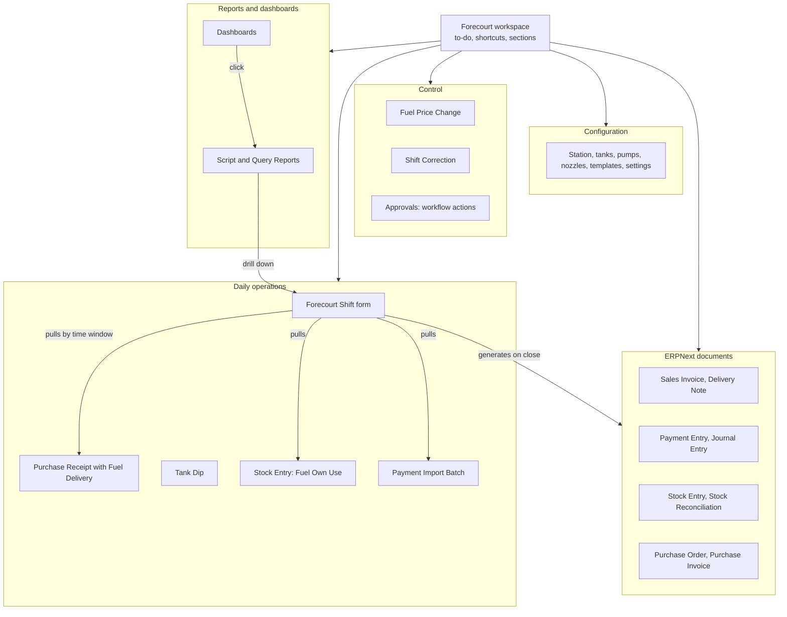
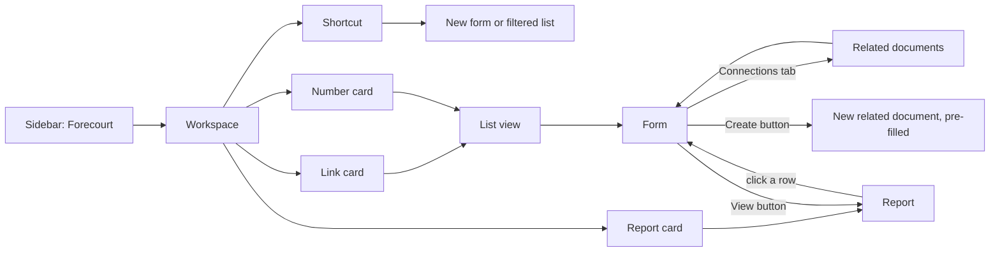
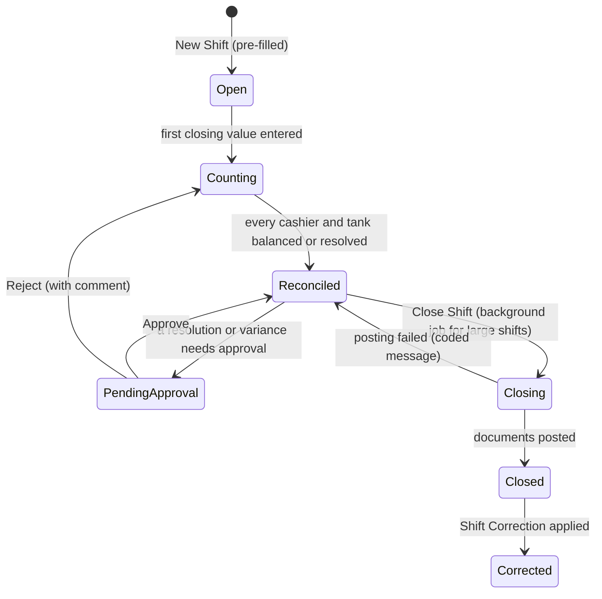
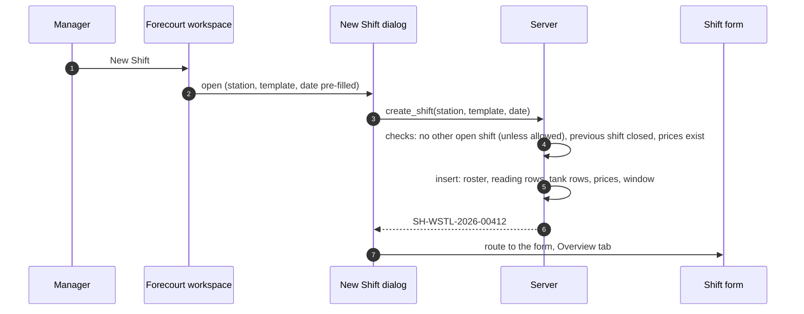

# AFMS UI/UX Design and Interaction Guide

**Version:** 1.0 (draft for review)
**Date:** 2026-11-06
**Applies to:** the `forecourt` app (AFMS) on Frappe Framework v16 and ERPNext v16 (HRMS v16 optional).

**Companion documents:** [FMS ](fms.md) v1.3 (behaviour) · [Catalogue ](catalogue.md) v1.2 (DocTypes, fields; authoritative for names) · [fms-nonfuel.md](fms-nonfuel.md) v0.2 (non-fuel and Mode B, proposed) · [TASKS.md](../TASKS.md) v1.1 (progress)
**Audience:** developers, AI coding agents, reviewers, the owner

This guide is the reference for how AFMS looks and behaves on screen: workspace, navigation, forms, grids, dialogs, buttons, reports, dashboards, statuses, messages and wording. It does not change behaviour defined in fms.md or names defined in catalogue.md. Where it recommends a change to either, the change is listed in [section 25](#25-design-decisions-and-outstanding-questions) for the owner to confirm.

---

## How to read this guide

### Status marks

Every significant statement carries one of four marks, so existing work, requirements and proposals are never mixed up.

| Mark | Meaning | Source |
|---|---|---|
| **[Exists]** | Built, according to TASKS.md (task ticked) | TASKS.md v1.1 |
| **[Spec]** | Documented requirement or design, built or not | fms.md, catalogue.md |
| **[Rec]** | Recommendation of this guide. Not yet accepted. | This guide, decisions UX-01 to UX-30 |
| **[Open]** | Needs the owner's decision. Not to be built until decided. | Section 25.2, questions Q-01 to Q-18 |

Items from fms-nonfuel.md (dry stock counts, services, Mode B) are **[Spec, proposed]**: documented, but their decisions D37 to D62 are not yet accepted.

### What was reviewed, and what was not

| Source | Reviewed | Notes |
|---|---|---|
| docs/fms.md v1.3 | Yes, in full for shifts, cashiers, wetstock, reports, errors, roles, decisions | |
| docs/catalogue.md v1.2 | Yes: modules, DocTypes, fields, custom fields, hooks, reports, cards, workspaces | |
| TASKS.md v1.1 | Yes: progress and task descriptions | 98 of 124 tasks ticked; sections K to N (testing, CI, deployment, pilot) not started |
| docs/fms-nonfuel.md v0.2 | Yes | Proposed |
| CLAUDE.md, README.md | **No** | Not available in this session |
| DocType JSON, controllers, client scripts, workspace JSON, report code | **No** | The repository was not reachable from this session |

**Consequence.** "[Exists]" means *ticked in TASKS.md*, not *checked in code*. Before any recommendation is implemented, the gap check in [section 24.1](#241-step-0-gap-check-against-the-code) compares this guide with the code and records any difference.

### Names used in this guide

- **AFMS** is the product. **`forecourt`** is the Frappe app. **FMS** is used as a prefix for codes and fields (`FMS-S101`, `fms_forecourt_shift`), as in the existing specs.
- **Forecourt workspace** is the single main workspace this guide recommends (the "FMS Workspace" of the brief).
- **Cashier** is the person accountable for money in a shift (fms.md 7.1). **Attendant** is a person who pumps fuel but carries no balance. The roles are in [section 17](#17-role-based-ux).

---

## Table of contents

1. [Executive summary](#1-executive-summary)
2. [Project context and design objectives](#2-project-context-and-design-objectives)
3. [UI/UX design principles](#3-uiux-design-principles)
4. [Overall application architecture](#4-overall-application-architecture)
5. [Workspace and navigation design](#5-workspace-and-navigation-design)
6. [Form design standards](#6-form-design-standards)
7. [Child tables vs independent DocTypes](#7-child-tables-vs-independent-doctypes)
8. [Dialogs and Quick Entry guidelines](#8-dialogs-and-quick-entry-guidelines)
9. [Automatic field population and dependencies](#9-automatic-field-population-and-dependencies)
10. [Detailed operational form designs](#10-detailed-operational-form-designs)
11. [Shift lifecycle and operational UX](#11-shift-lifecycle-and-operational-ux)
12. [Shift closing and reconciliation UX](#12-shift-closing-and-reconciliation-ux)
13. [Reporting architecture and standards](#13-reporting-architecture-and-standards)
14. [Detailed report specifications](#14-detailed-report-specifications)
15. [Dashboard and KPI design](#15-dashboard-and-kpi-design)
16. [Alerts, statuses and colour standards](#16-alerts-statuses-and-colour-standards)
17. [Role-based UX](#17-role-based-ux)
18. [Naming and terminology standards](#18-naming-and-terminology-standards)
19. [Buttons and interaction patterns](#19-buttons-and-interaction-patterns)
20. [Validation and error-handling standards](#20-validation-and-error-handling-standards)
21. [Native Frappe/ERPNext compatibility](#21-native-frappeerpnext-compatibility)
22. [Responsive and mobile UX considerations](#22-responsive-and-mobile-ux-considerations)
23. [Accessibility and usability standards](#23-accessibility-and-usability-standards)
24. [Implementation recommendations](#24-implementation-recommendations)
25. [Design decisions and outstanding questions](#25-design-decisions-and-outstanding-questions)

---

## 1. Executive summary

AFMS turns what happens on a forecourt (meter readings, dips, cash, mobile money, credit slips, deliveries) into ordinary ERPNext accounting and stock. Its most important screen is the **Forecourt Shift** form. A station manager fills it in after every shift, often on a tablet, often with a queue outside. The specs set the target: a typical shift closed in **under 10 minutes**, typing only what only a human can know (fms.md 1.5).

Most of Phases 0 to 3 is built (98 of 124 tasks). The core design is sound and follows Frappe conventions: one submittable shift with child tables, standalone documents for things with their own life (deliveries, spot dips, price changes, corrections), append-only ledgers for reports, and coded error messages. This guide keeps that architecture and concentrates on how people reach and use it.

**The ten most important recommendations**

| # | Recommendation | Why | Ref |
|---|---|---|---|
| 1 | **One Forecourt workspace** with nine sections replaces the seven built workspaces (and the ten proposed in catalogue 1.2). Role differences come from permissions, not separate workspaces. | The owner prefers one workspace. Frappe already hides what a user cannot open, so one workspace serves every role with less to maintain. | 5, UX-01 |
| 2 | **A to-do row with live counts** at the top of the workspace: *Open Shifts*, *Pending Approval*, *Unmatched Payments*, *Draft GRNs* | The manager sees what needs doing without searching | 5.3, UX-02 |
| 3 | **Overview tab first** on the shift. It holds status, the readiness panel and the read-only prices. The separate *Prices* tab goes. | The current first tab (Prices) holds nothing to type. The first screen should show the state of the shift. | 10.1, UX-05 |
| 4 | **Close readiness panel**: *Ready*, *Attention required* or *Blocked*, with every issue listed, coded, explained and linked to the exact row | Uses the gates that already exist (F12) before the user presses Submit, not after | 12, UX-10 |
| 5 | **A Close Shift button** as the primary action. It runs the readiness check, shows a summary, then submits. A second click cannot start a second close. | "Submit" says nothing to a station manager. Closing twice must be impossible. | 12.5, UX-12 |
| 6 | **Next-shift prompt** after a successful close, opening a pre-filled new shift in one click. No automatic creation (D32). | Saves a navigation step without taking the decision away from the manager | 11.3, UX-13 |
| 7 | **Grids show only what the user types plus the result.** Openings and calculations are read-only columns. History moves to reports (*Meter Movement*, *Tank Stock Movement*). | Keeps the reading grid to one line per nozzle on a tablet | 10.2, UX-07 |
| 8 | **Six new or reshaped reports** for gaps the specs leave: Meter Movement, Tank Stock Movement, Shift Reconciliation, Payment Reconciliation, Cash Collection, Cashier Performance | Requested in the brief and needed to answer daily questions | 14, UX-20 |
| 9 | **One colour language**: green done, blue in progress or information, yellow waiting for someone, orange needs attention, red blocked or failed, grey neutral, purple corrected. Always with text. | Today colours are chosen screen by screen | 16, UX-23 |
| 10 | **Keep the existing error-code scheme** (`FMS-S105`, `FMS-T203`) and a fixed three-part message: what happened, why, what to do. Never a traceback. | Codes already exist in `errors.py` and in the specs. A second scheme (`FMS-CLS-004`) would split the catalogue. | 20, UX-26 |

**What this guide deliberately does not do:** add a custom navigation system, replace Desk forms with custom pages in Phases 0 to 3, or change any DocType, workflow or permission. Every recommendation is a configuration or a small client script on top of native Frappe, except one later option (the dedicated Shift Close page, already a backlog epic), which is assessed in [section 21.3](#213-custom-elements-and-their-justification).

---

## 2. Project context and design objectives

### 2.1 Where AFMS is used

| Condition | Effect on design |
|---|---|
| Shift close happens at the station, after the shift, often on a 10-inch tablet, sometimes on a desktop | Large touch targets, short grids, no horizontal scrolling outside grids, *Enter* moves down in grids |
| The manager types from a paper sheet or a photo of the meters | Grid order must match the physical order of nozzles and tanks (pump, nozzle number), not the order of creation |
| Interruptions are normal: a delivery arrives, a customer complains | Drafts save at any point, the form shows where the user stopped (status, readiness) |
| Connectivity can be weak | Few round trips; no screen that reloads large data on every keystroke |
| Users range from cashiers with little computer experience to accountants and directors | Plain words, consistent labels, one place to start |
| Money and fuel are at stake every shift | Errors must be prevented or caught before posting; nothing is cleared silently (P6) |
| Several stations, several companies, one or many sites (D1 open) | Every screen filters by the user's stations; nothing depends on the deployment choice |

### 2.2 Users and their main jobs

| Persona | Main jobs in AFMS | Frequency | Device |
|---|---|---|---|
| Station manager, assistant manager | Create and close shifts, post GRNs with dips, own use, spot dips, review variances | Every shift | Tablet, desktop |
| Supervisor | Help with shift entry, mid-shift events (handovers, price-change readings, drops) | Every shift | Tablet |
| Cashier | Hand over money and slips; check own statement | Every shift (statement weekly) | Phone or none; Mode B app later |
| Attendant | Pumps fuel. In Mode A, rarely uses the system. | Rarely | None, or the Mode B app |
| Station accountant | Mobile money and bank reconciliation, supplier invoices, receivables, period close | Daily | Desktop |
| Area manager | Approve variances, price changes and over-limit credit; compare stations; spot checks | Daily | Desktop, phone |
| Director | Approve Shift Corrections; read dashboards and statements | Weekly | Desktop, phone |
| Investor | Read dashboards and statements of their companies | Monthly | Phone, desktop |
| Forecourt administrator | Set up stations, equipment, settings and masters | At setup, then rarely | Desktop |
| Integration service account | API only (feeds, fiscal, devices) | Continuous | None |

### 2.3 Design objectives

| # | Objective | Measured by |
|---|---|---|
| O1 | A typical shift (8 nozzles, 3 tanks, 2 cashiers, 5 credit slips) closes in under 10 minutes on a tablet | Task FMS-K02 timing test **[Spec]** |
| O2 | Any daily task is three clicks or fewer from the Forecourt workspace | Walk-through in task FMS-U12 **[Rec]** |
| O3 | Every blocking problem is shown before Submit, with the row it concerns | Readiness panel lists 100% of gates (test in FMS-U06) **[Rec]** |
| O4 | No user other than a System Manager ever sees a traceback | Error handling test (FMS-U10) **[Rec]** |
| O5 | The same word means the same thing everywhere | Terminology check against section 18 in code review **[Rec]** |
| O6 | Every figure on a dashboard equals the report it opens | Report totals tests (FMS-H11) **[Exists]** plus card checks (FMS-U09) **[Rec]** |
| O7 | A user who knows ERPNext feels at home | No custom navigation; native lists, forms, reports **[Rec]** |

---

## 3. UI/UX design principles

These principles extend P1 to P9 of fms.md, which remain the rules for behaviour. Every review of a screen checks it against this list.

| # | Principle | In practice | Brief priority |
|---|---|---|---|
| UX-P1 | **Type only what only a human can know** | Openings, prices, receipts, own use, totals and differences are filled by the system. The user types closing readings, dips, cash, slips and reasons. (fms.md 1.4, "extra requirements") | 1, 3 |
| UX-P2 | **One starting point** | Everyone starts on the Forecourt workspace. Its top rows are the to-do list. | 2, 10 |
| UX-P3 | **Show the state, always** | Every operational document shows its status as a labelled indicator. The shift also shows its readiness. | 4 |
| UX-P4 | **Catch errors where they are made** | Field-level checks while typing (warnings), document checks on save, gates before close. The earliest possible moment, with the row named. | 3, 9 |
| UX-P5 | **Separate entry from history** | Entry screens show the current shift only. History lives in reports opened from the row. | 2 |
| UX-P6 | **Same pattern, same place** | Status top left, primary action top right, *Create* and *View* button groups, audit fields at the bottom, the same column order in every grid | 5 |
| UX-P7 | **Permissions decide visibility** | No role-specific copies of screens. Users simply do not see what they cannot open. | 6 |
| UX-P8 | **Native first** | A Frappe feature is used before any custom element. Custom elements must pass the test in section 21.3. | 8 |
| UX-P9 | **Explain, then guide** | Every message says what happened, why, and what to do next, with a code for support | 9 |
| UX-P10 | **Fast paths for frequent work** | Frequent tasks have a shortcut, a keyboard path and an entry point from the related record | 10 |
| UX-P11 | **Built for the forecourt** | Tablet-sized targets, one-column fallback, no reliance on hover, works with interruptions | 7 |
| UX-P12 | **Nothing silent** | No automatic clearing, no hidden adjustments. A system-filled value that the user changes is visibly marked. | 3 |

---

## 4. Overall application architecture

### 4.1 What the user sees



### 4.2 Modules and DocTypes **[Spec]**

Catalogue 2.1 to 2.4 list the six modules (five accepted: Forecourt Setup, Wetstock, Forecourt Shift, Forecourt Finance, Forecourt Integrations; one proposed: Forecourt Services) and every DocType with its kind. For UX the relevant grouping is by **kind**, because each kind gets the same treatment.

| Kind | Examples | Created by | UX treatment |
|---|---|---|---|
| **Single** (settings) | Forecourt Settings | Administrator | One form, grouped in tabs by topic; never on daily screens |
| **Master** | Station, Fuel Tank, Pump, Nozzle, Forecourt Shift Template, Customer Vehicle, Payment Provider | Administrator, accountant | Short forms; Connections tab to transactions; created in setup, looked up elsewhere |
| **Transaction, submittable** | Forecourt Shift, Fuel Price Change, Meter Change, Tank Dip, Tank Transfer, Shift Correction | Station and approval roles | Status indicator, primary action, workflow where approval exists |
| **Extended ERPNext transaction** | Purchase Receipt (Fuel Delivery section), Stock Entry (Fuel Own Use), Sales Invoice (fiscal fields) | Station roles, accountant | Native form; FMS fields in their own section; nothing moves native fields |
| **Log** | Integration Inbox, Payment Feed Entry | Integrations | Read-only lists with status filters; actions *Retry*, *Ignore*, *Assign* |
| **Ledger** | Nozzle, Sales, Cashier, Wetstock Ledger Entry | Code only (`in_create`) | Never in shortcuts or forms; read through reports |
| **Child table** | Shift Meter Reading, Shift Tank Dip, Shift Collection… | Inside the parent | Grid rules of section 6.7 |

### 4.3 How FMS uses ERPNext **[Spec]**

| ERPNext DocType | AFMS use | Who opens it directly |
|---|---|---|
| Purchase Order | Fuel and shop orders (optional) | Accountant, manager |
| Purchase Receipt | Every fuel delivery (GRN) with the Fuel Delivery section and dips; shop receipts | Manager, accountant |
| Purchase Invoice | Supplier bill against the GRN | Accountant |
| Landed Cost Voucher | Separately invoiced transport | Accountant |
| Sales Invoice, Delivery Note | Generated by the shift close (credit and walk-in); POS sales; manual invoices by the accountant | Accountant (manual); others read |
| POS Invoice | Shop sales through POS, pulled into the shift | Cashier at POS |
| Payment Entry | Generated per mobile money and card transaction, per cash, per drop; debt receipts; supplier payments; bank deposits | Accountant |
| Journal Entry | Generated for differences and expenses; manual adjustments | Accountant |
| Stock Entry | *Fuel Own Use* (manager), tank transfers (generated), delivery shortage (prepared by button) | Manager, accountant |
| Stock Reconciliation | Generated for tank variance; opening stock at go-live | Accountant (manual) |
| Customer, Supplier, Item, Item Price, Employee, Mode of Payment | Masters | Accountant, administrator |
| Bank Reconciliation Tool, Bank Transaction | Clearing and bank matching | Accountant |
| Expense Claim (HRMS) | **Not used by the specs.** Station expenses are shift collections of type *Expense*; larger expenses are Purchase Invoices (fms.md 8.7). | **[Open] Q-10** |

**Rule [Rec].** AFMS never shows a copy of an ERPNext screen. It links to the native screen with the right filter or Stock Entry type preset.

---

## 5. Workspace and navigation design

### 5.1 One Forecourt workspace **[Rec] UX-01**

**Current state [Exists, Spec].** Task FMS-H08 built seven workspaces (Forecourt, Shifts, Wetstock, Forecourt Finance, Forecourt Operations, Forecourt Group, Forecourt Setup; catalogue 1.1 section 14). Catalogue 1.2 section 14 proposed ten.

**Recommendation.** Consolidate into **one public workspace, *Forecourt***, as the owner prefers, organised in sections. This supersedes the workspace tree of catalogue 1.2 sections 2.5 and 14.2 to 14.3. The rest of catalogue 14 (shortcut conventions, dashboards, Connections, list views, notifications, onboarding, Module Profiles) stays, with the colour changes of section 16.

| | Seven or ten workspaces | One workspace (recommended) |
|---|---|---|
| Finding things | Users must know which workspace holds what | Everything starts in one place |
| Role differences | Separate pages per role | Frappe hides shortcuts and links the user cannot open, so each role sees its own subset of the same page |
| Maintenance | Several workspace fixtures to keep in step | One fixture |
| ERPNext familiarity | Unlike ERPNext, which has one workspace per app area | Like ERPNext's *Stock* or *Accounting* workspaces: one page with cards |
| Page length | Short pages | Long page for administrators; manageable because sections are ordered by frequency and the top two rows are role-relevant |
| Analytics | Mixed with operations | Moved to **Dashboards** (section 15), opened from the workspace |

**Retiring the old workspaces.** A patch deletes the six retired Workspace records and the fixture stops shipping them. Users whose default workspace was a retired one are moved to *Forecourt*. *To verify in the build task:* that v16 removes workspaces deleted from fixtures only through a patch.

**Permission filtering.** The design relies on Desk hiding shortcuts, links, number cards and charts whose DocType or report the user cannot read. *To verify in FMS-U02:* the exact v16 behaviour for each block type. Where a block is not filtered, set its `roles` (Number Card and Dashboard Chart support role restriction) or move it to a dashboard.

### 5.2 Workspace layout

```
┌─ Forecourt ────────────────────────────────────────────────────────────┐
│ TODAY             [Open shifts] [Pending approvals] [Unmatched payments]│
│                   [Litres sold today] [Fuel sales today]                │
│ TO DO AND ACTIONS [New Shift] [Open Shifts 2] [Pending Approval 1]      │
│                   [Import Payments] [Unmatched Payments 14] [New GRN]   │
│                   [Draft GRNs 1] [Spot Dip] [Fuel Own Use] [New Price…] │
│ RECENT SHIFTS     quick list: last 5 shifts with status                 │
│ TREND             chart: litres per day by product (30 days)            │
│ WORK AREAS        [Shifts and Reconciliation] [Forecourt Management]    │
│                   [Inventory and Stock] [Sales and Payments]            │
│                   [Purchases and Expenses] [Accounting and Finance]     │
│ REPORTS           [Shift reports] [Fuel and wetstock] [Sales]           │
│                   [Cash and payments] [Control and exceptions]          │
│                   [Dashboards]                                          │
│ ADMINISTRATION    [Configuration and Administration]   onboarding panel │
└─────────────────────────────────────────────────────────────────────────┘
```

| Order | Block (Frappe block type) | Content | Who sees it |
|---|---|---|---|
| 1 | Header *Today* + **Number Cards** (max 5) | Open shifts · Pending approvals · Unmatched payments · Litres sold today · Fuel sales today | Station roles, accountant, area manager; executives see sales cards |
| 2 | Header *To do and actions* + **Shortcuts** (max 12) | Section 5.3 | By permission |
| 3 | **Quick List** | Forecourt Shift: last 5, title, status | Station roles, area manager |
| 4 | **Chart** (one) | Litres per day by product, 30 days | All FMS desk roles |
| 5 | Header *Work areas* + **Cards** (link cards) | Six cards, section 5.4 | By permission |
| 6 | Header *Reports* + **Cards** | Five report cards and the Dashboards card, section 5.5 | By permission |
| 7 | Header *Administration* + **Card** + **Onboarding** | Configuration and Administration; Module Onboarding (hidden when complete) | Administrator, System Manager |

**Rules.** Number cards above shortcuts, because the cards answer "is anything wrong?" and the shortcuts answer "what do I do?". At most one chart: trends belong on dashboards. Section order follows frequency of use. **[Rec]**

### 5.3 To-do and action shortcuts **[Rec] UX-02**

Shortcuts with a count use `stats_filter` with the same filter as the list they open, so the number and the list always agree.

| # | Label | Opens | Count shown | Colour (section 16) | Main users |
|---|---|---|---|---|---|
| 1 | **New Shift** | New Shift dialog (section 8.3) | | Blue | Manager, supervisor |
| 2 | **Open Shifts** | Forecourt Shift list, docstatus 0 | `{} open` | Yellow when > 0 | Manager, supervisor |
| 3 | **Pending Approval** | Forecourt Shift list, `approval_state` = Pending Approval | `{} waiting` | Yellow | Area manager (and manager to follow up) |
| 4 | **Import Payments** | Payment Import Batch, new | | Blue | Manager, accountant |
| 5 | **Unmatched Payments** | Payment Feed Entry list, status Unmatched | `{} unmatched` | Yellow | Accountant, manager |
| 6 | **New GRN** | Purchase Receipt, new | | Blue | Manager, accountant |
| 7 | **Draft GRNs** | Purchase Receipt list, docstatus 0, station set | `{} draft` | Orange (they block a close, T204) | Manager |
| 8 | **Spot Dip** | Tank Dip, new | | Blue | Manager, area manager |
| 9 | **Fuel Own Use** | Stock Entry, new, `stock_entry_type` = Fuel Own Use | | Blue | Manager |
| 10 | **New Price Change** | Fuel Price Change, new | | Blue | Manager, area manager |
| 11 | **Pending Price Changes** | Fuel Price Change list, workflow state Pending Approval | `{} waiting` | Yellow | Area manager |
| 12 | **Pending Corrections** | Shift Correction list, workflow state Pending Director Approval | `{} waiting` | Yellow | Director |

Not shortcuts: reports (they live in report cards), masters, ledgers. The *Daily Station Report* is the one exception worth considering as shortcut 13 if the pilot shows it is opened daily (**[Open] Q-01**).

### 5.4 Work-area cards **[Rec]**

Each card is a link card with sub-headings (Card Break). Links are DocTypes, reports or pages. A link the user cannot open is not shown.

| Card | Links (in order) |
|---|---|
| **Shifts and Reconciliation** | Forecourt Shift · Shift Correction · Forecourt Shift Template · Payment Import Batch · *(P)* Dry Stock Count · *(P)* Service Job |
| **Forecourt Management** | Station · Island · Pump · Nozzle · Meter Change · Fuel Tank · Tank Calibration Chart · *(P)* Forecourt Device |
| **Inventory and Stock** | *Fuel:* Purchase Receipt · Tank Dip · Tank Transfer · Stock Entry (Fuel Own Use) · Stock Reconciliation · *Dry stock:* Item · Stock Entry · *(P)* Stock Adjustment Reason · *(P)* LPG Product · *Reports:* Tank Stock Position · Stock Balance (ERPNext) |
| **Sales and Payments** | Sales Invoice · Delivery Note · POS Invoice · Payment Entry · Payment Feed Entry · Customer · Customer Vehicle · Fuel Price Change · Item Price |
| **Purchases and Expenses** | Purchase Order · Purchase Receipt · Purchase Invoice · Landed Cost Voucher · Supplier · Expense Type · Journal Entry · *(if HRMS is used, Q-10)* Expense Claim |
| **Accounting and Finance** | Journal Entry · Payment Entry · Bank Reconciliation Tool · Bank Transaction · Process Statement of Accounts · Chart of Accounts · *Reports:* General Ledger · Accounts Receivable · Accounts Payable · Profit and Loss Statement · Balance Sheet |
| **Configuration and Administration** | Forecourt Settings · Forecourt Company Settings · Station Group · Variance Reason · Expense Type · Own Use Purpose · Payment Provider · Integration Inbox · FMS Health · *(P)* Service Type |

Purchase Receipt appears in two cards (Inventory, Purchases) and Journal Entry in two (Purchases, Accounting). This is deliberate: people look for a GRN as "stock" or as "purchase". No other duplication.

### 5.5 Report cards **[Rec]**

| Card | Reports |
|---|---|
| **Shift reports** | Shift Report (print) · Sales by Shift · *Shift Reconciliation* (new) · Daily Station Report · Open Items |
| **Fuel and wetstock** | *Meter Movement* (new) · *Tank Stock Movement* (new) · Wetstock Variance · Tank Stock Position · Delivery Variance · Meter Drift · Run-out Forecast · Sales by Tank · Sales by Pump and Nozzle |
| **Sales** | Sales by Product · Sales by Cashier · Payment Mix Matrix · Sales Mix by Payment Type · Credit Slips Register · *(P)* Dry Stock Movement |
| **Cash and payments** | *Payment Reconciliation* (new) · *Cash Collection* (new) · Cashier Statement · Cash Position by Station · Clearing Account Ageing |
| **Control and exceptions** | Exception Register · *Cashier Performance* (extends Cashier Variance Ranking) · Station Comparison · FMS Health |
| **Dashboards** | Station Dashboard · Operations Dashboard · Finance Dashboard · Group Dashboard |

### 5.6 Navigation hierarchy



| Navigation element | AFMS rule | Native feature |
|---|---|---|
| **Module navigation** | One sidebar entry, *Forecourt*. ERPNext's own workspaces stay for accountants and administrators. Module Profiles hide unused ERPNext modules from station staff (catalogue 14.11). | Workspace sidebar, Module Profile |
| **Workspace shortcuts** | Section 5.3 | Workspace Shortcut with `stats_filter` |
| **DocType navigation** | Every DocType reachable from a card; list views with saved filters (catalogue 14.7) | Link cards, List View Settings |
| **Report navigation** | From report cards, from *View* buttons on forms, and from number cards | Report links, custom buttons |
| **Contextual links** | Every form links to its parents and children: shift ↔ generated documents, nozzle ↔ readings, tank ↔ dips and deliveries | Connections (`links` in DocType JSON), Link fields |
| **Quick actions** | *Create* button group on masters and on the shift (New Shift from Station, Spot Dip from Tank, Meter Change from Nozzle, Correction from a closed shift) | `frm.add_custom_button(label, fn, __("Create"))` |
| **Breadcrumbs** | Native: *Forecourt › Forecourt Shift › SH-…*. Each FMS DocType's module maps to the Forecourt workspace so the breadcrumb returns there. | Breadcrumbs from module; *to verify* the v16 breadcrumb source when one workspace covers several modules |
| **Related documents** | Generated ERPNext documents show *Forecourt Shift: SH-…* as a link at the top (form indicator or intro), so nobody is stranded in a generated invoice | `fms_forecourt_shift` link field plus a form intro |
| **Search** | Awesomebar finds stations by code, shifts by number or title, vehicles by plate | `search_fields`, `title_field` |

**More than one entry point for frequent tasks [Rec].** The entry points are listed together so none is forgotten.

| Task | Entry points |
|---|---|
| Create a shift | Workspace *New Shift* · Forecourt Shift list *+ Add* · Station form *Create → Shift* · success dialog after the previous close (*Create next shift*) · Awesomebar "new forecourt shift" |
| Continue an open shift | Workspace *Open Shifts* · quick list · Forecourt Shift list filter *Open* · notification links |
| Post a fuel delivery | Workspace *New GRN* · Purchase Receipt list · Purchase Order *Create → Purchase Receipt* (native) · Fuel Tank form *Create → GRN* |
| Spot dip | Workspace *Spot Dip* · Fuel Tank form *Create → Spot Dip* |
| Approve | Notification bell · email workflow action · *Pending Approval* shortcut · shift form *Actions* menu |
| Correct a closed shift | Shift form *Create → Shift Correction* · Shift Correction list |
| See a nozzle's history | Meter reading row action *History* · Nozzle form *View → Meter Movement* · Meter Movement report |

## 6. Form design standards

### 6.1 The standard order of information **[Rec] UX-03**

Every FMS form follows this order. A form leaves out the groups it does not need, but never reorders them.

| # | Group | Contents | Layout |
|---|---|---|---|
| 1 | **Identity** | What this record is: station, date or time, title fields, type | First section, no label or a short one, 2 or 3 columns |
| 2 | **Status and readiness** | Status, approval state, readiness panel, banners (corrections, warnings) | Indicator in the header; panel directly under identity (transactions only) |
| 3 | **Operational details** | Template, linked documents, settings that drive the entry | Section, 2 columns |
| 4 | **Entries** | What the user types: readings, dips, counts, slips, cash | Tabs or sections with grids, one per work step |
| 5 | **Results** | Calculated values: litres, amounts, expected, differences | Read-only, next to or after the entries they come from |
| 6 | **Money and reconciliation** | Cashier balances, resolutions, totals | Own tab or section |
| 7 | **Approval and audit** | Approved by, settings snapshot, source, posting summary, links to generated documents | Last, collapsible, collapsed by default |

### 6.2 Tab Breaks

| Rule | Detail |
|---|---|
| Use tabs when | The form has more than one **work step** (shift: meters, tanks, cash) or more than about 25 visible fields |
| Do not use tabs when | The form is a master with fewer than 25 fields, or the user must see everything at once to decide (Fuel Price Change, Tank Dip) |
| Tab labels | One or two nouns, the name of the work step: *Meters*, *Tanks*, *Cashiers*. Never "Details" or "More". |
| Order | The order in which the user works (fms.md 6.4) |
| Counts in labels | Not possible natively. Show progress in the readiness panel instead (12.2). |
| First tab | Shows the state of the document, not reference data |

### 6.3 Section Breaks and Column Breaks

| Rule | Detail |
|---|---|
| Sections | Group fields that are filled together. Label every section except the first. Labels are nouns: *Delivery*, *Readings*, *Approval*. |
| Columns | Two columns for headers on desktop; three only for short identity fields (station, date, template). Grids always full width. On tablets and phones Frappe stacks columns, so the left column holds the fields entered first. |
| Column order | Left: what the user enters or selects. Right: what the system derives from it (company, times, previous shift). |
| Empty space | No Column Break used only to push a field to the right |

### 6.4 Collapsible sections

| Collapsible, collapsed by default | Never collapsible |
|---|---|
| Approval and audit · settings snapshots · posting summary · photos and attachments · rarely used options (temperature, density) | Anything mandatory · readiness panel · grids the user must type into |

A collapsed section that contains an error opens automatically when the user clicks the message. This is native behaviour for mandatory fields. Readiness links must do the same (section 12.3).

### 6.5 Field types and flags

| Value comes from | Field setting | Look |
|---|---|---|
| The user, always | Editable, `reqd` or `mandatory_depends_on` | Input box |
| The user, sometimes | `depends_on` shows it only when relevant (rollover, drift reason) | Appears when needed |
| The system, never changed | `read_only` 1 | Plain text, no box: the native signal that nothing needs typing |
| The system, overridable by permitted users | Editable with a default; the override is recorded (section 9.4) | Input box with a description *Filled from …; change only if …* |
| Fetched from a link | `fetch_from`; read-only unless `fetch_if_empty` makes sense | Plain text |

**Mandatory fields.** Use `reqd` only for values the user can always supply. Use `mandatory_depends_on` for conditional ones (a reason only when outside tolerance). Never make a calculated field mandatory: if a calculation cannot run, raise a coded message that says which input is missing.

**Descriptions.** Every editable field that is not self-evident has a one-line `description` (section 18.5). Calculated fields have a description naming the formula, as fms.md 15.1 requires ("every computed value has a tooltip naming its formula").

### 6.6 HTML fields and custom elements

HTML fields are used **only for read-only, calculated summaries** that a grid cannot show well:

| HTML field | Form | Status |
|---|---|---|
| Reconciliation summary (cashier and tank calculations as lines) | Forecourt Shift, Review tab | **[Exists]** (FMS-F17) |
| Close readiness panel | Forecourt Shift, Overview tab and Review tab | **[Rec] UX-10** |
| Delivery summary (received, invoiced, variance per tank) | Purchase Receipt, Fuel Delivery section | **[Rec]** optional; the grid already shows it |

Never for input. An HTML field holds no data of its own: it is rendered from saved fields on every refresh, so it can never disagree with them.

### 6.7 Grids (child tables in forms)

Most of the shift is grids. One set of rules covers all of them. **[Rec] UX-04**

| Rule | Detail |
|---|---|
| Column order | Identity (what the row is) → reference (read-only: opening, expected) → **entry** (what the user types) → result (read-only: litres, variance) → flag or status → reason |
| Columns visible | The `columns` widths of `in_list_view` fields add up to at most 10. Anything else is in the row's detail form. |
| Rows | Created by the system when it knows them (nozzles, tanks, cashiers). The user adds rows only where the list is open (credit slips, cash counts, collections, resolutions). `cannot_add_rows` and `cannot_delete_rows` on system-created grids. |
| Row order | Physical order: pump number, then nozzle number; tank code. Not creation order. |
| Keyboard | *Enter* moves to the same column in the next row (fms.md 6.4) **[Spec]** |
| Flags | A short read-only Data column with a word (*Check*, *Over*, *Missing*), coloured by the client script; never colour alone |
| Large grids | Grids that can exceed 50 rows (collections) sit in their own collapsible section, with a filter by cashier and totals per cashier shown elsewhere (section 10.6) |
| Row detail | Fields used rarely (photo, temperature, attendant, source) go only in the row's detail form |

### 6.8 Recommended structure per DocType

The shift and the high-frequency forms are specified field by field in section 10. The others follow the standard order with the structure below.

| DocType | Tabs or sections, in order | Notes |
|---|---|---|
| **Station** | Tabs: *Station* (code, name, company, group, time zone, address) · *Equipment* (read-only counts; Connections do the rest) · *Operations* (dip entry mode, meters recorded, sales basis, price change mode, delivery dips required) · *Accounts* (warehouses, till accounts, payment terminals, cost center) · *Integrations* | Settings that change daily behaviour are on *Operations*, separate from accounts that the accountant owns |
| **Fuel Tank** | *Tank* (code, station, item, warehouse) · *Capacity* (capacity, safe fill, reorder level) · *Dips* (dip entry mode override, chart link) · *Tolerances* (overrides, collapsed) | |
| **Tank Calibration Chart** | *Chart* (tank, valid from, method) · *Rows* (grid: depth, volume; paste supported) | Import from CSV is the main path; grid validation names the bad row (FMS-M605) |
| **Island, Pump, Nozzle** | One section each plus *Meters* (nozzle: meters recorded, sales basis override, `last_*` read-only, max meter, test limit) | `last_*` read-only with the description *Changed only by a shift or a Meter Change* (FMS-M607) |
| **Forecourt Shift Template** | *Template* (station, name, times, sequence, dips required, active) · *Roster* (cashiers with floats) · *Nozzle assignments* | Sections 10.1.3 and 11.4 on rosters |
| **Fuel Price Change** | One page: *Change* (station, effective at, reason, reference) · *Prices* (grid: item, old price RO, new price) · *Approval* (collapsed) | Approval by workflow |
| **Meter Change** | *Change* (nozzle, changed at, reason, technician) · *Final values* · *New start values* · *Certificate* | |
| **Tank Dip** | Section 10.3 | |
| **Tank Transfer** | One page | |
| **Purchase Receipt** (FMS part) | Native tabs unchanged; FMS adds a **Fuel Delivery** section after the items (delivery note no., truck, driver, transporter, seals, witness) and the **Delivery dips** grid | Section 10.5 |
| **Stock Entry** (Fuel Own Use) | Native form; FMS fields (nozzle, attendant, purpose, vehicle or asset) in a section *Own use* directly after the header, shown only for that Stock Entry Type | `depends_on` on the stock entry type |
| **Shift Correction** | *Correction* (shift, type, reason, evidence) · *Items* · *Resolutions* · *Approval and result* (approved by, applied documents, collapsed) | |
| **Payment Import Batch** | *Import* (provider, file, station, period) · *Result* (rows created, duplicates, unmatched) | Opened from the shift with the shift pre-filled |
| **Customer Vehicle** | One page: plate, customer, allowed items, monthly litre limit, drivers | Quick Entry allowed (section 8) |
| **Forecourt Settings, Company Settings** | Tabs by topic: *Shifts*, *Tolerances*, *Cash*, *Payments*, *Posting*, *Integrations* | Each field with a description and its default |
| **Integration Inbox, Payment Feed Entry** | Read-only header, payload in a collapsed Code field, actions as buttons | Never editable by station roles |

---

## 7. Child tables vs independent DocTypes

### 7.1 Decision rules **[Rec]**

| Ask | If yes | Because |
|---|---|---|
| Does the data only make sense inside one parent, and is it created, changed and posted with that parent? | **Child table** | One save, one submit, one transaction; the parent's permissions apply |
| Must it be posted, approved or cancelled on its own, at its own time? | **Standalone submittable DocType**, linked to the parent | Its own lifecycle and docstatus |
| Does it happen at a moment other than the parent's entry (during the shift, before or after)? | **Standalone**, pulled by time window | Users record it when it happens, not at close |
| Will a different role create it from the role that owns the parent? | **Standalone** | Separate permissions |
| Is it reference data used by many records? | **Master**, linked by Link field | One place to change it |
| Must analytics read it across many parents and years? | Write it to a **ledger** as well, whatever its source | Reports never unpack child tables (fms.md 11.1) |
| Is it needed by a frequent task done without the parent open? | Also a **workspace shortcut** to the standalone DocType | Speed |
| Can it have hundreds of rows per parent? | Child table only if posting needs it atomically; otherwise standalone with a link | Form performance |

### 7.2 Applied to AFMS

| Data | Current design | Assessment | Recommendation |
|---|---|---|---|
| **Meter readings** | Child *Shift Meter Reading*, one row per nozzle × cashier × price segment; Nozzle Ledger for history **[Exists]** | Right. Readings have no life outside the shift: openings come from the previous close, closings drive the shift's posting. History is in the ledger. A standalone Meter Reading DocType would need its own submit and could disagree with the shift. | **Keep.** Mid-shift handovers and price segments stay as extra rows (fms.md 6.5). Mode B fills the same rows from the controller (`source` = FCC). |
| **Tank dips at close** | Child *Shift Tank Dip* **[Exists]** | Right, same reasoning | **Keep** |
| **Spot dips** | Standalone *Tank Dip* (submittable, purposes Audit, Handover, Pre-delivery check) **[Exists]** | Right: taken at any time, by other roles, not posted | **Keep.** Shortcut *Spot Dip*. |
| **Delivery dips** | Child *GRN Delivery Dip* on Purchase Receipt **[Exists]** | Right: belong to the GRN, posted with it | **Keep** |
| **Product (shop) sales** | Child *Shift Item Sale*; POS Invoices pulled **[Exists]** | Typed per line, no independent control (fms-nonfuel.md gap G1) | Follow fms-nonfuel.md: counts in a child *Shift Stock Count* plus standalone *Dry Stock Count* for handovers and audits; *Shift Item Sale* becomes a fallback **[Spec, proposed]** |
| **Services** | Typed as item lines today | Need a ticket and their own time | Standalone *Service Job* pulled by window **[Spec, proposed]** |
| **Attendant and cashier assignments** | Template children (standing roster) copied into shift children **[Exists]** | Right for the shift (history is frozen per shift). Missing: assignments that change for a period (leave, rotation) without editing the template. | **Keep**, and see section 11.4 for period overrides **[Open] Q-03** |
| **Payment breakdown** | Child *Shift Collection*, one row per mobile money or card transaction, drop, expense, voucher, debt receipt **[Exists]** | Correct for posting (one Payment Entry per transaction, atomic with the shift). Risk: hundreds of rows make the form heavy. Payment Feed Entry already exists as the standalone log. | **Keep as child** (posting needs it) with the grid rules of 6.7: own collapsible section, filter by cashier, totals in *Shift Cashier*, import rather than type. Revisit only if K02 shows the form is slow with 250 rows. |
| **Cash counts** | Sibling child *Shift Cash Count* keyed by cashier (children cannot nest) **[Exists]** | Right | **Keep** |
| **Shift reconciliation** | No DocType. Calculated into *Shift Cashier* and *Shift Tank Dip*, shown in the Review HTML summary; differences cleared in *Shift Resolution* rows **[Exists]** | Right: a separate "Shift Reconciliation" DocType would duplicate figures that are always derivable | **Keep.** Name the view, not a DocType: *Reconciliation* on the Review tab, and a *Shift Reconciliation* report across shifts (14.3). |
| **Price segments** | Child *Shift Price*, read-only; source is Fuel Price Change **[Exists]** | Right | Keep; show on the Overview tab (10.1) |
| **Own use** | Standalone Stock Entry type *Fuel Own Use*, pulled into readings **[Exists]** | Right: posted when it happens, by its own role | Keep |
| **Credit slips** | Child *Shift Credit Sale* **[Exists]** | Right in Mode A | Keep. In Mode B, credit sales are posted at the sale (fms-nonfuel.md 11.5). |

---

## 8. Dialogs and Quick Entry guidelines

### 8.1 Which pattern when **[Rec]**

| Pattern | Use when | Do not use when |
|---|---|---|
| **Field in a grid** (child-table editing) | Typing a value per row: reading, dip, cash, reason | The value needs more than one supporting field |
| **Quick Entry** (native, `quick_entry` 1) | Creating a simple master from a Link field: few mandatory fields, no child tables to fill | Transactions; anything submittable; anything with a control (credit customers) |
| **frappe.prompt** | One or two values to confirm an action: rejection comment, reason | More than three fields |
| **frappe.ui.Dialog** | A short operation with 3 to 8 fields that ends in a server call: create a pre-filled shift, import a statement, add a resolution | The result needs to be reviewed before saving, or has a lifecycle |
| **Standalone form** (full DocType form) | The record has its own lifecycle, approval or many fields: GRN, Fuel Price Change, Meter Change, Shift Correction, Own Use | |
| **frappe.confirm** | Before an action that cannot be undone or that posts: Close Shift, Apply correction, Reject | Routine saves |
| **frappe.show_alert** | Success that needs no acknowledgement (saved, imported 64 rows) | Errors |
| **frappe.msgprint** with indicator | Information the user must read; lists of issues | Errors that must stop an action (use `frappe.throw`) |

### 8.2 Major operations

| Operation | Pattern | Detail | Status |
|---|---|---|---|
| Create a shift | **Dialog** *New Shift* → server insert → open form | 8.3 | [Rec] UX-06 |
| Enter closing readings, dips, cash | Grid fields on the shift | 10.2 to 10.6 | [Exists] |
| Mid-shift handover or price-change readings | Grid: *Add handover row* button on the meter grid creates the split row pre-filled | 10.2.4 | [Rec] |
| Cash drop | Grid row in Collections (type *Drop*) | | [Exists] |
| Import mobile money or card statement | **Dialog** from the shift: provider, file → creates a Payment Import Batch → rows appear | 10.6 | [Exists] as button (F10, J01); dialog form [Rec] |
| Resolve a cashier or tank difference | **Dialog** from the row's *Resolve* button: action (policy default pre-selected), reason, note → adds a Shift Resolution row | 12.6 | [Exists] as button creating the line (F11); dialog [Rec] |
| Drift or variance reason | Grid field (Link Variance Reason) | | [Exists] |
| Spot dip | Standalone Tank Dip form (short, one page) | 10.3 | [Exists] |
| Fuel delivery | Standalone Purchase Receipt with Fuel Delivery section | 10.5 | [Exists] |
| Own use | Standalone Stock Entry, type pre-set by the shortcut | | [Exists] |
| Price change | Standalone Fuel Price Change, workflow | | [Exists] |
| Meter change | Standalone Meter Change from the Nozzle | | [Exists] |
| Record delivery shortage | Button on the GRN prepares a draft Stock Entry and opens it | | [Exists] |
| Approve or reject a shift, price change, correction | Native workflow action (*Actions* menu, email, notification); rejection asks for a comment with **frappe.prompt** | | [Exists] (I03); prompt [Rec] |
| Close a shift | **frappe.confirm** with a summary, after the readiness check | 12.5 | [Rec] UX-12 |
| Create next shift | **Dialog** after close (same as New Shift, pre-filled with the next template) | 11.3 | [Rec] UX-13 |
| Correct a closed shift | Standalone Shift Correction from the shift's *Create* menu, shift pre-filled | | [Exists] |
| New credit customer during close | **Not allowed** from the slip grid: credit customers need limits set by the accountant. The Link field shows only credit customers (`get_query`) and station roles have no create permission on Customer. | | [Rec] |
| New vehicle for an existing credit customer | Quick Entry on Customer Vehicle, accountant and manager | | [Rec] **[Open] Q-04** (can the manager add vehicles?) |

### 8.3 The New Shift dialog **[Rec] UX-06**

**Why a dialog and not Quick Entry.** Forecourt Shift is submittable, and its useful content (reading rows, tank rows, roster, prices) is created by `before_insert` (fms.md 6.3). The user needs to choose only three things. A dialog that inserts the shift on the server and then opens the filled form gives the manager a ready form in one step. Native Quick Entry would show the derived mandatory fields (`shift_start`, `shift_end`) and could not explain conflicts.

| Field | Type | Default | Rule |
|---|---|---|---|
| Station | Link Station | User's default station (User Permission *Is Default*) | Read-only when the user has one station |
| Shift template | Link Forecourt Shift Template, filtered by station and active | The template that follows the last closed shift's template by `sequence` | |
| Shift date | Date | Date of the next shift in the station's time zone (D20) | |
| Information line | HTML | *Opens from SH-… (Day, 2026-11-05), closed at 18:04 by Amina* | Shows the previous shift so the manager can see what the new shift opens from |

**Primary action:** *Create shift*. The server method inserts the shift (running the existing `before_insert`), returns its name, and the client routes to it. Errors (an open shift already exists, the previous shift is still pending approval, no price for an item) come back as coded messages in the dialog without creating anything.

**The normal list *+ Add* still works**: it opens the full form with the same defaults. The dialog is a faster path, not a replacement.

---

## 9. Automatic field population and dependencies

### 9.1 Kinds of values

| Kind | Meaning | Editable | Example | Implementation |
|---|---|---|---|---|
| **Default** | A starting value the user may change | Yes | Shift date, cash float | `default`, user defaults, client `onload` |
| **Fetched** | Copied from a linked record when the link is set | No (or only if empty) | Company from Station, item from Tank | `fetch_from` |
| **Derived** | Set by the server from context and rules | No | Opening readings from the previous shift, shift window from template and date, price segments | Controller `before_insert` / `validate` |
| **Calculated** | Computed from other values in the same document | No | Litres, amount, expected, variance, difference | `forecourt/calc/*` on validate, client mirror for live display |
| **User-entered** | Only a person can know it | Yes | Closing readings, dips, cash, slips, reasons | Input fields |
| **Overridden** | A system value changed by a permitted user, with a trace | Yes, by permission | Cashier on a reading row, float | Editable field plus an `*_override` flag or Version history |

### 9.2 Field population map (shift and related)

| Field | Kind | Source | Editable by | If missing or wrong |
|---|---|---|---|---|
| Shift: station | Default | User's default station | Manager (multi-station users) | Must be chosen; dialog refuses to create without |
| Shift: company | Fetched | Station | No | Station without company is a setup error (FMS-M602 class) |
| Shift: shift_template | Default | Next template by sequence after the last closed shift | Manager | No active template: message pointing to the Station's templates |
| Shift: shift_date | Default | Next shift date in station time zone | Manager | |
| Shift: shift_start, shift_end | Derived | Template times + date, overnight handled | No | |
| Shift: previous_shift | Derived | Last submitted shift at the station | No | None found: first shift; openings come from the Nozzle `last_*` values and opening stock |
| Shift: dip_entry_mode, sales_basis, price_change_mode, record_* | Derived snapshot | Station settings at creation | No | Snapshot stays even if settings change later (audit) |
| Shift Price rows | Derived | Fuel Price Change in force at shift start, station price list | No | No price for a fuel item: block creation with a coded message (new code, [Rec]) |
| Meter rows | Derived | One per active nozzle; openings = previous closings (locked) | Openings: no. Closing: user. | Previous shift corrected after this one was created: FMS-S102 and the *Re-fetch openings* button |
| Meter row: cashier, attendant | Derived from roster | Shift Template Nozzle (or the period override, 11.4) | Manager before close | Missing: FMS-S104 |
| Meter row: price, segment | Derived | Shift Price | No | |
| Meter row: own use | Derived | Submitted Fuel Own Use entries in the window | No | Draft entry: FMS-S113 |
| Meter row: litres, amount, drift | Calculated | Readings, basis, price | No | |
| Tank rows | Derived | One per active tank; opening = previous closing dip | No (opening) | |
| Tank: receipts | Derived | Submitted fuel GRNs in the window | No | Draft GRN: FMS-T204; unexplained rise: FMS-T203 |
| Tank: sales, own use, transfers, expected | Calculated | Readings and documents | No | |
| Tank: dip_l (chart mode) | Calculated | Dip mm through the calibration chart valid on the date | No | No chart: FMS-T201 |
| Tank: variance, within_tolerance, needs_approval | Calculated | Expected vs dip, tolerances | No | |
| Shift Cashier rows, float | Derived from roster; float default from template | Template | Float: manager | Cashier not in roster: *Add cashier* row |
| Credit slip: rate | Calculated | Price segment at `sold_at` | No | |
| Credit slip: over_limit | Calculated | Customer credit limit, vehicle limits | No | Needs approval (FMS-S107) |
| Collections from import | Derived | Payment Import Batch or Payment Feed Entry; cashier by till or terminal mapping | Cashier assignment: manager | Unmapped till: rows unassigned (FMS-S111) |
| Collection: mode_of_payment | Fetched | Provider | No | |
| Shift Cashier: expected, accounted, difference | Calculated | All of the above | No | |
| Resolution: action | Default | Company policy | Manager confirms | |
| Approved by | Derived | Workflow transition | No | |
| Generated documents: posting time | Derived | `shift_end` rules (D35) | No | |
| GRN: delivery dip volumes, received, variance | Calculated | Chart, dips, sales during drop | No | |
| Own Use: expense account | Derived | Own Use Purpose | No | Purpose without account: FMS-P class message |
| Spot dip: book_volume_l, difference_l | Calculated | Stock ledger at `dipped_at` | No | |

### 9.3 Live recalculation **[Exists]** (FMS-F03)

Calculated fields update on the client as the user types, using the same formulas as `forecourt/calc/*`, and the server recalculates on save. The server result always wins. **[Rec]** The client must never post or depend on its own calculation; it only displays.

### 9.4 Overrides **[Rec] UX-08**

| Overridable value | Who | Trace |
|---|---|---|
| Cashier or attendant on a reading row | Manager, supervisor, before close | Version history (track_changes) plus a row flag *Changed from roster* shown in the grid's detail and in the Shift Report |
| Float amount | Manager | Version history |
| Policy default on a resolution | Manager | The resolution row itself |
| Station default on a shift | Users with several stations | Normal field |

Everything else that the system derives is read-only. A value that is wrong because its source is wrong is fixed at the source (previous shift through a correction, template, station settings), never typed over.

---

## 10. Detailed operational form designs

### 10.1 Forecourt Shift: overall layout **[Rec] UX-05**

**Current tabs [Exists]:** Prices, Meters, Tanks, Credit, Items, Cashiers, Review (catalogue 9.1).

**Recommended tabs:** **Overview**, Meters, Tanks, Credit, **Shop**, Cashiers, Review.

| Change | Reason |
|---|---|
| New first tab **Overview** holding header, readiness panel and prices | The form opens on the state of the shift, not on a read-only price list |
| *Prices* tab removed; its grid moves to a collapsible section of Overview | Prices are read-only reference (fms.md 6.5a) |
| *Items* relabelled **Shop** | "Items" is vague; the tab is for non-fuel sales and, later, counts (fms-nonfuel.md) |
| Order otherwise unchanged | It follows the manager's work order (fms.md 6.4) |

Tabs versus alternatives:

| Option | Pros | Cons | Verdict |
|---|---|---|---|
| **Tabs on one form** (recommended) | One document, one save; native; works on tablet; keyboard shortcuts per tab | Some scrolling within tabs | **Recommended** for Phases 0 to 3 |
| One long form with sections | Everything visible | Very long on tablets; hard to find the place | No |
| Separate forms per step (readings form, dips form, cash form) | Small screens | Many saves and round trips; partial states; breaks P4 | No |
| Dedicated Shift Close page (Vue) | Fully tailored, mobile-first | Custom code; upgrade risk | Later, only if K02 shows the form is too slow (21.3) |

#### 10.1.1 Overview tab

| Section | Field (label) | Fieldname | Kind | Notes |
|---|---|---|---|---|
| *(no label)* col 1 | Station | `station` | Default | |
| | Shift template | `shift_template` | Default | |
| | Shift date | `shift_date` | Default | |
| col 2 | Start | `shift_start` | Derived, RO | |
| | End | `shift_end` | Derived, RO | |
| | Opens from | `previous_shift` | Derived, RO | Link |
| col 3 | Status | `status` | RO | Also in the header indicator |
| | Approval | `approval_state` | RO | Hidden when *Not Required* |
| | Approved by | `approved_by_user` | RO | Hidden until set |
| **Close readiness** | *(HTML)* | `readiness_html` **[Rec]** | Rendered | Section 12.2. Always open. |
| **Prices** (collapsible, open when there is more than one segment) | Shift Price grid | `prices` | Derived, RO | Item, segment, price, from, to, price change link |
| **Settings used** (collapsible, collapsed) | Dip entry mode, sales basis, price change mode, meters recorded | snapshot fields | RO | Audit |

#### 10.1.2 Header and banners

| Element | Content | Native means |
|---|---|---|
| Title | *Westlands · Day · 2026-11-06* (`shift_title`) | `title_field` **[Exists]** |
| Indicator | Status label with colour (section 16) | `get_indicator` / form indicator |
| Banner: corrected | *This shift was corrected by COR-… on …* | `frm.dashboard.set_headline_alert` **[Spec]** fms.md 6.8 |
| Banner: closing | *Closing… posting documents. This page will refresh.* | Headline plus realtime refresh **[Exists]** F16 |
| Banner: rejected | *Rejected by … : "reason". Fix and send again.* | Headline |
| Primary button | *Close Shift* (draft) or none (closed) | `frm.page.set_primary_action` **[Rec]** 12.5 |

#### 10.1.3 Attendant and cashier assignments on the shift

- Rows come from the roster (template, or period override 11.4). **[Exists]**
- The *Cashiers* tab grid lists the cashiers on duty; the *Meters* grid shows the cashier per nozzle row. **[Exists]**
- Changing the cashier on a reading row before close is allowed for managers and supervisors, flagged *Changed from roster* (9.4). **[Rec]**
- After close, assignments are history: the shift is submitted, the ledgers carry the cashier per row. **[Exists]**

### 10.2 Meter readings (Meters tab)

#### 10.2.1 Grid columns **[Rec] UX-07**

The current child table has up to three meters per row (catalogue 9.2). Showing all three plus results exceeds the 10-column budget on a tablet. The grid therefore shows **the basis meter** plus results; the other meters are in the row's detail form and in a second grid view when the station records more than one meter.

| # | Column (label) | Field | Width | Kind |
|---|---|---|---|---|
| 1 | Nozzle | `nozzle` (shows pump and nozzle number, for example *P2 · N3*) | 1 | RO |
| 2 | Product | `item` (item name, not code) | 1 | RO |
| 3 | Cashier | `cashier` | 2 | Editable before close |
| 4 | Opening | `opening_<basis>` | 1 | RO |
| 5 | **Closing** | `closing_<basis>` | 2 | **Entry** |
| 6 | Litres | `net_volume_l` | 1 | Calculated |
| 7 | Amount | `amount` | 1 | Calculated |
| 8 | Check | flag text: *OK*, *Missing*, *Below opening*, *Unusual*, *Drift* | 1 | Calculated |

Detail form of a row (opened by the row's edit icon): all recorded meters (opening and closing for each), rollover ticks, test volume, own use, drift values and reason, attendant, segment and price, photo, source.

**Several meters recorded.** When the station records more than the basis meter, the client shows a toggle above the grid, *Show all meters*, which switches the visible columns to: nozzle, closing E-cash, closing E-vol, closing manual, drift flag. *To verify in FMS-U04:* toggling `in_list_view` columns at runtime in v16 grids; if not reliable, the detail form is the only place for the extra meters.

#### 10.2.2 Validation indicators

| Situation | When shown | Indicator | Effect |
|---|---|---|---|
| Closing empty | Always, until filled | *Missing* (grey text) | Readiness: blocked (FMS-S101) |
| Closing below opening, no rollover | On entry | *Below opening* (red) + field-level message | Blocked (FMS-S101) |
| Closing above the meter maximum | On entry | Red | Blocked (FMS-W102) |
| Litres above the nozzle's 30-day average by the settings multiple | On entry | *Unusual* (orange) | Attention only (fms.md 6.4) |
| Drift beyond tolerance | On entry | *Drift* (orange) | Reason required when the station requires it (FMS-W103) |
| Test volume above the nozzle limit | On entry | Red | Blocked (FMS-S115) |
| Price segment without change-time readings | When a segment exists | Readiness item | Blocked (FMS-S112) |

#### 10.2.3 History without clutter **[Rec] UX-09**

The grid shows only this shift. History is one click away:

| Need | Where |
|---|---|
| Last readings of a nozzle | Row detail: *Previous closing* is the opening, with the previous shift link in the Overview |
| Movement over days or weeks | Row action **History** → *Meter Movement* report filtered by the nozzle, last 30 days (14.4) |
| Meter changes | Nozzle form, Connections → Meter Change |
| Drift trend | *Meter Drift* report |

The row action is a button in the row detail form (*View history*) and a *View → Meter Movement* button on the form filtered to the station and shift date.

#### 10.2.4 Mid-shift events in the grid **[Spec]** (fms.md 6.5)

A button above the grid, **Add handover**, asks for nozzle(s), time and the new cashier (dialog), then splits each selected row: the first row closes at the intermediate reading, the new row opens at it for the incoming cashier. Price segments create split rows automatically; the readiness panel lists any without readings (FMS-S112).

### 10.3 Tank dip readings

#### 10.3.1 Tanks tab grid (Shift Tank Dip)

| # | Column | Field | Width | Kind |
|---|---|---|---|---|
| 1 | Tank | `tank` (code and product) | 1 | RO |
| 2 | Opening | `opening_l` | 1 | RO |
| 3 | Expected | `expected_l` | 1 | Calculated |
| 4 | **Dip** | `dip_mm` (chart mode) or `dip_l` (litres mode) | 2 | **Entry** |
| 5 | Volume | `dip_l` (chart mode, calculated) | 1 | Calculated |
| 6 | Variance | `variance_l` | 1 | Calculated |
| 7 | % | `variance_pct` | 1 | Calculated |
| 8 | Status | *Within*, *Outside*, *Approval* | 1 | Calculated |
| 9 | Reason | `reason` | 1 | Entry when outside tolerance |

Total width 10. Detail form: water (mm and litres), receipts, sales, own use, transfers, temperature, density, approved by, source.

#### 10.3.2 What is automatic

| Calculation | Source | Status |
|---|---|---|
| Opening = previous closing dip | Previous shift | [Exists] |
| Receipts from GRNs in the window | Purchase Receipts | [Exists] |
| Sales from readings, own use, transfers | Meter rows, Stock Entries, Tank Transfers | [Exists] |
| Expected = opening + receipts − sales − own use ± transfers | `calc` | [Exists] |
| Volume from depth via the chart valid on the date | Tank Calibration Chart | [Exists] |
| Variance, %, tolerance (larger of % and litres), approval need | Tolerances | [Exists] |
| Temperature compensation | — | Not in Phases 0 to 3 (D30) |

#### 10.3.3 Abnormal readings

| Reading | Message type | Text pattern |
|---|---|---|
| Dip above chart maximum | Blocking, on entry | FMS-T202 |
| Rise without a GRN | Blocking at close, readiness item with a link *Open GRNs for this window* | FMS-T203 |
| Variance outside tolerance | Attention until a reason is chosen, then accepted; reason field becomes mandatory | FMS-S106 |
| Variance above the approval threshold | Readiness: *Waiting for approval*; the shift goes to *Pending Approval* when saved | FMS-S106 |
| Water above a threshold | **[Open] Q-05**: the specs record water but set no threshold | |

#### 10.3.4 Spot dip form (Tank Dip)

One page, no tabs: tank, dipped at (default now), purpose, dip mm or litres, water, **book volume** and **difference** (calculated, shown large under the entry), dipped by, witness, temperature and density (collapsed). Submit records it; nothing posts (catalogue 8.4).

### 10.4 Dry stock recording **[Spec, proposed]** (fms-nonfuel.md 7)

Today the *Shop* tab holds the *Shift Item Sale* grid (cashier, item, qty, rate, amount, POS link) **[Exists]**. The proposed design records counts, not sales:

| Data | Where | Why |
|---|---|---|
| Per-shift counts (opening, receipts, posted outflows, book, **in hand**, sold, expected) | Child *Shift Stock Count* on the *Shop* tab | Posted with the shift; one row per counted item |
| Batch and serial detail | Sibling child *Shift Stock Count Detail* | Children cannot nest |
| Handover counts, spot audits, full stock takes | Standalone *Dry Stock Count* | Own time, own roles; mirrors Tank Dip |
| Damage, own use, promotions | Stock Entry type *Dry Stock Adjustment* | Own document, posted when it happens |
| Services | Standalone *Service Job* | Ticket, vehicle, consumables |

Shop tab grid (when accepted): item · cashier · book (hidden in blind-count mode) · **in hand** · sold · price · expected · flag. Width 10. Detail form: opening, receipts, outflows, service parts, consumption, credit qty, batch and serial link. Approval: count above book needs a reason or a GRN (FMS-D705); write-offs above the limit need approval (fms-nonfuel.md 7.7).

### 10.5 Fuel delivery (Purchase Receipt)

| Part | Layout | Status |
|---|---|---|
| Native header and items | Unchanged | Native |
| **Fuel Delivery** section, after items | col 1: delivery note no., truck, driver · col 2: transporter, seals, witness | [Exists] |
| **Delivery dips** grid | tank · before (mm or L) · after · sales during drop · received · invoiced · variance · % · reason | [Exists] |
| Buttons | *Create → Record delivery shortage* (when beyond tolerance) · *View → Delivery Variance* | [Exists] / [Rec] |
| Indicator | *Delivery: within tolerance* (green) / *short −0.5%* (orange) next to the status | [Rec] |

### 10.6 Cash and payments (Cashiers tab)

| Section | Content | Kind |
|---|---|---|
| **Cashiers** | Grid *Shift Cashier*: cashier · float · expected · accounted · **difference** · status (*Balanced*, *Short*, *Over*, *Resolved*) · *Resolve* button | Calculated except float |
| **Cash counted** | Grid *Shift Cash Count*: cashier · currency · denomination · count · amount | Entry |
| **Payments and other collections** (collapsible; opens with a count, *214 rows*) | Toolbar: **Import payments** · filter *Cashier* · filter *Type*. Grid *Shift Collection*: cashier · type · reference · time · amount · status | Mostly imported |
| **Unassigned** callout | *3 mobile money payments are not assigned to a cashier* with *Assign* (opens the rows filtered) | Readiness item (FMS-S111) |

Typing rules: mobile money and card rows are imported, not typed (fms.md 6.4). Drops, expenses, vouchers and debt receipts are typed rows. A typed mobile money reference that already exists is refused on entry (FMS-S114) **[Exists]**.

### 10.7 Credit tab

Grid *Shift Credit Sale*: slip no. · customer · vehicle · product · qty · amount · cashier · flag (*Over limit*). Detail form: driver, odometer, nozzle, sold at, approval. Customer and vehicle Link fields filtered to credit customers and their vehicles (`get_query`). **[Exists]** fields; filters **[Rec]**.

### 10.8 Review tab

| Section | Content | Status |
|---|---|---|
| **Close readiness** | Same panel as Overview (12.2) | [Rec] |
| **Reconciliation** | HTML summary: for each cashier and tank, the calculation as lines (fms.md 8.2 style) | [Exists] |
| **Resolutions** | Grid *Shift Resolution* | [Exists] |
| **Totals** | Fuel litres and amount, shop amount, credit, mobile, card, cash, expenses, total difference, tank variance | [Exists] fields |
| **Documents to be created** (collapsed) | `posting_summary`: list of documents the close will create | [Exists] |

---

## 11. Shift lifecycle and operational UX

### 11.1 States as the user sees them **[Spec]** (fms.md 6.2, D19)



| Status | What it means to the manager | What the form offers | Colour (16) |
|---|---|---|---|
| **Open** | Created; nothing typed yet | Readiness: blocked (readings missing) | Grey |
| **Counting** | Entry in progress, or something unbalanced | Readiness lists what is left | Orange |
| **Reconciled** | Everything balances or is resolved | *Close Shift* enabled | Blue |
| **Pending Approval** | Waiting for the area manager | Read-only for the preparer; *Approve*/*Reject* for the approver | Yellow |
| **Closing** | Posting in progress | Read-only, banner | Blue |
| **Closed** | Posted | *Print*, *View* reports, *Create → Shift Correction*, *Create next shift* | Green |
| **Corrected** | Closed and corrected | Banner with corrections | Purple |

**Label note [Open] Q-06.** *Counting* reads as "counting cash" to some users. A friendlier label would be *In progress*. Changing the stored value touches code; changing only the displayed label is possible through translation. To decide with the pilot users.

### 11.2 Shift creation



| Check at creation | If it fails |
|---|---|
| Another draft shift is open at the station (and overlapping is not allowed, D28) | Message with a link to the open shift; no shift created |
| Previous shift is pending approval or closing | Message: *The previous shift SH-… is not closed yet. Its closing values are this shift's openings.* with a link |
| No price for a fuel item at shift start | Message naming the item and a link to *New Price Change* |
| No active template | Message with a link to the Station's templates |

The codes for these creation checks are not in the current catalogue. **[Rec]** add them in the FMS-S1xx range (proposed S116 to S119, section 20.4).

### 11.3 After a successful close: the next shift **[Rec] UX-13**

D32 says the system does not open the next shift by itself. The close therefore ends with a choice, not an automatic action:

> **Shift closed.** SH-WSTL-2026-00411 posted 14 documents.
> [ **Create next shift: Night, 2026-11-06** ] [ Print Shift Report ] [ Done ]

*Create next shift* opens the New Shift dialog with the next template and date filled in, and creates the shift on confirmation. If the owner later decides to auto-open (D32 alternative), the same server method is called by the close job instead.

### 11.4 Recurring and period assignments **[Open] Q-03**

**Today [Exists, Spec].** The roster is standing: the Shift Template holds cashiers, floats and nozzle assignments, and every new shift copies them. History is safe: each shift keeps its own copy, and template changes are tracked.

**Gap.** Planned changes (a cashier on leave next week, a monthly rotation) require editing the template and then editing it back, or changing every shift by hand.

| Option | How | Pros | Cons |
|---|---|---|---|
| A. Template only (current) | Edit the template | Simple, native | Edits back and forth; easy to forget |
| **B. Roster override for a period** (recommended if the need is confirmed) | New DocType *Shift Roster Override*: station, template, valid from, valid to, nozzle assignments and cashiers. Shift creation uses an override valid on the shift date, else the template. | Plans ahead; template stays the standard; history per shift unchanged | One more DocType and a creation rule |
| C. Copy from previous shift | Shift creation copies the previous shift's actual assignments | No new DocType | Mistakes carry forward; mid-shift changes complicate it |

This guide does not add the DocType: the specs do not establish the need. The owner confirms whether planned rotations are common at the pilot stations.

### 11.5 During the shift

| Event | Where the manager goes | Clicks from the workspace |
|---|---|---|
| Delivery arrives | *New GRN* | 1 |
| Cashier hands over | Open shift → Meters → *Add handover* | 3 |
| Price change announced | *New Price Change* (approval) → then the open shift shows the new segment in Overview and the readiness panel asks for change-time readings | 1, then 2 |
| Cash drop | Open shift → Cashiers → add a *Drop* row | 3 |
| Own use | *Fuel Own Use* | 1 |
| Spot dip | *Spot Dip* | 1 |

### 11.6 User journey: closing a day shift

Station Westlands, 8 nozzles, 3 tanks, 2 cashiers, electronic cash meters only.

| Step | Action | Screen | Time |
|---|---|---|---|
| 1 | Open *Open Shifts 1* from the workspace | Shift form, Overview: *Blocked: 8 closing readings, 3 dips, 2 cash counts missing* | 0:15 |
| 2 | *Alt+2* (Meters): type 8 closings from the paper sheet, *Enter* down the column | Litres and amounts appear; one row shows *Unusual* | 2:00 |
| 3 | Tanks: type 3 dips | Variance T2 −35 L, *Outside*; choose reason *Dip error* | 1:00 |
| 4 | Credit: 5 slips | Customer and vehicle filtered; one *Over limit* | 1:30 |
| 5 | Cashiers: *Import payments* (M-Pesa CSV, card batch) | 76 rows imported, all assigned by till | 0:45 |
| 6 | Cash counted for 2 cashiers, one expense | Amina −350, John 0 | 1:00 |
| 7 | Amina's row: *Resolve* → *Charge to cashier*, reason | Readiness: *Attention: 1 unusual volume; waiting for approval: over-limit slip* | 0:30 |
| 8 | Save → *Pending Approval*; area manager approves on the phone | Readiness: *Ready* | (approver) |
| 9 | *Close Shift* → confirm | *Closing…* then *Closed*; next-shift prompt | 0:30 |
| | | **Total for the manager** | **about 7:30** |

---

## 12. Shift closing and reconciliation UX

### 12.1 The readiness model **[Rec] UX-10**

The existing gates (fms.md 6.6, built in FMS-F12) run in `before_submit` and already report all failures together. This guide adds a **readiness check** that runs the same gate functions on demand, without submitting, and shows the result before the user tries to close.

| State | Meaning | Close Shift button |
|---|---|---|
| **Ready** (green) | Every gate passes; nothing waiting | Enabled |
| **Attention required** (orange) | No gate fails, but there are warnings to review (unusual volume, drift within rules, repeated excess, approved over-limit) | Enabled; the confirm dialog repeats the warnings |
| **Waiting for approval** (yellow) | Gates pass except approvals not yet given | Disabled; shows who must approve |
| **Blocked** (red) | At least one gate fails | Disabled; each issue listed with its fix |

*Waiting for approval* is shown separately from *Blocked* because the manager cannot fix it alone.

### 12.2 The readiness panel

```
┌ Close readiness ─────────────────────────────── Blocked ┐
│ ✖ Meters      FMS-S101  Pump 3 · Nozzle 2 has no closing reading.        → Go to row │
│ ✖ Tanks       FMS-S103  Tank T2 (AGO) has no closing dip.                → Go to row │
│ ✖ Cashiers    FMS-S105  Amina has a difference of −350 with no resolution.→ Resolve  │
│ ⏳ Approval    FMS-S107  Over-limit credit for Coast Haulage needs the area manager.  │
│ ⚠ Meters      Unusual   Pump 1 · Nozzle 1 sold 2,450 L (30-day average 900 L).       │
│ ✔ Payments    76 of 76 payments assigned · references unique                         │
│ ✔ Stock       No draft GRNs or own-use entries in the window                         │
│                                            [ Check again ]                           │
└─────────────────────────────────────────────────────────────────────────────────────┘
```

| Part | Rule |
|---|---|
| Overall state | Top right, word and colour |
| One line per issue | Icon + area + code + message + action link |
| Order | Blocked, then waiting, then attention, then passed checks (collapsed to one line per area when all pass) |
| Links | *Go to row* switches tab, scrolls to the grid, opens the row and focuses the field (`frm.scroll_to_field`, grid row `toggle_view`). *Resolve* opens the resolution dialog. *Open GRNs* opens the filtered list. |
| Refresh | On every save (server result) and with *Check again* |
| Where | Overview tab and Review tab |

**Implementation outline [Rec].** A whitelisted method `get_close_readiness(shift)` runs every gate in "collect" mode and returns a list of `{code, severity, area, message, fix, target}` where `target` names the tab, table, row and field. The same function feeds `before_submit` (blocking items raise) and the panel (all items render), so the panel and the real close can never disagree.

### 12.3 Readiness checks

| Area | Check | Code | Severity |
|---|---|---|---|
| Meters | Every active nozzle has a closing reading ≥ opening (or rollover) | FMS-S101 | Blocking |
| Meters | Openings equal the previous closings | FMS-S102 | Blocking (fix: *Re-fetch openings*) |
| Meters | Every reading row has a cashier | FMS-S104 | Blocking |
| Meters | Every price segment has change-time readings | FMS-S112 | Blocking |
| Meters | Test volume within the nozzle limit | FMS-S115 | Blocking |
| Meters | Drift beyond tolerance has a reason (when required) | FMS-W103 | Blocking when the station requires a reason, else attention |
| Meters | Volume far above the 30-day average | (warning) | Attention |
| Tanks | Every tank requiring a dip has one | FMS-S103 | Blocking |
| Tanks | Variance outside tolerance has a reason; above the threshold, approval | FMS-S106 | Blocking / Waiting |
| Tanks | No rise without a GRN | FMS-T203 | Blocking |
| Stock | No draft fuel GRN in the window; dips present | FMS-T204 | Blocking |
| Stock | No draft Fuel Own Use in the window | FMS-S113 | Blocking |
| Stock *(P)* | Dry stock counted, no draft adjustments, no count above book | FMS-D702, D704, D705 | Blocking |
| Cash | Every cashier balanced or resolved | FMS-S105 | Blocking |
| Cash | Write-offs above the limit approved | FMS-S105 (approval) | Waiting |
| Cash | Expenses have a type and are within limits | FMS-S109 | Blocking |
| Mobile money and card | Every feed entry in the window assigned to a cashier | FMS-S111 | Blocking |
| Mobile money and card | References present and unique | FMS-S114 | Blocking |
| Credit | Customer, vehicle, limits; over-limit approved | FMS-S107 | Blocking / Waiting |
| Credit | Credit litres do not exceed metered litres per product | FMS-S108 | Blocking |
| Window | No overlap with another closed shift | FMS-S110 | Blocking |
| Incidents | Drive-offs and spillages are recorded as variance reasons (D31) | — | Shown as information in the Cash and Tanks areas |
| Approvals | `approval_state` is *Approved* or *Not Required* | — | Waiting |

**What close does not check.** Settlement of mobile money and card payments against the provider's settlement and the bank is the accountant's later work (Payment Reconciliation report, Bank Reconciliation Tool). The shift checks that every payment is present, unique and assigned, not that it has been settled. **[Spec]** fms.md 8.5.

**Incidents [Open] Q-07.** The brief lists "unresolved incidents reviewed". D31 decided there is no incident DocType; drive-offs and spillages are variance reasons. If the owner wants incidents tracked as their own records (with follow-up), that is a new decision.

### 12.4 Warning versus blocking

| Type | Rule | Example |
|---|---|---|
| **Blocking** | Any gate of fms.md 6.6; anything that would post wrong figures | Missing reading, unresolved difference |
| **Waiting** | A required approval not yet given | Write-off above limit |
| **Attention** | Something a reviewer should see but that is legitimate | Unusual volume, repeated excess, approved over-limit, drift within rules |
| **Information** | Context | 76 payments imported |

Attention items do not need to be acknowledged one by one: the close confirmation lists them and the user confirms the close once. **[Open] Q-08** whether an explicit acknowledgement per item is required for audit.

### 12.5 Close Shift **[Rec] UX-12**

| Step | Behaviour |
|---|---|
| 1. Button | *Close Shift* is the primary action on a draft shift. The native *Submit* is not shown separately. |
| 2. Save | Unsaved changes are saved first |
| 3. Readiness | `get_close_readiness`; if blocked or waiting, the panel opens and the action stops |
| 4. Confirm | `frappe.confirm` with: shift title; litres and amount; cashiers and differences; tank variances; attention items; *This will post 14 documents and cannot be undone. Corrections need a Shift Correction.* Buttons *Close shift* / *Go back* |
| 5. Run | The button is disabled and the page frozen for small shifts; large shifts run as a background job (FMS-F16) with *Closing…* and a progress message |
| 6. Result | Success: green alert, the next-shift prompt (11.3), the form reloads as *Closed*. Failure: the shift returns to *Reconciled* and the coded message is shown; nothing is posted. |

**Preventing a duplicate or concurrent close.**

| Risk | Protection | Status |
|---|---|---|
| Double click | Button disabled after the first click; page freeze | [Rec] |
| Two users close at once | Server refuses unless status is *Reconciled* and docstatus 0, inside the job | [Rec] |
| Background job started twice | Job deduplicated by shift | [Exists] F16 |
| Stale form overwrites newer data | Frappe's modified-timestamp check (*Document has been modified after you opened it*) | Native |
| Editing during *Closing* | Form read-only while status is *Closing* | [Rec] |
| Approver is the preparer | Workflow rule | [Exists] I03 |

### 12.6 Resolving differences

From a cashier or tank row, *Resolve* opens a dialog:

| Field | Default | Rule |
|---|---|---|
| Action | Company policy (*Charge to cashier* for shortages, *Record excess* for excesses, *Accept variance* for tanks) | Manager must confirm (fms.md 7.3) |
| Amount or litres | The full difference | Can be split across two resolutions |
| Reason | | Required |
| Note | | Required when the reason requires |

The resolution row is created; the row's status changes to *Resolved* or *Waiting for approval*.

### 12.7 Approval and submission

- Approval is a **workflow transition** on `approval_state` (D19). The approver sees *Approve* and *Reject* in the *Actions* menu, in the email and in the notification. **[Exists]**
- *Reject* asks for a comment (frappe.prompt) that appears as a banner on the shift. **[Rec]**
- Any change to an approved amount or reason sets approval back to *Pending* (fms.md 6.2). The readiness panel says why. **[Spec]**
- Closing is always the preparer's action after approval, not the approver's. **[Spec]**

---

## 13. Reporting architecture and standards

### 13.1 Report types **[Rec]**

| Type | Use in AFMS | Examples |
|---|---|---|
| **Report Builder** (saved report on a DocType) | Ad hoc lists by users; saved views for accountants | Unmatched payments by provider; credit slips this week |
| **Query Report** | Fixed reports that are one SQL query over ledgers, with no calculation after the query | Credit Slips Register, Clearing Account Ageing |
| **Script Report** | Any report with calculations, grouping options, summary cards, charts or tree rows. **The default for FMS reports.** | Wetstock Variance, Meter Movement, Shift Reconciliation |
| **Print format** | One-document outputs | Shift Report (one A4 page) **[Exists]** |
| **Dashboard Chart / Number Card** | A single trend or number on the workspace or a dashboard | Litres per day, open shifts |
| **Dashboard** (Frappe Dashboard) | A page of cards and charts for one audience | Station, Operations, Finance, Group |
| **Frappe Insights or external BI** | Self-service analysis, heavy multi-year queries | Optional (fms.md 11.1) |
| **Custom analytical page** | Not used. A Script Report with a chart and group-by covers every specified need. | |

### 13.2 Filters

**Rules [Rec].**

1. **Company** is mandatory on every report that shows money, defaulted from the user's default company. Operational reports that show only litres may leave it optional.
2. **Date or date range** is mandatory, defaulted to the shortest useful period for the report's purpose (today for a daily report, this month for analysis).
3. **Station** is optional but defaulted from the user's default station, and filtered by company and station group (dependent filter).
4. Equipment filters (tank, pump, nozzle) depend on the station.
5. People filters (cashier) depend on the station (cashiers assigned there).
6. A filter is added only if a user will actually narrow by it. Reports have at most eight filters.
7. Filters are always in the same order: company, station group, station, date(s), shift, equipment, product, person, party, payment, status, group by.

| Filter | Type | Depends on | Notes |
|---|---|---|---|
| Company | Link | | Mandatory for money |
| Station group | Link (tree) | Company | Includes descendants |
| Station | Link | Company, station group | Default user station |
| From date, To date | Date | | Or a single *Date* for daily reports |
| Shift | Link Forecourt Shift | Station, dates | |
| Tank | Link | Station | |
| Pump, Nozzle | Link | Station (nozzle also pump) | |
| Product | Link Item, `fms_is_fuel` for fuel reports | | |
| Cashier | Link Employee, `fms_is_forecourt_cashier` | Station | |
| Customer, Supplier | Link | Company | |
| Payment type | Select | | Cash, Mobile Money, Card, Credit, Voucher |
| Provider | Link Payment Provider | | |
| Status | Select | | Report-specific |
| Group by | Select | | Only on reports with selectable grouping |

### 13.3 Grouping

| Rule | Detail |
|---|---|
| **Fixed grouping** for statements and reconciliations | The structure *is* the meaning: Cashier Statement (by cashier, then shift), Tank Stock Movement (by tank, then day or shift) |
| **Selectable grouping** (*Group by* filter) for sales and performance reports | Station, date, shift, product, tank, pump, nozzle, cashier, payment type |
| **Pivot** for two dimensions | Payment Mix Matrix **[Exists]** |
| Tree rows | When grouped, group rows are parents (`indent` 0) and detail rows children (`indent` 1), collapsible |
| Default | The grouping most users need, so the report is useful without changing filters |

### 13.4 Totals and summary figures **[Rec]**

| Figure | Where | Rule |
|---|---|---|
| **Summary cards** (`report_summary`) | Top of Script Reports | At most four: the headline answers (litres, amount, variance %, count of exceptions) |
| **Grand total row** | Bottom (`add_total_row`) | Only additive columns (litres, amounts, counts). Never sum percentages, prices, averages or balances. |
| **Group subtotals** | Group rows when grouped | Same additive rule |
| **Percentages and averages in totals** | Recomputed from the totals (weighted), not summed or averaged from rows | Variance % total = Σ variance ÷ Σ sales |
| **Record count** | In a summary card when the count is the point (exceptions, slips) | Not as a column |
| **Running balances** | Statement reports only (Cashier Statement, Tank Stock Movement) | Opening row, movements, closing row |
| **Variance sign** | Physical minus book: negative is a loss, everywhere | Consistent with fms.md 5.5 |
| **Units** | Litres `L`, money in company currency, percentages with one decimal place | Column labels carry the unit: *Variance (L)* |

### 13.5 Drill-down and charts

- Every row links to its source: ledger row → shift → reading row (fms.md 11.1). Link columns use Link fieldtype so the click opens the document. **[Spec]**
- A Script Report returns a chart only when a trend or a comparison helps the reader (section 15.3 for chart choice).
- Reports respect User Permissions on Station and Company. **[Spec]**
- Performance target: a station-month in under 3 seconds, a group-year in under 10 (FMS-H12). **[Spec]**

---

## 14. Detailed report specifications

Each report lists purpose, type, source, filters (**M** mandatory, **D** defaulted, **O** optional), grouping, columns, calculations, totals and presentation. Existing reports keep their names; new ones are marked.

### 14.1 Shift Summary (*Sales by Shift* + Shift Report print) **[Exists]**, extended **[Rec]**

| Item | Specification |
|---|---|
| Purpose | One line per shift: what was sold, how it was paid, what was left over |
| Type, source | Script Report over Sales, Cashier, Wetstock Ledgers |
| Filters | Company M · Station D · From/To date M (default this week) · Shift template O · Status O |
| Grouping | Fixed: by shift (optional *Group by* day) |
| Columns | Shift (link) · Date · Template · Status · Litres · Fuel amount · Shop amount · Mobile · Card · Cash · Credit · Expenses · Cashier difference · Tank variance (L) · Resolutions (count) |
| Totals | Sum of litres, amounts, differences; tank variance in litres |
| Summary cards | Litres · Sales · Total cashier difference · Shifts with exceptions |
| Chart | Bar: sales per shift (stacked by payment type) |
| Print | The Shift Report print format stays the one-page per-shift output **[Exists]** |

### 14.2 Shift Reconciliation **[Rec] new**

| Item | Specification |
|---|---|
| Purpose | Across shifts, per cashier: expected, accounted, difference and how it was resolved. Answers "which shifts did not balance and what was done". |
| Type, source | Script Report over Cashier Ledger Entry and Shift Resolution |
| Filters | Company M · Station D · From/To M (this month) · Cashier O · Only with difference O (check, default on) · Resolution action O |
| Grouping | Fixed: shift, then cashier (tree) |
| Columns | Shift · Cashier · Expected · Cash · Mobile · Card · Credit · Expenses · Accounted · Difference · Action · Reason · Approved by · Journal Entry (link) |
| Totals | Expected, accounted, difference |
| Summary | Shortages · Excesses · Written off · Charged to cashiers |
| Chart | None |

### 14.3 Meter Movement **[Rec] new**

| Item | Specification |
|---|---|
| Purpose | History of a nozzle's meters: what the entry form leaves out |
| Type, source | Script Report over Nozzle Ledger Entry, including Meter Change rows |
| Filters | Company O · Station M · Pump O · Nozzle O · From/To M (last 30 days) · Meter O (basis, all) |
| Grouping | Fixed: nozzle, then shift in time order |
| Columns | Date · Shift (link) · Nozzle · Product · Cashier · Opening · Closing · Litres · Test · Own use · Net litres · Drift (L) · Event (*Meter change*, *Rollover*, *Correction*) · Source (Manual, FCC…) |
| Calculations | Gaps (closing ≠ next opening) flagged as *Gap* |
| Totals | Litres, test, own use, net per nozzle and grand |
| Summary | Net litres · Test litres · Gaps found · Meter changes |
| Chart | Line: litres per shift for the selected nozzle |
| Entry point | Meter row *History* button (10.2.3) |

### 14.4 Tank Stock Movement **[Rec] new**

| Item | Specification |
|---|---|
| Purpose | A tank's "bank statement": opening, every movement, closing, variance |
| Type, source | Script Report over Wetstock Ledger Entry |
| Filters | Station M · Tank O · From/To M (this month) · Period O (Shift, Day) |
| Grouping | Fixed: tank, then period |
| Columns | Period · Shift · Opening · Receipts · Sales · Own use · Transfers · Expected · Dip · Variance (L) · Variance % · Cumulative variance % · Reason · Delivery (link) |
| Totals | Receipts, sales, own use, transfers, variance; opening and closing as first and last rows (not summed) |
| Summary | Receipts · Sales · Variance · Cumulative variance % |
| Chart | Line: cumulative variance % with the tolerance band |

### 14.5 Wetstock Reconciliation (*Wetstock Variance*) **[Exists]**

| Item | Specification |
|---|---|
| Purpose | Period-level book against physical for tanks, stations and products; outliers |
| Filters | Company M · Station group O · Station D · Product O · From/To M · Group by D (tank) |
| Columns | Group · Sales (L) · Variance (L) · Variance % · Within tolerance (shifts) · Outside (shifts) · Largest single variance |
| Totals | Sales and variance; % recomputed |
| Chart | Bar: variance % by group, tolerance line |
| Note | Keep the name *Wetstock Variance*; describe it as the wetstock reconciliation report. Tank Stock Movement is the per-tank statement. |

### 14.6 Dry Stock Movement **[Spec, proposed]** (fms-nonfuel.md 18)

Per item and location: opening, receipts, sales (counted or recorded), adjustments, service consumption, closing count, difference. Filters: Station M, Item group O, Item O, From/To M, Cashier O. Fixed grouping by item. Summary: units sold, value, adjustments, count exceptions.

### 14.7 Fuel Sales (*Sales by Product*) **[Exists]**

| Item | Specification |
|---|---|
| Filters | Company M · Station D · From/To M · Product O · Group by D (product; options day, shift, station) · Payment type O |
| Columns | Group · Litres · Amount · Average price · Cash · Mobile · Card · Credit · Basis (Exact/Attributed share) |
| Totals | Litres, amounts; average price recomputed |
| Chart | Bar or line by the time grouping |

### 14.8 Payment Reconciliation **[Rec] new**

| Item | Specification |
|---|---|
| Purpose | For each provider and day: what the provider says, what the shifts recorded, what reached the bank |
| Type, source | Script Report over Payment Feed Entry, Shift Collection (through Payment Entry), Bank Transaction |
| Filters | Company M · Station D · Provider D (mobile money) · From/To M (last 7 days) · Status O (Matched, Unmatched, Settled, Not settled) |
| Grouping | Fixed: provider, then date |
| Columns | Date · Provider · Till or terminal · Feed count · Feed amount · Recorded in shifts · Unmatched · Settled to bank · Not settled · Fees |
| Totals | Additive amounts |
| Summary | Unmatched amount · Not settled · Oldest unsettled (days) |
| Note | Fees and settlement need the bank import (FMS-J06). Columns without data are hidden, not shown as zero. |

### 14.9 Cash Collection **[Rec] new**

| Item | Specification |
|---|---|
| Purpose | Follow the cash: counted, dropped, in safe, banked, in transit |
| Source | Shift Collection (drops), Shift Cashier (counted), Payment Entry (internal transfers, deposits), GL balances |
| Filters | Company M · Station D · From/To M (this week) · Cashier O |
| Grouping | Fixed: day, then shift |
| Columns | Day · Shift · Cash counted (net of float) · Drops · Banked (deposit slip link) · In transit · Safe balance end of day |
| Summary | Cash collected · Banked · Not yet banked |
| Relation | *Cash Position by Station* stays the balance view **[Exists]** |

### 14.10 Cashier Performance (extends *Cashier Variance Ranking*) **[Rec]**

| Item | Specification |
|---|---|
| Purpose | Fraud signals and performance per cashier (fms.md 7.4) |
| Filters | Company M · Station group O · Station D · From/To M (last 30 days) |
| Columns | Cashier · Station · Shifts · Litres per hour on duty · Shortage count · Shortage amount · Excess count · Mobile money share vs station average · Test litres · Tank variance on their shifts vs others |
| Presentation | Rows ranked by shortage amount; signals beyond thresholds shown with a flag word |
| Note | The attendant (non-accountable) has no balance; performance is per cashier. "Attendant Performance" from the brief maps here. |

### 14.11 Pump Performance (*Sales by Pump and Nozzle* + *Meter Drift*) **[Exists]**, extended **[Rec]**

Columns added: idle hours (no sales), share of station volume, drift trend, meter changes. Filters: Station M, From/To M, Pump O, Group by D (nozzle). Chart: bar of litres per nozzle.

### 14.12 Station Performance (*Station Comparison*) **[Exists]**

Columns: station · litres per day · margin per litre · losses per 1,000 L · shortage per 1,000 L sold · mobile share · open items. Filters: Company O, Station group D, From/To M. Chart: bar per station for the selected measure.

### 14.13 Variance and Exceptions (*Exception Register*) **[Exists]**

Columns: date · station · shift · type (tank variance, write-off, over-limit credit, back-dated post, rejected approval, drift) · amount or litres · reason · approved by · document link. Filters: Company M, Station D, From/To M, Type O, Only unapproved O. Summary: count by type.

### 14.14 Other reports

| Report | Status | Gap or note |
|---|---|---|
| Daily Station Report | [Exists] | The daily one-page summary; Auto Email Report to executives |
| Open Items | [Exists] | The station's to-do list; shortcut candidate (Q-01) |
| Credit Slips Register | [Exists] | Slip-number gaps per customer |
| Cashier Statement | [Exists] | Per-cashier running balance |
| Delivery Variance | [Exists] | By supplier, transporter, driver |
| Run-out Forecast | [Exists] | Order suggestion |
| Price History | **[Rec] new, small** | Fuel Price Change by station and item over time; today only available as a list |
| Approvals Log | **[Rec] new, small** | Who approved what and how fast (workflow history); for area managers |

---

## 15. Dashboard and KPI design

### 15.1 Strategy **[Rec] UX-21, UX-22**

- **The workspace answers "what needs doing now".** It holds counts of open work and today's headline figures (section 5.2).
- **Dashboards answer "how are we doing".** They hold trends, comparisons and money. Four Frappe Dashboards replace the seven of catalogue 1.2 section 14.5:

| Dashboard | Audience | Content |
|---|---|---|
| **Station Dashboard** | Station manager | Today and this month at the user's stations: litres, sales, payment mix, cashier differences, tank variance, tanks below reorder, *(P)* shop and services |
| **Operations Dashboard** | Area manager | Approvals waiting, exceptions, variance by station and tank, cashier ranking, station comparison |
| **Finance Dashboard** | Accountant | Unmatched payments, clearing ageing, cash position, receivables, cash short |
| **Group Dashboard** | Directors, investors | Sales, litres, margin per litre, losses, cash position, receivables by company and station |

*(P)* Device health (Mode B) joins the Operations Dashboard when Mode B exists, instead of a separate dashboard.

### 15.2 KPI definitions

All figures come from the FMS ledgers and the ERPNext GL and Stock Ledger, never from a separate store (fms.md 11.1). Figures based on ledgers include **closed shifts only**, and their cards say so.

| KPI | Definition | Source | Unit | Workspace | Dashboard | Refresh |
|---|---|---|---|---|---|---|
| Open shifts | Forecourt Shift with docstatus 0 | Forecourt Shift | count | ✔ | Station | On load |
| Pending approvals | Shifts, price changes, corrections waiting | Workflow states | count | ✔ | Operations | On load |
| Unmatched payments | Payment Feed Entry status Unmatched | Payment Feed Entry | count, amount | ✔ | Finance | On load |
| Draft GRNs | Purchase Receipt docstatus 0 at FMS stations | Purchase Receipt | count | shortcut | Station | On load |
| Fuel volume sold | Σ net litres | Nozzle Ledger | L | ✔ today | Station, Group (MTD, vs last year) | On load |
| Fuel sales | Σ fuel amount | Sales Ledger | currency | ✔ today | Station, Group | On load |
| Total sales revenue | Fuel + shop + services, excluding debt receipts | Sales Ledger | currency | | Station, Group | On load |
| Gross profit | Sales − cost of goods sold, by station dimension | GL | currency | | Group, Finance | Daily |
| Margin per litre | Fuel gross profit ÷ litres | GL, Nozzle Ledger | currency/L | | Group | Daily |
| Net profit | Profit and Loss by station | ERPNext financial statements | currency | | Not a card: link to the P&L (accruals make a live card misleading) | Period |
| Cash collected | Σ cash counted net of float | Cashier Ledger | currency | | Station, Finance | On load |
| Mobile money collections | Σ mobile money by provider | Cashier and Sales Ledgers | currency | | Station, Finance | On load |
| Outstanding reconciliation | Clearing account items older than 3 days | GL | currency, count | | Finance | Daily |
| Wetstock variance | Σ variance and % of sales, month to date; cumulative 30-day % | Wetstock Ledger | L, % | | Station, Operations | On load |
| *(P)* Dry stock variance | Count differences (Mode B unreceipted, store variance) | Dry Stock Ledger | currency | | Station, Operations | On load |
| Cashier shortages | Σ shortages this month | Cashier Ledger | currency | | Station, Operations | On load |
| Open exceptions | Exception Register rows without approval | Ledgers, resolutions | count | | Operations | On load |
| Receivables | ERPNext Accounts Receivable | GL | currency | | Finance, Group | On load |
| Tanks below reorder | Book stock below reorder level | Stock Ledger, Fuel Tank | count | | Station | On load |

**"Unresolved incidents"** is represented by *Open exceptions* (D31). See Q-07.

### 15.3 Choosing the visual **[Rec]**

| Data | Visual | Why |
|---|---|---|
| One number that needs action (open, pending, unmatched) | Number Card, Document Type based, so a click opens the filtered list | Counts are clickable to their records |
| One money or volume figure | Number Card, Report based (opens the report) or Custom method | Drill-down to the report |
| Change against a previous period | Number Card with the native percentage-change indicator | Shows direction without a chart |
| Trend over time | Line chart | Continuous change |
| Comparison between categories (stations, tanks, cashiers) | Bar chart, sorted | Easy to rank |
| Composition with few parts (payment mix, ≤ 5 parts) | Donut | Share of a whole; never more than five slices |
| Progress to a target | Percentage card or a progress line in a report | Only where a target exists (none is specified today) |
| Many dimensions or exact values | Table (report) | Charts are bad at exact values |
| Variance against tolerance | Line with the tolerance as a second series | The band shows whether it is acceptable |

No 3D charts, no dual axes, no more than five series on one chart.

### 15.4 Data, refresh and drill-down

| Topic | Rule |
|---|---|
| Origin | Ledgers and GL only. A card never computes from draft shifts except the counts of open work. |
| Real-time | Counts of open work and pending approvals (computed on load; a refresh control on each card) |
| Periodic | Profit, margin, ageing, comparisons: charts use the chart cache with a daily refresh. *To verify in FMS-U09:* the v16 cache and scheduling options of Dashboard Charts. |
| Mode B | Live sales come from Sales Invoices as they are posted (fms-nonfuel.md 11) |
| Station and date filters | User Permissions limit every card and chart to the user's stations automatically. Charts expose *Station* and date range as chart filters; cards are fixed periods (today, this month) stated in their label. |
| Consistency | Every card names its report. Test FMS-U09 checks that each card equals its report for the scenario data, as FMS-H11 does for reports. |
| Drill-down | Card → list or report → document. Chart → report with the same filters (chart links to its source report). |

---

## 16. Alerts, statuses and colour standards

### 16.1 The colour language **[Rec] UX-23**

Seven Frappe indicator colours, each with one meaning. Colour is never the only signal: every indicator also has a word, and alerts have an icon.

| Meaning | Colour | Icon | Used for |
|---|---|---|---|
| **Success, done** | Green | ✔ | Closed, approved, matched, within tolerance, ready |
| **Information, in progress** | Blue | ℹ | Reconciled, closing, submitted, imported |
| **Waiting for someone** | Yellow | ⏳ | Pending approval, unmatched, open work in shortcuts |
| **Attention** | Orange | ⚠ | Outside tolerance with reason, unusual volume, drift, draft documents that block a close |
| **Critical, blocked, failed** | Red | ✖ | Blocked, failed, rejected, unresolved shortage, below opening |
| **Neutral** | Grey | — | Open (nothing entered), inactive, ignored, draft masters |
| **Special state** | Purple | ↺ | Corrected |

**Changes to catalogue 1.2.** Catalogue 14.4 used orange for "work waiting" and red for "approval waiting". This guide uses **yellow for waiting** (both) and keeps red for blocked or failed, so red always means "something is wrong". Catalogue 14.7 showed Pending Approval as red; it becomes yellow.

### 16.2 Status mapping per DocType

| DocType | Status → colour |
|---|---|
| Forecourt Shift | Open grey · Counting orange · Reconciled blue · Pending Approval yellow · Closing blue · Closed green · Corrected purple |
| Fuel Price Change | Draft grey · Pending Approval yellow · Approved green · Rejected red |
| Shift Correction | Draft grey · Pending Director Approval yellow · Approved blue · Applied green · Rejected red |
| Tank Dip, Meter Change, Tank Transfer | Draft grey · Submitted green · Cancelled red |
| Payment Feed Entry | Unmatched yellow · Matched green · Ignored grey · *(P)* Used green |
| Integration Inbox | Received grey · Processed green · Failed red · Ignored grey |
| Payment Import Batch | Draft grey · Imported blue · Completed green · Failed red |
| *(P)* Service Job | Draft grey · Submitted orange · Paid green · Used by shift blue |
| *(P)* Forecourt Device | Active green · Suspended orange · Revoked red |
| Row flags in grids | *OK* green · *Missing* grey · *Unusual*, *Drift*, *Outside* orange · *Below opening*, *Over limit* red · *Approval* yellow |

### 16.3 Where colour appears

| Place | Rule |
|---|---|
| Form header | Indicator with the status word |
| List views | `get_indicator` returning label, colour and the filter (click to filter) |
| Grids | Flag column text, coloured by the client script |
| Readiness panel | Icon + word + colour per line; overall state top right |
| Buttons | Primary button native (dark). No coloured custom buttons except the danger style for destructive actions in confirm dialogs. |
| Alerts | `show_alert` green for success, red only for failure. Orange and yellow alerts for warnings that do not stop work. |
| Charts | Neutral palette for series; red and green only for variance against tolerance (loss red, gain green, within band grey) |
| Shortcuts | Section 5.3 colours |

---

## 17. Role-based UX

### 17.1 Roles **[Rec] UX-24, [Open] Q-11**

The brief lists eleven roles. The catalogue defines eight custom roles (section 2.2), and fms.md 14.1 uses a third set of names (review item R21). This table maps them. Final names are the owner's decision.

| Role in the brief | Catalogue 2.2 role | fms.md 14.1 | Recommendation |
|---|---|---|---|
| Forecourt Administrator | (none) | Forecourt Administrator | Add the role (catalogue 2.5 proposal) |
| Station Manager | Station Manager | Station Manager | Keep |
| Assistant Manager | Assistant Station Manager | | Keep the catalogue name |
| Supervisor | Forecourt Supervisor | | Keep |
| Station Cashier | Site Cashier | Forecourt Cashier | One name needed; *Station Cashier* reads best |
| Forecourt Attendant | Forecourt Sales Operator | | One name needed; *Forecourt Attendant* reads best |
| Station Accountant | Station Accountant | Station Accountant | Keep |
| Area Manager | (none) | Area Manager | Add the role |
| Forecourt Director | Business Executive | Forecourt Director | Decide: one executive role with workflow rights, or two roles |
| Forecourt Investor | Business Executive | Forecourt Investor | As above |
| Integration Service Account | Integration Service Account | | Keep; no desk access |

### 17.2 What each role sees and does

All roles land on the **Forecourt workspace**. Permissions decide which blocks they see.

| Role | Sees first | Immediate actions | Reports | Needs approval for | Read-only |
|---|---|---|---|---|---|
| **Forecourt Administrator** | Administration card, onboarding | New Station, equipment, templates, settings, masters | FMS Health | — | Transactions (no create on shifts) |
| **Station Manager** | Today cards, to-do shortcuts | New Shift, close shifts, GRN, spot dip, own use, price change (draft), import payments | Shift, wetstock, sales, cashier reports for own stations | Write-offs above limit, tank variance above threshold, over-limit credit, price changes, corrections | Approved figures, closed shifts |
| **Assistant Manager** | Same as manager | Same as manager | Same | Same | Same |
| **Supervisor** | To-do shortcuts | Enter readings, dips, handovers, drops, own use; cannot close (**[Open] Q-11**: can a supervisor close?) | Shift reports | Same as manager | Settings, resolutions |
| **Station Cashier** | Own statement | Read own shift and statement; in Mode B, the app | Cashier Statement (own) | — | Everything |
| **Forecourt Attendant** | Mode A: nothing needed. Mode B: the app. | Own use recording, meter readings if the station delegates them | — | — | Everything else |
| **Station Accountant** | Unmatched payments, Finance Dashboard | Bank and clearing reconciliation, supplier invoices, credit customers, payment imports | Finance and payment reports | — | Shifts (no submit by default) |
| **Area Manager** | Pending approvals, Operations Dashboard | Approve or reject, spot dips, compare | Operations reports | Their own changes above their limits (director) | Station settings |
| **Forecourt Director** | Pending corrections, Group Dashboard | Approve corrections and price policy | All, read-only | — | Everything except approvals |
| **Forecourt Investor** | Group Dashboard | None | Dashboards and statements of their companies | — | Everything |
| **Integration Service Account** | — | API only | — | — | — |

### 17.3 Rules

- No role-specific copies of forms or workspaces (UX-P7).
- Read-only by permission (no write) rather than by hiding fields.
- Field-level restrictions (`permlevel`) only where a role can edit a document but not certain fields: approval fields (approved by), accountant-owned accounts on Station. **[Rec]**
- Approval actions are workflow transitions, never custom buttons that bypass the workflow. **[Spec]**

---

## 18. Naming and terminology standards

### 18.1 Rules **[Rec] UX-25**

| Rule | Example |
|---|---|
| DocType names are singular nouns, with a context prefix only when the plain name is ambiguous | *Fuel Tank* (not "Tank"), *Forecourt Shift* (not "Shift") |
| Child tables start with their parent's short name | *Shift Meter Reading*, *Shift Tank Dip* |
| Reports are named after what they show, plural where they list | *Meter Movement*, *Credit Slips Register* |
| A word used for a thing is never reused for another thing | *Reconciliation* is the calculation on the shift and the report, never a DocType |
| Labels say what the user sees on the forecourt | *Closing reading*, not *closing_elec_cash* or *E-cash cl.* |
| Abbreviations only when universal at stations, and explained in the description | *PMS*, *AGO* as item codes; labels show item names |
| Actions are verb + noun | *Close Shift*, *Import Payments*, *Add Handover* |
| Statuses are adjectives or past participles | *Open*, *Reconciled*, *Closed*, *Corrected* |
| British English spelling in all labels and messages, consistent with the specs | *Colour*, *recognise* |
| Every user string is wrapped for translation (`_()` / `__()`) | |

### 18.2 Similar names: how to tell them apart

| Name | Kind | What it is | Do not confuse with |
|---|---|---|---|
| **Forecourt Shift** | Transaction | The shift document | |
| **Shift Meter Reading** | Child of the shift | Readings of one nozzle for one cashier and price segment | Meter Movement (report) |
| **Shift Tank Dip** | Child of the shift | Closing dip and reconciliation of one tank | Tank Dip (spot dip) |
| **Tank Dip** | Transaction | A spot dip at any time; posts nothing. Shortcut label: *Spot Dip*. | Shift Tank Dip |
| **GRN Delivery Dip** | Child of Purchase Receipt | Before and after dips of a delivery | |
| **Meter Movement** | Report (new) | History of readings per nozzle | Meter Change (DocType: replacing or resetting a meter) |
| **Meter Change** | Transaction | A meter replaced, reset or calibrated | |
| **Tank Stock Movement** | Report (new) | A tank's statement over time | Tank Stock Position (report: current stock) |
| **Tank Stock Position** | Report | Current book stock, last dip, days of cover | |
| **Wetstock Variance** | Report | Wetstock reconciliation over a period | |
| **Reconciliation** | Section of the shift | The cashier and tank calculations | Shift Reconciliation (report across shifts) |
| **Shift Correction** | Transaction | Correcting a closed shift | Stock Reconciliation (ERPNext) |
| *(P)* **Dry Stock Count** | Transaction | Handover, spot audit or full stock take of shop items | Shift Stock Count (child: per-shift counts) |

The brief's illustrative *Shift Dip Reading* is **Shift Tank Dip** in the built system. The name stays (it is in code and matches Tank Dip).

### 18.3 Label changes recommended

| Where | Current | Recommended | Reason |
|---|---|---|---|
| Shift tab | Prices | (removed; section of *Overview*) | 10.1 |
| Shift tab | Items | Shop | Clearer |
| Shift button | Submit | Close Shift | The user's word for the action |
| Shortcut | (various) | Verb + noun, section 5.3 | |
| Meter columns | E-cash, E-vol, M-vol | Electronic cash, Electronic volume, Manual meter (grid headers may use *E-cash* with the full name in the description) | Readable |
| Status | Counting | Keep, or *In progress* (Q-06) | |
| Term for the accountable person | Cashier | Keep the company setting (D8: Cashier or Salesperson) | **[Spec]** |
| Report | Cashier Variance Ranking | Cashier Performance (extended) | Covers more signals |

### 18.4 Status labels

Use the statuses of section 16.2 exactly. No synonyms in messages ("finalised", "posted", "done" are not status words; "Closed" is).

### 18.5 Field descriptions and help text (examples)

| Field | Description |
|---|---|
| Closing reading | *Reading on the meter at the end of the shift (or at the handover).* |
| Rollover | *Tick if the meter passed its maximum and started again from zero.* |
| Test litres | *Litres pumped for a test and poured back into the tank.* |
| Dip (mm) | *Depth measured with the dipstick, in millimetres. Converted to litres with the tank's calibration chart.* |
| Expected | *Opening + deliveries − sales − own use ± transfers.* |
| Variance | *Dip minus expected. Negative is a loss.* |
| Float | *Cash given to the cashier at the start of the shift. It is subtracted from the cash counted.* |
| Difference (cashier) | *Accounted minus expected. Negative is a shortage.* |
| Opens from | *The previous closed shift. Its closing readings and dips are this shift's openings.* |

---

## 19. Buttons and interaction patterns

### 19.1 Action classes **[Rec] UX-28**

| Class | Native means | Placement | Style | Examples |
|---|---|---|---|---|
| **Primary** | Primary action button | Top right, one per screen | Primary (dark) | *Save*, *Close Shift*, *Create shift* (dialog) |
| **Secondary** | Custom buttons, grouped | Top bar, groups *Create*, *View*, *Actions* | Default | *Import Payments*, *Add Handover*, *Check again* |
| **Navigation** | Custom buttons in *View*, Connections, links | *View* group; Connections tab | Default | *View → Meter Movement*, *Shift Report* |
| **Contextual** | Row buttons in grids, buttons in sections | Next to the data they act on | Small | *Resolve*, *Go to row*, *Assign* |
| **Approval** | Workflow actions | *Actions* menu (native) | Native | *Approve*, *Reject* |
| **Submission** | Submit (or the relabelled primary) | Top right | Primary | *Close Shift*, *Submit* on spot dips |
| **Destructive** | Cancel, Delete, *Apply correction* | Menu (⋯), never in the top bar | Danger style in the confirm dialog | *Cancel* (System Manager only on shifts) |

### 19.2 Rules

| Rule | Detail |
|---|---|
| One primary action | The most likely next step for this status. A closed shift has no primary action; *Create next shift* is offered in the success dialog. |
| Groups always in the order *Create*, *View*, *Actions* | |
| Labels | Verb + noun, at most three words, sentence case: *Import payments*, *Close shift*. (Shortcut labels in title case follow the workspace style: *New Shift*.) |
| Show only what applies | Buttons depend on status and permission; no disabled buttons left for the user to wonder about, except *Close Shift*, which stays visible but disabled with the reason ("Blocked: 3 issues") so the user knows where to look |
| Confirm before posting or irreversible actions | Close Shift, Apply correction, Reject, Cancel |
| No confirm for saves | Saving a draft is safe |
| Keyboard | *Ctrl+S* save (native); FMS shortcuts on the shift (catalogue 14.8) |

### 19.3 The words that are easy to mix up

| Action | Meaning in AFMS | Button exists? |
|---|---|---|
| **Save** | Store the draft; recalculates everything and the status | Native |
| **Check again** | Run the readiness check without saving | Readiness panel |
| **Close Shift** | Readiness check → confirm → submit → post | Primary on draft shifts |
| **Reconcile** | Not an action. Reconciliation happens on every save; *Reconciled* is a status. | **No button** (avoids a fake step) |
| **Approve / Reject** | Workflow transitions by the approver | Actions menu |
| **Submit** | Native on other submittable FMS documents (spot dip, price change, meter change, transfer, correction) | Native |
| **Cancel** | Reverse a submitted document. Not available for shifts to FMS roles; corrections instead. | Menu, restricted |
| **Correct** | Create a Shift Correction for a closed shift | *Create → Shift Correction* |

---

## 20. Validation and error-handling standards

### 20.1 Where checks happen

| Layer | When | Behaviour | Example |
|---|---|---|---|
| Field (client) | On change | Inline message under the field or flag in the grid; does not block typing | Closing below opening |
| Document (server `validate`) | On save | Draft saves with warnings; impossible values refused with a coded message | Dip above chart maximum |
| Gates (server `before_submit`, readiness) | On *Check again*, on save (panel), on close | All issues listed together | FMS-S1xx, T2xx, W1xx |
| Posting (server) | During close | Any failure rolls back everything; coded message | FMS-P3xx |
| Integrations | In the inbox worker | Logged on the inbox row; shown to administrators | FMS-I4xx |

### 20.2 Message format **[Rec] UX-26**

```
<CODE> — <What happened, with the specific object>. <Why it matters, when not obvious>. <What to do>.
```

Example built from an existing code:

> **FMS-S101** — Pump 3 · Nozzle 2 has no closing reading. The shift cannot close without it. Enter the reading on the Meters tab, or tick *Rollover* if the meter passed its maximum.

| Rule | Detail |
|---|---|
| Code first | Always, so support can find it |
| Name the object | The nozzle, tank, cashier, document: never "a row" |
| Plain words | No field names, no SQL, no Python |
| One action | The most likely fix, with a link where possible |
| Lists | Several issues at once in one list (FMS-F12 behaviour) |
| Tone | Neutral, never blaming: "has no closing reading", not "you forgot" |
| Translation | Messages are translatable strings with placeholders |

### 20.3 Error codes **[Rec] UX-26, [Open] Q-09**

The brief's example uses `FMS-CLS-004`. AFMS already has a catalogue of codes in the form `FMS-<area letter><number>` (fms.md 15.3, D36; built in `forecourt/errors.py` by FMS-F12), referenced in tests, docs and the help page. **Keep the existing scheme.** The brief's areas map onto it:

| Brief's idea | Existing range |
|---|---|
| CLS (closing) | FMS-S1xx shift gates |
| Meters | FMS-W1xx |
| Tanks, dips, deliveries | FMS-T2xx |
| Posting | FMS-P3xx |
| Integrations | FMS-I4xx |
| Corrections | FMS-C5xx |
| Masters, settings | FMS-M6xx |
| *(P)* Dry stock, services | FMS-D7xx |

### 20.4 Proposed new codes **[Rec]**

| Code | Message | When |
|---|---|---|
| FMS-S116 | Shift SH-… is already open at this station. Close it before opening another one, or open it to continue. | Creating a shift while another is open (overlap off) |
| FMS-S117 | The previous shift SH-… is not closed yet. Its closing values are this shift's openings. Close it first. | Creating a shift after a pending one |
| FMS-S118 | There is no price for AGO at Westlands at 06:00. Post a Fuel Price Change, then create the shift. | Creating a shift |
| FMS-S119 | Westlands has no active shift template. Ask the administrator to add one. | Creating a shift |
| FMS-S120 | Shift SH-… is already being closed. Wait for it to finish; the page will refresh. | Second close attempt |
| FMS-P399 | Something went wrong while posting shift SH-…. Nothing was posted. Give support this reference: ERR-2026-…. | Unexpected exception during close |

### 20.5 Never a traceback **[Rec] UX-27**

- All expected failures use `frappe.throw` with a coded message. **[Spec]**
- The close job and every whitelisted FMS method catch **unexpected** exceptions, write the Error Log (title includes the shift, fms.md 15.5), roll back, and raise FMS-P399 with the Error Log name as the reference.
- Tracebacks are visible only to System Managers in the Error Log.
- Messages never contain database errors, field names, or document internals.
- Test FMS-U10 forces an exception in posting and checks that a Station Manager sees only FMS-P399.

---

## 21. Native Frappe/ERPNext compatibility

### 21.1 Native features used

| Native feature | AFMS use |
|---|---|
| Desk, Workspace | One Forecourt workspace (5) |
| DocType forms, tabs, sections | Every form (6, 10) |
| List views, indicators, saved filters, Kanban, Calendar | Lists (catalogue 14.7, 16.2) |
| Child tables, editable grids | Readings, dips, counts, collections (7) |
| Link and Dynamic Link fields, `get_query` filters | Equipment, customers, vehicles, POS invoice links |
| `fetch_from`, `depends_on`, `mandatory_depends_on`, `read_only_depends_on` | Population and conditions (9) |
| Quick Entry | Small masters only (8) |
| `frappe.ui.Dialog`, `frappe.prompt`, `frappe.confirm`, `frappe.show_alert` | Dialogs and feedback (8, 12) |
| Workflow | Shift approval (`approval_state`), Fuel Price Change, Shift Correction |
| Document lifecycle (draft, submit, cancel, amend) | All transactions; corrections instead of cancel for shifts |
| Connections (`links`) | Related documents (catalogue 14.6) |
| Script and Query Reports, Report Builder, print formats | Reports (13, 14) |
| Number Cards, Dashboard Charts, Dashboards | KPIs (15) |
| Notifications, Auto Email Report, Assignment (ToDo) | Alerts and follow-up (catalogue 14.9) |
| Role permissions, User Permissions, permlevels | Access (17) |
| Module Profile | Hiding unused ERPNext modules |
| Module Onboarding | Setup guidance |
| Realtime | Close job progress and refresh **[Exists]** |
| Translations | All strings |
| ERPNext Purchase Receipt, Stock Entry, Sales Invoice, Payment Entry, Journal Entry, Stock Reconciliation, Bank Reconciliation Tool | Extended through custom fields and hooks, never overridden (P9) |

### 21.2 Things AFMS must not do

- No custom sidebar, no custom navigation framework, no custom list views replacing native ones.
- No class overrides of ERPNext DocTypes (fms.md P9; hooks only).
- No custom approval buttons that bypass Workflow.
- No duplicate screens for ERPNext documents.
- No hidden fields used to carry state between client and server.
- No HTML fields for input.

### 21.3 Custom elements and their justification

| Element | 1. Why native is not enough | 2. Benefit | 3. Integration | 4. Risk |
|---|---|---|---|---|
| **Readiness panel** (HTML field rendered by client script from a whitelisted method) | Native validation shows errors only on submit and has no "ready/waiting/attention" view or row links | Users fix everything before closing; fewer failed closes | Uses the same gate functions as `before_submit`; plain HTML field; Frappe UI classes | Low: no framework internals; keep markup to standard classes |
| **New Shift dialog** | Quick Entry cannot run the server pre-fill or explain conflicts | One step to a filled shift | `frappe.ui.Dialog` + whitelisted method; normal list *+ Add* still works | Low |
| **Close Shift primary action** | Native *Submit* label and flow give no readiness step or summary | Clear action; no surprise failures; duplicate protection | `frm.page.set_primary_action` calling readiness then `frm.savesubmit()` | Low to medium: check on each upgrade that the primary action hook still replaces Submit cleanly |
| **Grid flag colours** | Grid cells have no native conditional colour | Problems visible at a glance | Client formatter on a read-only Data column; text carries the meaning | Low |
| **Keyboard shortcuts on the shift** | Native shortcuts are generic | Faster entry | `frappe.ui.keys.add_shortcut` | Low; check clashes on tablets (FMS-K03) |
| **Show all meters toggle** | Grids have fixed columns | Fewer columns on tablets | Client changes the grid's visible columns | Medium: grid internals; fall back to the detail form if fragile (10.2.1) |
| **Dedicated Shift Close page** (backlog epic P4) | Only if K02 shows the Desk form misses the 10-minute target on tablets | Mobile-first close | Frappe UI page calling the same server methods; no data model change (fms.md 16.4) | High: custom front end to maintain. **Not recommended for Phases 0 to 3.** |

---

## 22. Responsive and mobile UX considerations

### 22.1 Device matrix **[Rec] UX-29**

| Task | Desktop | Tablet (10") | Phone |
|---|---|---|---|
| Shift close | ✔ | ✔ **primary target** | Not supported for entry (**[Open] Q-13**); read and approve only |
| GRN with dips | ✔ | ✔ | Possible, not optimised |
| Spot dip, own use | ✔ | ✔ | ✔ (short forms) |
| Approvals | ✔ | ✔ | ✔ (email action, notification, form *Actions*) |
| Dashboards, reports | ✔ | ✔ | Dashboards ✔; wide reports desktop |
| Setup | ✔ | Possible | No |
| Mode B sales | | | The PDQ/POS app (fms-nonfuel.md 11) |

### 22.2 Rules

| Rule | Detail |
|---|---|
| Grids fit | 10 column units, short labels; no horizontal page scroll outside grids (FMS-K03 check) |
| Touch targets | Native button sizes; no tiny row icons as the only way to an action |
| Numbers | Numeric keyboard on numeric fields. *To verify in FMS-U11:* v16 input mode on Float and Currency fields; set it in the client script if missing. |
| One column | Sections stack on small screens; left column first (6.3) |
| No hover | Nothing important only in tooltips; descriptions visible under fields |
| Weak network | One save per work step; no auto-refresh loops; the close runs server-side |
| Interruptions | Drafts save at any time; the readiness panel shows where to continue |

---

## 23. Accessibility and usability standards

| Area | Standard |
|---|---|
| Colour | Never the only signal (16.1). Text and icons always. |
| Contrast | Native Frappe theme; no custom colours below WCAG AA contrast |
| Labels | Every input has a label; placeholders are not labels |
| Keyboard | Every action reachable by keyboard; *Enter* down grids; focus moves to the field named in an error |
| Focus after errors | Clicking an issue moves focus to the field and opens the collapsed section or row |
| Text size | Native size; no text below the native small size in grids |
| Language | Plain English, short sentences; translatable; numbers formatted by the user's locale |
| Consistency | Same layout order, same words, same colours (6, 16, 18) |
| Error prevention | Read-only for system values; ranges checked on entry; confirmation before posting |
| Recovery | Drafts editable until close; corrections after close; nothing lost on a failed close |
| Feedback | Every save shows a status change; every long action shows progress |
| Help | Field descriptions (18.5); the error catalogue as a help page (fms.md 15.3); onboarding steps |

**Usability checks before release [Rec]:** the 10-minute close on a tablet (K02), the tablet check (K03), a three-click walk-through of daily tasks (FMS-U12), and a first-time user closing a test shift with only the onboarding and descriptions.

---

## 24. Implementation recommendations

### 24.1 Step 0: gap check against the code

This guide was written from the documents, without the repository (see *How to read this guide*). The first task compares it with the code.

| Task | Content | Output |
|---|---|---|
| **FMS-U01 · Review · Gap check of the UI against this guide** | Read the built DocType JSON, workspace JSON, client scripts and reports; list where they differ from sections 5, 6, 10, 14, 16, 18 | A gap table appended to this section: confirmed, differs (with the reason), not built |

**FMS-U01 gap table — audited 2026-11-06** against code at `apps/forecourt/` and `forecourt/` (bench root).

Legend: ✅ Confirmed · ⚠ Differs · ❌ Not built

#### Section 5 · Workspace

| Item | Guide spec | Built state | Status | Task |
|---|---|---|---|---|
| 5.1 Single workspace | One *Forecourt* workspace replaces all others | 7 separate workspaces (`forecourt/forecourt_shift/workspace/` etc.) | ⚠ Multiple workspaces exist; UX-01 accepted — keep until new design ready | U02 |
| 5.3 Shortcuts with live counts | To-do shortcuts show live counts (Open Shifts, Awaiting Approval) | 5 shortcuts, no live counts | ⚠ Counts missing | U02 |
| 5.3 Shortcuts set | New Shift, Open Shifts, Awaiting Approval, GRN, Spot Dip | New Shift, Open Shifts, New GRN, Spot Dip, Daily Station Report | ⚠ Daily Station Report present, Awaiting Approval absent | U02 |
| 5.4 Number cards on workspace | 9 KPI cards on workspace | 9 cards exist in `fixtures/number_card.json` | ✅ |  |
| 5.5 Dashboard charts | 4 dashboards (Station, Cashier, Wetstock, Management) | 6 charts in `fixtures/dashboard_chart.json` — single dashboard, not 4 | ⚠ Structure differs | U09 |

#### Section 6 · Form layout

| Item | Guide spec | Built state | Status | Task |
|---|---|---|---|---|
| 6.1 Header order | Station, Company, Template, Date, Start, End | station, company (col break), template, date (col break), start, end | ✅ |  |
| 6.2 Status section | Status, Approval State, Approved By, Previous Shift | section_status with status, approval_state, col break, approved_by_user, previous_shift | ✅ |  |
| 6.3 Snapshot section collapsible | Station settings snapshot collapsed by default | `section_snapshot` has `collapsible: 1` | ✅ |  |
| 6.7 Grid standards | Column order, 10-unit widths, locked system rows, physical row order | No `in_list_view` column-width metadata on child tables; not yet applied | ⚠ Not applied to grids | U04 |

#### Section 10 · Shift form tabs

| Item | Guide spec | Built state | Status | Task |
|---|---|---|---|---|
| 10.1 Tab order | Overview, Meters, Tanks, Credit, Shop, Cashiers, Review | Prices, Meters, Tanks, Credit, Items, Cashiers, Review | ⚠ No Overview tab; Items not renamed to Shop | U03 |
| 10.1 Overview tab content | Prices section + summary totals + readiness panel | No Overview tab; prices are in a separate "Prices" tab | ⚠ Not built | U03, U06 |
| 10.2 Meter grid columns | Nozzle, Basis, Opening, Closing, Sales Vol, Sales Cash, Drift | `meter_readings` table present; column metadata not applied | ⚠ Columns not set | U04 |
| 10.3 Tank grid columns | Tank, Opening, Deliveries, Dips, Closing, Variance L, Variance %, Within Tolerance | `tank_dips` table present; columns not configured | ⚠ Columns not set | U04 |
| 10.5 Cashier grid | Cashier, Expected, Counted, Difference, Resolved | `cashiers` + `cash_counts` + `collections` tables present | ✅ (tables exist) |  |

#### Section 12 · Close shift

| Item | Guide spec | Built state | Status | Task |
|---|---|---|---|---|
| 12.1 Readiness panel | `get_close_readiness` → panel showing blocking/waiting/attention items | No `get_close_readiness`; no panel | ❌ Not built | U06 |
| 12.5 Close primary action | `frm.page.set_primary_action("Close Shift", …)` when Reconciled | `frm.add_custom_button("Close", …).addClass("btn-primary")` | ⚠ Wrong button placement; not `set_primary_action` | U07 |
| 12.5 Confirm dialog | Summarised readiness items in confirm body | `frappe.confirm("Close this shift and post all accounting entries?", …)` — plain text | ⚠ No readiness summary | U07 |
| 12.5 Duplicate protection | Re-entrancy guard while enqueued | Reloads doc to show Closing status; no explicit guard | ⚠ Partial | U07 |

#### Section 14 · Reports

| Item | Guide spec | Built state | Status | Task |
|---|---|---|---|---|
| 14.1 Report count | 21 built reports + 5 new + 2 extended | 21 Script Reports built; `common.py` framework absent | ⚠ Framework missing; 5 new not built | U08, R02 |
| 14.2 `common.py` shared framework | `forecourt/reports/common.py` with shared filters/formatters | File does not exist | ❌ Not built | R02 |
| 14.3 New reports | Meter Movement, Tank Stock Movement, Shift Reconciliation, Payment Reconciliation, Cash Collection | None of these 5 built | ❌ Not built | U08 |
| 14.4 Extended reports | Cashier Performance, Pump/Nozzle — add grouping/totals | Built without grouping | ⚠ Needs extension | U08 |

#### Section 16 · Status colours and indicators

| Item | Guide spec | Built state | Status | Task |
|---|---|---|---|---|
| 16.1 Indicator colours | Open=orange, Counting=yellow, Pending Approval=purple, Reconciled=blue, Closing=blue, Closed=green | `STATUS_COLOUR` map in `forecourt_shift.js` lines 2–9 matches exactly | ✅ |  |
| 16.1 Submitted override | On submit show Frappe green "Submitted" | `if (frm.doc.docstatus === 1) return;` guards correctly | ✅ |  |
| 16.2 Closing disable save | Disable save while Closing | `frm.disable_save()` + intro when status === "Closing" | ✅ |  |

#### Section 18 · Labels, roles, field descriptions

| Item | Guide spec | Built state | Status | Task |
|---|---|---|---|---|
| 18.1 Tab label: Shop | Tab 5 labelled "Shop" | Tab labelled "Items" (fieldname `tab_items`) | ⚠ Rename needed | U03 |
| 18.3 Roles on DocType | Supervisor + Assistant Station Manager have submit; Business Executive removed | DocType perms: Business Executive present, Supervisor and Asst Station Manager absent | ⚠ Permissions wrong | U11 |
| 18.5 Field descriptions | Key fields carry description strings | No `description` on any field in the DocType JSON | ❌ Not added | U11 |

### 24.2 Proposed tasks (section U of TASKS.md, when accepted)

| Task | Scope | Depends on | Size | Decisions |
|---|---|---|---|---|
| FMS-U02 | One Forecourt workspace: blocks, shortcuts with counts, cards; patch removing the six old workspaces; default workspace for users | U01 | M | UX-01, UX-02 |
| FMS-U03 | Shift form: Overview tab, Prices section, Shop label, settings section collapsed, banners | U01 | S | UX-05 |
| FMS-U04 | Grid standards on the shift: column sets (10.2 to 10.7), flags, row order, *Show all meters*, *History* row action | U03 | M | UX-04, UX-07, UX-09 |
| FMS-U05 | New Shift dialog and next-shift prompt; creation codes S116 to S119 | U03 | S | UX-06, UX-13 |
| FMS-U06 | `get_close_readiness` and the readiness panel; gates refactored to collect mode with targets | U03 | M | UX-10, UX-11 |
| FMS-U07 | Close Shift primary action, confirm summary, duplicate protection, S120 | U06 | S | UX-12 |
| FMS-U08 | New reports: Meter Movement, Tank Stock Movement, Shift Reconciliation, Payment Reconciliation, Cash Collection; extend Cashier Performance and Pump reports; filter, grouping and totals standards applied to existing reports | U01 | L | UX-16 to UX-20 |
| FMS-U09 | Four Dashboards; KPI cards per 15.2; card-equals-report tests | U08 | M | UX-21, UX-22 |
| FMS-U10 | Error handling: P399 wrapper, message wording pass over `errors.py`, test that no traceback reaches station roles | U01 | S | UX-26, UX-27 |
| FMS-U11 | Colour and status mapping (16.2) in list and form indicators; label pass (18.3); field descriptions (18.5) | U01 | S | UX-23, UX-25 |
| FMS-U12 | Usability walk-through: three-click check, first-time user test; findings into the bug log | U02 to U11 | S | O2 |

FMS-K02 (timing) and FMS-K03 (tablet) run after U12.

### 24.3 Documents to update when decisions are accepted

| Document | Update |
|---|---|
| catalogue.md | Section 14.2 and 14.3: one workspace (supersedes 1.2); 14.4 and 14.7 colours; 14.5 four dashboards; 9.1 tab list (Overview, Shop); new reports in 13.1; new codes |
| fms.md | 15.3 new codes; 16.4 UI (one workspace, readiness panel); 6.4 close screen (Overview first, readiness) |
| TASKS.md | Section U |
| errors.py | Codes S116 to S120, P399, wording |

---

## 25. Design decisions and outstanding questions

### 25.1 Design decisions (all **Proposed**)

| # | Decision | Section |
|---|---|---|
| UX-01 | One Forecourt workspace replaces the seven built (and the ten proposed in catalogue 1.2); dashboards for analysis | 5.1 |
| UX-02 | To-do shortcuts with live counts at the top | 5.3 |
| UX-03 | Standard order of information on every form | 6.1 |
| UX-04 | Grid standards: column order, 10-unit width, system-created rows locked, physical row order | 6.7 |
| UX-05 | Shift tabs: Overview, Meters, Tanks, Credit, Shop, Cashiers, Review | 10.1 |
| UX-06 | New Shift dialog creating a pre-filled shift | 8.3 |
| UX-07 | Meter grid shows the basis meter and results; other meters in the row detail | 10.2.1 |
| UX-08 | Overrides of system values are traced and flagged | 9.4 |
| UX-09 | History through reports, not on entry forms | 10.2.3 |
| UX-10 | Close readiness check and panel using the gate functions | 12.1 |
| UX-11 | Four severities: blocking, waiting, attention, information | 12.4 |
| UX-12 | Close Shift primary action with confirm and duplicate protection | 12.5 |
| UX-13 | Next-shift prompt after close; no automatic opening (D32) | 11.3 |
| UX-14 | Rejection asks for a comment shown as a banner | 12.7 |
| UX-15 | Credit customers cannot be created from the slip grid | 8.2 |
| UX-16 | Report filter standards and order | 13.2 |
| UX-17 | Totals rules (additive only, weighted percentages) | 13.4 |
| UX-18 | Fixed versus selectable grouping | 13.3 |
| UX-19 | Script Report as the default report type | 13.1 |
| UX-20 | Six new or extended reports | 14 |
| UX-21 | Four dashboards | 15.1 |
| UX-22 | KPI placement: counts on the workspace, trends and money on dashboards | 15.2 |
| UX-23 | Seven-colour status language, always with text | 16 |
| UX-24 | Role mapping (final names open) | 17.1 |
| UX-25 | Terminology rules and label changes | 18 |
| UX-26 | Keep `FMS-<letter><number>` codes; three-part messages | 20.2, 20.3 |
| UX-27 | Unexpected errors become FMS-P399 with an Error Log reference | 20.5 |
| UX-28 | Button classes and placement | 19 |
| UX-29 | Tablet is the primary close device; phones read and approve | 22.1 |
| UX-30 | Accessibility standards | 23 |

### 25.2 Outstanding questions

| # | Question | Why it matters | Default if not answered |
|---|---|---|---|
| Q-01 | Should *Daily Station Report* and *Open Items* be workspace shortcuts? | Daily use is unknown until the pilot | Report cards only |
| Q-02 | Are four dashboards enough, or does each executive need a company-level dashboard? | Investors with one company | Four, filtered by permissions |
| Q-03 | Are planned roster changes (leave, rotation) common enough for a *Shift Roster Override*? | New DocType | Template only |
| Q-04 | May station managers add vehicles to existing credit customers? | Credit control | Accountant only |
| Q-05 | Is there a water threshold for dips that should warn or block? | Specs record water without a rule | No rule |
| Q-06 | Should the status *Counting* be shown as *In progress*? | Wording | Keep *Counting* |
| Q-07 | Are incidents (drive-offs, spillages) to be tracked as records with follow-up, beyond variance reasons (D31)? | Brief mentions incidents | Variance reasons |
| Q-08 | Must each attention item be acknowledged individually before close? | Audit | One confirmation |
| Q-09 | Keep the existing error-code scheme (recommended) or adopt `FMS-CLS-004` style? | Code, docs, tests | Keep |
| Q-10 | Is HRMS Expense Claim used for staff expenses outside the till? | Not in the specs | Not shown except in the Purchases card when HRMS is installed |
| Q-11 | Final role names; can a supervisor close a shift; one or two executive roles? | Permissions (R21) | Mapping in 17.1; supervisor cannot close |
| Q-12 | Decimal precision for meters, litres and money | Display and rounding | System precision |
| Q-13 | Must shift entry work on a phone? | Grid design | Tablet minimum |
| Q-14 | Which languages besides English (for example Swahili, Somali)? | Translations | English |
| Q-15 | Do cashiers get Desk access in Mode A (statement), or nothing until the Mode B app? | fms.md 14.1 says no desk access; catalogue has Site Cashier | Read-only statement access |
| Q-16 | Confirm D32 (no automatic next shift) given the next-shift prompt | Brief asks to suggest or create | Suggest only |
| Q-17 | Relabel the *Items* tab to *Shop* now, before fms-nonfuel.md is accepted? | Wording | Yes |
| Q-18 | Confirm that this guide supersedes the workspace tree of catalogue 1.2 (2.5 and 14.2 to 14.3) | Consistency | Yes, after acceptance |

### 25.3 Review against the brief

| Check | Result |
|---|---|
| Verified against the project structure | Against fms.md, catalogue.md, TASKS.md, fms-nonfuel.md. **Not** against code, CLAUDE.md or README.md (not available); FMS-U01 closes this gap. |
| Compatible with Frappe v16 | Uses native v16 features only; points that depend on exact v16 behaviour are marked *to verify* with the task that verifies them (5.1, 5.6, 10.2.1, 15.4, 22.2) |
| Terminology consistent | Section 18 defines the terms; this guide uses them |
| Major workflows covered | Shift creation, entry, mid-shift events, close, approval, correction; deliveries; own use; spot dips; payments import; cash; credit; dry stock (proposed); purchases and expenses; reporting; dashboards |
| No business requirement silently omitted | Requirements not in the specs are open questions (Q-03, Q-05, Q-07, Q-10, Q-12, Q-13); D31 and D32 are respected, not overridden |
| Unresolved decisions explicit | 25.2 |
